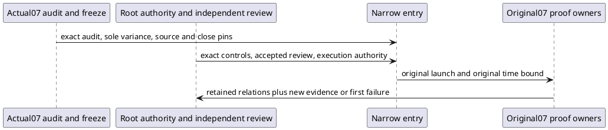

# Native07 bounded proof entry

Product Frame: fixed ABIogenesis 5.0/T-287/RC14 fixture proof. These controls are derived execution/evidence tooling. Actual ABG admission, typed completion, fresh replay and resource owners remain authoritative. This changes no Product, test, worker, original control or prior raw receipt.

Authority: Root Writer12's separate external-controls Writer activation at `7c31d6bda84d54a3672b9455cab4a23550a29ab0`, under finish-RC14/T293. Applicable AGENTS and installed STDO3.0.4 stdo-work apply. Selected Definition SHA b5720642ff00ebcb47f77ae68df3a960ab70f82cd1227c0712edda9d40745f44, STDO manifest 102817a3f4bea4dca1d6fa0fc634b94404dd2ba82ba6d8c38b273402dda9f95b, empty composition and project basis #exact-basis are unchanged. Reuse the acquired Product, Proof and method reference frame.

## Cause and exact re-entry

The original07 gate requires `deviations == []`. The actual audit retains exactly one literal allowance variance: appended `node --version` in tool call `toolu_01D77inrt9uoRDgS2BTZBAnP` after the permitted syntax check. It is not zero literal variance. All five required method sections and selected readFirst content were acquired before Edit. Root admits this pinned tool-version observation for bounded technical proof, without another author or retrospective full command-compliance claim.

AUTHOR_AUDIT.json is byte-identical to B30's finalized compact audit. The new entry authenticates that audit, its original observation, actual source freeze and completion/close pins; permits only the exact named command variance; and requires separate Root execution authority plus the independently accepted source review. The source-review record is now known and pinned. Execution remains disabled until Root accepts and checkpoints/pushes this packet and supplies its actual external authority.



## Preserved proof

The runner is copied from original07 with fixed HERE. Only the audit gate, explicit authority argument and PROOF_REENTRY receipt are added. Reversing the exact entry delta restores the original runner bytes; every pre-existing helper AST is identical. No other main-path statement changes.

Ten fresh whole files007–016 retain38 top-level cases. Six earlier files retain44 actual passing cases/33 top-level only through the original complete causal checks; total71 top-level names and two optional historical gaps remain. All typed completion/fresh replay, original controls, one-worker write scope,17 build-reuse exceptions, complete input/build/source/topology/candidate-capture checks, finally22 input comparisons, primary failure preservation and process cleanup remain unchanged.

The original enclosing deadline is `2026-11-15T14:44:43.176910+00:00`. The original90-minute proof bound is clipped to it with the original15-second cleanup reserve. The original proof root and subject remain fresh and are used once. This preparation starts no proof clock, retries no proof and changes no old campaign.

After Root's separate accepted and pushed authority only:

```text
python3 -B <accepted-carrier>/prove.py '/Users/jim/Library/Application Support/ABIogenesis/development-runs/rc14-regression-repair-20261115-07/LAUNCH.json' <Root-authorized external proof authority>
```

The disabled template is not authority. Static parsing, exact hash joins, delta reversal and AST equality are preparation evidence only. No Product import, provider, test, build or proof was executed. Source qualification and release remain withheld.
