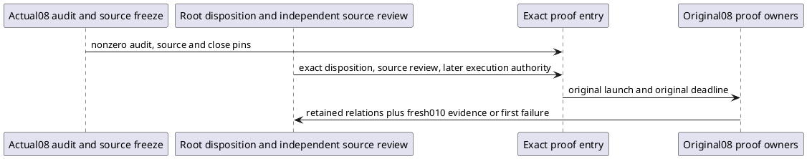

# Native08 bounded proof entry

Product Frame: fixed ABIogenesis 5.0/T287/RC14 fixture proof. These are derived execution and evidence controls. Actual ABG admission, typed completion, fresh replay and resource owners remain authoritative. No Product, test, original08 control or prior receipt changes.

Authority: Root's separate external-proof-controls Writer activation from exact main50bec4106a4765521eaad51b39a5c188d7964733 under finish-RC14/T293. Applicable AGENTS and exact installed STDO3.0.4 stdo-work apply. Definition SHA b5720642ff00ebcb47f77ae68df3a960ab70f82cd1227c0712edda9d40745f44; manifest102817a3f4bea4dca1d6fa0fc634b94404dd2ba82ba6d8c38b273402dda9f95b; empty composition; project basis #exact-basis. Read-only manager verification returned installed:true,valid:true,failures:[]. This follows the accepted native07-proof-reentry mechanism.

## Exact cause and handoff

Original08 requires deviations==[]. The byte-identical actual audit instead preserves two read-scope variances: one wildcard wc command accessed ten sibling control files outside the declared list; two directory Grep queries exceeded the exact-file scope. wc consumed file bytes and returned only line counts/names. Grep returned matches from declared event_store.ts. The audit's phrase no content acquired means no body content returned, not no physical read; Root's exact disposition explicitly corrects that distinction. The audit is not rewritten and fullLiteralCompliance remains false. All selected method and readFirst content preceded the permitted edit. Independent source review is separately bound, not supplied by this Writer.

The entry authenticates the actual audit/observation, original launch/source freeze, close pins and exact Root disposition/review. Only those two named variances are admitted for bounded component proof. The historical audit pending-root wording remains an original observation; the later Root disposition owns the decision. The disabled template is not execution authority.



## Preservation and limits

The original08 runner is copied with fixed HERE. The only other changes are the explicit Root-authority argument, the narrow audit gate, and PROOF_REENTRY receipt. All ten original helper ASTs are identical, including complete historical retention and current eight-input/24-comparison finalization. Reversing ENTRY_DIFF restores the original runner exactly. Launch/control, typed actual completion, original324 source/dirty state, setup custody, all build/dependency/input/source/topology/candidate guards and first-failure/secondary-error/process cleanup remain unchanged.

Fresh wholefile010 retains nine named top-level minima. Fifteen historical wholefiles retain83 passes/one declared skip,64 observed top-level against62 named minima; original71 named minimum stays unchanged. Historical05/06/07 and diagnostic011 retain their own seven-input/22-comparison premises; the passing remaining-five diagnostic and current proof have eight inputs/24 comparisons. No original failed campaign becomes green.

The original enclosing deadline is2026-11-15T16:37:49.211017+00:00. Requested90-minute proof remains clipped to it with15-second cleanup reserve. Original proof root and subject are used once; preparation starts no clock and grants no retry.

After exact independent controls acceptance/checkpoint/push and a separate Root execution grant only:

```text
python3 -B <accepted-carrier>/prove.py '/Users/jim/Library/Application Support/ABIogenesis/development-runs/rc14-regression-repair-20261115-08/LAUNCH.json' <actual Root proof authority>
```

Only Python AST/JSON/hash/delta checks were performed. No Product import, setup, test, build, provider or proof execution. No source acceptance by this controls Writer; qualification and release remain withheld.
