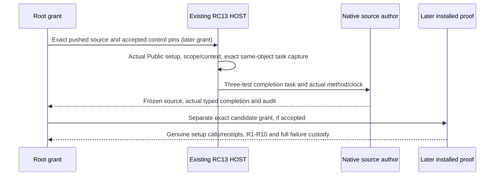

# S01 completion control handoff

Product: unchanged fixed5.0 ordered R1-R10 on one exact installed episode. Selected definition/request authority, runtime admission and fresh replay remain owned by existing Public/ABG owners. Controls and retained candidates are derived evidence.

The four findings remain explicit in ROOT_SELECTION and READ_PLAN. Optional root setup uses existing selected-definition/request owners; no hash-formula substitute or Product export. Raw/publication/Program candidates are captured before assertions. Available log/read evidence survives failure and cleanup; partial raw bytes remain observations. Original unexpected child/parse errors and separately retained secondary capture failures preserve failure precedence, while expected-nonzero component behavior remains valid.

Seven Python owners are byte-identical to985285f6; HOST labels alone may differ. prove.py is a required authenticated input only, unselected; no proof launch template or campaign. Source/candidate values remain unresolved until separate grants. Native preflight/final custody, finite deadline, process closure and no-retry laws remain unchanged.
