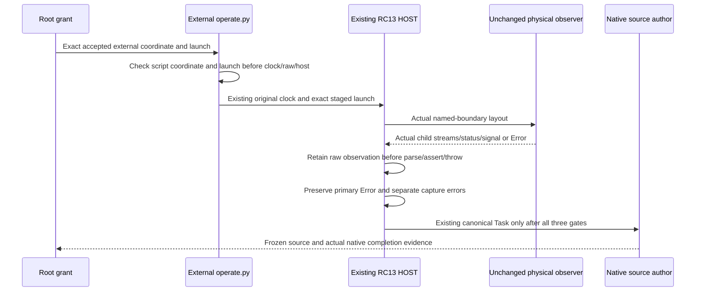

# S01 external control handoff

Product remains fixed5.0 ordered R1-R10 on one exact installed episode. Existing Public and ABG owners retain selected-definition/request, runtime admission and replay authority. This successor repairs only the two external-control relations selected in `CONTROL_REENTRY.json`: actual execution location and failed-observer custody.

The coordinate comparison supplies no physical separation proof. The observer remains byte-identical, all three gates retain `ok` and `separated` predicates, and all post-guard finite clock/environment/process/cleanup behavior is preserved. The only newly imported host callable is standard-library `execFile`, whose callback supplies the original child Error plus both raw streams and actual process status/signal. Same-object Task candidate capture precedes its canonical constructor unchanged.

The native outcome, read authority and write paths are conserved with attempt03 labels. Genuine selected-definition/request setup, pre-assertion candidate capture, raw-event/read custody and original-error precedence remain the four source findings. Independent declarations/input/oracle and supported R7-R10 stay unchanged. Native author limits remain one Opus5.5 xhigh45-minute/360-turn/5-minute inactivity call within a fresh three-hour grant with three-minute reserve; this preparation activates none of it.

The bounded controls checks exercise only entry-prefix or isolated wrapper code using standard-library mocks. They cannot establish physical separation, actual command execution, native completion, source correctness or S01 closure. Original Operator02 evidence and uncertainty remain historical; future runtime observations must be fresh. No proof, build, candidate, qualification or publication authority follows from this control preparation.
