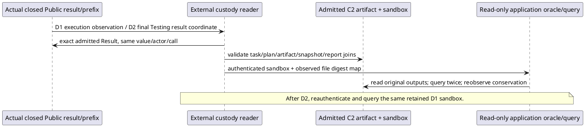

# S06 five-join control re-entry

Product Frame: fixed 5.0 F17/S06 requires the selected original specification,
working application, admitted evidence and a consequential targeted revision.
Product §§5.0 release boundary and ABG5-S06, REQ-P-SCENARIOS-013, the selected
project basis `#exact-basis`, and STDO 3.0.4 ASSURANCE govern this preparation.
These controls are derived invocation/evidence tooling. Installed Public, ABG
and C2 retain their existing admission, identity, execution and evidence owners.
The oracle and all 35 external input rows remain byte-identical. No historical
Run or old application result becomes current runtime credit.

Root selected a separate Writer over frozen
`6af06d60ea84ba15f1222479070b5950ca887267` after the independent S06-01..05
review. The rejected subject remains in ancestry. Only this control carrier is
written; no Product, tenant, test, source policy, main or release change occurs.

| Finding and violated join | Bounded repair and typed handoff |
| --- | --- |
| S06-01: lexical directory URL and capture container conflated with runtime archive | Canonical dirname; planned operator-custody layout excludes prospective runtime children. Fresh post-setup/pre-dispatch `ExactPrefixWorkspaceEnvironment` supplies every binding/install root to two explicit roles, sharing identical W and conserving their complete protected union. Runtime role uses the actual binding archive. Observer bytes are unchanged. |
| S06-02: generic `workOrders.review` conflicts with declared named reviews | Remove only the generic entry. Preserve the declared impact review, its source, frame, assessment and prerequisite. Actual `constructGovernanceWorkState` checks the successor input. |
| S06-03: Testing's selected files omit command input/dependencies | `GovernanceOriginal.testing.selectedPaths` takes the exact application files, all original/current source paths (including `source/d2-input.json`) and retained semantic asset paths. The fixed command entrypoint and input must occur. D2 updates the existing mapping/job binding; an undeclared new command dependency remains a refusal/gap, not ambient acquisition. C2 copies these selected sources through its existing owner. |
| S06-04: oracle reads original worksite lookalikes instead of C2 output | D1 terminal envelope selects its exact admitted execution observation. D2's final Testing result ref/digest/call selects its exact admitted C2 Result. Public Product predicates validate the task/observation/artifact. Task manifest bytes, helper plan, canonical artifact bytes, source snapshot and required report digests join to the retained sandbox. Every externally inspected application/query file must match an admitted snapshot or helper-observed delta. D1 sandbox and custody remain the post-D2 query subject; there is no copy-back. |
| S06-05: Boolean original record coerced to text | Derive the error original record from the immutable oracle; D2 changes only the property name `source_key` to `record_id`. All values, including Boolean true, remain exact. |

This is mechanical input/custody preparation, not independent source review or
S06 execution. Independent meaning, report adequacy, real amendment and
affected/unaffected evidence assessment remain required. The selected command
environment preserves explicit JAVA_HOME/PATH and the owner's captured ambient
variables; it does not invent a second environment owner.

## Bounded preparation evidence

External records live at
`/Users/jim/Library/Application Support/ABIogenesis/development-runs/rc14-s06-control-preflight-20261115-02`.
All 35 external rows rehashed. JavaScript syntax, Python AST and canonical
installed Product types check. The exact installed pure Governance constructor
accepted the repaired D2 input with its named review and complete declared
dependency set. That specimen is an input check, never an admitted D1 Result.

The genuine closed basic04 event log (SHA256
`31a6356b5b4f0ff934fba6e07dcc488430fffdb3a68566ca64b2beb6d74847ea`)
supplied Result admission ordinal471. The reader selected it through the real
terminal Testing coordinate, authenticated its actual helper artifact and all
10 source snapshot files. This example has no expected reports, so the
report/output join is source/type checked, not claimed exercised. It supplies
no S06 application or qualification credit.

The first preparation probe then failed: it treated immutable
`installedProduct` coordinates as physical installed rows. Root classified
that probe-carrier error and selected re-entry only at the already successful
basic04 physical role layout. The original failed script and passed C2 receipt
are retained. Constructor/C2 checks were not repeated. The successor extracted
the final actual topology function, conserved 19 protected roots, and ran the
unchanged observer for both roles under one 60-second preparation bound.
Both returned `separated` (309/303ms), with empty stderr and owned process groups
absent. This measures that producer over retained basic04 environment fields
and prospective S06 W; future S06 setup/dispatch still must measure its own
complete actual environment. No S06 clock or execution grant started.

## Required application acquisition before an execution grant

`BINDING.template.json` pins the Node24.7 executable, Python3.11.5, Claude
2.1.322, Java11 executable, npm CLI and SBT1.11.7 **wrapper file** by path/hash.
`INPUTS.json` pins the five sources, 22 Scala/build files and the Scala2.13.12
runtime jar used by the independent query. Those 22 files are source, not a
compiled application/runtime closure.

The pinned SBT wrapper delegates to
`/opt/homebrew/Cellar/sbt/1.11.7/libexec/bin/sbt`; that script, launcher jars,
JDK libraries/modules, Scala compiler/reflect, compiler bridge, Spark3.5.1,
ScalaTest3.2.18 and their transitive build/runtime dependencies are not yet
acquired as an exact execution closure. `project/build.properties` and
`project/plugins.sbt` declare the retained build inputs, not available binaries.
No Java/SBT launch, dependency resolution, compilation, network reachability or
capacity was measured here. The proposed five-minute command budget remains
an unproved capacity premise.

Npm's offline setup does not establish SBT/Coursier offline behavior. Ambient
HOME and their usual user caches can cause reads, downloads, locks or writes
outside C2's declared sandbox. These controls grant none of those machine-wide
effects. Before execution, Root must select and authenticate the actual
compiler/library acquisition and read sources, isolate necessary mutable cache
and temporary state within declared owned territories, and explicitly settle
network availability/authority or an offline closure. The verifier must not
silently acquire missing dependencies or write shared user/toolchain caches.
That unresolved premise is not repaired by a path/version string or the retained
Scala runtime jar. No new Product feature or general machine-closure policy is
selected here.

## D1 Result-coordinate successor

The independent review of ffdf680 found one remaining S06-04 defect: value
equality is not producer identity. A C2 child leaf and its forwarded parent
carry equal observation values; basic04 records this at471 and484. The semantic
evidence owner already supplies executionResultRef/executionResultDigest from
its authenticated predecessor. The external selector now uses that exact pair,
then checks successful admission and equality with the declared observation.
It preserves the typed C2 and downstream task/helper/snapshot/report checks.
No first/last value match, graph change or new runtime owner is introduced.

Root acted as a separately activated Writer (SELECTOR_REENTRY.json). One
read-only installed owner prefix derivation supplied both genuine decoded
events to a pure selector input specimen. The prior selector refuses it; the
successor selects the declared leaf in either row order. Missing/mismatched
coordinates, duplicate exact coordinates and changed observation values refuse.
Existing D2 final Testing selection stays exact. Six checks passed in5907ms,
owned group absent; event bytes conserved. No D1/S06 envelope was admitted and
no application/report execution was claimed. Source syntax and canonical no-emit
types pass. The first wrapper call supplied the wrong Python deadline type and
stopped before child creation; its empty folder and causal record are retained,
with the corrected UTC API call in a new bounded receipt. No prior successful
constructor, topology or C2-custody probe was repeated.
