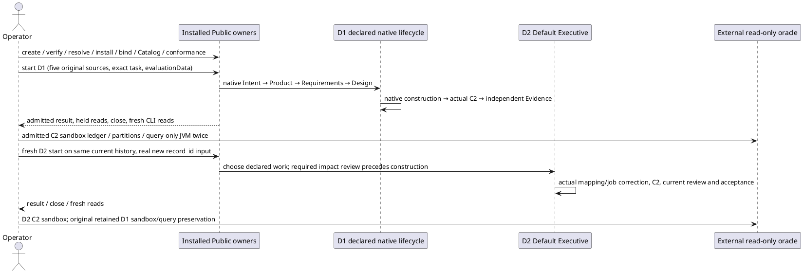

# S06 fresh lifecycle witness — preparation only

Product Frame: fixed 5.0 fifteen-family Product, F17/S06; the active RC14
release-gap slice is a fresh source-to-application lifecycle and genuine
source_key → record_id amendment. No 5.1 extension is selected. The Definition
selects STDO 3.0.4, manifest
102817a3f4bea4dca1d6fa0fc634b94404dd2ba82ba6d8c38b273402dda9f95b,
with empty companion composition. `stdo status --verify` returned valid,
installed, no failures. The project basis is
`build_tenants/abiogenesis/typescript/design/ABI5_PROJECT_REFERENCE_FRAME_BASIS.md`.
Source/specification selects meaning; these external controls compose declared
Public calls and observations. Only installed ABI owners admit capabilities,
Catalog, binding, invocations, native work, evidence, events and replay. There
is no new runtime, authority, schema family, private installed HOST import,
semantic-revision cause or historical Run credit.

Authority: Root's separate S06 Writer activation on ebe085acf2812252daf45bc7d86b5dc3f4cb1b5e,
`../S06_FRESH_WITNESS_PREPARATION.md`, Product F17/S06, and the selected original
witness. The concrete consumer HOW chosen during this preparation declares
one prospective phase-addressable verifier interface. D1's native constructor
must implement it; the host supplies neither its implementation nor verdict.
The prior native source at 7a2411def is conserved. All files in this increment
are external controls/declarations or compact authored records.

## Exact inputs and exclusions

`INPUTS.json` binds all five original members (135,805 bytes), the original
witness/source-basis, evaluator-only oracle, all 22 retained application files
(111,575 bytes), the pure odd_glc declaration module and its local dependency,
and the exact existing Scala 2.13.12 runtime. Every source/application hash was
reacquired. Historical inode/log and Run relations are deliberately unused.
`SELECTION.md` is the verbatim witness byte span 631..5035, SHA256
2ebbce863f958f13f3f0fc41abcdf9a9bf7ebe150706bc47fc71cd4ba5b703a7. It conserves
selected clauses and prerequisites, excluding the evaluator's expected table.
Full original source stays available, with excluded parent obligations pending.

Native author context gets the original five sources, that exact selection,
logical input and declared task. The independent oracle travels only in the
canonical job's `evaluationData`; the native semantic owner controls role
projection. It is never copied into the worksite. D2's worksite rubric contains
meaning/adequacy criteria, not the private expected-answer table.

The old full-sandbox wrapper is not selected: it still names retired Consensus
and STDO 2.5 material. The pure fresh-native declaration is reused directly,
with current core publications. Its optional old run environment is absent;
current semantic task owners bind roles, sources, candidates and evaluations.
D2 uses the current packaged default-library environment and exact schema
bytes. The two publications belong to one fresh consumer artifact/install and
WorkspaceBinding. Both Programs receive Public conformance before dispatch.

## Declared chain and effects

The external task interface is:
`node application/witness.mjs --phase d1|d2 --input source/d1-input.json|source/d2-input.json --run-root evidence/d1/run|evidence/d2/run`.
Commands are fixed at their respective intake. They are actual C2 commands,
with ledger, actual ScalaTest/JUnit falsifier report and query-classpath file
as expected reports. The external observer authenticates the actual admitted C2 Result and its retained sandbox; original-worksite lookalikes supply no evidence. D1 must not pre-create the record_id binding or D2 run.
The new D2 input/rubric and a compact projection of actual D1 admitted coordinates are written only after D1's actual close and fresh reads,
with an exact custody receipt. This adds incoming task data; it does not edit
application mapping/job configuration. D2's native author must make the real
application change. Its review sources include the actual application files,
so changes affect currentness. Host code supplies no successor graph or
judgment and never manufactures a failed source Run.

Prospective native writes are the application source/build declarations,
new witness/configuration paths and semantic assets. Actual C2 writes are
phase evidence and explicit SBT target directories. Semantic read roots omit
compiler outputs and the query-runtime jar. Protected original sources and
rubrics remain outside native/C2 writes. Fresh complete actual binding/install
roots are acquired immediately before each dispatch. The exact accepted
physical-topology observer is reused at SHA256
eb5d0028cf7cb27d233c4512a57882785698c301ba83575396c3fc9eb045fc31.
Its bounded ASCII-layout evidence is not a universal topology/race guarantee.

## Independent observation and limits

The observer reads the exact admitted C2 sandbox, with each inspected file bound to its source snapshot or helper-observed delta. It checks actual original input keys/field, real output, three exact
persisted partitions, error original record and parse reason, balanced ledger,
status, lineage reference, persisted completion order and required falsifier
cases with no failures/skips. It preserves findings before refusing. The
fresh JVM uses only an audited query-runtime: known reader/core classes and
the exact cached Scala runtime (c6a879e4…9131dd1); Spark and the retained
CdmeEngineImpl/DataFrameExecutor implementation are absent. It repeats the
query and verifies no observed input mutation. After D2 it repeats D1 reads
and compares all D1 durable evidence and query output.

These controls do not turn ledger text, XML, exit zero or native self-report
into semantic assurance. Independent review must join actual native-built
verifier/application source, admitted same-Run C2/report identities, filter
ordering, Full Lineage, failure paths, real amendment/invalidation and preserved
meaning. The program's native assessors and final current verdicts are
required, but external `observed` is not qualification/acceptance. No general
absence-of-arbitrary-code or hostile-sandbox claim is made. SDK starts and
fresh CLI reads are selected; no additional native-CLI parity credit is invented.

## Finite prospective controls

`BINDING.template.json` has execution disabled, no candidate, no grant and no
live deadline. Root must select the exact future artifact/bootstrap identity,
source checkpoint, topology acceptance and absolute deadline. The proposal is
four hours enclosing, three minutes reserved for final input audit, native
Opus 5.5 at xhigh, 20-minute actor absolute/10-minute inactivity/120-turn bounds,
16 Executive steps, and five minutes per selected application command. These
are proposed capacities, not a promise of completion; the native Design must
retain an insufficient-capacity gap. Tool files were hash-observed only;
Java/SBT startup and build dependency availability remain future preflight/C2
facts. Java 11 is selected explicitly, rather than the host's Java 25 default.

Every command uses the retained finite process owner. First failure retains
streams, result and candidate/worksite evidence, stops without repair/retry,
and attempts the actual held-resource close. Native actor owners supply their
separate process closure facts; the outer process-group receipt does not claim
closure of unrelated groups. No Public invocation, runtime admission, native setup, application execution, build, test, pack, install, provider, release, pin, main merge or push occurred in this repair. Pure installed input constructors and read-only C2 validators were used as explicitly granted. See `CONTROL_REPAIR.md` for the five-join re-entry, preserved failed probe, bounded checks and unresolved Java/SBT acquisition.
