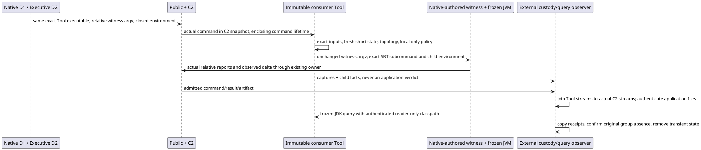

# S06 Tool-to-C2 preparation successor

Product Frame: fixed fifteen-family 5.0, T-287 RC14, F17/S06. The exact selected
original specification must progress through Intent/Product, Requirements,
Design, working application, admitted evidence and genuine D2 amendment. Public,
ABG and C2 retain admission, events, execution and replay. These external
controls and acquired tool inputs have no runtime or verdict authority.

Root selected this Writer on `27d971a3641ae016451ac72eb766f22c170f63b3` after the
closed read-only Tool/C2 join intake. `60cd47319` and every failed and successful
S06 toolchain record remain immutable. STDO3.0.4 manifest
`102817a3f4bea4dca1d6fa0fc634b94404dd2ba82ba6d8c38b273402dda9f95b`, empty
composition and the selected ABI Project Reference-Frame Basis govern.

Product S06/REQ-P-SCENARIOS-013 and C2 HOW299–310,470–476,648–652 are unchanged.
The latter permits host toolchains/caches without making external effects C2
truth. Root explicitly grants this immutable Tool fresh short phase/attempt
cache/tmp/IPC state and receipts, separately from task/worksite writes.
No original A/W root is placed in the declared child command. Relative witness,
source, report and build/evidence paths still resolve inside C2's real snapshot.

`TOOLCHAIN.json` binds the complete read-only frozen JDK, launcher, boot, file
Maven corpus/configuration and S06-03 owner-selected closure. The 163 selected
classpath jars remain distinct from the acquisition superset; no minimal
POM/parent/BOM read-set claim is made. S06-03 proves offline resolution and
compiler-bridge selection, not compilation, tests, Spark or five-minute capacity.

The actual C2 executable is `tool-launcher.py`, with a pinned Python shebang.
Both D1 and D2 use its identical explicit environment, capability and expected
command. The application/verifier remains native-authored. Its SBT call uses
`S06_SBT_TOOL --sbt ...`, which directly execs the frozen Java/launcher with the
selected file-only repository, isolated boot/cache properties and disabled
server/client. The wrapper is retired from this path. No ambient JVM option is
merged; explicit Tool-owned JAVA_TOOL_OPTIONS carries short tmp/home/Spark-local
storage into the retained build's forked test JVMs. This added fork propagation
is source-derived, not already exercised by the resolution-only proof.

Each invocation uses `/private/tmp/as6j2/attempts/d1-<8hex>` or `d2-<8hex>`;
receipts use disjoint `/private/tmp/as6r2/attempts/<same>`. Both roots must be
fresh. Actual complete binding/install roots are reobserved before dispatch.
The Tool checks its exact attempt and C2 snapshot topology again. SBT's maximum
51-byte suffix including NUL plus each actual tmp/IPC prefix must be below104.
There is no short symlink alias or reuse of the closed03 state.

The witness child receives only explicit environment values. The selected
Darwin arm64 profile denies remote network and DNS; it permits pathname-scoped
owned Unix IPC and IPv4 TCP loopback for local[1] Spark/SBT test communication.
Read-only source build.sbt15–25 binds loopback driver settings and forked tests.
Actual Spark behavior under that permission remains unproved. Query mode has
no network allowance and uses only the frozen JDK and the existing authenticated
reader/Scala classpath; transformation/Spark classes remain excluded.

Children never create a new session in the Tool. C2/Operator owns the enclosing
group; the Tool reports direct-child reaping only. C2 terminationConfirmed and
fresh group absence are required before accepting the selected Tool capture.
The Tool's stdout/stderr are joined byte-for-byte to C2's actual observed
streams. Original application report/custody and semantic oracles are retained.

The Tool reserves20s within the unchanged300s C2 limit (280s child ceiling),
and10s within the30s query limit. Root's prospective lifecycle deadline remains
unbound. The Operator keeps the original wall/monotonic boundary through input
conservation and copy-first cleanup. Live/unknown groups or unaccounted states
are retained, not silently deleted. All cache state is external transient Tool
state; it supplies no application evidence.

Only this carrier is written. No Product/HOW, tests, application implementation,
version, pin, qualification or main/push effects are selected. Preparation uses
one fresh60s static/canonical constructor and local socket-control check; no
Java/SBT/application/provider/runtime admission. Candidate and live grant remain
unset. Return to Root for independent review and exact candidate binding.
