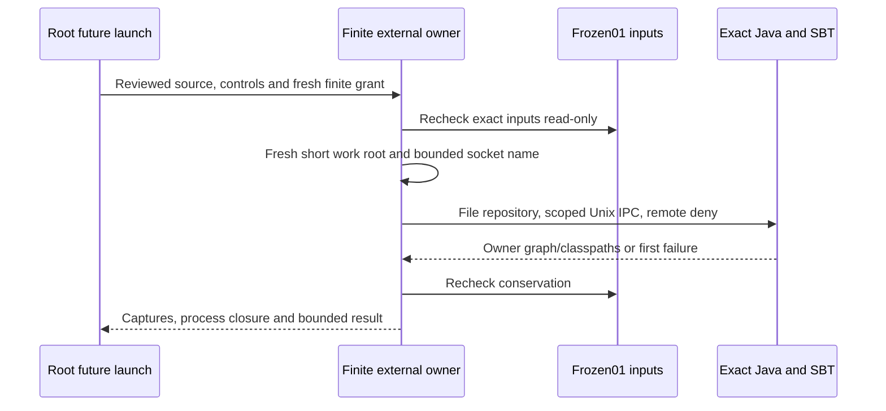

# S06 toolchain 03: short scratch and owned Unix IPC

Preparation only under Root's separate grant. Fixed5.0/T287 RC14/F17/S06 and exact STDO3.0.4 bootstrap apply. Immutable tool inputs and diagnostic observations create no ABG authority, Product change, lifecycle acceptance or qualification. This branch starts at03f6cf858; original60cd S06 branch and diagnostic02/f022 stay untouched.

The preserved02 failure is specific: PID63319 trapped in ipcsocket1.6.3 `bindNative` -> `__memcpy_chk` -> overflow; crash registers carry156 copied bytes against104 destination bytes. The actual generated pathname is156 bytes. Darwin's `sockaddr_un.sun_path` is104 bytes. The mDNSResponder denial is correlated, not the fatal cause. `TRIAGE.json` pins the original crash and stopped return; they remain unchanged.

The exact SBT1.11.7 BootServerSocket owner chooses XDG_RUNTIME_DIR with java.io.tmpdir fallback, then appends `/.sbt/sbt-socket<signed64 decimal>/sbt-load.sock`. Both explicit roots are27-byte paths below the real `/private/tmp/abg-s06-03` work root. Allowing20 decimal bytes and the terminating NUL gives a conservative78-byte maximum, strictly below104. No symlink shortening is selected. All home/boot/global/Ivy/Coursier/temp/application work remains in that short owned root; raw captures remain in the distinct external03 archive.

The sandbox keeps `deny network*` and allows only pathname-filtered Unix bind/inbound/outbound beneath `/private/tmp/abg-s06-03/ipc/.sbt`. Local installed Apple profiles supply that syntax. There is no IP, mDNSResponder, DNS, external socket or broad network exception. The retained frozen01 repository configs still name only the exact file Maven repository. The prior `sbt.server.autostart=false` and native-client controls remain; this necessary boot socket is a distinct SBT startup mechanism.

Exactly one control-only sandbox `/usr/bin/true` and one small Unix exchange/refusal probe ran under a fresh60-second envelope. Syntax passed in108ms. The socket child passed in416ms: allowed the owned exchange, denied another Unix pathname inside the writable work root, and denied IPv4/IPv6 loopback connections with EPERM. Groups were absent, source controls conserved and the temporary work root removed. The Python launcher emitted an ambient xcrun-cache-write denial, retained in stderr; no such launcher is used for future direct Java. These observations are bounded controls, not a universal network test or SBT success.

Java/SBT have not run in03. The unchanged prospective preflight remains15 minutes total with2 minutes reserved for cleanup, one Java-version command and one SBT build-definition/dependency/external-classpath sequence. It never selects application compile/test/run, Spark, ABG or providers. Exact frozen01 inputs are reused read-only without recopy; ordered inventory equality stays normalized. First new failure returns without automatic retry or download. Distinct review and Root execution admission remain required. Closure, compiler bridge, application capacity, DNS necessity and S06 acceptance remain unproved.

The selected source03f6 contains13 ABI test/falsifier changes relative to the prior tool carrier's96b93 source. An overbroad tenant-equality check was rejected during Return assembly; no equality claim is made. These are unrelated to the exact22 external Scala inputs, whose immutable acquisition/tool pins still match. This Writer changes only the new tool carrier.
