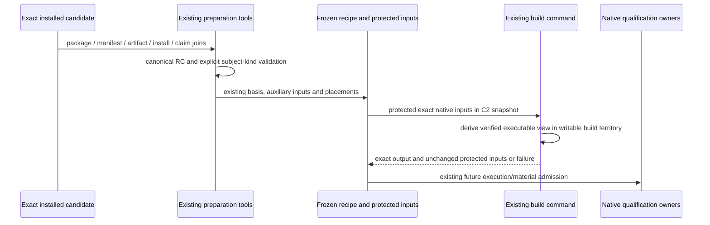

# Qualification preparation and native input repair

This is one bounded RC13-native increment in the derived build/preparation tools.
Root's TRIAGE.md binds the source, authority, counterexamples, invariants and
proof. The accepted D4/D5 HOW supplies the exact preparation and placement rule;
C0 supplies the already-selected native foundation. The Product, qualification
schema and native event owners are unchanged.

Prepare controls first; Root binds/pushes them before one native author. Prove
with real relocated compilation and precise negative cases. All copied compiler,
SDK/header/dependency bytes, proof inventories and captures stay outside GitHub.
This slice stops at frozen source and bounded proof. Final composed generation,
actual qualification and release acceptance remain separate downstream outcomes.
