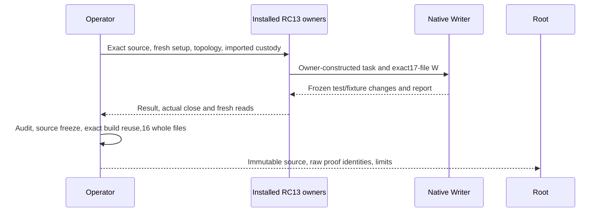

# RC14 regression fixture repair preparation

Product Frame: fixed15-family5.0 under current STDO3.0.4 and empty companion composition. RC13 is the unchanged unqualified builder. Owner selects finish RC14; T293 B36-B42/B45 are derived Proof premises under T292 retirements. Immutable declaration/admission identities are distinct from mutable worksite/evidence. Actual owners retain strict new-work admission, historical recorded reading, currentness, physical protection and ABG runtime authority. No Product outcome, implementation or public contract change is authorized.

This one coherent native Writer increment covers16 tests and only the F09 fixture worker. Root selected60min/240turns Opus5.5 xhigh and90min affected-file proof inside a fresh prospective3h clock. Preparation creates no clock or provider allocation. ACT/TASK/PROOF_PLAN are one closed handoff; Root must accept/push and separately authorize execution.

Seven original retained inputs are hash-verified669118059bytes; proof copies remain external. Required positives execute. Only optional governance C2 material selectors and steel retained-start-call may skip. Test-owned pack/install work stays in whole-file proof. Compiled Product/native/dependency reuse is bound to prior actual successful build, input rows and complete output inventory, not path equality. All tenant/spec/Definition bytes at69f5c035 equal prior7a2411d; afterward only selected test/falsifier deltas are lawful. Unknown source/build drift stops reuse.

B45 changes stale private extraction only; the real read-close block remains unchanged and protection ordering is conserved. B37 remains a fixture-currentness discriminator; return any supported owner failure instead of repairing runtime. The current peer campaign is independent; no broad campaign or duplicate union is selected. External unspaced proof subject preserves the peer path premise and makes no new spaced-URL claim.

No main/push/reviewer/version/cut/pin/qualification/acceptance effects are granted here. Raw evidence and inventories remain external. First complete failure is retained and stops the pass; no automatic repair or retry.
