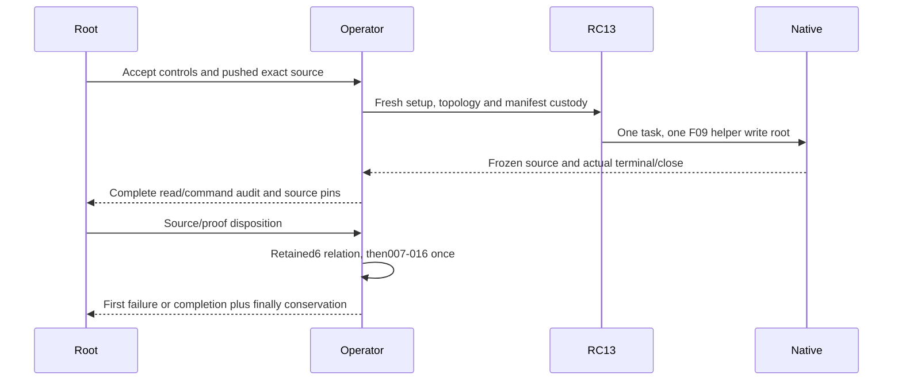

# Native07 preparation

Product Frame: fixed 15-family5.0; T287/T293 B37 derived F09 fixture repair. Runtime admission/rollback/replay remain ABG-owned. Controls are external tooling and evidence, not a new Product contract. ROOT_ACTIVATION and exact ROOT_TRIAGE carry the selected grant.

Preparation does not start a provider or deadline. Final source HEAD and launch remain unbound. Root will integrate/push, supply exact source identity, and separately admit dispatch. The Operator advances a clean branch only to that checkpoint, uses freeze-source.py once, and supplies an external approved-launch/LAUNCH.json; operate.py exclusively stages raw LAUNCH.json. Actual pinnedRC13 native ClaudeOpus5.5/xhigh gets20min/160turn/5min inactivity, fresh135min enclosing. Proof is at most90min clipped to that original deadline, with15s cleanup inside. No retry.

Only runtime-f09-worker.mjs is native-writable. Actual installed STDO work and four referenced method documents have exact member hashes and required content ranges in TASK/ACTIVATION; native reads must precede Edit. All16 saved source rows and17 build exceptions stay explicit. Native cannot execute Product/tests or edit controls.

Six historical wholefiles retain44 actual passes across05/06 only under RETAINED_PROOF; this is not one green campaign or new07 execution. Ten fresh wholefiles start with F09.71 original top-level titles and two explicit optional historical skips remain. The original build, dependencies, two generated outputs and seven required input bodies are reused by identity; no new build. Source and setup custody are checked finally; initialized fixture build/input checks also run finally on failure, preserving primary/secondary distinctions and original deadline.

After preparation: one exact controls commit and stop. Raw captures/input inventories remain external; no main/push, version/cut/pin or qualification effects.
