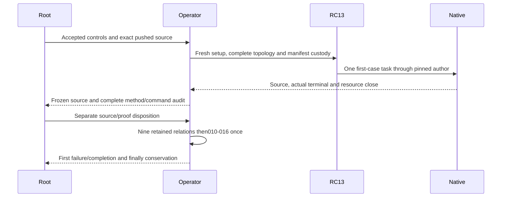

# Native08 preparation

Product Frame: fixed 15-family 5.0; T287/T293 B38 first-case Proof repair. The Product distinguishes established immutable evidence from cold/current physical acquisition. ABG remains the sole runtime authority. This carrier is external Tool/evidence, not a Product contract. ROOT_ACTIVATION and ROOT_TRIAGE bind the existing selection.

No provider or clock starts in preparation. Final launch source remains unbound until Root checkpoints/pushes controls. A clean named branch advances only to that exact checkpoint; freeze-source.py captures the exclusive preimage. The external approved-launch/LAUNCH.json is staged exclusively by operate.py. One actual installed pinned RC13 native Claude Opus5.5/xhigh author:20min/160turns/5min inactivity under fresh135min enclosing deadline. Separate proof is at most90min clipped to that original deadline with15s cleanup inside. No retry.

Native W is only the governance test's first case plus necessary preassert capture helper. Complete actual results and phase-specific history/body/open observations precede assertions. Initial body materialization through the held descriptor is distinguished from zero extra after-close reuse. Every existing identity, close, wrong-inode, tamper and current-length check survives. No blanket open-count rewrite, other-case changes or Product edits. The five installed method inputs/sections remain byte-pinned and content-read before Edit; node --version is now expressly allowed metadata. Prior07 literal variance is not erased.

Nine historical wholefiles retain52 actual passes/36top across05/06/07. Seven fresh files010-016 cover35top; all71 original titles and two declared optional gates remain. Failed wholefile010 is never retained green.05/06 input conservation was later;07's22 comparisons ran in original finally. Each history retains its own source/capture/command identities. Full source/support comparisons exclude only declared transitions that the retained fixtures do not consume. No retained file references this governance test; it is excluded from compiled and packaged Product. Existing complete build, dependency, derived-output and seven retained-input relations remain required. No rebuild.

The five maintained helpers are byte-identical to07. HOST/operate change coordinates only; proof changes only retained three-group evidence joining and fresh population. Existing finally input/source/setup checks, primary/secondary error distinction, deadlines and actual process-group closure remain. Raw inputs/captures stay external. One frozen preparation commit returns to Root for independent review; no main/push, version/cut/pin or qualification effects.
