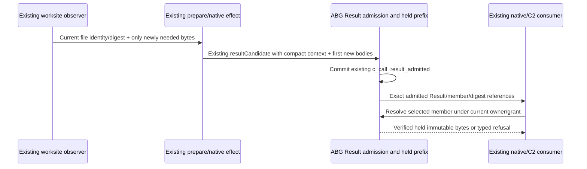

# Single-machine P1: compact native context and retained handoffs

Status: prospective HOW/contract re-entry and native-Worker activation draft; not admitted implementation or permission to run. Owner instruction selects an actual single-machine fix after bounded design. It does not establish that distributed-system intent caused the code: the measured cause is whole context-body carriage. No Product WHAT, new Public feature, event kind, store, controller, service or compatibility branch is proposed.

Frame: repo://abiogenesis/build_tenants/abiogenesis/typescript/design/ABI5_PROJECT_REFERENCE_FRAME_BASIS.md#abiogenesis-project-reference-frame-basis, purpose single-address-space reference carriage under STDO3.0.2/f7f3f824… and its computational binding. Product HOW223–248, CONTEXT/PAYLOAD and PROJECTION law govern: immutable bodies and established owner facts may be reused; ABG alone admits events; recovery remains from exact admitted history and retained evidence. Cold historical bytes do not establish current mutable-worksite state. The old saga/continuation and typed refusal meanings remain.

The subject is frozen commit97406077c9a91e18e9425c3df55c6cd80f4c2073 (parent927b8c0…), exact14 blobs matching admitted B11 C2; archive0f77694c1930b069477afd39f0f33bcd53d1e60522b45c32da75b93b1628ac2c/content34cfb9f8…/manifest14d5b7d1…. [SOURCE_CHECKPOINT_14.json](SOURCE_CHECKPOINT_14.json) pins it. Native writes target only /Users/jim/src/apps/abiogenesis-single-machine-p1; /Users/jim/src/apps/abiogenesis-rc3-dogfood and all prior Run/artifact/evidence bytes are frozen/read-only. Package identity remains5.0.0-rc.3 unless Root separately selects a change. [RCA](../efficiency-p1-01/ROOT_CAUSE_ANALYSIS.md) and [measurements](../efficiency-p1-01/MEASUREMENTS.json) are the counterexample: three965-entry contexts consume117.77MB inside one sourceNativeWork; Result/route/transport rows dominate1.34GB. The1,274.165s between-process time remains partly unattributed. This package does not assert a speedup from an isolated hash measurement.

The minimum custody route is existing preparation/observation Result admission, not a new registration endpoint:

A candidate is not custody. First new bodies remain inline in that existing Result's value until c_call_result_admitted commits. Only the subsequent current route/input-origin owner projection may construct an admitted ResultRef/ResultDigest/exact member-path/body-digest reference. No future eventRef, self-admitted candidate, actor-provided receipt or caller callback can establish retention. Existing first-inline/back-reference c_call_result_value encoding remains the physical owner; this repair adds no RuntimeEvent envelope fields or capture operation. A failed admission/transaction never publishes an index entry. The initial admitted preparation/basis input is reusable only if it actually contains the selected bytes and its exact origin is authenticated.

The new native normal form has three explicit distinctions; exact field spelling remains native implementation work within this contract. First-inline birth versus admitted reference is the lifecycle state established by the owner, never a caller-selected mode:

- Context identity is the observed workspace/binding/read-scope/bounds plus ordered path/state/file-identity/length/content-digest metadata. Body storage location does not change that identity. Before/after comparisons and changedPaths compare those physical facts, not different storage locators.
- A first-body bundle contains only byte strings not already held from an eligible admitted preparation/observation. Subsequent contexts carry authenticated producer/member/digest references for unchanged bodies. Changed bytes first appear inline in the existing new observation Result, then become referenceable after admission. Content may be shared without conflating observations, producer lineage, path identity, grants or currentness. Literal-first versus admitted-reference is one normalized representation rule, not an old/new compatibility fallback.
- Native tasks/observations, C2 source lineage, retained entry/source and instruction-assembly envelopes carry compact context/task/producer references. They must not re-embed a whole task or full before/after bodies merely to validate/hash them again. Resolve only selected members at actual raw ingress, effect, helper-process or cold-recovery boundaries; ordinary local handoffs use immutable owner-established values/identities. Do not expand all bodies solely to hash a role transition.

The derived index belongs to the existing held Event Store/prefix owner, maps only these declared native context/body member coordinates, and is reconstructible from the same committed log. It is neither a recursive CAS library nor a context lifecycle. A bare digest/key is an index hint, never read authority. Actual resolution joins source Result/event/basis/producer and exact member digest, current consumer applicability and grant. The new context representation must not replace a fresh physical currentness check with an old digest. Existing close/rollback/poison/generation invalidation applies to retained indexes and established facts.

The proposed finite write outer bound is33 existing code files, eight existing tests and three existing HOW files, all pinned in NATIVE_GRANT_DRAFT.json. It is not a demand to edit every file: delete/replace only causally required carriage and repeated-check paths. No new Product file/module or generic recursive resolver is granted. The finite owner delta is below. Lines refer to the B11 checkpoint; they are navigation, not a substitute for its exact bytes. This table owns the causal scope, not a general refactoring license.

| Contract/owner | Existing reason for change | Required resulting relation |
| --- | --- | --- |
| product/worksite_effect.ts1869–1938; product/worksite_operations.ts1080–1150 | Context file entries require bytes and pure guard repeatedly decodes/hashes them | Separate compact immutable context metadata from first retained bodies and authenticated member sources; preserve all observation/currentness checks at the effect/ingress owner |
| product/native_workspace_work.ts24–51,146–205; implementation/native_workspace_work.ts25–76 | task.context + before + after repeats full bodies; pre/post effects reobserve | Compact native input/observation/failure source links; new after bytes retained once in existing Result; truthful partial effects/failure still observed |
| product/default_library.ts121–140,234–273; default_library_fulfillment.ts99–134; abg/default_library.ts78–103,205–303 | Selector/native/testing builders and source grounding read byte-bearing contexts | Existing owner derives exact compact context/body use from committed sources; selected source text/quotes remain available under declared access, never guessed |
| product/worksite_command_execution.ts424–470; implementation/worksite_command_execution.ts; worksite_command_helper.ts; abg/native_work_reacquisition.ts | C2 embeds sourceNativeWork and derives selected file bytes from after | Source Result/member refs plus exact 961 protected source metadata; helper receives only its required snapshot bytes at its actual process boundary, result keeps compact lineage; preserve predicate/command/env/currentness law |
| product/worksite_preparation_contracts.ts187–190; worksite_preparation.ts142–147; abg/traversal_route.ts4318–4323 | Retained pairs embed entry/source again | Preserve exact original/progressed input and source relation using authenticated identities; edge/route cannot mint admission or hide a second evaluator |
| abg/instruction_assembly.ts69–91,171–185,536–570; actor_process.ts917–955 | Compact prompt coexists with complete full task/nativeBasis envelope | Admit exact selected rendered prompt/response/tool plan and compact source coordinates; preserve B10 command-only correspondence and B11 endpoint authentication; no whole historical carrier in envelope |
| abg/event_store.ts and event_body_encoding.ts; event_prefix.ts/runtime_history.ts only where owner index integrates | Existing Result body source and held prefix/index own durable bytes | Reuse that owner and exact first-inline/backref mechanism; rollback/cold reconstruction/refusal stay exact, no second persistent state |
| implementation/contracts.ts/leaf_invocation_port.ts; product/builtin_semantics.ts/semantics.ts; affected identity/publication/barrel/gtl binding owners | Typed leaf proof/input contracts and packaged guards must agree | Private owner-bound lookup only; no callable Public capture/read API; exact new canonical contract/publication identities and owned exports |
| product/semantic_job.ts/semantic_revision.ts; abg/semantic_job.ts/semantic_revision.ts; native_workspace_assessment.ts | Real typed consumers of the shared native/context contracts | Mechanical selected representation adaptation only; preserve stage/assessment/continuation meaning; stop on new domain behavior rather than expanding scope |

This changes owned native canonical task/observation/failure/context and retained-input shapes, not the worker report or user acceptance rubric. Exact native contract refs/versions/guards, graph publications and schema/handler bindings must be reconciled by their owning modules. Do not retain a second old-shape branch. Root Event envelope/profile need not change merely because an existing Result.value has a new owned shape; if implementation needs a new event/profile or publicly callable operation, return the concrete blocker for re-entry before coding it. Generic Public workspace/invoke/read request shapes are expected unchanged but must be demonstrated, not assumed. TypeScript declarations, packaged guard/code, generated capability graph and Product manifest/digests must be regenerated by existing build/package owners; do not hand-edit generated artifacts or rewrite old logs/packages. No new package version is operator-selected.

A single native package is plausible because these are one carriage relation with one owner commit point; it is broader than the old three-path B11 patch. Native author must first implement the smallest deterministic actual-owner discriminator in existing tests: initial prepared body becomes admitted; a later compact native/C2/route/assembly uses that exact member; unchanged body is retained once; a changed body is first-inline once; malformed/foreign/pending refs refuse. If that cannot be expressed through existing Result admission and route/input-origin owners without a new Public authority/operation, return that concrete gap immediately. Do not build a generic registry to cover it.

The proposed four native acceptance criteria are local to this package:

1. The selected native selector→Construction→Testing→assessment carriage uses compact context/task/producer/member references, with first bodies retained once at existing actual Result admission. Same body reuse does not change source/observation/actor/Run attribution. No expanded-body transport/route/input copies, new store/event/controller/service, generic CAS or legacy fallback. Retire the superseded copy/re-hash/revalidation paths; do not wrap and preserve them behind a new resolver.
2. Actual-owner deterministic tests prove first-body admission, two or more unchanged handoffs, changed-member invalidation, full selected bytes and typed missing/tampered/foreign/denied/stale/pending references. They count semantic body occurrences/bytes and owner acquisitions, not just compressed file size. Nonempty allowed/denied GC03/correspondence/B10/B11 cases remain meaningful and green; body lookup still obeys current occurrence and grants.
3. A model-free actual-owner 965-member equivalence case (same paths/state/file identities/lengths/content digests and complete bytes, three changed members) covers two or more handoffs without body multiplication. Cold reconstruction and exact-intent replacement-Run continuation use retained history/evidence without original mutable source, do not rerun committed producer work or invent assessment, and match terminal/result/current-input/lineage. New work/effects still reobserve current W. Existing saga/failure/rollback/poison/envelope/refusal gates stay exact. No retrocredit for003.
4. The nine existing C2 purposes/IDs/toolchain/STDO environment are retained; only the source-correspondence member list and focused-owner test list are updated to the selected finite P1 source/test set. All nine C2 commands are green on the actual source/artifact, with meaningful affected new tests, no test bypass or new skip/todo. Record matched structural bytes/operation counts plus cold/warm local timings/CPU/RSS on one fixed model-free workload. Do not claim the full1,274s gap is fixed or an end-to-end speedup without actual matched evidence; later Root live proof is separate from native UAT criteria.

Tests belong in the eight existing files listed in NATIVE_GRANT_DRAFT.json: event-body encoding, native retained-assembly/input, worksite command execution, governed-context, cold decoder/store reopen, retained-route/cursor and calculus state-transfer lanes. New required cases must not be hidden by old environment-dependent skips. Reuse actual owner paths and closed fixture transports; do not spend on nested models inside C2. A structural falsifier is any unchanged body copied once per role/route; correctness falsifiers include a fabricated/pending producer reference, inaccessible required bytes, lost first cause/partial effects, current W inferred from cold data, changed original criterion or replay mismatch. Set any numeric performance target prospectively after the controlled matched fixture exists; this draft invents none.

Proposed native activation: one ordinary Construction→Testing→UAT Program. Construction outcome is the implemented compact-carriage repair plus localized accepted HOW/contract/consumer mapping and required native Work Return; Testing outcome is exact current source/build/package plus the eight affected owner lanes under the nine C2 purposes; UAT outcome is only the four selected local repair criteria against the actual admitted C2 evidence. Use recursionBound4, sourceBasis none, empty observations/null synthesis, no old Result imported. Use exact installed B11 artifact as builder via existing supported setup, not a donor/source import or direct Construction shortcut. The new worktree is the only native canonical write root. Root selects Opus5.5 xhigh240 turns,40min inactivity/90min absolute/3h outer/no dollarcap for this finite cross-owner repair. These are finite ceilings, not a target for authoring duration. Author must return required native Work promptly after focused checks, before automatic full C2. No dependency installation, broad census, loader probing or scratch test campaign; a contract/authority gap is a Return, not a new framework.

Construction readRoots should be the finite owner/HOW/test/task projection, not all961 C2 bodies if the supported owner contract permits that separation. Existing native C2 currently couples selectedSources to observed context entries; therefore no narrowing is assumed safe. Retain the authenticated 961 fallback dependency selection and existing toolchain/STDO pins by reference in the operator factory; amend only source-correspondence and focused-test arguments as declared above, not another inventory transcription. No smaller producer closure is selected: retain the fallback for this one repair, rather than block on a dependency audit. The measured census has 701 matching successor files and260 absent (258 historical operator inputs plus two .claude assets); the setup analyst owns exact source-pinned materialization, not Product rewriting. The new sparse worktree lacks some untracked historical operator inputs, so exact source-pinned no-clobber materialization is required. No setup field may falsely assert those files exist. The setup analyst's provider-free builder prototype and source checkpoint are preparation, not actual setup/call authority.

Model-free preflight before Root dispatch must pin checkpoint14/current worktree, exact builder archive/content/manifest and installed payloads, prospective selected task/HOW/rubric, exact finite Product write set, source/serialized consumer map, actual C2 selected paths and their copied dependencies, full local executable closure and Node/Claude/npm/Python/offline/STDO pins. After Root-supported setup, bind actual published Program/roles, sourceBasis none/empty state, protected roots/current physical event prefix, exact invocation and exclusive launch marker; freeze and independently review. No setup/Public/provider/native/observer call or Product write is performed by this design Writer. No existing setup or paid invocation is declared ready by this draft.

Proposed admission: Root accepts this finite first-Result/member-reference representation direction under bounded HOW/contract re-entry, reviews the exact typed/native/public consumer delta and activation grant, then delegates Product HOW/code/test authoring to one ABG native Worker in the isolated worktree. This document does not itself select a cut, release, tag, push or implementation invocation. Return to Root on any new Public meaning, second authority, missing original material, unsupported retention commit point or causal owner outside the frozen grant.

After deterministic/native C2 and local UAT proof, Root separately selects one installed-new-candidate composition witness through the same Public/HoG owners: fresh context → work → evaluation/consequence → retained handoff/cold read. Preserve original task/oracle and capture semantic body-count/event bytes and observed timing. No paid model calls are hidden in C2, no all-family rerun is demanded, and this future external witness is not smuggled into native UAT criteria. It earns its own bounded standing.

---

# Amendment01: prospective measurement scope and exact source closure

Root selects this amendment before native launch. The frozen DESIGN_AND_ACTIVATION.md SHA2561f8ac926fdecc1a1a842f77a6571ef28c97307407e2b0aa901fe774d8b4177f8 and NATIVE_GRANT_DRAFT.json SHA256612d1c3d7efbe5f523741b4a9a12d67982c173aab4df6db1133573aa6503ebef remain unchanged. This is the prospective interpretation/admission source for criterion4 and closure only; all other criteria, outcomes, authority boundaries, finite write scope and Root-selected resource ceilings stand.

Replace criterion4 with:

> The nine existing C2 purposes/IDs/toolchain/STDO environment are retained; source-correspondence and focused-owner arguments cover the selected finite P1 source/test set. All nine commands pass on the actual current source/build/package/artifact, with meaningful required cases and no bypass or new skip/todo. On one fixed model-free965-member fixture, C2 compares the source-grounded old expanded representation with the actual new-owner compact representation: record serialized bytes, semantic body-occurrence counts, exact reconstructed logical bytes/metadata and owner acquisition counts. Record actual new-owner cold/warm local wall/CPU/RSS measurements with method/cache limitations. Label the old expanded projection as a structural/serialization baseline, not an executed old runtime; do not claim matched old-runtime CPU/RSS/wall or a full end-to-end speedup. Root's later actual matched old/new installed-runtime resource comparison and one live composition are separate post-candidate proof, not native UAT conditions or facts supplied in advance.

Root approves963 C2 selected source paths: conserve the authenticated B11 fallback961 and add only the two existing granted HOWs missing from that snapshot, design/M03_INSTRUCTION_ASSEMBLY_DERIVATION.md and design/T287_W2_R3_C2_WORKSITE_COMMAND_EXECUTION_DESIGN.md, under the same tenant prefix. Five new P1 operator documents are separate governance reads, yielding968 readRoots; the controlled965-member test fixture is independent of that live readRoot count. Preserve exact source pins and no-clobber materialization. No old archive/runtime or historical124MB event is added to C2 inputs. No maxContextBytes increase is selected by this amendment.

Reason: the present C2 resources do not declare the old B11 runtime/archive/historical Result as inputs. Filesystem reachability cannot grant that read. Adding its10,936,961B archive to29,151,991 source bytes would exceed the existing32MiB observation bound and amplify the very path under repair. Source-proven expanded serialization is sufficient to falsify duplication; it cannot establish old-runtime resource costs. This clarification refines the expected claim prospectively rather than weakening a failed evaluation or injecting a future Root fact. Native UAT still evaluates the actual repair and all preserved functional/refusal/cold/recovery requirements; it must not fabricate an old runtime benchmark.

Authority: Root explicit selection of criterion4 clarification/no baseline input expansion/963 closure in this session. This record neither runs anything nor creates Product or Public semantics. Actual native input/call/manifest and launch remain Root-controlled and separately reviewed. No frozen design/grant bytes changed.

## Added existing test outer bound

Root also admits these two existing test files, increasing the original44-path causal write outer bound to46. Both are already within the affected C2 command and963 protected source selection; no extra test command or dependency expansion is added:

- `build_tenants/abiogenesis/typescript/test_env/tests/t287-default-library.test.mjs`: 212273B, SHA256 `9dfee75df15788d4ff53f44c188055a3732cf3f4d72d568e0ed39a2b0df70d31`, exact commit `97406077c9a91e18e9425c3df55c6cd80f4c2073` preimage.
- `build_tenants/abiogenesis/typescript/test_env/tests/t287-native-workspace-work.test.mjs`: 88910B, SHA256 `18941e48a57166d48ea0f65500c67301d376be72ba47e8714a0531c5f9453f71`, exact commit `97406077c9a91e18e9425c3df55c6cd80f4c2073` preimage.

The default-library test contains old inline task/source variants and native-workspace-work contains whole task/before equality and retarget/rewrite refusals. Native Worker must adapt those assertions to authenticated reference equivalence while preserving producer/lineage/currentness/tamper checks; removing/skipping the cases is not repair. All46 paths are an outer bound, not mandatory edits. No new Product helper/module/file is granted.

Root admission: explicit current-session ruling accepts the independent conditional GO, this criterion4/963 clarification and the two test additions. The successor NATIVE_GRANT_ADMITTED.json is ROOT_ADMITTED_DESIGN_AND_NATIVE_PREPARATION; actual provider dispatch remains Root-only after final exact-call preflight. Original frozen design/grant stay immutable.

# P1-02 prospective continuation amendment

ROOT-SELECTED COMPLETION PREPARATION: the first Run and fresh reads closed blocked, and the exact second20 native partial source is frozen at 9c4a5c5e136ec564c66d1598fd32161ad4101f24. Actual new dispatch remains Root-only after final call review. This neither amends the active P1-01 task nor launches a new Work. Complete the whole original single-machine P1 outcome and all four conserved criteria; six additional paths or tsc0 are not the outcome. The prior partial21-file source and genuine admitted partial Work retain their exact standing. No C2/UAT/final success is inferred. The later operator scratch check is separately scoped below and is not retroactive first-Run C2 evidence.

[Prior custody](../single-machine-p1-01/attempt-001/CONSTRUCTION_RETURN_CUSTODY.json) SHA0a0d123e… binds21 changed paths, partial structured report, compiler transcript, patchbcbadca2… and archive9e840e8c…. Root reports partial Resultf3f2aff9… at ordinal6181/event09240402… in Run300105eb… . The custody itself was captured before admission and explicitly does not authenticate a native Result; keep the later owner/admission relation separate. Current parent is still active and has selected Testing. Do not freeze a next baseline, carry old Results as new observations, reinterpret the current verdict or dispatch until Root receives the actual first Run return and selects the exact source.

Root-selected finite write outer bound: retain the46 existing paths and add exactly abg/native_worksite_execution.ts, abg/execution_basis.ts, product/native_workspace_work_identity.ts and existing tests t287-native-worksite-execution.test.mjs, t287-native-work-reacquisition.test.mjs, t287-owned-native-proof.test.mjs (all under the tenant code/src or test_env/tests). All six exist and currently match97406077; NATIVE_ACTIVATION_DRAFT.json pins this observation. Together with the additional GTL binding owner selected below, it is a53-file causal outer bound, not an instruction to edit all53 or approval of a semantic repair. Reviewer is independently triaging the actual guard/contract/identity relations. Preserve native principal/source/producer/permission/currentness/retarget/rewrite negatives, and exact canonical handler/publication identities; do not weaken guards or use identity-equal unadmitted fixtures to make tests pass.

Future author host effects are expressly selected for the next task: fresh exclusively owned host TMPDIR, copies of declared current candidate inputs and exact pinned offline dependencies, ordinary compiler emit/build and focused tests/output within that temp only. No network/install, writes to original dependencies, canonical generated output or broader Product write root. This supersedes only the previous --noEmit operational restriction for the NEXT task. Do not mutate the active grant or claim its missing runtime proof retroactively. Full actual native C2 remains required acceptance; scratch is diagnostic evidence disclosed in the author Return.

The actual new965 discriminator is test_env/tests/t287-event-body-encoding.test.mjs:641, named `965-member native context carriage is byte-equivalent to the expanded structural baseline without body multiplication`. It imports emitted build/code/src modules and test_env/support/t287-generic-job-worksite.mjs. Its cold child imports ./build/code/src relative to the tenant cwd. That test creates its own960 files +5 directory entries, changes3, uses actual EventStore/body retention owner operations, and deletes mutable src before its cold child. It does not require historical ABI5_* native/catalog fixtures. Its comments explicitly limit this to body-owner/F_D lower premises, not full native Work/C2 qualification. Running it cannot substitute for the real native-worksite/source/identity guards in this package.

Root-authorized FIRST runtime recipe, now mechanically executed on the exact frozen21-file partial archive over immutable97406077 (not moving source): copy current code/src, tenant package.json/tsconfig.json, this existing test and its direct support file, and the census-verified offline node_modules into a fresh scratch tenant layout. Run pinned Node node_modules/typescript/bin/tsc -p tsconfig.json WITHOUT --noEmit. From that scratch tenant root, run pinned Node --test --test-concurrency=1 --test-name-pattern='965-member native context carriage' test_env/tests/t287-event-body-encoding.test.mjs. Retain full output/exit and actual diagnostics, even failure. The emit satisfies relative imports and the cold child; package.json preserves NodeNext ESM. Actual recipe result: emit exit0/8.197s; selected965case exit0/2.990s,1pass0skip, no stdout/stderr truncation. See scratch-recipe-check-001/RESULT.json. This proves that exact partial body-owner fixture and author-host mechanics, not full native Work/C2/candidate qualification. Missing runtime assets are a concrete reported input gap, never license for in-memory loader/probing. No claim is made that the earlier successful typecheck ran it.

For the broader focused runtime guard suite, reuse the complete selected C2 source topology in scratch rather than invent an incomplete minimal build. Preserve repo-relative paths, existing scripts/contracts/qualification seeds/default-library payload and test support; copy only the pinned selected sources plus exact offline tools. Follow the existing C2 contract-seed/toolchain/build preparation; npm run build emits tsc then scripts/generate-product-manifest.mjs. That generator reads contracts/qualification/rule-catalog.json and generated/public assets, so code-only scratch is NOT a qualified full-build recipe. Run the existing focused/affected tests with their actual declared environment (including experimental VM support where the existing command uses SourceTextModule). Retained/catalog-dependent tests need their actual existing fixture environment or an in-scope newly admitted deterministic case; no fabricated fixtures/booleans, assertion deletion or new skips. The source closure/copy manifest and exact commands are late-bound to the actual final firstRun source; do not duplicate a961/963 inventory here.

Next native task keeps original criteria1–4 (including Amendment01 metric scope), overall compact context/task/producer/member/route/instruction outcome,53-path source correspondence, current source/C2/nativeUAT evidence and exact Product/Method basis. First run the emitted-body-owner discriminator and the actual affected guard tests before further broad edits; repair the complete relation and remove redundant legacy carriage/check paths, not just the newly writable six files. If the complete native route still fails, Return the exact owning gap honestly. Never substitute compile success, a local synthetic fixture or a partial report for original acceptance.

Actual next source/preimages/parent disposition/setup/call/manifest remain null. Root alone selects next invocation after review; one Product Worker remains the only Product author. This operator draft changed no Product/current-task files. Under separate explicit Root authorization, the preparation writer ran only scratch emit plus the selected965test against immutable inputs, verified all46canonicalsource hashes unchanged, and retained full outputs. No native/Public/provider or Git mutation occurred.

## Root-selected precise completion direction (source baseline still pending)

Replace full task/source/value comparisons in native_worksite_execution83–107 and execution_basis747–750 with exact owner-resolved admitted Result/member/input coordinates and their retained identity, using the existing invocation_execution_truth37–65 owner relation. Do not delete equalities/predicates or accept a matching bare digest. Reconcile representation/handler/publication identity in native_workspace_work_identity.ts by its actual owning declaration, not an arbitrary version rename or new Public meaning.

Inside the already granted event_prefix owner, reuse891/resolver940 currently reject any sourceRun other than consumerRun. Default same-Run remains the rule, but an actual authorized replacement-Run continuation must reuse body members reached through its authenticated retained-input/source-use/cover relation. Preserve source Run/call/actor/Result and current consumer applicability/grant plus fresh W checks. No allowForeign flag, caller assertion, cross-log service or widening of GC03's same-Run Testing rule. The body-holder source may be an earlier exact member within the admitted authorized producer, not arbitrary bytes from any old Run. Test real retained reachability and forged/foreign/stale/currentness negatives.

Existing exports provide the current routes: invocation_execution_truth.projectExactInvocationAdmissionAtPrefix, hasAdmittedGovernanceSourceUse and hasAdmittedGovernanceCoveredSourceUse; worksite_revision.projectWorksiteRevisionBindingCover; traversal_cursor.projectTraversalInputAtPrefix returns its retainedProjection/sourceResult; construction_continuation projects/prepares actual intent continuation lineage. Governance source-use functions are restricted to governance-state sources and are not a generic continuation permission. No further outside-owner edit for covered use is currently demonstrated; do not confuse the separately selected GTL source-binding repair with a new authority projection. If the actual required replacement case cannot be expressed through these owned facts, return its exact missing projection; do not invent a general grant.

Separate actual C2 build triage found one additional owner outside the initial52 draft, now expressly selected by Root as the53rd: gtl/worksite_command_execution.ts36–39 pins the changed compiled Product command source's digest/byteCount. generate-product-manifest.mjs95–102 correctly refuses it. Root explicitly selected this single existing-file extension for exact compiled member digest/span/inventory/policy reconciliation; NATIVE_ACTIVATION_DRAFT.json includes it. Never disable the generator check or count downstream package/GC03 ENOENT as a repaired build. Actual native Testing observation is now admitted, with command exits [0,0,0,0,1,1,1,1,1]; parent outcome remains pending. The passing965structural case does not erase that red C2.

Concrete runtime-test repair target: test t287-event-body-encoding603 builds a mutable events.slice(...) then passes it to selectValidatedRuntimeEventPrefix; the owner correctly requires an explicit immutable snapshot. Existing validatedRuntimeEventPrefixBeforeEvent(actualPrefix, changed.event.eventId) at420–426 selects the exact admitted earlier cut without an implicit tail or copied mutable array. Use that owning cut API where it preserves this pending-reference case; retain malformed/tamper/currentness/foreign assertions and do not weaken the snapshot guard.

Generator95–108 checks the C2 publication's single commandSourceMember and one source policy span. gtl/worksite_command_execution.ts owns that member's whole-file digest/byteCount, inventory and shifted span. Later110–123 checks selected immutable STDO manifest/member/spans, not another changed Product JS member. No second stale packaged-JS member is currently demonstrated in this gate; full native build/generation still must run and may reveal its own actual counterexample. Do not edit generator or fake its output.

## Closed first-Run binding

Root accepted the first Run closure2ab9af74… as blocked/bound-exhausted, terminal null, no UAT/P1 acceptance; fresh run_result not_found and run_replay blocked agree. Its admitted first-C2 Result83036136… remains red. A second partial Construction Result4d185c42… was admitted after that C2; its20-path source is the actual new baseline, with no second C2. Root separately authorized only that native source preservation commit and this operator completion preparation. SOURCE_CHECKPOINT_53.json binds every finite writer preimage. Historical pending prose above remains the original prospective triage context; this actual binding supersedes its pending-state assertions, never either partial source/evidence.

Current-source refinement: the second partial restored Product worksite_command_execution.ts to baseline SHA0d9a1332eeef34e065275fa17da41729bd21a52e725a8a70b13f9b3c66c29edf and moved input carriage into native_work_reacquisition. The53rd GTL file stays an outer-bound owner, not a mandatory edit: only an actual current emitted mismatch selects pin/span reconciliation. All nine commands/new cases must run; no missing-basis pass is inferred.
