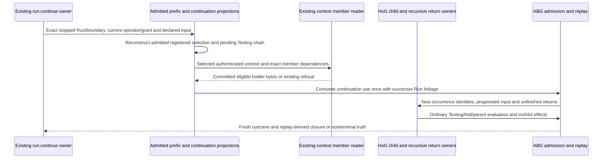

# RC4 point 1: actual registered-selection pending Testing recovery

Revision 2 follows Root's explicit structural decision recorded in ROOT_SELECTION.md. It supersedes the first draft's unresolved frontier assumption; the first-draft files and manifest stay byte-identical historical preparation. Status: exact revised packet for Root admission, no setup/native dispatch. The existing T-287 selection drives the native task, rubric, write grant, admitted Run and return disposition. No new ticket or competing plan.

Root selects the practical outcome: the actual default-library registered-selection/recursion spine reaches pending native Testing after completed Construction; a fresh process restores that pending execution and its unfinished returns, consumes admitted Construction and retained native context once, and produces fresh result/replay agreement without duplicate Construction. A narrower OneSurface fixture and fresh retained-work invocation cannot satisfy that selected claim. Only this one native frontier is selected, not arbitrary crashpoints or generalized recovery.

The immutable source is bcb1faf63cfb39bd7ccf7e14b48b133d1163216b/tree a013136818170f69609b2211665815e1a328e242 in /Users/jim/src/apps/abiogenesis-rc4-native-recovery (codex/rc4-native-recovery). Builder stays exact installed local/unqualified RC3: archive70de04c36e5716fd37d23e00daa37ab9f5bc079f51aec2544f8f0eb1c40649cd; manifest8e2230b5821c7f16df3db968862ee26e0306a845759d0d5b9a4f4cc0e498ef89; contentc89cf68f895743213b89c65c406f3e7ff3ed7878d24ce1fe7859403568997af4. Source predecessor, frozen release/install, old Runs and evidence are protected. Package version stays unchanged unless separately selected; RC4 work is not a release cut.

Authority: STDO3.0.2/f7f3f824ee1ac3e048d1b1ea86ce3aae84866e2e9d5010fe5eda2e38e12f4477; ABI Product Definition and Project Reference-Frame Basis; Product810–847; CONTINUATION-011–016; REQ-P-POLICY-024. The latter already requires general run.continue to identify an admitted Run or continuation boundary and resolve its lawful frontier under substrate/Program/binding/declaration compatibility, without caller-authored private traversal state. Re-entry is bounded contract-domain/HOW design_reframe followed by realization_refactor. No Product/requirement change, failure-code-set change, new event family, new engine/store/controller or 5.1 human/yield activation is selected.

The default library has no constructionComposition. Its admitted registered selection chooses the Testing wrapper; bounded recursion and nested workflow parents carry unfinished returns. Existing current_intent and selected_action each require actual ConstructionIntent relations, so their meanings remain unchanged. Root authorizes an explicit typed registered-selection pending-execution alternative inside existing run.continue. The native Worker chooses its precise name, schema and helper arrangement after recording the accepted owning HOW. A hidden bypass, synthetic ConstructionIntent or default-library workflow hardcoded into generic HoG is forbidden.

The relation to declare is: exact admitted registered-selection route + pending occurrence/cursor + progressed native input/source + all selected pending child/recursive return obligations -> an authenticated continuation use, consumed once -> replacement Run with new Run-local occurrence identities. Existing Program topology, input-origin, basis, traversal, parent/child, recursion and continuation owners reconstruct it. Parent completion still requires ordinary foldback/evaluation and current closure predicates; no historical judgment or Result is retargeted as current. Preserve attempt/term/recursion allowances; inability to establish the selected bounded relation refuses rather than resets budget or selects a new action.

Body authorization follows the exact selected authenticated context -> member -> committed holder dependency. The holder can be an earlier prepare-selection or prepare-native Result; hasAdmittedGovernanceSourceUse names successful state observations/synthesis and is not sufficient as a generic holder predicate. The source-use/continuation owner establishes allowed context and dependencies; the member reader retains exact result/member/path/digest/inline-birth/authority/binding/read-grant checks. No boolean allowForeign, arbitrary ancestor authorization or requirement that a holder itself be listed as a governance observation. Resolve selected old references only. New contexts may continue to birth inline; no cross-Run producer-sharing search is needed.

Retained bytes establish historical identity, not present W. Consume existing currentness, native reacquisition and unknown-effect dependencies; refresh only materially affected observations and preserve unaffected support, unresolved assessment and required independence. An uncertain effect remains uncertain, with the existing scoped consequences/refusal; this work does not create automatic reconciliation or compensation. Exact restoration and separately supported fresh retained work retain distinct meanings and proofs.

CAUSAL_SCOPE.v2.DRAFT.json pins the finite existing source/HOW/test outer bound. It removes ten presumptive first-draft code/HOW write routes and adds the actual Public owner contract/capability membership, operation/basis projection, continued-cursor and HoG child/recursive-return owners plus causal tests. No file is a mandatory edit. Currentness/effect/native contracts and generic publication sources remain read/reuse routes where their existing behavior suffices. Native Worker chooses callable names, helper placement and algorithms inside the granted canonical owners. New owner/module or required out-of-scope publication source returns to Root; it does not activate a redesign.

Causally necessary new fields in existing event payload/contract domains must preserve exact owning descriptor/schema/calculus and emitted asset correspondence. The generator remains the existing one; build/package in owned scratch/C2 emits the affected run.continue schemas/operation contract, adapter/capability projections and native-event profile. Never hand-edit generated schemas or change the failure-code set. Generated artifacts and source/contract identities are proof outputs, not permission to rewrite frozen RC3. If generic generators already derive the new member correctly, leave them unchanged.

Consolidation is a completion condition: each extraction identifies replaced callers; remove displaced duplicate responsibility and unsupported workarounds/adapters/config. Do not invent deletion where a mechanism is canonical. Every survivor cites its supported use, owner, purpose and bounded cost, with a removal trigger for temporary mechanisms. Preserve supported distinct exact-intent, selected-action and fresh-retained-work semantics. Tests assert preserved meaning, refusal and recovery instead of obsolete structure. No Q23, unrelated typed-stop, route-codec or telemetry redesign.

Native C2 remains model-free and uses all nine existing command purposes, toolchain/STDO paths and predicates, with exact source correspondence and the affected recovery tests; focused timeout25min. Reuse authenticated source closure by reference only where the unchanged build/package needs it. No dependency census/materialization is performed in this revision. One Construction Worker uses Opus5.5/xhigh240 turns,90min absolute,40min idle,3h outer,no dollar cap. Worker returns exact source/contract/test/consolidation evidence promptly; Root separately operates the actual installed interrupted-native/fresh-process/no-duplicate witness, preserving the original practical oracle.

Fresh setup is rooted in the pinned installed RC3 from the first import and CLI call; no old paid Run or P1-03 builder reuse. Root-only v2 setup recipe records ordinary run.json provenance through existing exclusiveRecord before populateSandbox. SourceBasis none/empty observations/null synthesis belong to the authoring Run, not a claim of recovered work. Root's structural direction is accepted; exact v2 packet admission and then actual setup/call/dispatch remain separate Root decisions under the already-authorized user instruction.
