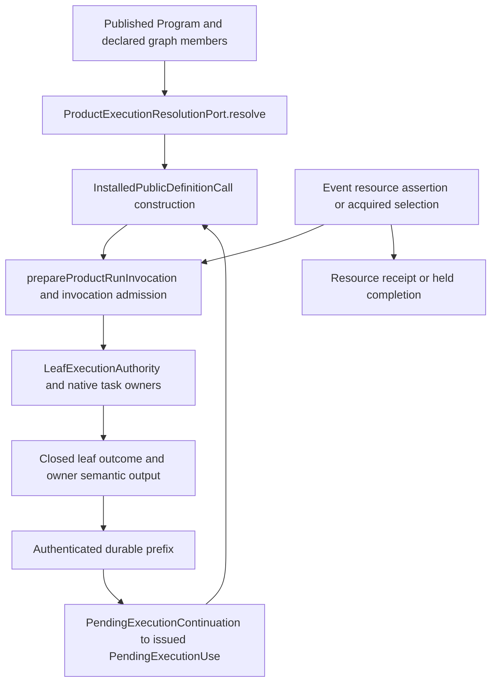

# Selected execution/recovery contract map

Descriptive review evidence, 2026-11-03. Source basis: `16d245c1e30119c4f8bbadce06c63d857a576ee4` (unaccepted attempt013 custody), inspected with `git show` in `abiogenesis-rc4-native-recovery`. All source locators below are relative to `build_tenants/abiogenesis/typescript/` at that revision, including files now being edited by native014. This is a selected-path, non-exhaustive map, not a whole-product interface census, new hierarchy, admission or release gate. The source map preserves the014 baseline; the later014 blocked/unaccepted return is held separately in `attempt-014-r1/review-subject-001/SUBJECT.json`. Owner/Install/Effect/Proof frames and operative STDO3.0.2 remain controlling.

**Finding:** the core is not untyped or missing all finite interfaces. It already separates owner contracts, Public envelopes, admitted invocation preparation, leaf authority, native outcomes, resource custody and continuation use. The observed frailty does support narrower concerns: independently populated transport fields, JavaScript proof/operator adapters outside strict TypeScript compilation, and permission/context conditions whose completeness requires owner checks and path evidence. This evidence does not establish that another framework layer would solve them.

## Composition, not inheritance

Arrows identify selected producer/consumer dependencies, not substitutability or a single serialized supertype. The installed envelope constructor is pure and explicitly does not admit its input. Durable history, active acquisition and invocation admission remain separate owners.

## Selected handoff categories

The row labels are descriptive categories, not proposed contracts. Discriminants quoted below belong to existing definitions; they do not enumerate the entire Product.

| Handoff | Existing types and actual variants | Population/admission and consumer |
|---|---|---|
| Owner call and semantic return | `DefinitionCall<TPacket,TResources>` → `DefinitionReturn<TPacket,TReceipt>`; `ExactDefinitionCallable` returns an Effect with `DefinitionExecutionFault`. `OwnerSemanticOutput` has `outcomeKind: result | refusal | nonterminal` (the last conditional on the packet). | Packet schemas determine request/result/refusal types; exact owner executes the call. Resources accompany the admitted invocation but require selected-owner validation. `shared/effect_definition.ts:32–72`; `shared/public_function_contracts.ts:486–525`. |
| Installed Public envelope | `InstalledPublicDefinitionCallInput<TRequest,TResources>`; operation/member identifiers are strings, request and resources independent generics. Run targets use `kind: next | graph_function | asset | declared_start`. | Constructor checks installed definition/projection and contract coordinates, then constructs invocation identity; it does not establish every operation-specific request/resource relationship at compile time. Product resolution and subsequent owner admission supply further checks. `public/installed_public_definition_call.ts:20–46,122–269`; `product/run_operation_contracts.ts:27–32`. |
| Prepared Run | `PreparedProductRunInvocation<M>` / `ProductRunInvocationPreparationRefusal<M>` use `kind: prepared_product_run_invocation | product_run_invocation_preparation_refusal`. Source assertion is `none | admitted_source_result`; member is `invoke | start`. | `prepareProductRunInvocation` joins exact invocation, resolution, workspace, admitted input, source basis, policy and grants. Optional resource fields such as `historicalSource` can become semantically required on a selected branch. Shape optionality is not branch permission. `product/run_invocation_operation.ts:61–120,445–460`. |
| Leaf execution | `LeafExecutionAuthority` has `kind: leaf_execution_authority`. Owner result is closed receipt, prepared probabilistic invocation or owner refusal. Closed probabilistic receipts distinguish `effectDisposition: not_dispatched | completed`; deterministic receipt has `computeRegime: F_D`. | `constructLeafExecutionAuthority` freezes/digests and validates exact authority. Native proof callbacks are internal operations, not serialized evidence. The implementation consumes this authority and completes actor exchange into a closed receipt. `implementation/contracts.ts:129–203,248–305`; `implementation/leaf_execution_authority.ts:183–201`. |
| Native work | `native_workspace_work_task`, `native_workspace_work_observation`, `native_workspace_work_failure`. Success contains non-null `after`; failure permits null `after`, `changedPaths` and typed observation failure. | Task constructor/schema validates correspondence and authority/grant/context relations. Implementation observes current context, prepares the selected assembly, then observes effects and constructs success/failure. A provider report does not substitute for successful after-observation. `product/native_workspace_work.ts:23–51,148–213`; `implementation/native_workspace_work.ts:26–70`. |
| Physical event-resource custody | Assertions: `new_abg_event_resource | reopen_abg_event_resource`; held selection: `acquired_abg_event_resource_selection`; outcome: `abg_event_resource_receipt | abg_event_resource_completion`. Acquisition returns `acquired_abg_event_resource | abg_event_resource_refusal`. | Existing acquire/select/currentness/close owners validate assertions and maintain internal issued handles. Receipt contains a close handoff; held completion explicitly does not represent physical release. Prefix/lease/current-byte conditions are not proved by a structurally matching JSON object. `abg/definition_event_resource.ts:33–85,98–173,268–376`. |
| Pending execution | `PendingExecutionContinuation` has `continuationKind: pending_execution`, phase `undispatched | effect_unknown`, status `open | consumed`. Selection returns `kind: pending_execution_use | refused`. | Projection derives the frontier; `selectPendingExecutionUse` joins exact Run, root basis/scope, cursor, input and original invocation, refusing uncertain effect. Issued-use tracking and admission enforce currentness and one-use. `projectPendingExecutionInputAtPrefix` supplies actual input. This is logical continuation, not resource reopening. `abg/construction_continuation.ts:219–321,2264–2310,2430`. |
| Host transport | `DefinitionHostReceipt` has exit code `0 | 1 | 3 | 70`, nullable owner output/resources/failure; host failure distinguishes `typed_execution_fault | defect_or_interruption`. | Host executes the closed Effect and serializes its receipt. Operator must retain null/fault output instead of manufacturing resources or reusing stale handoffs. `shared/effect_definition.ts:74–103`. |

## Where caller glue remains

`test_env/support/registered-graph-selection.mjs:227–432` canonically resolves next/declared/asset starts, constructs policy/grants/work authority, and populates request, authority slots and resources before calling the installed constructor. Its pending helper (`:467–574`) uses existing pending projection/use/input owners, but still explicitly assembles the required call/slots. These are real population seams, not additional authority owners. Remaining local B-start and recursive pending assembly are the bounded caller-consolidation work selected for014; completion is not claimed here.

`tsconfig.json` enables strict TypeScript, exact optional properties and unchecked-index protection, but includes only `code/src/**/*.ts`. The `.mjs` support helpers and campaign operator scripts are outside that compilation boundary. Syntax checks do not prove their operation/resource pairing. Conversely, weakening runtime validation because internal TypeScript types exist would erase necessary checks at serialized or physical boundaries.

## Counterexamples and what they establish

| Evidence | Structural versus semantic issue; standing |
|---|---|
| Practical004 B selector received historical first-root commentary but no factual current B root/start/bound. Actual prompt was 44,960 bytes, SHA `0b1918f621f585b1b3e8daf6a22a4b84fb2f13c166b3e08464a478e154d4db5d`. | Instruction population omitted current meaning despite a valid machine state. At16d, `abg/instruction_assembly.ts:409–458` projects current binding from authenticated invocation/root owners and separately names predecessor source. This is semantic context completeness; types alone cannot ensure correct F_P judgment. See `practical-witness-004/proof/v2/B_STOPPED_CUSTODY.json`. |
| Manual start/pending/resources and missing historical dependency in earlier operator preparations. | Incomplete caller population across individually valid shapes; exact operation constructors and branch preflight help. Conditional historical-source/currentness requirements remain runtime obligations. Canonical helpers reduce duplicated assembly, not all semantic checks. |
| Removing forced W⊆R exposed protected W-outside-R territory. | A previously implicit guard was lost. Typed W/R arrays and legitimate observed R do not establish effect permission.014 reuses existing territory/protected-path owner for exact/ancestor/descendant overlap; no new schema is required. See `attempt-013/ROOT_DISPOSITION.md`; frozen implementation boundary `implementation/native_workspace_work.ts:26–39`, territory owner `product/worksite_effect.ts:506,848`. |
| Selected-profile fulfillment fixture failed `unknown_dependency` after current-binding premises became required. | Fixture omitted genuine invocation/root premises; failure is evidence of incomplete integration setup, not absence of typed core contracts. Do not bypass the guard. See `attempt-013/review-subject-001/independent-evidence/CUSTODY.json`. |
|014 had duplicate `product/worksite_operations.ts` in roots/selected paths after locator correction. | `readonly string[]` does not encode uniqueness. Existing `observeWorksiteContext` rejected it before paid work (`product/worksite_operations.ts:1083–1086`). Original operator assertion hid the typed refusal; diagnostic retained it.014-r1 records original/unique counts and fixes caller preparation. See `attempt-014/diagnostic-001/OWNER_OBSERVATION.json` and `attempt-014-r1/CAUSE_AND_REVISION.json`. |

The supported consolidation direction is owner-led population and reuse at these specific seams, with typed internal coupling where useful and actual serialized/installed-path evidence. The implementation authorization recorded below comes from the owner through Root, not from this descriptive map. Strong types, canonical constructors, admission checks and full-path proof complement one another: none alone proves permissions, currentness, physical custody, semantic completeness or successful recovery.

## Authorized implementation intent

On2026-11-03 AEDT the owner explicitly reaffirmed the earlier mandate and directed implementation (“lets just do it”). Root preserves the original RC4 recovery goal and will bind the full affected cone and owning HOW before native coding. This section records intended acceptance, not completed design, new authority, permission to alter014, or acceptance of its unaccepted return.

- Enumerate the finite applicable interface families and declared variants; provide canonical strongly typed construction/prepare paths for each selected LLM-facing request and handoff, with operation/request/resources/return coupling made explicit.
- Existing owners populate and validate authority, current execution versus predecessor context, resources and dependencies. Expose these paths through the existing callable SDK/CLI surface; scripts and tests become thin consumers rather than manual assemblers.
- Return exact owner-produced returns, receipts and admitted truth, preserving null/refusal/nonterminal distinctions. No general receipt constructor may mint authority or substitute constructed data for admission, currentness or physical resource custody.
- Require static coupling and raw/serialized/runtime guards together, plus actual full-path positive and refusal evidence. Strong types alone do not establish permissions, currentness, eligibility or recovery.
- Retire superseded manual population/assembly and displaced helpers after affected consumers migrate; supported survivors require explicit reasons. Inherit/conjoin014 routine fixes and evidence rather than reworking them under a new label.

No new registry, controller, universal DTO, state authority or algebra is selected. One coding Worker remains the policy; no new Worker starts until014 is closed and Root binds the next implementation grant. The map remains descriptive review evidence. See `EXECUTIVE_NEXT_STEPS.md` for current routing and the held014 subject for exact source/C2/UAT standing.
