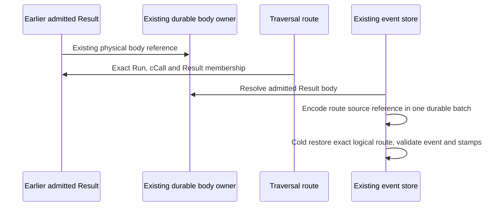

# F4 selected re-entry and measured causal cone

This is the next serial native increment after method-01; it is not yet a coding
activation. User approved the bounded RC5 storage/performance scope. Root selects
the existing F4 capsule's private durable-codec re-entry, unchanged Product WHAT.

The pinned historical stream is 879,927,317 bytes, SHA256
93fea1f65a4cc268cfe386e82a4d24eb7894251eba09c488b0b0769a784f5f46. The read-only
measurement uses RC4's shipped decoder, then exact same-Run/cCall prior Result
value equality. Of 156 route rows (163,410,528 bytes), 15 retained nested source
values match and occupy 155,009,467 bytes before reference overhead. The selected
cut Run has 3 eligible values totaling 35,608,536 bytes. This is RC3 building RC4,
not an actual RC4 performance result or a realized saving.

All 15 exact source Results are themselves physically encoded by the existing
body-reference codec. A repair supporting only physically inline Results would
produce zero gain for this measured population. The exact admitted Result must
remain the authorizing source while its existing earlier inline-body dependency
is resolved through the durable owner. A basis/input body with equal value cannot
substitute for Result membership or occurrence. Routes remain consumers, not a
new source of authority. Missing eligible representation may remain inline;
counterfeit references refuse.

Owning HOW/implementation: default-library and retained-route provenance,
`abg/event_body_encoding.ts`, `abg/event_store.ts`,
`abg/worksite_input_provenance.ts` and `abg/traversal_transition.ts`.
Use the existing durable index/acquisition and atomic staging/rollback. No
constructor, native-identity or cross-Run rewrite; no second store, stream,
service, registry, controller or Public/schema feature. Physical prefix digests
may change; logical events, payload/value/route identities, lineage, currentness,
refusals and fresh projections must not.

Required focused counterexamples: same-valued basis/foreign-occurrence decoys,
missing/forward/tampered/uncommitted Result or body, mixed inline/reference
material, exact Result already physically referenced, rollback/fsync poison,
and full/selected/descriptor cold decode. Conjoin with selected installed sunny
path and measured same-workload encoded bytes. The existing capsule's broader
qualification and crash/saga exclusions remain explicit. Native Worker owns
realization under a separately frozen grant; independent max review examines
that frozen result alongside affected proof.
