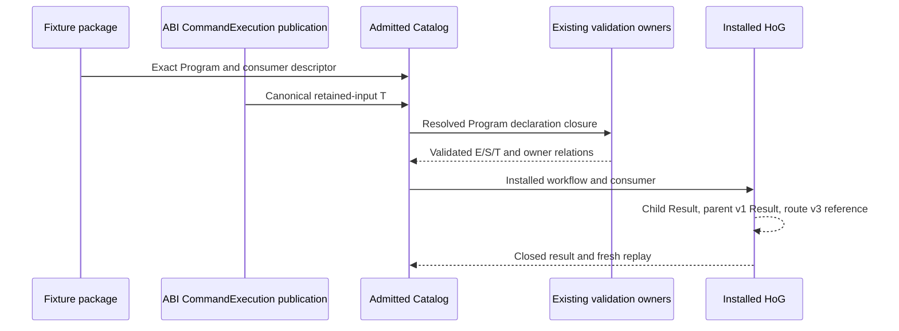

# RC5 F4 installed witness re-entry

Root Executive disposition under the approved RC5 outcome. This is a bounded
fixture/preparation realization repair, not a codec or Product design change.
Exact failed source is1ad6b9f8549e9a81bf0b045f835ea0d12192584e, preserving Native
Result4accfc2f and frozen subjecte82e3e6391a9f16199b684b0b553564ed09bdfdfc45107accda3bdb45d959fb8.
Actual C2 Resulted46e43e/Helper4769075a has six commands0 and final-proof1.
Planning1,codec24,route10 with3 disclosed skips and prior installed1 passed;
new installed1 failed before the scenario. No codec defect was found in the
independent max source review. Whole Run is blocked, fresh result not_found and
replay blocked, terminal absent. No UAT or installed witness acceptance.

## Origin, complete affected relation and why earlier checks missed it

Product/identity/owner: canonical retained-input T remains declared by exact ABI
WORKSITE_COMMAND_EXECUTION, never the fixture. The source correctly omits local
T, but the helper's publication-local Program validation lacks its declaration.
validator/validation.ts969-979 cannot prove E/S/T. Its refusal at1876 has no
successful programRef; root-installed-environment504-509 then dereferences
undefined. The observed TypeError is this downstream symptom. The underlying
refusal diagnostics were not captured, so do not claim an executed diagnostic.

Integration/execution: Product execution_resolution758-805 independently requires
T's exact admitted ABI CommandExecution owner. The required module contributes
T at gtl/worksite_command_execution308-309. Supplying a copy of T or setting a
fake semanticLifecycle to bypass prevalidation violates that relation.

Implementation/proof: new rc5Consumer metadata and function lack an exported
packaged descriptor. implementation_resolution208-231 and430-446 require an
exact match. implementation_absent is a source-proved downstream counterexample,
not a second executed failure. The finite workflow/entry/source/closure relation
otherwise remains coherent; internal child callable membership uses the full
Program/Catalog despite the public root-only allowlist.

The earlier feasibility review's one-file claim was incomplete: it missed local
prevalidation, actual CommandExecution publication ownership and descriptor
export. Root carried that incomplete map into the grant and limited author
feedback to syntax/in-memory checks; those checks could not establish installed
composition. Native fixture construction retained T ownership but did not finish
these missing handoffs. This is the failed work decision, not an operator env
failure or evidence of a codec defect. The actual failed candidate is retained.

## Selected smallest complete re-entry

Three source territories only: m5-installed-graph-edge.test.mjs,
support/installed-language-test.mjs, support/root-installed-environment.mjs.
Use existing additionalCorePublicationConstructors to supply canonical ABI
CommandExecution. Forward it through installed-language-test. After the genuine
Catalog exists (root-installed-environment544-563), validate the selected
cross-publication Program through existing Product owners:
resolveProgramDeclarationClosure -> constructCatalogProgramValidationInput ->
validator.validateProgram (catalog_operations84-105,129-183; execution_resolution729-755).
Keep typed refusals visible and preserve actual execution-resolution checks.
No declaration copying, fake lifecycle, permissive skip or Product-owner change.
Extend the test-local sourceTransform with the exact rc5Consumer descriptor.
language-structural-fixture.mjs and runtime owners need no repair.

Keep codec/store, method, identity, contracts and accepted HOW bytes fixed.
Final independent review is only the3file repair, conjoined with the held
no-material-codec-finding result. Retain18 method passes; do not rerun completed
RC4 qualification. Current affected C2 recipe is unchanged except correspondence
adds the2support files; its source/build/pack and selected tests establish the
repaired snapshot. Runtime-code and captured sample passes remain valid history.

Before final C2, the native Worker may make one focused installed author check
in its declared scratch using exact already-compiled C2 archive4c098c82. This
explicitly corrects the earlier insufficient author-feedback boundary. Assemble
only copied source/test inputs and the unmodified compiled package; no canonical
build/install or provider. Test fixture packages/scratch installs may be created
by the existing helpers. If the helper repacks ABI bytes, require digest equality
with the bound archive. This is feedback only; final C2/native UAT still own
acceptance. New integration failure returns to Root for triangulation, no hidden
repair loop. Preserve streams and exact errors, not just a shell exit code.
