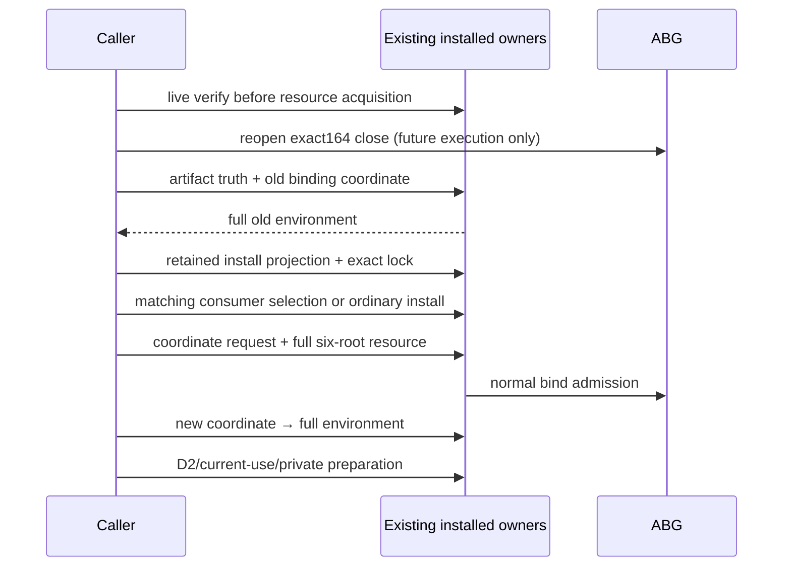

Product frame: fixed fifteen-family ABI5.0, GOAL035/T287, external original Data Mapper, exact STDO2.5.1rc2. This caller realization uses existing Product817–867 and canonical Environment/Install/ArtifactTruth/D2 owners; it adds no owner or law.

164 failed before bind dispatch because a correct Public binding coordinate was used as a full record. The intended sequence is: early live verifier identities → reopen genuine164 close → authenticate historical136 source and unchanged34 state → project old environment from its exact binding coordinate → rederive and match current lock and retained native26 install → select admitted matching consumer or ordinary unchanged consumer installation → canonical six-root bind → project new full binding → catalog/D2/current-use/private preparation. Public requests/slots use coordinates; D2/policy/private consumers use the owner-projected record.

No167 runtime effects are granted. Preflight checks only recorded scalar fields, canonical schemas/hash and ProductSet/roots under explicitly controlled lower premises; it cannot establish ABG admission/currentness or actual composition. The new toolchain/product roots are selected from real matched installs and manifest/bind law at execution; the app A, canonicalRoot, actor, original Program, raw34 and event/runtime/projection/archive roots remain exact.
