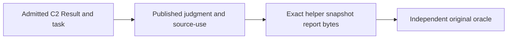

# ABG tests

Unit and owner tests in `tests/` check generic contracts, algebras, admission,
effects, traversal, evidence and replay. Integration tests exercise their
composition. A test's purpose follows its current owning contract; age or a
historical ticket name alone does not make it obsolete.

Sandbox UAT tests exercise ABG as a user would: start with a clean deployment,
supply an application specification through supported installed Public
interfaces, obtain actual construction and execution through the generic
default library, and check the application against an independent oracle.
Fresh reads must preserve the admitted result and its producer. These are
end-to-end integration tests used for user acceptance.

The seven workloads are `basic-cli`, `js-tenant-test`, `js-sdlc-bootstrap`,
`rust-cli`, `rust-service`, `parallel-js`, and `data-mapper-full`. Their source
inputs and independent acceptance oracles belong in
[`fixtures/sandbox-uat/`](fixtures/sandbox-uat/). They are test data, excluded
from the shipped ABG product. Hello World is a minimal test program; Data Mapper
is the larger test workload. Neither supplies ABG runtime authority.

[`uat/`](uat/) owns the runner and clean-deployment checks. Runtime execution
uses the installed ABG public interfaces and default library. Acquisition
provenance can name the original donor; execution must resolve every workload
locally without odd_glc. Deterministic or supplied worker responses qualify
only their declared boundary; real external-worker behavior requires a live
run. Preparation and skipped cases are not UAT passes.

Every sandbox run retains its exact artifact identity, inputs, install truth,
commands and streams, worksite observations, runtime events, and available
fresh result/replay reads in a new persistent archive before cleanup. Blocked
and failed runs retain evidence too. `npm run clean` preserves test evidence.
Historical green results apply only to their original subjects. A successful
UAT run does not by itself qualify or release an RC.

The independent command oracle acquires XML from each selected admitted C2
observation's exact task/attempt helper snapshot, rather than the mutable
application tree. The published C2 judgment and, for earlier Runs, explicit
admitted-source-use owner must validate that observation first. Each original
report identity/path, byte count and digest must match its confined physical
snapshot file. The latest matched original command supplies the eight-report
set, pass floor and depth-name evidence; each mutant/restoration episode uses
its own authenticated report population. Application/original-file checks
remain in the worksite. Historical XML alone grants no current execution or
semantic UAT credit, and the full original criteria remain binding.

