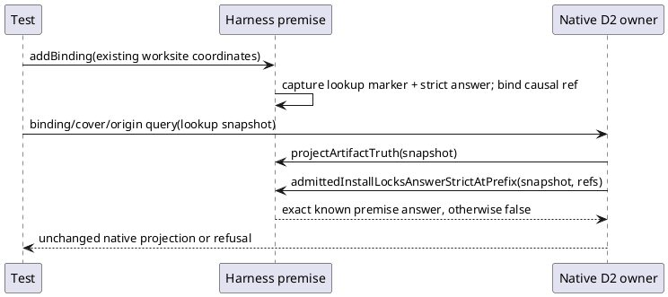

# B28 D2 fixture Return

| Binding | Exact selection |
|---|---|
| Activation / role | `T292-B28-D2-FIXTURE-01`, Codex delegated Writer `/root/b28_d2_fixture`; return to Root Executive |
| Authority / admission | Root's exact repair instruction after its Product/typed-owner/Proof conjunction of [TRIAGE.md](b28-d2-fixture-01/TRIAGE.md), under the owner-approved [T-292 Codex resumption](../../tickets/active/T-292-consolidate-and-clean-the-code-base.md#codex-resumption-2026-11-13). Consumed existing grant; no new approval or Reviewer activation. |
| Subject | `/private/tmp/abg-t292-b28`, branch `codex/t292-b28-d2-premise`, clean predecessor `3d4ab89828989c2828ed4bbce0349e2f8721be02`; tenant equal to failed C_final `e36e4b316503053a81c4556f0bda73216e76cdf6` before this repair |
| Frame | `repo://abiogenesis/build_tenants/abiogenesis/typescript/design/ABI5_PROJECT_REFERENCE_FRAME_BASIS.md`; F01 exact install/lock/binding, F05/F06 one Public/thin shells, F07 Executive/default-direct, F10 ABG-owned admitted truth |
| Method | Definition `stdo_abiogenesis.json`, SHA-256 `b5720642ff00ebcb47f77ae68df3a960ab70f82cd1227c0712edda9d40745f44`; native `stdo-work`, `stdo://releases/v3.0.4/`, manifest `102817a3f4bea4dca1d6fa0fc634b94404dd2ba82ba6d8c38b273402dda9f95b` |
| Verification / host | Selected manager `/Users/jim/.local/bin/stdo`, store `/Users/jim/Library/Application Support/STDO`: installed/valid/checked. Native source reader verified bootstrap member `9fb337b2c8462e9d6788f52f11ca75199253a3a66a10774bc05a9798a772e502`, including its activation/admission sections. Shared filesystem/tools; no clean-room or independent-assurance claim. |
| Change / re-entry | Test-only realization repair at the proof-premise owner. Goals, Intent, Product, requirements, accepted design, Public definitions and production remain unchanged. |
| Effect grant | Three named test/support paths and this Return; scratch `/private/tmp/abg-t292-b28-work`; one author repair pass, one finite run of each affected file, own-branch commit. Root owns integration and inventory/recipe refresh. |
| Result | `satisfied` for the bounded fixture repair and mechanical reproof. No new cause appeared; no retries. Root retains acceptance and continuation decisions. |

The original failed run remains a failed run: 1/10 passed, nine failed, exit 1
in 3.2 seconds; raw stdout SHA-256
`f70b549623cdadff24d0cc5151359d824a1bbbfdd023521011ffcf6c76c6873a`.
All ten [INPUTS.json](b28-d2-fixture-01/INPUTS.json) members were verified;
the five captured source/test members also matched the live predecessor.

## Owner relation and compact design record

The owning HOW is [Recorded and strict Product truth](../../../build_tenants/abiogenesis/typescript/design/T287_PACKAGE_OWNED_NATIVE_DECLARATIONS_DESIGN.md#recorded-and-strict-product-truth)
and [D2 Same-App Binding Transition Evidence](../../../build_tenants/abiogenesis/typescript/design/T287_D2_REQUIREMENT_LIFECYCLE_DESIGN.md#d2-same-app-binding-transition-evidence).
Requirement routes: REQ-P-CATALOG-011/012/013, REQ-P-INSTALL-055,
REQ-R-ABG3-BINDING-018 and REQ-R-ABG3-CONTINUATION-014. TD77's native
`worksite_revision.admittedBindingRow` asks the retained strict answer before
handing a binding to new work; recorded reading keeps its explicit question.

| Producer -> consumer | Typed handoff and declared computation |
|---|---|
| Test worksite -> `bindingHarness.addBinding` | Existing Product `WorkspaceBinding` and `WorkspaceAuthorityBasis` coordinates; one lookup-only install marker names the lock id/digest, then the binding row records its causal ref. This is an `ArtifactTruthRow` field premise, not an admitted row. |
| Harness snapshot -> artifact lookup / strict-answer lookup | Snapshot copies existing lookup rows. The two ArtifactTruth substitutes share one premise owner. A nonempty ref list must resolve every ref to one exact marker in that prefix, equal its captured digest, with an explicitly retained `lockAnswersStrict === true`. |
| Lookup answers -> native D2 accessor | Existing `RuntimeEventPrefix`/`ArtifactTruthRow`/`ProductTruthQuestion` contracts stay owned by their native modules. The fixture supplies substitutes at that boundary; actual `admittedBindingRow`, binding cover, origin, entry and downstream algorithms execute unchanged. No substitute claims a validated runtime prefix. |
| Manual semantic-revision builders -> shared premise | Both callers now use `addBinding`; they no longer construct incomplete competing rows. Existing ancestry, first-refusal, witness, currentness and source-preservation assertions are unchanged. |



Preserved invariants: install/lock/binding identities remain distinct from
mutable worksite state; the current prefix cannot borrow an absent, foreign or
ambiguous install premise; default strict never becomes recorded; ABG alone
admits runtime facts. `lookup_install_premise` markers are deliberately outside
the runtime-event vocabulary. They are never admitted, persisted or passed to
the real artifact fold. The retained answer is an explicit component premise,
not evidence that an actual lock passes the production guard.

The added control drives the real binding accessor with absent/empty causes,
mixed known/foreign refs, an absent prefix marker, changed marker bytes,
duplicate markers and a non-strict premise. Each refuses. Positive and copied
prefix controls succeed; the same non-strict binding remains readable only
under the existing explicit recorded question. Physical reads stay zero in
this control. All original assertions were mechanically checked as preserved.

## Frozen test source and proof

Source hashes below identify the tested worktree subject. The own-branch commit
containing these bytes and this Return is the frozen handoff; its exact commit
is returned to Root after checkpointing. No test-source edit follows proof.

| Tenant-relative path | Bytes | SHA-256 |
|---|---:|---|
| `test_env/support/d2-binding-harness.mjs` | 26920 | `ed27f8c21d4be44acb3037602176d78d65d6f4f8a232b31471780cf841d1f87b` |
| `test_env/tests/d2-binding-transition.test.mjs` | 35568 | `0e9aa4c9f4fbff7cb5694a109e7dd7dfed8cf78ff37eea23804fffdbc4485590` |
| `test_env/tests/t287-native-semantic-revision.test.mjs` | 66671 | `a5dd0df62e8c96ec17c81f4ac80c0e83e8910a8262687b7132d5c6c155316c43` |

Evidence root: `/private/tmp/abg-t292-b28-work/proof-01`.
`subject.json` pins all three sources and ten unchanged C_final build/contract
members. `preflight.json` retains successful syntax checks, assertion
conservation and build correspondence. `run-one.py` retains the finite runner;
each row's directory contains `request.json` (exact argv/cwd/environment and
subject), `process.json` (exit, clock, timeout and TAP totals), `stdout.raw`
and `stderr.raw`. Raw streams are preserved without normalization.

For each named file, from this worktree's TypeScript tenant:

```sh
/opt/homebrew/Cellar/node/24.7.0/bin/node --max-old-space-size=8192 --experimental-vm-modules --test --test-concurrency=1 --test-reporter=tap test_env/tests/<file>
```

Both use `ABI5_TESTING_MODE=mechanical`,
`ABI5_CANDIDATE_BASIS_SOURCE=committed`, and
`ABI5_EVIDENCE_ROOT=/Users/jim/src/apps/abiogenesis/.ai-workspace` in the
retained sanitized environment. Each has an external 600000 ms cap; neither
timed out. The shared campaign start remains `2026-11-13T09:00:32Z`.

| File / receipt directory | UTC start | Exit / elapsed seconds | Tests | Suites | Pass | Fail | Cancelled | Skipped | Todo | TAP duration ms |
|---|---|---|---:|---:|---:|---:|---:|---:|---:|---:|
| `d2-binding-transition.test.mjs` / `01-d2-binding-transition` | `09:21:36.150261` | 0 / 39.156873 | 11 | 0 | 11 | 0 | 0 | 0 | 0 | 39069.537 |
| `t287-native-semantic-revision.test.mjs` / `02-t287-native-semantic-revision` | `09:22:20.703438` | 0 / 1.945929 | 7 | 0 | 7 | 0 | 0 | 0 | 0 | 1886.661292 |

| Raw stream | Bytes | SHA-256 |
|---|---:|---|
| `01-d2-binding-transition/stdout.raw` | 3460 | `1d06cb6b4507d7dad6e0198ed0e8e9764892bddbc37c00836d372b4d1506c949` |
| `02-t287-native-semantic-revision/stdout.raw` | 3246 | `935d9087c8369fd9177a5933acdb9171aafdafdba890ef0e3b99a78c01e73332` |
| Each `stderr.raw` | 0 | `e3b0c44298fc1c149afbf4c8996fb92427ae41e4649b934ca495991b7852b855` |

## Boundaries and return

The ten original D2 cases plus the new premise control and all seven native
semantic-revision cases pass. This closes only the selected component-proof
premise repair. It does not establish production admission, installed runtime
behavior, full composed coverage, history compatibility or qualification.

No production, specification, design, generated output, inventory, recipe,
release identity, pin or history changed. No build was needed: the tested build
and its selected identity/contract pins remain the failed C_final build. No
provider opt-in, live run, broad/history/cut/install campaign, reviewer,
cleanup, main integration, push or publication occurred. The earlier failed
proof remains immutable. Root must bind this successor and refresh the
inventory/recipe before any separately selected campaign continuation.
