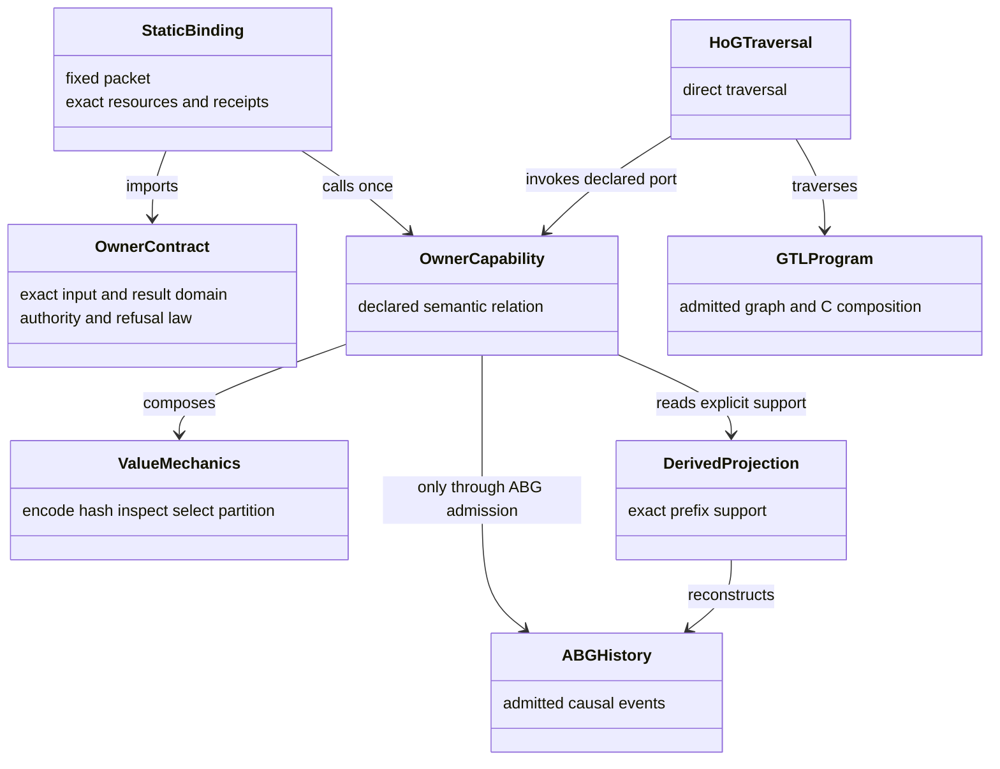
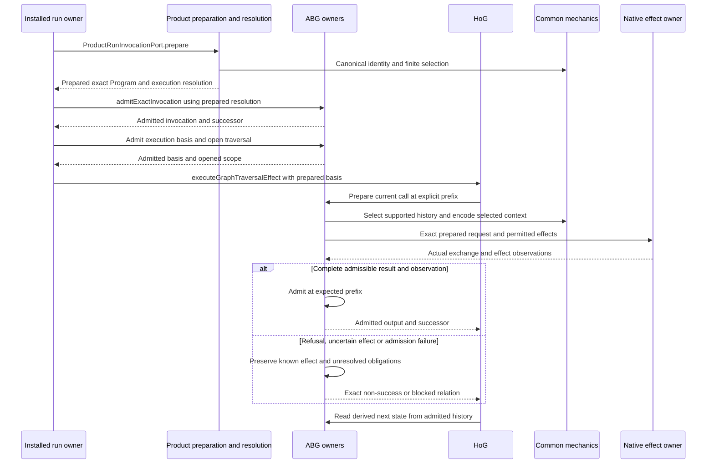
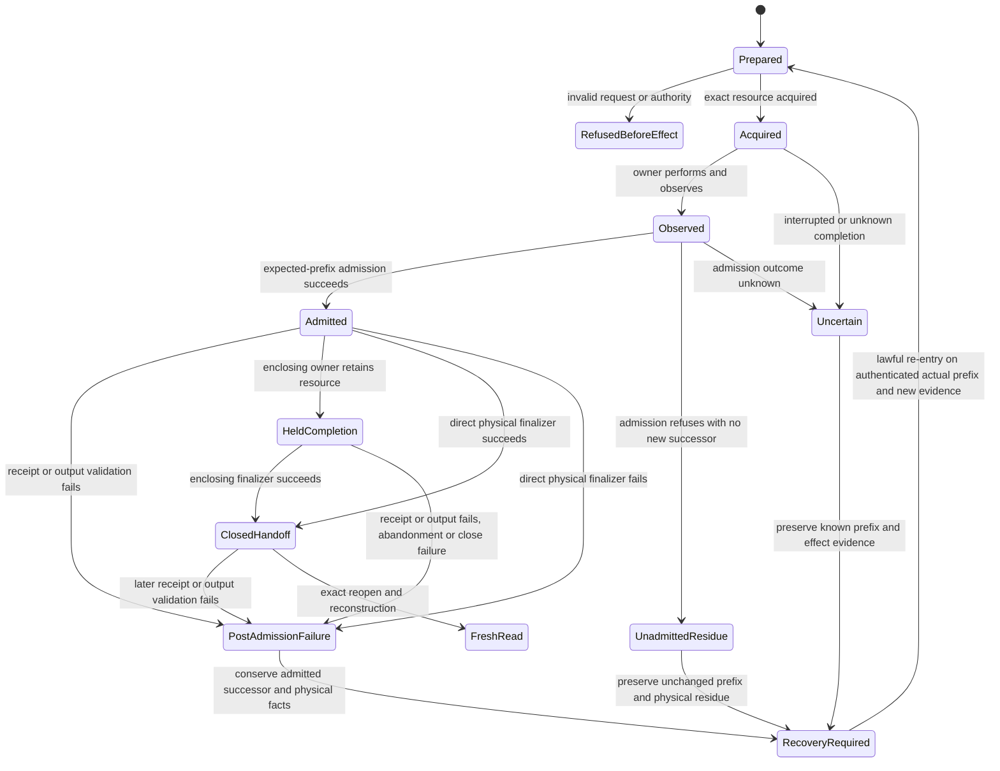

# ABIogenesis 5 Common Computational Capability Library

**Status:** Root-ratified bounded design conjunction, 2026-10-21. C1 lifecycle, C3 checked reading and cross-consumer failure handoff are accepted at DESIGN scope. C2/C4/C5 common callable contracts and finite retirement directions are accepted with six owner obligations and two composite classifications OPEN. Full migration, implementation conformance, measured savings, installed outcomes, L5 delivery acceptance and release remain unproved. [Current conjunction](../../../../.ai-workspace/work/T287_COMMON_LIBRARY_DELIVERY_01/realization/common-consolidation-conjunction-01/decision.md) records the exact subjects and limits.

**Selection:** the owner's 2026-10-21 clarification makes this library design the first ABG activity. The intended asset is a common computational basis from which features are composed, reducing independent solutions to equivalent computational problems. Explicit obligations determine what execution must establish; execution determines the actual outcomes.

**Historical L1 basis:** [activation](../../../../.ai-workspace/work/T287_COMMON_COMPUTATIONAL_LIBRARY_DESIGN_01/activation.md), [source inventory](../../../../.ai-workspace/work/T287_COMMON_COMPUTATIONAL_LIBRARY_DESIGN_01/basis.json), SHA-256 `7c4196afaf481be05056a5c3b5120b98b9e4d012ccf2b673f765076b3ec23376`; HEAD `727f1dbcab3c198f7704735fdf91b994b7aac243` plus the inventoried dirty bytes. The [Product assessment](../../../../.ai-workspace/work/T287_COMMON_COMPUTATIONAL_LIBRARY_DESIGN_01/product-assessment.md) and [realization assessment](../../../../.ai-workspace/work/T287_COMMON_COMPUTATIONAL_LIBRARY_DESIGN_01/realization-assessment.md) are separate source-evidence inputs conjoined by the Executive. The latter searched 264 TypeScript sources and inspected the named consumer bodies; it is not a complete semantic clone or dynamic-path audit.

**Authority:** [Product](../../../../specification/PRODUCT.md), [requirements](../../../../specification/requirements/README.md), the [project frame](ABI5_PROJECT_REFERENCE_FRAME_BASIS.md), [realization constitution](ABI5_REALIZATION_CONSTITUTION.md) and [computational binding](ABI5_STDO3_COMPUTATIONAL_BINDING.md). The exact method is `stdo://releases/v3.0.0-rc.1/`, manifest `069285ad5a79d59ca2dd835e34a54b3e537b0eeef99c29994b18c339dbe62232`, including [DESIGN_MODULE](stdo://releases/v3.0.0-rc.1/standards/DESIGN_MODULE.md), [SPEC_METHOD §11](stdo://releases/v3.0.0-rc.1/standards/SPEC_METHOD.md#11-build-tenant-binding) and [FOUNDATIONS](stdo://releases/v3.0.0-rc.1/standards/FOUNDATIONS.md). No companion or moving methodology source is selected.

## 1. Selected asset and Product boundary

The common library consists of the canonical mechanics, reusable owner ports and static compositions specified below. Existing modules remain its implementation locations. Direct typed imports are the consumption mechanism. No new root barrel, package export, runtime catalog, dispatcher, resource framework or `runPipeline` is selected merely to give the library one name.

The design covers the intended common capability basis across all fifteen selected Product families. The present installation, preparation, history and continuation path is an initial consumer and proof discriminator, not the boundary of the library. Under [Product’s compression boundary](../../../../specification/PRODUCT.md#common-computational-library-prerequisite), the selected library requires accepted design, usable implementations, actual consumer adoption and retirement or justified retention, executed obligations and independent acceptance before release work resumes. C1–C5 below are inside that selected deliverable; none is automatically deferred to 5.1. Optional pure-helper contraction outside the deliverable retains Product’s later allocation. This finite selection is not an unbounded all-helper sweep.

The following decisions are selected:

1. One admitted computational relation is reused across equivalent instances. A feature name or Public definition key does not justify another algorithm.
2. Canonical bytes, exact coordinate equality, finite selection and closed structural mechanics have canonical implementations. Owner predicates and result interpretation remain explicit.
3. Product declaration resolution, GTL construction, HoG traversal, ABG event resources/history and native effect owners remain reusable libraries in their existing domains. Their semantic relations are not reimplemented inside a generic helper.
4. Existing Effect 3.22.1, exact owner schemas and Node mechanics remain the admitted foundation composition. No material new dependency is selected.
5. The finite consolidation ledger in §6 distinguishes equivalent mechanics, existing compositions, intentionally different contracts and proposed additions awaiting a material design decision.
6. Each retained implementation increment must name its consumer replacements and complete affected path. Default to the common implementation. A retained variant needs a concrete supported input/caller for which that implementation changes the required outcome, with owner, falsifier and disposition. Missing equivalence evidence remains an open obligation; it does not justify retention. Preserve equality, failure and admission domains until their owner explicitly decides a correction. Moving code or counting fewer functions does not establish reduced proliferation.

The [published default governance/lifecycle library](T287_DEFAULT_GOVERNANCE_LIBRARY_DESIGN.md) remains ordinary declared GTL GraphFunctions and Programs. Its Executive, induction, design, testing and UAT roles use this lower realization library through GTL/HoG/Product/ABG owners. They do not become low-level library primitives. Likewise [capability_contracts.ts](../code/src/shared/capability_contracts.ts) describes existing public definition capabilities; this document's capability identifiers are design coordinates, not additional DS1 capability rows or callable exports.

### 1.1 Exact accepted consolidation contracts and open boundaries

Root incorporates the following exact design bodies and their finite consumer/deletion/proof maps. Original proposal labels and freezes remain immutable historical inputs; this owning HOW records their present acceptance. These maps, rather than the K01–K12 taxonomy alone, bind the selected computational consolidation.

| Selected family | Exact incorporated subject and disposition |
|---|---|
| C1 — lifecycle and physical facts | [Lifecycle HOW](../../../../.ai-workspace/work/T287_COMMON_LIBRARY_DELIVERY_01/realization/e03-common-lifecycle-law-design-02/HOW-proposal.md), SHA-256 `122df37438d9f5930fcc83a3159bc0b3b8b5e6927c4546288a32d11a8a96a910`, freeze `6114dba2945fca732df86e852b638261da876c91df31263c8289c871137020ee`, and [retirement/proof map](../../../../.ai-workspace/work/T287_COMMON_LIBRARY_DELIVERY_01/realization/e03-common-lifecycle-law-design-02/retirement-and-proof.md). Accepted bounded DESIGN; the [terminal-quiescence owning HOW](T287_TERMINAL_QUIESCENCE_OWNER_NETWORK_ACCEPTED_DESIGN.md) ratifies the precise census supersession and token frontier. |
| C1 — command/HTTP failure boundary | [Cross-consumer HOW](../../../../.ai-workspace/work/T287_COMMON_LIBRARY_DELIVERY_01/realization/e03-cross-consumer-handoff-design-01/HOW-proposal.md), SHA-256 `8fb5ca195bab507f2203a67e07937e4d7e9bab982b638ff3e974fecfd5d2d7ec`, freeze `93d088fb4ad4a1ed1b2a846a1bfb54e2a220012e9c6fdfbcee953c8d6eb96bf8`. Accepted bounded DESIGN; the [C2 execution owning HOW](T287_W2_R3_C2_WORKSITE_COMMAND_EXECUTION_DESIGN.md) carries original cause, immutable final facts and exact-attempt diagnostic inspection. Helper realization remains open. |
| C3 — exact selection and checked records | [Checked-read HOW](../../../../.ai-workspace/work/T287_COMMON_LIBRARY_DELIVERY_01/realization/checked-fact-reader-design-02/HOW-proposal.md), SHA-256 `5e2169845cd3015ea6ed99223044b89ba7dc18788f1d73236b929f075f8356e7`, freeze `368854bc8bb340677e7afd278c4ca69e30b2f6355899073b426298c9fccf0e0a`, and [consumer/retirement/proof map](../../../../.ai-workspace/work/T287_COMMON_LIBRARY_DELIVERY_01/realization/checked-fact-reader-design-02/retirement-consumer-proof-map.md). Accepted bounded DESIGN, including both explicit malformed null-digest refusals; source depends on the truthful C5 wrapper contract. |
| C2/C4/C5 — value mechanics | [Value proposal](../../../../.ai-workspace/work/T287_COMMON_LIBRARY_DELIVERY_01/realization/value-mechanics-consolidation-design-02/proposal.md), SHA-256 `e1ebd2047eab1aa7cfb56ce7a4384279e8a40c10dbdbdaf815442707e0e89246`, freeze `6ef9e727844242d82295291c41847e5a1fb1417341b717c3301d53df8d1cadc0`, and [finite retirement/proof map](../../../../.ai-workspace/work/T287_COMMON_LIBRARY_DELIVERY_01/realization/value-mechanics-consolidation-design-02/retirement-proof-map.json), SHA-256 `955f167580081eee0290a8add7a053b730a64f246b522c08970b28d0536580ab`. Common callable contracts and selected retirement directions accepted; O-TYPE/O-RESOURCE/O-SHAPE/O-CODEC/O-SCHEMA/O-KEY and two native composite classifications remain OPEN. This is not full migration or source-readiness acceptance. |

The finite selected scope is 24 simple equality bodies, 13 local exactly-one helpers, three streamed canonical framers, five shared plus 38 local shallow guards, and five shared plus one private NUL-joined key body. Counts identify targets, not semantic coverage or a promised net diff. Source grants may follow separately for dependency-ready C1/cross-consumer work while value owner decisions continue. Whole value migration at an unresolved owner boundary, the combined candidate/build and affected execution remain held until the required conjunction. No source or execution effect is granted here.

## 2. Library organization and dependency direction

| Library portion | Canonical locations and direct dependencies | Consumers and retained meaning |
|---|---|---|
| Value and finite-structure mechanics | [canonical_json.ts](../code/src/shared/canonical_json.ts), [digests.ts](../code/src/shared/digests.ts), [immutable.ts](../code/src/shared/immutable.ts), [i_json.ts](../code/src/shared/i_json.ts), [admission_predicates.ts](../code/src/shared/admission_predicates.ts), [references.ts](../code/src/shared/references.ts), [exact_match.ts](../code/src/product/exact_match.ts), [rooted_topology_partition.ts](../code/src/shared/rooted_topology_partition.ts). Native arrays/maps/strings and Node crypto; I-JSON text uses existing jsonc-parser. | GTL, Validator, Product, HoG, ABG and Implementation import exact functions. Mechanics do not select semantic preimages, evidence, topology targets or grants. The historical placement of `exact_match.ts` under Product does not give its generic selection algorithm Product admission authority. |
| Static contract and execution membrane | [public_function_contracts.ts](../code/src/shared/public_function_contracts.ts), [definition_binding_mechanics.ts](../code/src/shared/definition_binding_mechanics.ts), [static_definition_bindings.ts](../code/src/shared/static_definition_bindings.ts), [effect_definition.ts](../code/src/shared/effect_definition.ts). Exact owner types/schemas, Valibot, Effect subpaths and the ABG resource-receipt checks explicitly imported by the prefix binders. | Module-static definition bindings consume one fixed packet and one imported owner. Resource types remain concrete generics. This is an explicit boundary composition, not a reason for foundational value modules to import Public or ABG behavior. |
| Reusable semantic-owner capabilities | Product declaration/install/environment ports; GTL constructor/materialization/source-path ports; ABG event resource, exact-prefix, history, Event Calculus and projection ports; Implementation request/effect ports. §3 names their precise contracts. | Callers reuse owner relations. Common mechanics may implement a role, but the declaring owner retains identity, admission, refusal, effect ordering, lifetime and closure meaning. |
| Executable composition | [graph_execute.ts](../code/src/hog/graph_execute.ts), [traversal.ts](../code/src/hog/traversal.ts), existing leaf/child/retry owner ports and [run_invocation.ts](../code/src/owner_bindings/run_invocation.ts). | The admitted GTL Program supplies topology; HoG directly executes it with the existing Effect fold. Public/SDK/CLI invoke and project the result. No feature controller or second execution plan is introduced. |

There are 18 existing shared modules on the assessment basis; that fact locates current code, not the required module count. Pure mechanical functions remain cohesive with their actual domain. Owner-local compositions need not move to `shared/`. The April [common realization derivation](ABG_COMMON_REALIZATION_LIBRARY_DERIVATION.md) and [common delivery derivation](ABG_COMMON_DELIVERY_LIBRARY_DERIVATION.md) are design lineage: their `shared/abg_library`, `shared/delivery`, `app/m04/control` and directory `abg/m03/transport` implementations are absent from this basis. They do not select a replacement layout or restore M04 control.

### Domain scaffold

These are design roles, not proposed classes or runtime identities. The domain carriers and identities remain those in [binding §3](ABI5_STDO3_COMPUTATIONAL_BINDING.md#3-ontology-and-carrier-projection). No library entry owns a new lifecycle. A pure value is constructed/read/discarded; a derived projection is recomputed or invalidated; a physical resource is acquired/completed/closed or abandoned by its existing owner. Immutable Product coordinates, mutable worksite state, observations, proposed effects and admitted runtime truth remain distinct.

## 3. Closed capability contracts

`K01`–`K12` are review coordinates. They classify concrete functions and compositions; they are not twelve new atoms, services or runtime operations. Source-owned type declarations are imported, not redeclared as a universal result/resource union. “Pure” below excludes physical I/O and semantic admission; allocation and explicitly stated freezing or sink writes still occur.

### K01 — Closed value and structural admission

**Mechanisms:** [i_json.ts](../code/src/shared/i_json.ts), [admission_predicates.ts](../code/src/shared/admission_predicates.ts), exact owner Valibot schemas and GTL [raw_admission.ts](../code/src/validator/raw_admission.ts).

`admitIJsonText(string) → IJsonValue` or `IJsonAdmissionError`; `admitIJsonValue(unknown) → IJsonValue` on its inspected finite ordinary-value domain, or the same typed error. The seven declared error codes are duplicate key, invalid framing, invalid Unicode scalar, malformed JSON, non-finite number, non-I-JSON value and unsafe integral number. Text admission retains duplicate-key detection; value admission constructs detached ordinary dense arrays/records and normalizes negative zero. Arbitrary cyclic/proxy/host-object behavior is outside the established totality claim; a stack/inspection fault is not a fabricated typed refusal.

`isRecord(unknown)` owns one shallow non-null non-array shape algorithm and refines only unknown members. `isJsonRecord(JsonValue)` and the optional JSON wrapper delegate while preserving an already established JSON domain; the unknown-input shape wrapper cannot confer JSON admission. C5 selects five shared and 38 local Boolean-body retirements with the owner obligations in §9. `hasExactKeys(object, readonly string[])` owns the elementwise sorted-key comparison with equal lengths; `hasExactJsonKeys` delegates. The five shared and one private NUL-joined bodies are selected retirement targets, not presumptively retained variants: `["a","b"]` and `["a\u0000b"]` collide when joined. O-KEY binds each owner’s admitted domain and correction/refusal decision. For `product/default_library.exactKeys`, Root selects common exact-own-key checking and rejection of the collided/inherited `basis`/`judgment` form; valid existing results remain true. This explicit correction supplies no general raw-input-equivalence claim or broader schema closure.

All operations retain exact input-domain and failure behavior except the explicitly selected owner corrections in §1.1 and §9. Strict owner schemas decide concrete carrier shape; raw GTL admission, TypeScript local typing, complete Program validation and semantic judgment remain different evaluations. Resource work is proportional to inspected text/value/keys; no ambient cache, default field or semantic repair is introduced.

### K02 — Canonical bytes, digest and named equality

**Mechanisms:** [canonical_json.ts](../code/src/shared/canonical_json.ts), [digests.ts](../code/src/shared/digests.ts) and the existing `sameJson`/`sameCoordinate` in [definition_binding_mechanics.ts](../code/src/shared/definition_binding_mechanics.ts).

On a finite acyclic admitted JSON value, `canonicalJson(value) → string`; `writeCanonicalJson(value, synchronousSink) → void` emits the same ordered text chunks; `sha256Canonical(value) → Sha256Digest` hashes that stream. Preserve Unicode code-unit key ordering, array order, finite-number handling and `-0 → 0`. The stricter common I-JSON path excludes sparse arrays. Existing canonical-writer sparse-array behavior is historical source behavior, not a new valid-JSON guarantee or permission to silently change an existing caller's accepted domain.

The sink is an explicit synchronous output effect. A sink or encoding exception propagates and may follow partial output; it is not a successful complete encoding. `sha256Bytes` hashes exactly its input bytes; `sha256File` performs a physical file read and can reject. Owners choose all preimages and coordinate meanings. A digest does not authenticate a publication, install or event.

C2 selects `canonicalJsonEquals(JsonValue, JsonValue, encode = canonicalJson)` and its explicit `canonicalJsonEqualsOrFalse` projection in the canonical writer, plus `canonicalDigestEquals` and `canonicalDigestEqualsOrFalse` in the digest owner. Preserve complete left-before-right evaluation and each owner’s throw/false channel across the 24 finite bodies. Digest equality is not exact-text equality. `ReferenceDigest` pair comparison remains its strict ref/digest relation. Installed Public equality delegates with exactly `(value) => product.canonicalJson(value)`, preserving per-operand method lookup, receiver and missing-dependency throw rather than selecting the local default. The two native identity/deep-strict/canonical compositions remain OPEN classification obligations, not automatically retained variants. No unchecked cast, shallow guard or handle enumeration may establish the typed JSON input.

C4 selects `writeCanonicalRecord(acquire, writeMember, sink)` in `canonical_json.ts`: opening brace, one acquisition, sorted private key entries, separators and one member callback per key, closing brace. The ordinary writer acquires `Object.entries` before framing; the three stream owners acquire keys after the brace and read values after the colon. Preserve eager/lazy acquisition, factory consumption, partial-output exception trace and owner preimages. The three private framing loops are retired; prefix/replay authentication and member dispatch remain local. Streaming avoids a required whole-text intermediate for hashing; actual retained memory and whole-path benefit require measurement.

### K03 — Capturing and preserving immutable values

**Mechanisms:** [immutable.ts](../code/src/shared/immutable.ts), K01 construction and existing typed owner constructors.

`deepFreeze<T>(value) → Readonly<T>` mutates the reachable, not-already-frozen ordinary object graph in place and returns the original reference. It neither detaches caller aliases nor authenticates/adopts a value; it returns early for an already-frozen object and therefore does not establish recursive immutability of every input. `isDeeplyFrozen(unknown) → boolean` inspects ordinary data-descriptor object/array graphs with a visited set, rejects unsuitable prototypes/accessors and checks nested frozen state. It is inspection, not admission.

A caller requiring detached admitted I-JSON composes K01's copying construction and freezing. An event owner requiring a captured event uses its own [captureRuntimeEventCandidate](../code/src/abg/event_body_encoding.ts), then owner validation/admission. These are distinct contracts, not overloads of “immutable.” No general clone/cache/branding framework is added. The lifetime is that of the owning value; alias mutation, already-frozen shells, cycles and unsupported object kinds are explicit preservation cases when changing a consumer.

### K04 — Multiplicity-preserving finite selection

**Mechanism:** existing [exact_match.ts](../code/src/product/exact_match.ts), extended by the exact C3 contract in §1.1.

`exactMatchCardinality(length)` owns zero/one/many. `resolveExactMatch(ExactMatchSource<T>, predicate)` preserves the existing direct `values.filter(predicate)` and frozen result wrapper/many-array behavior. `exactMatchValue` returns the original singleton value or null. `onlyExactMatch(alreadySelected)` uses the same count decision without filtering, copying or freezing. Two throwing owners retain their exact error projection. Thirteen local exactly-one helpers are selected for retirement; five existing common calls remain consumers.

Preserve every occurrence, candidate identity, predicate order/exception and the array’s filter behavior, including sparse holes and mutation. Existing lazy event views use their own filter without whole-history materialization. Preselected cardinality is O(1); selection runs its full predicate. There is no early exit, deduplication, default or first-match substitution. Justified ordered-first raw history readers retain the named controls in the C3 map.

Owners retain absence versus ambiguity/refusal, declaration reachability, causal joins and output/registry identity. K04 owns neither semantic admission nor the selection of a prefix category.

### K05 — Static owner binding and typed execution

**Mechanisms:** [static_definition_bindings.ts](../code/src/shared/static_definition_bindings.ts), [definition_binding_mechanics.ts](../code/src/shared/definition_binding_mechanics.ts), [effect_definition.ts](../code/src/shared/effect_definition.ts).

`ExactDefinitionCallable<Packet, Resources, Receipt>` consumes `DefinitionCall<Packet, Resources>` and returns `Effect<DefinitionReturn<Packet, Receipt>, DefinitionExecutionFault<Packet.definitionKey>, never>`. `DefinitionReturn` preserves the exact owner semantic output and resource receipt. Expected semantic refusals remain owner values; structural execution faults and defects/interruption remain their existing channels.

Exactly three module-static constructors are selected: `bindStaticOwner` admits the fixed call/resource contracts, calls its imported owner once and checks output/receipt; `bindExactPrefixRead` additionally requires an exact reopened unchanged prefix; `bindExactPrefixTransition` checks the owner-issued matching same-store successor, including the held-resource completion form. No dynamic function lookup, fourth binding mode, generic workflow, outer transaction, per-key switch or erased `Resources` carrier is added.

Effect supplies typed sequence, stack-safe suspension/iteration and owner-local physical Scope. [runEffectProgram](../code/src/shared/effect_definition.ts) is the existing outer host runner. Scope release is a physical event, not ABG semantic closure. Invalid returned receipts can occur after owner effects; the binder must conserve that fact and cannot imply rollback. Cost includes call/resource checking, one owner call and result checking; expensive acquisition inside the owner is accounted for separately.

### K06 — Admitted construction and rooted-path partition

**Mechanisms:** GTL [c_algebra.ts](../code/src/gtl/c_algebra.ts), [materialize.ts](../code/src/gtl/materialize.ts), [source_path.ts](../code/src/gtl/source_path.ts); common [rooted_topology_partition.ts](../code/src/shared/rooted_topology_partition.ts).

GTL owns its existing typed constructors and materialized-graph contracts. The reusable structural atom here is `deriveCanonicalRootedTopologyPartition(sourceWitness, targetWitness) → CanonicalRootedTopologyPartition | CanonicalRootedTopologyPartitionRefusal`. Its domain is two finite unique canonical root-to-frame paths with one topology, exact basis and root. Output preserves their common prefix, exits inner-to-outer and enters outer-to-inner. Refusal codes are `invalid_witness | topology_mismatch | basis_mismatch | root_mismatch | adjacency_mismatch`.

The function performs no effects, semantic target choice or candidate admission. Work/temporary state is linear in supplied paths. Identity, ancestor exit, descendant entry and lateral movement are covered. Cycles, multiple-parent causal DAG search, cross-basis topology, human response `H → S`, retry policy and HoG next-route choice are not this relation. [retry.ts](../code/src/abg/retry.ts) is an actual consumer; further consumers must first supply the same admitted witness contract. Existing [TV5 obligations](ABI5_REALIZATION_CONSTITUTION.md#108-accepted-implementation-gate-and-remaining-proof-obligations) remain open where not proved.

### K07 — Exact immutable dependency and executable resolution

**Mechanisms:** Product [declaration_closure.ts](../code/src/product/declaration_closure.ts), [execution_resolution.ts](../code/src/product/execution_resolution.ts), [implementation_resolution.ts](../code/src/product/implementation_resolution.ts) and [installed_module.ts](../code/src/product/installed_module.ts).

`resolveExecutionDeclarationClosure(catalog, view, programRef, graphFunctionRef)` and `resolveProgramDeclarationClosure(catalog, view, programRef)` return their distinct resolved closure or `ExecutionDeclarationClosureRefusal`: `absent | ambiguous | catalog_mismatch | missing_dependency | wrong_owner`. `ProductExecutionResolutionPort.resolve` composes exact Product inputs/selection, closure, implementation and semantic binding into the existing resolution result/refusal. Resolution refusal codes and stages remain the source-owned closed unions; physical acquisition failures retain their actual fault boundary.

Catalog/view are pure readiness/narrowing. A view may contain zero or several Programs; an executable resolution selects one exact Program and its lawful membership. Closure reuse is keyed by the actual deeply frozen catalog/view objects plus Program, execution/program scope and requested GraphFunction. Copied or mutable foreign values require their own validation. Installed module preparation is reused only within one physical resolution call per actual install object; it is not a global install/currentness cache.

K01–K04 support the mechanics; publication ownership, dependency reachability, callable membership and executable source provenance remain Product/GTL relations. Changed dependencies invalidate affected results. Consumers include current execution, [historical project reads](../code/src/abg/project_read_ports.ts), invocation truth and qualification; none may build a feature-local closure map with weaker source rules.

### K08 — Authenticated history, selected bodies and derived current state

**Mechanisms:** ABG [runtime_history.ts](../code/src/abg/runtime_history.ts), [runtime_derivation.ts](../code/src/abg/runtime_derivation.ts), [event_prefix.ts](../code/src/abg/event_prefix.ts), [event_calculus.ts](../code/src/abg/event_calculus.ts) and [replay.ts](../code/src/abg/replay.ts).

The existing `RuntimeEventPrefix` union distinguishes validated explicit snapshots, an owner-bound `RuntimeHistorySelection`, and a prospective validation view. Exact owner prefix selection plus scope/index/body selectors returns the declared view or the owner's refusal/exception; `runtimeEventAtPrefix` can return `undefined` for an absent member. A copied coordinate or selection cannot manufacture the owner's authenticity. Explicit current acquisition and a historical prefix read retain different contracts.

`runtimePrefixComputation` and owner derivation scopes reuse an established same-owner computation and advance through the required suffix. Event Calculus owns initiation/termination/inertia; replay and other projections compose those declared facts. Shared iteration/indexing is not an arbitrary caller-supplied reducer or axiom set. Rollback/abandonment invalidation, exact event-contract profile, scope and predecessor relationships remain part of reuse.

C3 adds `checkExactRuntimeRecord(selection, staticCheck)` beside the existing prefix accessors. It preserves absent/many, projects a singleton record once, optionally hashes before acquiring the expected digest, and returns invalid/record_projection, invalid/record_digest or the same event/value references in a frozen wrapper. It catches nothing, registers nothing and authenticates no prefix. Owners retain multi-fact joins, result identity and raw/owned/prospective categories. The exact execution-basis adapter correction maps both non-record/null-digest and unencodable-record/null-digest singleton inputs to its existing null/refusal outcome; unrelated selection, predicate, profile, construction and later whole-basis errors retain their channels. Proof rows B01–B06 bind this deliberate correction rather than claiming raw equivalence.

C1’s dependency-light EC-owned `decideActorProcessLifecycle` supplies the one Actor/Process/Run lifecycle decision to existing EC transition, Actor, replay and liveness consumers. The exact pre-event matching-Run Actor census, cleanup-token frontier, witnesses and source attribution are ratified in the terminal-quiescence HOW. The existing EC fold remains sole truth derivation; there is no second reducer/cache/admission mechanism.

Operational history retains envelope/index/scalar/body-location facts; it does not retain every decoded payload as current state. Selected body views are transient and released after the consumer; complete output remains complete when requested. Cold reconstruction must equal the supported warm result. Resource obligations separately count envelopes examined, selector extent, suffix rows, decoded bodies/bytes, retained live facts and recovery work. Repeated entire-history expansion at each call boundary is not justified by using a common function.

### K09 — Expected-prefix transaction and physical event-resource lifetime

**Mechanisms:** [event_store.ts](../code/src/abg/event_store.ts) and [definition_event_resource.ts](../code/src/abg/definition_event_resource.ts).

Reuse `admitRuntimeEventTransactionAtExpectedPrefix`/`admitRuntimeEventTransactionAtDurablePrefix`, durable reopen and held-prefix selection; reuse `acquireAbgEventResource`, `selectAcquiredAbgEventResource`, `completeAbgEventResource`, `closeAbgEventResource`, `abandonAbgEventResource` and declared interrupted recovery. Inputs/outputs remain their exact owner types, including `AbgEventResourceAssertion | AcquiredAbgEventResourceSelection` and `AbgEventResourceReceipt | AbgEventResourceCompletion`.

Admission preserves expected predecessor, declared semantic commit unit, event order, append durability and actual resource identity. A held selection is not serializable acquisition authority. Completing a held operation does not close its enclosing resource; only the physical finalizer produces a close/reopen handoff. Wrong predecessor, foreign resource, unavailable bytes, poisoned/interrupted store, failed append and failed finalization cannot become success through a shared wrapper.

Store locks, descriptors, staged rows and receipts are owned for their declared acquisition scope. ABG transaction atomicity applies to its admitted event batch, not to arbitrary earlier filesystem/native effects. No feature may invent a parallel lock/reopen protocol or write events outside these owners.

### K10 — Reversible physical encoding of admitted event bodies

**Mechanism:** [event_body_encoding.ts](../code/src/abg/event_body_encoding.ts), called by the Event Store.

`encodeEventBody(RuntimeEvent, committedInlineBodies, stagedInlineBodies, ownerReader?) → physical string`; `decodeEventBody(unknown, earlierInlineByEvent, ownerReader?) → {event: unknown, physicallyInline: boolean}` or a validation/read exception. The Event Store still validates the fully restored logical event and stamps. Encoding stages index additions; only committed durable rows establish later reuse eligibility.

The closed slots are `basis_input`, `c_call_result_value` and `native_definition_material`. The first two retain v1 cross-slot body reuse; native material uses the separately typed v2 bundle and cannot alias unrestricted input/result values. A reference names an earlier physically inline source from the same authenticated stream with matching slot compatibility, source event/payload/digest and exact canonical value. Missing/forward/foreign/chained/mixed references refuse. Small bodies remain inline when the reference would cost more.

Logical event identity and public values are unchanged by encoding; physical byte-prefix identity remains distinct. This is storage sharing, not a semantic result cache or permission to omit context. Cold raw/v1/v2 reconstruction, partial durable batches and staged-but-uncommitted reuse are finite proof cases.

### K11 — Exact source/context preparation and leaf exchange

**Mechanisms:** [instruction_assembly.ts](../code/src/abg/instruction_assembly.ts), [execution_basis.ts](../code/src/abg/execution_basis.ts), [Implementation contracts](../code/src/implementation/contracts.ts), [leaf_invocation_port.ts](../code/src/implementation/leaf_invocation_port.ts) and concrete native owner adapters.

Reuse the existing `NativeInstructionAssembly`, `PreparedProbabilisticLeafInvocation`, `LeafExecutionOccurrence` and `LeafRealizationCandidate` contracts. Declared assembly and native semantic/worksite assembly remain distinct owner entrypoints. Explicit assembly refusal causes are `unknown_dependency | unavailable_required_content | stale_basis | unsupported_selection | declared_bound_overflow`; compatibility entrypoints returning `null` or throwing remain their named projections, not universal success/failure conversions.

Within the assembly owner, existing `assemblyIdentity`, `renderInstructionSections` and `finishInstructionAssembly` share canonical bookkeeping after each branch establishes its own selected material. Exact current producer/input, role/frame, declarations, contracts, source provenance/qualification, accessible content, ordering and declared bounds must survive every projection. A locator is not supplied content; a digest is not semantic sufficiency; graph entry input is not necessarily the current input.

Prepared execution is completed from the actual attributed exchange. Worksite work requires post-effect observation even after timeout or malformed output; framed selection has its separate zero-tool-call and exact-choice obligations. Mechanical envelope/digest checks can be reused; owner assessment and required independent evaluation cannot be collapsed into a “successful transport ⇒ accepted result” function. Retention is limited to selected call material and exact reusable immutable definitions, with worksite freshness assessed separately.

### K12 — Authorized physical materialization and process observation

**Mechanisms:** Product [verify_product.ts](../code/src/product/verify_product.ts), [install_product.ts](../code/src/product/install_product.ts), [workspace_operations.ts](../code/src/product/workspace_operations.ts), [materialization_operations.ts](../code/src/product/materialization_operations.ts); ABG [worker_transport.ts](../code/src/abg/worker_transport.ts), [actor_process.ts](../code/src/abg/actor_process.ts) and [worksite_command_helper.ts](../code/src/implementation/worksite_command_helper.ts).

Use the existing closed Product request/candidate/refusal types and `ActorProcessRequest`, `ActorProcessObservation`, `ActorProcessCarrierValidationResult`, `ActorProcessEffectResult`. Input includes the exact declared request, resource/grant and executable/environment basis; output records actual physical observations/candidate, typed refusal or fault. Actor carrier-validation codes remain `invalid_actor_process_request | invalid_actor_process_observation`; effect refusals remain `actor_process_carrier_refused | actor_process_invocation_refused`. These do not exhaust physical completion states: observation fields separately preserve timeout class, exit/close evidence, signal sequence, status and `terminationConfirmed`.

Product payload inventory hashes declared file locators/content. [Execution-root inventory](../code/src/implementation/worksite_command_execution.ts) observes files, directories, symlinks and physical/link identities. They remain distinct contracts. Path traversal/hash mechanics may be shared only after preserving each policy and identity projection. The existing archive parser is retained; a material parser replacement requires new foundation discovery and archive-domain proof.

The recurring process-lifetime contract is fixed at this design level as: one owner-launched process and explicit platform scope + declared deadline/grace/drain bounds + actual observations → termination evidence with uncertainty preserved. Its closed material cases are:

| Case | Required mechanical distinction | Owner consequence |
|---|---|---|
| Launch refused/failed with no established child | Preserve launch evidence; do not invent an exit or process identity. | No completed work result follows; any known residue remains attributable. |
| POSIX owned process group | Launcher exit/pipe close is distinct from evidence that the owned group is absent. | Confirmed termination requires the selected group/exit relation; still assess performed work. |
| Windows owned child | Use the supported child-completion contract and identify its scope. | Do not relabel child completion as POSIX group absence or unproved descendant termination. |
| Absolute/inactivity deadline or cancellation | Preserve the triggering cause, ordered TERM/grace/KILL requests and actual outcomes. | Timeout or a signal request does not prove termination, rollback or nonperformance. |
| Confirmation/drain/probe/observer failure | Return uncertainty and any known exit, output and signal facts; release known local handles/timers as permitted. | Preserve cleanup obligation; withdraw dependent currentness when post-effect state is unknown. |
| Process terminated, output missing/invalid or semantic assessment negative | Preserve termination and output/effect evidence as separate facts. | Reobserve affected worksite; refuse/unresolve result as the existing owner requires. |

The existing `shared/owned_process_lifetime.ts` is the selected common physical mechanism for worker, command and HTTP progression, probing, bounded confirmation/drain and completion. Protocol, timeout and result policies remain local. The exact C1 and cross-consumer contracts in §1.1 complete the selected failure boundary: preserve the same immutable `OwnedProcessFacts` and original first cause outside suppressed ordinary callbacks before fallible owner finalization; retain exact-attempt `process-failure.json` evidence and its stateless internal inspection route on command/HTTP failure. No partial successful helper result or ABG admission follows. `hasConfirmedOwnedProcessBoundary` shares only the identical worker/Actor artifact-read predicate; no-child, direct exit, scope absence and admitted Actor consumption remain distinct. The accepted design still requires source completion and affected proof; old E03 extraction-deferred wording no longer governs this selected mechanism. No Effect scheduler, retry policy or new process authority is created.

## 4. Lawful composition and the calculus

The [eight operator classes](ABI5_REALIZATION_CONSTITUTION.md#561-closed-operator-algebra) remain `select`, `validate`, `derive`, `transition`, `admit`, `traverse`, `project`, `materialize`. They classify roles, not universal exported functions. K04 realizes selection mechanics; K01/K05 support structural validation; K02/K03/K06 support pure derivation; K07/K08/K10 support exact resolution/projection; K09 supports owner transition/admission; K12 supports physical materialization. K11 and executable owner paths compose several classes without acquiring their authorities.

The [seven C constructors](../../../../specification/requirements/gtl/REQ-L-GTL3-C-ALGEBRA.md) remain `C.of`, `C.id`, `C.compose`, `C.edge`, `workflow.C`, `C.batch`, `C.retry`. GTL's graph relations and continuation range remain as declared in [computational binding §4](ABI5_STDO3_COMPUTATIONAL_BINDING.md#4-closed-operation-and-composition-signature). Library reuse does not add an eighth constructor or another traversal algorithm.

The following composition laws apply to every selected consumer:

- **Closure:** the actual producer output, its type/cardinality and basis satisfy the next exact input. A raw candidate cannot replace an admitted Result, and a historical fact cannot replace required current observation.
- **Identity:** a pure identity preserves value and support. Re-encoding equal bytes does not create a new invocation, authority, admission or evaluation.
- **Ordered composition:** equivalent regrouping must preserve data dependencies, result/refusal behavior and every observable effect/admission/resource boundary. It may not commute effects, fold child completion into parent closure or hide partial completion.
- **Higher-order selection:** K04 predicates and K05 owners/contracts are selected statically within declared meaning. Data cannot register another semantic handler or choose an undeclared fallback.
- **Effects and cardinality:** Effect sequential bind/lifting handles execution mechanics. C.batch, graph fan-out/fan-in, retry and recursion retain GTL/HoG/ABG cardinality, ordering, bounds, attempt and parent relations; no generic concurrency or automatic physical retry is inferred.
- **Reuse:** admission/support, material dependency validity and present applicability must all hold. Reusing implementation code is different from reusing a computed value, historical Result, evidence or physical resource. Each uses K03/K07/K08/K09 and its owner invalidators.

The algorithmic account names the concrete scan/encoding/partition/fold or owner-call sequence. The informational account names what its values, refusals, evidence and identity relations mean. The computational account names actual Effect/Node/module execution, effects, storage, lifetime and cost. These three accounts must agree; neither an algebraic signature nor a method result proves execution.

No new categorical functor claim is made. Such a claim would separately require objects/arrows, equality, identity/composition and preservation evidence under FOUNDATIONS. The library's practical obligation is explicit callable/path correspondence and source-linked conservation under the already accepted calculus.

## 5. Foundation selection and cost

The bounded discovery population and exact package/lock hashes are recorded in the [realization assessment](../../../../.ai-workspace/work/T287_COMMON_COMPUTATIONAL_LIBRARY_DESIGN_01/realization-assessment.md#bounded-discovery-and-current-foundations). Its cutoff is this activation's source basis on 2026-10-21. Applicable populations were the current source/dependencies, Node mechanics, accepted constitution ledgers and named predecessor documents; archived donor bodies and fresh external alternatives were not independently searched.

| Capability decision | Selected foundation composition | Alternative and decisive boundary |
|---|---|---|
| K01–K04 finite value/shape/selection mechanics | Existing implementation + native strings/arrays/maps; exact jsonc-parser/Valibot in their admitted roles | A second serializer, duplicate exact-match scan or identical ref/digest comparator adds independently maintained behavior without a new relation. These bounded contractions introduce no material algorithm/dependency choice. Broader unknown-object equality, parser replacement and changed input domains are separate decisions. |
| K05/executable composition | Existing Effect **3.22.1**, fixed owner contracts and one outer runner, under [constitution §10.1.1](ABI5_REALIZATION_CONSTITUTION.md#1011-effect-3221-decision-ledger) | Preserve the accepted comparison against manual wrappers and alternate runtimes. No present-day package-health, size or universal dominance claim is inferred from that historical ledger. New scheduler/state/runtime features fail the current authority boundary. |
| K06 partition | Existing native array/path algorithm and accepted witness/refusal contract, under [§10.3–10.8](ABI5_REALIZATION_CONSTITUTION.md#103-semantic-and-computational-disposition) | General graph search/tree edit has a larger different domain and is not a lawful drop-in replacement. New domains re-enter instead of weakening witness checks. |
| K07–K11 owner computation/resource/representation | Existing owner ports + canonical/selection mechanics + [Node/Effect owner-local resource composition](ABI5_REALIZATION_CONSTITUTION.md#1013-exact-1856-resource-capability-foundation-ledger) | Universal resource carriers, ambient caches, parallel catalogs/event reducers and generic prompt engines add meaning/lifetime surfaces. Preserve exact owner contracts and bounded reconstruction instead. |
| K12 current physical owners | Existing Node filesystem/process composition, shared owned-process lifetime and source-owned Product/actor contracts | Preserve the selected common lifetime foundation and §1.1’s accepted failure/lifecycle contracts; source completion, adapter/effect evidence and total cost remain open. Any new archive parser or material inventory algorithm still requires E04’s proportional discovery; incumbency alone cannot select it. |

No fresh external alternatives were searched because this candidate selects no new material foundation. That residual does not block reuse of already admitted contracts; it blocks new package selection, new dominance claims and any material construction whose frontier could change. E03/E04 identify those proposed additions. A newly acquired applicable candidate that could materially change the choice reopens the affected decision.

Compare integration/deletion cost, authority leakage, package/startup/storage/runtime cost, determinism/failure/recovery, proof fan-out and exit cost. No dependency-count or line-count score substitutes for that comparison. A common module can increase migration and proof cost; actual benefit is established only by removed independent mechanisms plus preserved complete-path behavior.

## 6. Concrete consolidation and separation ledger

These are target design dispositions, not claims that code has already migrated. §1.1’s exact callable-to-consumer-to-deleted-body/proof maps govern the selected C1–C5 expansion. “Consolidate” preserves the owner adapter or its explicitly selected correction. “Retain” requires a supported distinguishing input/outcome, owner and falsifier; a missing proof remains OPEN. Historical L1/L2 acceptance and completed source cuts retain their exact scope.

| ID | Source recurrence and selected disposition | Exact target and preservation obligation |
|---|---|---|
| D01 | Canonical collected text and streaming digest already share one writer. **Consume** it throughout the named Product/event/context paths. | K02; no second serialization implementation or owner-independent preimage normalizer. Prove same bytes for the affected admitted domain and retain source-specific historical edge behavior. |
| D02 | **Consolidate C2’s 24 finite simple equality bodies** through the typed text/digest callables and explicit throw/false projections. Preserve the already selected coordinate contraction. | K02; actual owner/type proof is required under O-TYPE/O-RESOURCE. The installed method closure preserves lookup/receiver. Two native composite classifications stay OPEN, not retained by default. |
| D03 | **Consolidate C3’s 13 local exactly-one helpers** through common cardinality/selection/value projection. Retain the five existing common calls. | K04; full original filter versus O(1) preselected count remains explicit. Preserve duplicates, predicate order/throws, exact owner null/error projection, Result identity and justified ordered-first raw controls. |
| D04 | **Consolidate C5’s five shared plus 38 local shallow guards and five shared plus one private NUL key body**, with the finite owner obligations in §9. The earlier exact-key entrypoint source contraction remains. | K01; unknown members remain unknown, typed wrappers delegate, and exact-own-key checking has one mechanic. Missing admitted-domain proof does not justify NUL retention. The default-library collided/inherited form is explicitly selected for false/refusal; other O-KEY/O-SCHEMA decisions remain open. |
| D05 | `declaration_closure.ts::locateRequired` selects all matching declarations and eligible reachable declarations. **Compose/retain owner decision**, not replace wholesale with generic exact-one. | K04 may decide eligible multiplicity; `all.length === 0 → absent`, otherwise no eligible result → `missing_dependency` stays Product-owned. Dependency closure, source provenance and executable resolution reuse K07. No generic graph/dependency algorithm addition is selected. |
| D06 | Definition bindings, installed run entry and read/transition wrappers share structural admission and receipt checking. **Consume** K05's three binders where their exact domain fits; keep irreducible Product/ABG composition. | Fixed imported owner and concrete contracts; no fourth binder or per-definition interpreter. A custom body is only removed after its physical effects, receipt/currentness and refusal branches have an exact existing-binder correspondence. No blanket “all bindings already converted” claim. |
| D07 | **Consolidate C3 checked singleton record/digest mechanics and C1 lifecycle decisions** while consuming existing authenticated history/index/resource owners. | K08/K09; preserve raw/owned/prospective distinctions, malformed singleton versus absence, owner joins, output identity, exact cut/dependency stamps, current/cold/fork behavior and sole EC truth. No broad dependency acquisition or per-cause cost improvement is claimed. |
| D08 | Body storage and native instruction assembly both reuse immutable definitions but have different outputs. **Consume** K10 for storage and existing K11 bookkeeping inside its owner; **retain distinct** codec and context selection contracts. | Codec reconstruction restores every logical field. Context projection independently conserves required sources, role qualifications, actual current input and readable content. Body savings cannot justify semantic omission. |
| D09 | `deepFreeze`, I-JSON capture, event capture and immutable closure reuse address different alias/admission/lifetime relations. **Retain distinct, compose explicitly** through K03/K07/K10. | No substitute “immutable<T>” brand or universal cache. Detached value, recursively frozen inspection, owner-authenticated value and current observation remain separate predicates. |
| D10 | **Consume existing shared physical lifetime and complete accepted C1/cross-consumer failure and lifecycle consolidation.** Three canonical stream framers are separately selected C4 targets. | K12/K02; original cause plus immutable final facts must cross every selected adapter, with concrete failure-side inspection. C1 removes the competing EC/projector law and shares the identical physical guard/type fields. Inventory/parser factoring remains E04; no protocol, result or ABG authority moves. |
| D11 | Installation and artifact admission are used by many features. **Reuse their ordered composition**, not a fictitious all-or-nothing common transaction. | [install_definition_bindings.ts](../code/src/product/install_definition_bindings.ts) → `installProductInResolvedLock` → [admitProductInstallInResolvedLock](../code/src/abg/environment_admission.ts) → exact artifact projection/receipt. Physical success may precede admission refusal. Reuse a previously admitted install only under its original identity/support; changing invocation labels cannot create another install truth. |

D02–D04/D07/D10 now bind the finite selected C1–C5 contracts and retirement maps, beyond the original small contractions. D05/D06/D08/D09/D11 preserve their demonstrated owner distinctions and reusable construction basis; they do not certify all callers as consolidated. The complete selected library must satisfy Product’s prerequisite boundary. Optional 5.1 compression applies outside this selection. This document grants no implementation effects.

## 7. Source-to-library-to-outcome paths

These are reconstructible design paths, not executed traces.

| Path | Current source route and common capabilities | Outcome and irreducible remainder |
|---|---|---|
| Exact install and later reuse | [install binding](../code/src/product/install_definition_bindings.ts) → K01/K02/K05 request/resource checks → K09 acquisition → K12 Product verification/install → ABG environment admission → K08 artifact projection → resource receipt. Later K07 resolution consumes the exact valid installed dependency. | Physical installed candidate, admission result and usable resolved install are distinct. An existing same-content install with another occurrence must be lawfully reused or refused under owner rules; it cannot be relabeled to satisfy a new invocation. |
| Installed graph invocation and native work | [run owner](../code/src/owner_bindings/run_invocation.ts) → K05/K09 → K07 exact resolution → ABG invocation admission → [HoG fold](../code/src/hog/graph_execute.ts) → K11 exact current-input preparation → K12 actor/worksite execution → mandatory owner observation/assessment → ABG result admission → K08 current facts → next declared consumer. | Reuses the same value, selection, binding, resource and history mechanisms across producer and consumer. GTL topology, F_D/F_P/F_H authority, actual observed work and independent assessment remain distinct. |
| Retry/continuation | K08 exact current prefix → [GTL source path](../code/src/gtl/source_path.ts) → K06 rooted partition → [ABG retry](../code/src/abg/retry.ts) constructs predecessor-linked progress/route candidates → K09 atomic admission → same HoG traversal → K08 fresh projection. | Reuse the same partition for production and route verification. Target selection, retry allowance, attempt lineage, child/parent meaning and terminal closure remain owner decisions. |

### Sequence view: prepared native work

The entry shown is the admitted path: [Product preparation](../code/src/product/run_invocation_operation.ts) resolves the execution selection; the [installed run owner](../code/src/owner_bindings/run_invocation.ts) handles its refusal, calls `admitExactInvocation`, establishes the execution/opened-traversal basis and only then enters HoG. A preparation, admission or opening refusal returns through that owner before traversal, preserving the actual prefix. HoG's later GTL term/source-path resolution is a different operation.

The “common mechanics” participant groups static calls, not a service. A semantic assessment may be required before admission; no library return substitutes for it. Known physical residue and the actual admitted prefix remain distinct even when later output/receipt validation fails. Required unavailable evaluation is a missing result, not a completed negative or indeterminate assessment.

### State view: physical resource and admitted truth

This is the combined relation, not a new persisted state machine. Read-only acquisition may complete unchanged without performing a semantic transition. Pure K01–K07 operations do not require ABG lifecycle events. `RefusedBeforeEffect` is valid only when no relevant effect occurred. `UnadmittedResidue` applies only when the attempted admission established no successor; a refusal accompanied by admitted diagnostic events preserves that actual successor.

[Static binders](../code/src/shared/static_definition_bindings.ts) execute the owner before validating receipts and owner output. The run owner's `finish` passes its computed final prefix to [`completeAbgEventResource`](../code/src/abg/definition_event_resource.ts), which either completes a borrowed held resource or calls `closeAbgEventResource`. Receipt/output failure after admission, direct-finalizer failure and later held-finalizer failure therefore preserve the admitted successor. Physical close may itself have occurred before a receipt becomes unavailable or invalid. Recovery conserves those known facts and any unresolved physical state, reacquires the actual admitted prefix when needed, and never infers rollback, successful handoff or permission to repeat native work from a missing receipt.

Cross-view checks bind the same identities, typed handoffs, authority, effect order, current/historical support and resource owner. Whole-family Prime review considers identity, topology, lifecycle, admission, effects and closure as well as functions/carriers. This candidate proposes no new semantic atom; retained common mechanics and owner relations still require review against their declared domains. No global minimality or completed Prime contraction claim follows from the catalog.

## 8. Finite coverage and execution obligations

The finite coverage unit is a selected capability contract × concrete consumer mapping × material case partition. A counterexample in that domain re-enters the shared relation and every affected consumer, rather than authorizing a feature-local fork. New domains require explicit admission; no universal source-wide exhaustiveness is claimed.

| Obligation set | Finite cases and falsifiers |
|---|---|
| V1 values/equality/selection, K01–K04 | Each declared value/refusal variant; missing/extra/NUL-containing keys; unsafe/non-finite numbers; sparse versus admitted dense arrays; already-frozen shell/alias behavior; equal/unequal canonical text and ref/digest pairs; zero/one/multiple/duplicate matches; throwing predicate/sink. Falsifier: changed accepted input set, output byte, multiplicity, failure channel or identity. |
| V2 static composition, K05 | Each of three binders; exact/wrong packet, resource and receipt; unchanged read; same-store successor; held completion; owner success/refusal/fault/interruption; malformed output after effects. Falsifier: second owner call, new fallback/controller, erased resources, changed effect order or lost residue. |
| V3 algebra/structure, K06 and HoG | All seven C constructors and each retained graph relation through its owning proof; partition identity/ancestor/descendant/lateral and all five refusal codes; retry bounds/attempt lineage, child result/foldback, batch partial/unstarted cases. Falsifier: hidden callable constructor, duplicate walker or mismatched source-to-execution edge. Existing proof is reused only on unchanged support. |
| V4 exact resolution, K07 | Empty/multi-Program view and exact execution selection; absent/ambiguous/wrong owner/missing dependency; immutable same-input reuse, copied/mutated input and changed dependency; call-local preparation versus next-call fresh acquisition. Falsifier: catalog presence treated as authority or a stale/foreign closure consumed. |
| V5 history/resource/codec, K08–K10 | Held/warm versus copied/cold; current versus historical; relevant versus unrelated history growth; exact/scope-crossed/profile-changed prefix; committed/prospective/rolled-back state; selected versus complete bodies; raw/v1/v2; inline/reference including missing/forward/foreign/chained/mixed references; close/abandon/poison/failed append. Falsifier: different logical truth, missing full output, retained unbounded decoded history or reused invalid support. |
| V6 context/effect, K11–K12 | Current producer input versus entry input; available/missing/stale/over-bound required content; role/source qualifications; native success/invalid output/timeout/unavailable actor; POSIX versus Windows evidence; physical success with failed ABG admission; required post-observation unavailable; retained producer with failed consumer preparation. Falsifier: context omission, attributed wrong result, false termination, invented rollback/currentness or unperformed assessment reported as a result. |
| V7 whole path and cost | One selected actual installed producer→consumer path, retained work, close/reopen and fresh read, plus its negative/partial-effect discriminator. Record startup/acquisition counts, bytes read/hashed/encoded/written, decoded bodies, selector/suffix work, live/peak memory, native calls, wall/CPU time and material install/temp footprint. Falsifier: savings only move repeated work to another stage, changed source/basis, or endpoint proof omits the failing boundary. |

V1–V7 are execution/assessment obligations. No tests, builds, native calls or performance measurements were performed for this design activity. The existing [computational binding's evidence boundary](ABI5_STDO3_COMPUTATIONAL_BINDING.md#7-computational-realization-and-whole-path-work) and prior source/component proofs retain their exact subjects. They do not become STDO 3 installed qualification by citation.

For method assessment, declare the predicate and support first. A valid evaluation that proves wrong/missing/crossed submitted basis falsifies admissibility. An attempted evaluation whose own required basis is incoherent is `invalid_basis`; a performed admissible evaluation with insufficient evidence is `indeterminate`; an evaluation not performed because its actor/tool is unavailable has no result. Runtime refusal/transport tags, host exit codes and physical termination do not map globally to method results or Product completion.

### All fifteen Product families

| Family | Library routes | Owner outcome retained |
|---|---|---|
| A5-F01 | K01–K05, K07, K09, K12 | Exact verification/install/workspace and pure readiness catalog. |
| A5-F02 | K01–K04, K06–K07 | Complete retained GTL typing, raw admission, serialization and Program law. |
| A5-F03 | K04–K09, K11–K12 | Every retained graph/C/traversal relation with exact call and parent/child conservation. |
| A5-F04 | K01–K05, K08, K10–K12 | Declared context, actual attributed F_P output and admission integrity. |
| A5-F05 | K01–K05, K07 | One typed Public definition authority and exact derived projections. |
| A5-F06 | K04–K05, K07–K09, K12 | Thin installed SDK/CLI; no adapter continuation controller. |
| A5-F07 | K01–K05, K07–K12 | Distinct One Surface authorities, fresh evidence and admitted consequence. |
| A5-F09 | K01–K05, K07 | Pure catalog readiness/narrowing and exact callable/start membership. |
| A5-F10 | K01–K06, K08–K12 | ABG causal runtime truth, currentness, continuation and closure. |
| A5-F11 | K01–K05, K07–K11 | Authentic independent self-conformance and explicit uncovered obligations. |
| A5-F13 | K01–K05, K07, K09, K12 | Source-blind native operation through the same Public owners. |
| A5-F14 | K01–K12 as traversed | Independently authored installed mechanics/live F_P witness and oracle. |
| A5-F15 | K01–K05, K07–K12 | Exact candidate/law/assessment subject and sole qualification authority. |
| A5-F16 | K01–K05, K07–K09, K12 | Immutable publication, installed-RC proof and actual human acceptance. |
| A5-F17 | K01–K12 as traversed | Original source→working outcome→independent evaluation→consequential correction. |

This routes coverage without claiming every occurrence consolidated or every family qualified. F08/F12, native human response/resume and other [reserved 5.1 behavior](../../../../specification/PRODUCT.md#50-and-51-release-boundaries) are not reintroduced. Full Data Mapper delivery and all seven sandbox workloads are not additional library or 5.0 release gates.

## 9. Remaining decisions and finite realization sequence

Root accepts the bounded contracts in §1.1 after the closed reviews and their literal corrections. The following finite owner decisions remain OPEN. Their presence is not a retained-variant justification or automatic 5.1 deferral; the affected migration cannot be called source-ready until its owning relation closes.

| Open obligation | Required owner decision and affected proof |
|---|---|
| O-TYPE | Truthful JSON data types for all 24 selected equality bodies and their definition/publication/basis/scope/cursor/result producers, with no moved casts, omitted data or unproved `JsonValue` intersections. Strict compile-negative lazy-view/function-member cases must remain rejected. |
| O-RESOURCE | The seven self-comparison encodability probes and unknown `requiredSlot`/coordinate inputs require existing checked data or resource/handle premises, preserving absent/false/null/error outcomes. An equality probe is not admission. |
| O-SHAPE | Five shared plus 38 local shallow bodies and seven shape-wrapper consumers must preserve unknown members until the actual schema/member owner narrows them. No recursive validator at each read. |
| O-CODEC | Restored unknown event bodies remain for later Event Store validation; truthful parser/data types do not move event admission into a shallow check. |
| O-SCHEMA | Existing default-library shallow custom JSON schema and nullable project-read adapter need an actual ingress/refusal decision. The concrete collided-key refusal is selected but does not close broader JSON membership. No blanket stricter I-JSON policy. |
| O-KEY / E01 | Five shared plus one private NUL bodies have finite owner/caller rows. Bind valid, collided and noncollided outcomes and actual refusal. The default-library valid-true/collided-inherited-false correction is selected; other owner decisions/proof remain open. The prior honest NUL export rename is retained source, not full E01 closure. |
| Two native composite classifications | Name a supported input/outcome distinction for identity/deep-strict/canonical compositions, or select common replacement with owner proof. No unproved “retain” disposition. |
| E04 filesystem/archive factoring | Outside the selected C1–C5 addition, any proposed new parser/traversal capability still needs exact node/path/link/partial-write and archive-domain foundation/cost evidence. Existing distinct Product and execution-root inventories remain; no new framework is selected. |

E02’s former deferral of simple equality and E03’s former undecided physical-lifetime extraction are superseded by §1.1’s finite selections. They do not block reuse of the existing common lifetime or excuse competing lifecycle/failure boundaries. General unknown-object equality, shared dependency solvers and library-wide caches remain unselected. The lifecycle S2/Root P1 delivery blocker remains open in implementation: the accepted single law must replace the source disagreement and live-Process-only cleanup census. Source counterexamples do not claim an executed false Run closure.

Finite delivery order:

1. Preserve the closed frame reviews, literal corrections and exact bounded design acceptances in the [Root conjunction](../../../../.ai-workspace/work/T287_COMMON_LIBRARY_DELIVERY_01/realization/common-consolidation-conjunction-01/decision.md). No new broad design-review campaign is selected.
2. Resolve the remaining finite value owner/type decisions. Root may separately activate dependency-ready C1/cross-consumer source while those decisions continue; C3 requires the accepted truthful C5 wrapper contract. No source effect follows from this document, and an open owner boundary holds its affected migration.
3. Complete the separately granted source increments and actual consumer/body retirement, preserving earlier five source cuts and unchanged evidence. Conjoin the required source and owner relations before constructing one combined isolated candidate; main generated936 remains protected.
4. Under a later exact grant, verify affected finite contract/type/refusal cases and the earliest installed producer-to-consumer discriminator, including partial effects, actual inspection, close/reopen and fresh read. Combined build, P1/P5/P4 and dependent execution remain HELD until that conjunction. An integration failure returns to Root triage; no automatic retry follows.
5. Record actual contraction and whole-path work, independently assess the delivered exact subject and record L5 acceptance. Only then resume remaining fifteen-family release integration, lifecycle, F11/sole AF22, qualification and human release acceptance. Performance and the P5 timeout’s cause remain unproved.

Exhaustive design within this finite selection requires an owner, callable/consumer/deletion route and disposition for every material admitted case. The taxonomy does not predict execution; accepted bounded design and static source readiness do not discharge execution, library delivery or ABG 5.0 release obligations.
