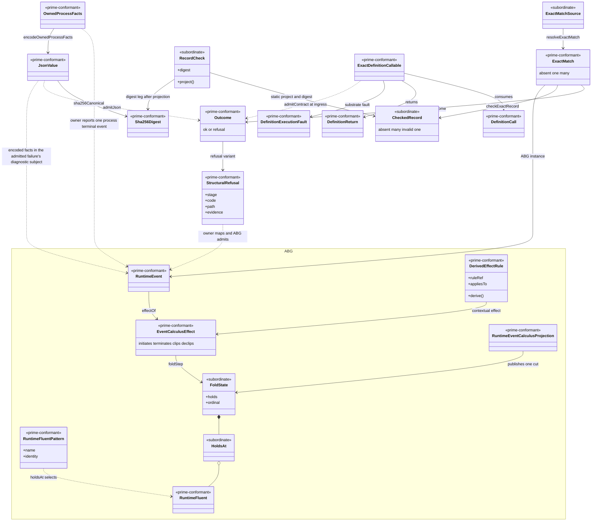
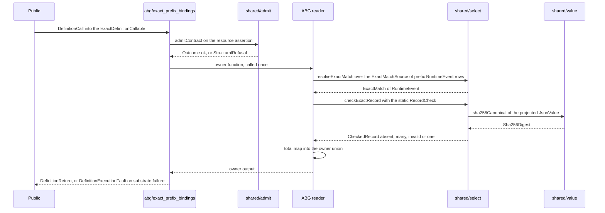
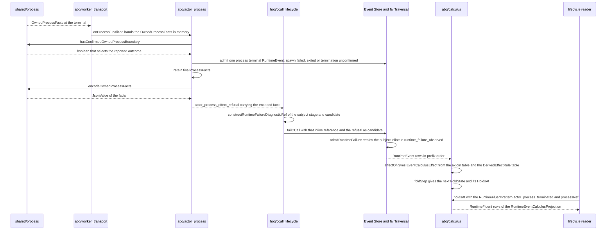
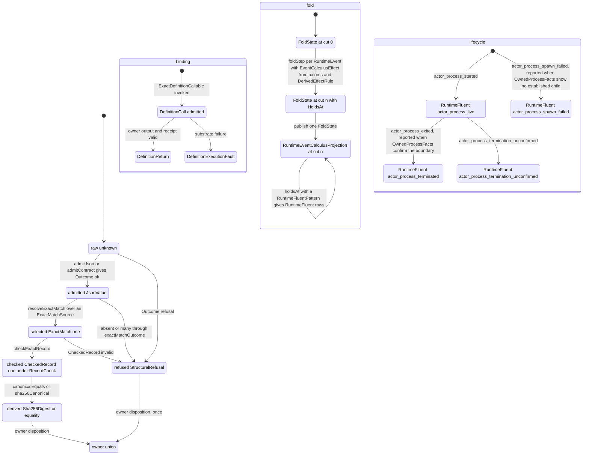
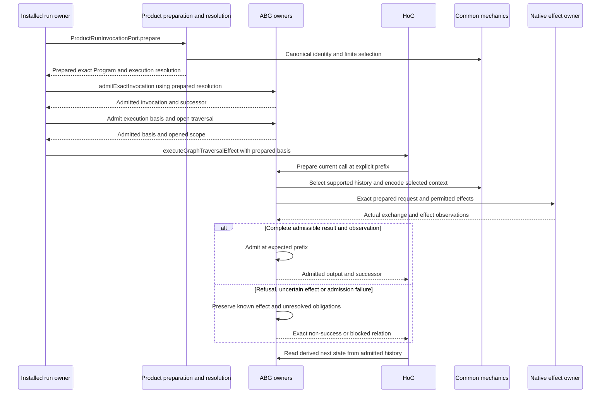
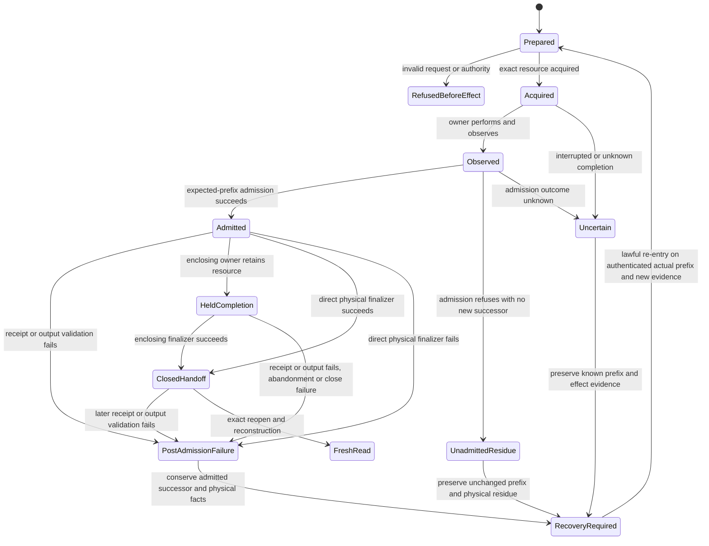

# ABIogenesis 5 Common Computational Capability Library

**Status:** active tenant design of the common computational library. Its decisions, change record and delivery evidence live in [T-287](../../../../.ai-workspace/tickets/active/T-287-deliver-abiogenesis-5-feature-waves.md).

**Selection:** the Product's [common-library prerequisite](../../../../specification/PRODUCT.md#common-computational-library-prerequisite) makes this library design the first ABG activity. The intended asset is a common computational basis from which features are composed, reducing independent solutions to equivalent computational problems. Explicit obligations determine what execution must establish; execution determines the actual outcomes.

**Authority:** [Product](../../../../specification/PRODUCT.md), [requirements](../../../../specification/requirements/README.md), the [project frame](ABI5_PROJECT_REFERENCE_FRAME_BASIS.md), [realization constitution](ABI5_REALIZATION_CONSTITUTION.md) and [computational binding](ABI5_STDO3_COMPUTATIONAL_BINDING.md). The exact method is `stdo://releases/v3.0.0-rc.1/`, manifest `069285ad5a79d59ca2dd835e34a54b3e537b0eeef99c29994b18c339dbe62232`, including [DESIGN_MODULE](stdo://releases/v3.0.0-rc.1/standards/DESIGN_MODULE.md), [SPEC_METHOD §11](stdo://releases/v3.0.0-rc.1/standards/SPEC_METHOD.md#11-build-tenant-binding) and [FOUNDATIONS](stdo://releases/v3.0.0-rc.1/standards/FOUNDATIONS.md). No companion or moving methodology source is selected.

## 1. Selected asset and Product boundary

The common library consists of the operator-family modules, carriers, atoms and static compositions specified below; §2 names their locations. Direct typed imports are the consumption mechanism. No new root barrel, package export, runtime catalog, dispatcher, resource framework or `runPipeline` is selected merely to give the library one name.

The design covers the intended common capability basis across all fifteen selected Product families. The present installation, preparation, history and continuation path is an initial consumer and proof discriminator, not the boundary of the library. Under [Product’s compression boundary](../../../../specification/PRODUCT.md#common-computational-library-prerequisite), release work resumes only after the selected library meets the delivery conditions that boundary names. The atom families of §4 are inside that selected deliverable; none is automatically deferred to 5.1. Optional pure-helper contraction outside the deliverable retains Product’s later allocation. This finite selection is not an unbounded all-helper sweep.

The following decisions are selected:

1. One admitted computational relation is reused across equivalent instances. A feature name or Public definition key does not justify another algorithm.
2. Canonical bytes, exact coordinate equality, finite selection and closed structural mechanics have canonical implementations. Owner predicates and result interpretation remain explicit.
3. Product declaration resolution, GTL construction, HoG traversal, ABG event resources/history and native effect owners remain reusable libraries in their existing domains. Their semantic relations are not reimplemented inside a generic helper.
4. Existing Effect 3.22.1, exact owner schemas and Node mechanics remain the admitted foundation composition. No material new dependency is selected.
5. §10.1 orders consumer retirement. §10.4 records the owner distinctions the library preserves.
6. Each retained implementation increment must name its consumer replacements and complete affected path. Default to the common implementation. A retained variant needs a concrete supported input/caller for which that implementation changes the required outcome, with owner, falsifier and disposition. Missing equivalence evidence remains an open obligation; it does not justify retention. Preserve equality, failure and admission domains until their owner explicitly decides a correction. Moving code or counting fewer functions does not establish reduced proliferation.

The [published default governance/lifecycle library](T287_DEFAULT_GOVERNANCE_LIBRARY_DESIGN.md) remains ordinary declared GTL GraphFunctions and Programs. Its Executive, induction, design, testing and UAT roles use this lower realization library through GTL/HoG/Product/ABG owners. They do not become low-level library primitives. Likewise [capability_contracts.ts](../code/src/shared/capability_contracts.ts) describes existing public definition capabilities; the module and atom names of this document are library exports, not additional DS1 capability rows.

### 1.1 Design boundary

- **Inside:** `code/src/shared/`; the pure atoms now private in `abg/`, `product/` and `hog/`; the fold interior of [event_calculus.ts](../code/src/abg/event_calculus.ts).
- **Outside:** HoG traversal, the GTL term algebra, Event Store append, Product install and verify, and the actor transport protocol. The library owns none of their decisions.
- **Requirements:** unchanged. The design realizes [EVENTS-018](../../../../specification/requirements/abg/REQ-R-ABG3-EVENTS.md) (declared Event Calculus effects), [PROJECTION-001, -002 and -013](../../../../specification/requirements/abg/REQ-R-ABG3-PROJECTION.md) (deterministic, incrementally maintained projection; `HoldsAt` derived by replay including derived-fluent rules), and the BINDING and PUBLIC-CONTRACTS requirements cited by [constitution §16.7](ABI5_REALIZATION_CONSTITUTION.md#167-t-287-static-definition-binding-compression-amendment-record). Product, including its [5.0 compression boundary](../../../../specification/PRODUCT.md#50-compression-boundary), is unchanged.
- **Constitution:** the library realizes the eight operator signatures of [§5.6.1](ABI5_REALIZATION_CONSTITUTION.md#561-closed-operator-algebra) and stays inside [§5.6.2C](ABI5_REALIZATION_CONSTITUTION.md#562c-operative-static-definition-binding-algebra). `bindStaticOwner`, `bindExactPrefixRead` and `bindExactPrefixTransition` remain the complete binding algebra. The library adds no fourth combinator, registry, callback, controller, mode selector or runtime. Its atoms are pure functions below the binders, which §5.6.2C permits: "Family modules may statically compose their own imported leaves before passing one typed owner function to a combinator".
- **Decision completeness:** §10.2 takes the material decisions of this boundary. §10.6 names, for each row of §10.1, the relations that remain unresolved, who decides each and when. A row whose unresolved set is empty evolves with its implementation and tests; any other row is design-gated on the relations it names.

## 2. Library organization and dependency direction

Each library module realizes one operator family of §5.6.1. The role column uses the module taxonomy of DESIGN_MODULE §9.

| Module | Operator family | Role | Imports | Effect class |
|---|---|---|---|---|
| `shared/refusal.ts` | carrier | carrier | `value` (types only) | pure |
| `shared/value/` | `derive` over `JsonValue` | semantic kernel | `refusal` | pure |
| `shared/admit/` | `validate` | ingress | `refusal`, `value` | pure; Valibot and jsonc-parser as foundations |
| `shared/select/` | `select` | semantic kernel | `refusal` | pure |
| `public/binding/` | lift at Public | effect boundary | `refusal`, `admit`, `shared/effect_definition.ts`, and the owner contract tables through the Public family | constructs Effect programs; runs one only in `runExactDefinition` |
| `shared/process/` | `materialize` facts, not the effect | effect boundary | `value` | Node child process and timers |
| `abg/calculus/` | `project`: the fold and `holdsAt` | semantic kernel, ABG-owned | `shared/*` | pure; a memoized class as realization |
| `abg/exact_prefix_bindings.ts` | lift of `admit` and `transition` | effect boundary, ABG-owned | `public/binding/`, `abg/event_store.ts` | Effect |

The dependency direction is one order; a module imports only modules to its left:

```text
refusal <- value <- admit <- select <- process <- abg/calculus <- owner contract tables <- public/binding <- owner definition-binding modules <- entrypoints
```

Owner contract tables live in owner directories and are data; owner definition-binding modules live in owner directories and are Public-surface compositions; the import-direction lint (`npm run lint:imports`) applies to `shared/`.

`shared/` imports nothing from `abg/`, `product/`, `hog/`, `gtl/`, `validator/` or `public/`. Three moves establish this direction:

1. `bindExactPrefixRead` and `bindExactPrefixTransition` move from [static_definition_bindings.ts](../code/src/public/binding/static_definition_bindings.ts) to `abg/exact_prefix_bindings.ts`.
2. [product/exact_match.ts](../code/src/product/exact_match.ts) moves to `shared/select/exact_match.ts`.
3. `shared/owner_contract_source_set.ts`, `shared/public_function_family.ts`, `shared/public_function_projections.ts`, `shared/definition_binding_mechanics.ts` and `shared/static_definition_bindings.ts` after move 1 move to `public/binding/`.

The location `product/exact_match.ts` that [constitution §10](ABI5_REALIZATION_CONSTITUTION.md#10-common-library-catalog) and [Table 5.6.3-B](ABI5_REALIZATION_CONSTITUTION.md#table-563-b---selected-leaf-instance-catalog) row `N06` give for exact-match cardinality is a realization coordinate, updated to `shared/select/exact_match.ts` when row 1 of §10.1 realizes move 2 (§10.7); the relation, role and prohibited role are unchanged.

The remaining operators stay with their owners. `traverse` stays in `hog/`. `admit` as append stays in [event_store.ts](../code/src/abg/event_store.ts). `transition` stays in its owner modules. `materialize` effects stay in Product install and verify and in ABG actor transport. The library never owns an owner decision ([FS-17](ABI5_REALIZATION_CONSTITUTION.md#55-axioms); the last prohibition of §5.6.2C).

Existing shared modules take these places:

- [canonical_json.ts](../code/src/shared/canonical_json.ts), [digests.ts](../code/src/shared/digests.ts) and [immutable.ts](../code/src/shared/immutable.ts) are the existing members of the `value` family.
- [i_json.ts](../code/src/shared/i_json.ts), [admission_predicates.ts](../code/src/shared/admission_predicates.ts) and [references.ts](../code/src/shared/references.ts) hold the bodies the `admit` family replaces.
- [effect_definition.ts](../code/src/shared/effect_definition.ts) is the `shared/` member of the `binding` family. Its other members are in `public/binding/`: [definition_binding_mechanics.ts](../code/src/public/binding/definition_binding_mechanics.ts), [static_definition_bindings.ts](../code/src/public/binding/static_definition_bindings.ts) after move 1, and the Public family modules that call admission reads, `owner_contract_source_set.ts`, `public_function_family.ts` and `public_function_projections.ts`.
- [owned_process_lifetime.ts](../code/src/shared/owned_process_lifetime.ts) is the `process` family.
- [rooted_topology_partition.ts](../code/src/shared/rooted_topology_partition.ts) is a `derive` atom over canonical root-to-frame paths. `deriveCanonicalRootedTopologyPartition(sourceWitness, targetWitness)` returns the preserved common prefix, the exits inner-to-outer and the entries outer-to-inner, or one of `invalid_witness | topology_mismatch | basis_mismatch | root_mismatch | adjacency_mismatch`. Cycles, multiple-parent causal search, cross-basis topology, retry policy and HoG route choice are outside its domain.
- The Public contract modules (`public_function_contracts.ts`, `public_invocation.ts`, `operation_definition_coordinate.ts`, `capability_contracts.ts`) and the `index.ts` barrel keep their roles, hold no atom of this design and obey the same import direction.

**Foundations.** Exact-pinned Effect 3.22.1 under [constitution §10.1.1](ABI5_REALIZATION_CONSTITUTION.md#1011-effect-3221-decision-ledger), Valibot, jsonc-parser and Node `crypto` and `child_process` are the admitted foundation composition. The library adds no dependency. A new parser, scheduler, runtime or package re-enters foundation selection (DESIGN_MODULE §5, Capability and foundation selection) before construction; incumbency alone selects nothing.

## 3. Irreducible carrier set

The library has one expected-failure carrier:

```ts
type StructuralRefusal = Readonly<{
  kind: "structural_refusal";
  stage: "validate" | "select" | "derive";
  code: string;             // closed per family, listed in §4
  path: readonly string[];  // JSON pointer segments where known
  evidence: Readonly<Record<string, JsonValue>>;
}>;
type Outcome<A> = Readonly<{ kind: "ok"; value: A }> | StructuralRefusal;
function ok<A>(value: A): Outcome<A>;
function refused(outcome: unknown): outcome is StructuralRefusal;
function andThen<A, B>(outcome: Outcome<A>, next: (value: A) => Outcome<B>): Outcome<B>;
```

The sequencing export is named `andThen`, not `then`, because a module namespace with an export named `then` is a thenable, so `import()` of the module never settles while static imports still work.

Admitted domain: the pure layer, `validate`, `select` and `derive`. Process facts reach the log as their owner's terminal event and, on a failure, inside the admitted failure's diagnostic subject, not through this carrier (§9.3). A `StructuralRefusal` carries no owner meaning ([FS-11](ABI5_REALIZATION_CONSTITUTION.md#55-axioms)). An owner maps it into its own union exactly once at the owner boundary. A binder maps the refusal of its own `admitContract` call to its existing resource or receipt fault (§4.5); no other `StructuralRefusal` crosses `DefinitionExecutionFault`. Defects keep `throw`; expected refusals never do.

| Carrier | Standing | Reason |
|---|---|---|
| `JsonValue` | prime | identity of every canonical comparison and digest |
| `Sha256Digest` | prime | identity of admitted bytes |
| `StructuralRefusal`, `Outcome<A>` | prime | the one expected-failure carrier of the library |
| `ExactMatch<T>` | prime | the `select` codomain: `absent`, `one`, `many` |
| `RuntimeEvent`, `RuntimeFluent`, `RuntimeFluentPattern`, `EventCalculusEffect`, `RuntimeEventCalculusProjection` | prime, ABG-owned | the [Event Calculus IACS](ABG_EVENT_CALCULUS_IACS.md); `EventCalculusEffect` is the type of its `RuntimeEventCalculusEffect` row; `RuntimeEventCalculusProjection` publishes one `FoldState` at a prefix cut and is the one prime name of the fold's result |
| `DerivedEffectRule` and its table `ROOT_DERIVED_RULES` | prime, ABG-owned | the realization of the IACS's `RuntimeDerivedFluentRule` |
| `OwnedProcessFacts` | prime | the one process-termination evidence carrier: observed once by its owner, handed in memory to the owner that reports it, reported once as one process terminal event and, on a failure, admitted once, encoded, as the failure's diagnostic subject; never re-observed, serialized beside the log or read back from a second store (§9) |
| `DefinitionCall`, `DefinitionReturn`, `ExactDefinitionCallable`, `DefinitionExecutionFault` | prime | the §5.6.2C ABI |
| `ExactMatchSource<T>`, `RecordCheck<E, P>`, `CheckedRecord<E, P>`, `FoldState`, `HoldsAt`, effect rows, `FoldState` internals (transition cache, probe and interruption facts) | subordinate | parameters or derived views: `FoldState` is the fold carrier behind `RuntimeEventCalculusProjection` and `HoldsAt` its map from fluent ref to `RuntimeFluent`; the promotion test fails for each: no independent identity, admission or lifecycle |

No table row adds a peer type.

**Lifecycle.** Library carriers are values: constructed, read and discarded. `foldStep` advances a `FoldState`; `forkAt` copies it at a cut; it is recomputed from the event log, never persisted as truth. `ROOT_EVENT_CALCULUS` and `ROOT_DERIVED_RULES` are declared at module construction and change only by design re-entry. `OwnedProcessFacts` is produced once per launch and handed in memory to its owner, which reports one process terminal event from it; on a failure, its encoding is admitted once with the failure (§9.3).

## 4. Atomic function families

Each family is one typed family with closed variants. The signatures instantiate §5.6.1. Counts are `grep` censuses over `code/src`; they identify retirement targets, not semantic coverage.

### 4.1 `validate`: `shared/admit/`

| Atom | Signature | Replaces | Codes |
|---|---|---|---|
| `isRecord` | `(value: unknown) => value is Readonly<Record<string, unknown>>` | 2 definitions, 32 inline bodies, 5 typed aliases in `admission_predicates.ts` | guard |
| `hasExactKeys` | `(value: object, keys: readonly string[]) => boolean` | 5 NUL-joined bodies | guard |
| `admitJson` | `(raw: unknown) => Outcome<JsonValue>` | the throwing path of `i_json.ts` for new callers | the seven `IJsonAdmissionFailureCode` values: duplicate key, invalid framing, invalid Unicode scalar, malformed JSON, non-finite number, non-I-JSON value, unsafe integral number |
| `admitContract` | `<T>(schema: v.GenericSchema<T, T>, raw: unknown) => Outcome<T>` | inline `v.safeParse` in the three binders and in owners | `contract_mismatch` with `path` |
| `admitRef` | `(value: unknown) => Outcome<string>` | the `requireRef` throw | `blank_ref` |

Ingress collapse (DESIGN_MODULE §3): `unknown` enters the pure layer only through this family. A `derive` or `select` export whose input is `unknown` is a defect of the library. `isRecord` refines only the outer shape; members stay `unknown` until their owner's schema narrows them. The throwing entry of `i_json.ts` is a lift over `admitJson` until retired (§10.2, D4).

### 4.2 `select`: `shared/select/`

| Atom | Signature | Replaces |
|---|---|---|
| `resolveExactMatch` | `<T>(values: ExactMatchSource<T>, predicate: (v: T) => boolean) => ExactMatch<T>` | existing, moved down; 213 inline `length === 1` sites migrate as touched |
| `exactMatchCardinality` | `(length: number) => "absent" \| "one" \| "many"` | the count decision for already selected arrays |
| `onlyExactMatch` | `<T>(selected: readonly T[]) => ExactMatch<T>` | 2 local `one()` helpers; returns the closed union, never `T \| null` |
| `exactMatchOutcome` | `<T>(match: ExactMatch<T>) => Outcome<T>` | lifts `absent` and `many` to `select` refusals for sequential composition |
| `checkExactRecord` | `<E, P>(match: ExactMatch<E>, check: RecordCheck<E, P>) => CheckedRecord<E, P>` | the private checked-record helpers; ABG instantiates `E = RuntimeEvent` for its 74 readers |

```ts
type RecordCheck<E, P> = Readonly<{
  project: (event: E) => Outcome<P>;
  digest: null | Readonly<{ expected: (event: E, value: P) => Sha256Digest; actual: (value: P) => Sha256Digest }>;
}>;
type CheckedRecord<E, P> =
  | Readonly<{ kind: "absent" }>
  | Readonly<{ kind: "many"; values: readonly E[] }>
  | Readonly<{ kind: "invalid"; event: E; reason: "record_projection" | "record_digest" }>
  | Readonly<{ kind: "one"; event: E; value: P }>;
```

`ExactMatch<T>` realizes the §5.6.1 `select` codomain: `one` is `exact`, `many` is `ambiguous`. Selection preserves every occurrence, predicate order and predicate exception; it has no early exit, deduplication, default or first-match substitution. `checkExactRecord` is `select`, then `validate`, then `derive`, composed once. The owner supplies `project` and `digest` as a module constant per reader, never as a runtime argument (§5.6.2C). The digest leg runs after projection (D2). Both malformed null-digest partitions, a non-record singleton and an unencodable record, yield `invalid`.

### 4.3 `derive`: `shared/value/`, domain `JsonValue` only

| Atom | Signature | Replaces |
|---|---|---|
| `canonicalJson`, `writeCanonicalJson` | existing | none |
| `canonicalEquals` | `(left: JsonValue, right: JsonValue) => boolean` | 12 `sameCanonical*` bodies and 39 inline comparisons |
| `sha256Canonical`, `sha256Bytes` | existing | none; the 57 inline digest comparisons stay as `===` on the branded string once ingress types their inputs |
| `writeCanonicalRecord` | `<T>(entries: readonly (readonly [string, T])[], writeMember: (member: T, key: string, sink: CanonicalJsonSink) => void, sink: CanonicalJsonSink) => void` | 3 hand-rolled record writers |
| `deepFreeze`, `isDeeplyFrozen` | existing | none |

Equality takes no encoder parameter: an `encode` argument would be a runtime-supplied function. Installed equality with an owner codec is `canonicalEquals(a, b)` after both sides pass `admitJson`. The two native composite comparisons are ingress questions, decided per site (D3), not equality variants. `writeCanonicalJson` and `writeCanonicalRecord` write to an explicit synchronous sink; a sink exception propagates after partial output and is not a complete encoding.

### 4.4 `project`: `abg/calculus/`, ABG-owned

```ts
type HoldsAt = ReadonlyMap<string, RuntimeFluent>;   // fluentRef -> fluent
type FoldState = Readonly<{ holds: HoldsAt; ordinal: number; /* transitions, probe and interruption facts */ }>;
type DerivedEffectRule = Readonly<{
  ruleRef: string;
  appliesTo: readonly RuntimeEvent["kind"][];
  derive: (state: FoldState, event: RuntimeEvent, dependencies: readonly RuntimeEvent[]) => EventCalculusEffect;
}>;
const ROOT_EVENT_CALCULUS: AxiomTable;                  // existing
const ROOT_DERIVED_RULES: readonly DerivedEffectRule[]; // terminal Run census, per-process cleanup, liveness, actor process lifecycle
function effectOf(state: FoldState, event: RuntimeEvent, dependencies: readonly RuntimeEvent[]): EventCalculusEffect; // pure, closed over both tables
function foldStep(state: FoldState, event: RuntimeEvent, dependencies: readonly RuntimeEvent[]): FoldState;           // pure, closed over both tables
function holdsAt(state: FoldState, pattern: RuntimeFluentPattern): readonly RuntimeFluent[];
```

The axiom table declares effects that depend only on the event kind. The rule table declares every contextual effect. Both are module constants; no caller supplies an axiom or a rule. `effectOf` and `foldStep` read both tables from their own module, so their exported signatures take no axiom or rule parameter. Each rule's `derive` is a module-owned function fixed when the table is declared, not a runtime-supplied callback ([FS-17](ABI5_REALIZATION_CONSTITUTION.md#55-axioms)); the constitution's typed Event Calculus projection admits closed module law and prohibits caller axioms ([§10](ABI5_REALIZATION_CONSTITUTION.md#10-common-library-catalog)).

`RuntimeEventCalculusDerivation` is the memoized realization of `foldStep`, with `forkAt`. Its `advance` is "for each event, state = foldStep(...)", with the class caching transitions. Agreement between the class and the pure fold is proof obligation P-FOLD, which is PROJECTION-002's live and cold agreement stated as a test.

`abg/replay.ts:1387` puts the held fluent set into the replay body. The body's digest is the replay state witness, stored as `replayStateDigest` in route and judgment payloads and as `sourceReplayDigest` in the invocation source-result basis. The witness states derived state under the calculus law in force when the route or judgment is proposed, so a law change under D1 moves it at every cut that change affects. Every comparison of the witness in `code/src` (`abg/traversal_route.ts:4438` and `:5371`, `abg/c_call.ts:7047`) checks a proposal built in the same transaction against the current replay; both values are computed in that transaction under the same law. No admission, reopen or cold-replay path compares a stored witness with a recomputation, so a stored witness is never re-read against a new law, and a route or judgment admitted under a prior law is neither re-admitted nor re-checked. History reopens unchanged after a law change under D1, and no prior law is retained.

The rule `actor_process_lifecycle` decides the Actor, Process and Run lifecycle for one actor invocation. Its inputs are admitted events only; it takes no `OwnedProcessFacts`. The owner reports exactly one process terminal event from its facts (§4.6), and the rule folds that event. The inputs: `S`, the process started (`actor_process_started`); `T`, a process terminal (`actor_process_exited` or `actor_process_spawn_failed`); `U`, termination unconfirmed (`actor_process_termination_unconfirmed`); `G`, a signal requested (`actor_process_signal_requested`); `O`, a timeout observed (`actor_process_timeout_observed`); `A`, an actor terminal (`actor_invocation_closed` or `actor_invocation_failed`); `R`, the matching Run's terminal. `G` and `O` carry the facts from which the fold derives `signalSequence` and `timedOut` (D5). Its formulas:

```text
processLive            = S and not T
terminationUnconfirmed = not T and U
cleanupPending         = not A and (T or U or (R and formerlyActiveActor))
```

`formerlyActiveActor` holds when the invocation's actor is in the matching Run's census of actors for which `actor_process_active` or `actor_process_live` held. The cleanup token frontier is the matching Run stop. The rule initiates `actor_process_terminated(processRef)` from `actor_process_exited`, which the owner reports only for a confirmed boundary after an admitted start (`abg/actor_process.ts:1318`). Two existing derivations are its falsification cases: counterexample A, the cleanup reading in `abg/actor_process.ts` at line 631, and counterexample B, the terminal Run census in `abg/event_calculus.ts` at line 1909, which counts only processes still live. The unconditional `actor_cleanup_pending` initiation in the axiom table (`abg/event_calculus.ts`, line 258) moves into the rule, which can see whether a process was ever started. The axiom entries that initiate or terminate `actor_process_live` and that initiate `actor_process_termination_unconfirmed` (`abg/event_calculus.ts`, lines 222 to 258) move into the rule with it, so each lifecycle fluent has one producer.

The lifecycle fluents are closed: `actor_process_spawn_failed`, from the axiom table, and `actor_process_live`, `actor_process_terminated`, `actor_process_termination_unconfirmed` and `actor_cleanup_pending`, from this rule. A lifecycle question asks whether one of these fluents holds for one process or actor invocation.

The rule also checks the copied `terminationConfirmed` against `actor_process_terminated` at the same cut. The copy is in `actor_result_artifact_observed` and in `c_call_evidenced` with evidence class `probabilistic_transport` (`abg/event_store.ts:301`, `:732`); these events are checked inputs, not decision inputs. The fluent wins. A disagreement initiates the diagnostic fluent `terminationConfirmed_copy_disagrees(processRef)`. No prefix is refused for it, so existing history reopens unchanged.

The rule produces fluents inside the one fold. `actor_process.ts`, `replay.ts`, `runtime_liveness.ts` and every other reader of a lifecycle fact read them through `holdsAt`, with a pattern `{ kind: "runtime_fluent_pattern", name, identity }` that names one lifecycle fluent. Four consumers that had to agree become one producer and its readers, as PROJECTION-013 requires.

### 4.5 Lift: `public/binding/`

`bindStaticOwner` lives in `public/binding/`, and `runExactDefinition` and `runEffectProgram` in `shared/effect_definition.ts`; all three keep their fault surface. `bindStaticOwner` consumes `admitContract` in place of inline `v.safeParse`. It maps a refused resource assertion to its existing `invalid_resource_assertion` fault and a refused receipt to its existing `invalid_resource_receipt` fault ([static_definition_bindings.ts](../code/src/public/binding/static_definition_bindings.ts), lines 47 to 58 and 66 to 77). The inner predicate changes; the faults a caller observes do not. `bindExactPrefixRead` and `bindExactPrefixTransition` live in `abg/exact_prefix_bindings.ts` and specialize `bindStaticOwner` as §5.6.2C states. Each binder is higher-order only at module construction; every captured owner function, schema and packet is a direct import. Exactly one `Effect.run*` site exists.

### 4.6 Process facts: `shared/process/`

`createOwnedProcessLifetime` and `OwnedProcessFacts` are the existing physical mechanism for worker, command and HTTP progression, probing, bounded confirmation and drain. The family adds three pure functions:

```ts
function hasConfirmedOwnedProcessBoundary(facts: OwnedProcessFacts): boolean;
// facts.scopeAbsence === "absent" && facts.directExit !== null
function classifyOwnedProcessTerminal(facts: OwnedProcessFacts): "spawn_failed" | "exited" | "unconfirmed";
// "spawn_failed" when facts.scopeAbsence === "absent", facts.noChildEstablished and facts.launchFailure !== null;
// otherwise "exited" when hasConfirmedOwnedProcessBoundary(facts); otherwise "unconfirmed"
function encodeOwnedProcessFacts(facts: OwnedProcessFacts): JsonValue;
```

The owner of a process boundary reports exactly one of three terminal outcomes from its facts, once:

- a spawn failure when no child was established (`scopeAbsence` is `"absent"`, `noChildEstablished` holds and `launchFailure` is set);
- an exit when `hasConfirmedOwnedProcessBoundary` holds after an admitted start;
- termination unconfirmed otherwise.

`classifyOwnedProcessTerminal` is that three-outcome report. The worker owner and the command and HTTP adapters branch on it, so no adapter keeps its own formula. The worker owner reports the outcomes as `actor_process_spawn_failed`, `actor_process_exited` with `status` and `signal`, and `actor_process_termination_unconfirmed` (`abg/actor_process.ts:1323-1340`); a spawn failure after an admitted start, and an exit or unconfirmed termination without one, are defects. The command and HTTP adapters report the same three outcomes in their result (§9.3): on the helper route `terminationConfirmed` is `classifyOwnedProcessTerminal(facts) !== "unconfirmed"`. A spawn failure has no child to clean up, so it reports `terminationConfirmed: true` with status 127; a group probed absent without an observed exit reports `unconfirmed`. `hasConfirmedOwnedProcessBoundary` is the one test for "the owned process is gone" at the physical observation. A launch with no established child is never a confirmed boundary. The classification selects which outcome the owner reports; it is not a lifecycle read, which only `holdsAt` answers (§9.1).

The remaining members of the facts (`firstError`, `launchFailure`, `cleanupElapsedMs`, `probeCount`, `signalAttempts`, `closeObserved`, `streamsDisposed`, `drainExpired`) are attribution evidence. `encodeOwnedProcessFacts` is the one encoding of the facts as admitted evidence, used by every route (§9.3). `OwnedProcessFacts` is not JSON: `launchFailure` and `firstError` are `Error`, and `cleanupDeadlineNs` is `bigint`. The encoding has one fixed form:

- every member of `OwnedProcessFacts` keeps its name;
- an `Error` becomes `{ name, message, code, errno, syscall, path }`, each member a string or `null`; `stack` is omitted, because it is unbounded and not canonical;
- the `bigint` becomes `{ "kind": "bigint", "value": "<base-10 digits>" }`;
- `null` stays `null`; booleans, numbers and strings pass through.

The lifetime hands its terminal facts in memory to the owner that reports them; it neither throws nor writes them. Protocol, timeout and result policies stay with each adapter. The family creates no scheduler, retry policy or process authority.

The lifetime's closed material cases:

| Case | Required mechanical distinction | Owner consequence |
|---|---|---|
| Launch refused or failed with no established child | Preserve launch evidence; do not invent an exit or process identity. | No completed work result follows; any known residue remains attributable. |
| POSIX owned process group | Launcher exit or pipe close is distinct from evidence that the owned group is absent. | Confirmed termination requires the selected group and exit relation; still assess performed work. |
| Windows owned child | Use the supported child-completion contract and identify its scope. | Do not relabel child completion as POSIX group absence or unproved descendant termination. |
| Absolute or inactivity deadline, or cancellation | Preserve the triggering cause, the ordered TERM, grace and KILL requests and their actual outcomes. | Timeout or a signal request does not prove termination, rollback or nonperformance. |
| Confirmation, drain, probe or observer failure | Return uncertainty and any known exit, output and signal facts; release known local handles and timers as permitted. | Preserve the cleanup obligation; withdraw dependent currentness when post-effect state is unknown. |
| Process terminated, output missing or invalid, or semantic assessment negative | Preserve termination and output or effect evidence as separate facts. | Reobserve the affected worksite; refuse or unresolve the result as the existing owner requires. |

## 5. Higher-order composition with laws

| Category | Library combinator | Laws | Owner of anything beyond |
|---|---|---|---|
| unit, lift | `ok`, `exactMatchOutcome`; `Effect.succeed` at the binder | `andThen(ok(a), f) = f(a)` | none |
| sequential | `andThen`, Kleisli composition over `Outcome` | associative: `andThen(andThen(o, f), g) = andThen(o, a => andThen(f(a), g))`; refusal-absorbing: `andThen(r, f) = r` for every refusal `r`; identity: `andThen(o, ok) = o` | Effect `flatMap` for the lifted layer, existing |
| parallel, applicative | none | none | `C.batch`, graph fan-out and fan-in |
| fold | `foldStep` | `fold(L ++ s) = foldStep*(fold(L), s)`; cold equals warm at the same cut | ABG |
| retry, recovery | none | none | `C.retry`, the HoG retry lifecycle |
| recursion, fixed point | none | none | `workflow.C`, the HoG recursion lifecycle |
| projection | `holdsAt`, `checkExactRecord` | read-only: no outcome of a projection is an admission | ABG and Product owners |

Authority law for every row: a composed function has no more authority than its inputs and constituents (FS-11; DESIGN_MODULE §5, Authority model). Nothing here reads a prefix, appends an event, selects a target or decides a continuation. The [seven C constructors](../../../../specification/requirements/gtl/REQ-L-GTL3-C-ALGEBRA.md) keep their GTL and HoG owners; the library adds no constructor and no traversal algorithm.

Falsifier for the sequential row: an `andThen` whose refusal branch is not the identity. Falsifier for the fold row: an admitted prefix split `L ++ s` where `fold(L ++ s)` and `foldStep*(fold(L), s)` differ, or a cut where cold replay and the warm fork differ.

## 6. Prime atoms, admitted domains, falsifiers

| Atom | Admitted domain | Falsifier |
|---|---|---|
| `canonicalEquals` | two `JsonValue`s: finite numbers, `-0` as `0`, keys sorted by code unit | equal under RFC 8785 and false, or unequal and true |
| `sha256Canonical` | `JsonValue` | digest differs from the hash of the `canonicalJson(v)` bytes |
| `isRecord` | `unknown` | a non-null, non-array object returning false |
| `hasExactKeys` | own enumerable string keys against a key list | sets equal under code-unit order and false; or a NUL-containing key colliding |
| `admitJson` | `unknown` | an I-JSON value refused, or a non-I-JSON value admitted |
| `admitContract` | `unknown` with a strict Valibot schema | `safeParse` success with refusal, or failure with `ok` |
| `resolveExactMatch` | finite source and total predicate | cardinality disagreeing with the filter length |
| `checkExactRecord` | `ExactMatch<E>` with a static `RecordCheck` | `one` when `project` refused or the digests differ |
| `effectOf`, `foldStep` | an admitted event in prefix order with its declared dependencies | a prefix split where the fold law of §5 fails; a cut where cold replay and the warm fork differ; or an effect differing from the expected-effect table of counterexample A or B (§4.4) |
| `holdsAt` | a `FoldState` at an admitted prefix cut and a pattern `{ kind: "runtime_fluent_pattern", name, identity }` | any module outside `abg/calculus/` that decides one of the lifecycle fluents of §4.4 (`actor_process_spawn_failed`, `actor_process_live`, `actor_process_terminated`, `actor_process_termination_unconfirmed`, `actor_cleanup_pending`) from a copied payload field, from the presence of an event kind in a prefix, from its own recomputation over the log or from a second store, instead of calling `holdsAt` with a pattern naming that fluent; the owner's report of a terminal outcome from its physical observation (§4.6) is not such a reader |
| `encodeOwnedProcessFacts` | `OwnedProcessFacts` from one lifetime | a member renamed or dropped; an `Error` encoded other than as `{ name, message, code, errno, syscall, path }` with string or `null` members; a `stack` member present; a `bigint` encoded other than as `{ "kind": "bigint", "value": "<base-10 digits>" }`; a changed `null`; or a second encoding of the facts in any adapter |
| `andThen` | any `Outcome` | the laws in §5 |

Whole-family Prime contraction. No atom duplicates another's domain: digest comparison is native `===` on a branded string and is not an atom. No atom adds an authority centre: all are pure and read nothing. `holdsAt` is the only admitted reader of "is this actor process gone"; for a helper-run process the answer is a projection of its admitted leaf result or failure (§9.3). The atoms in this table replace roughly 400 private bodies by census.

## 7. Three views

The three views name the same twenty-one carriers, the named rows of §3: `JsonValue`, `Sha256Digest`, `StructuralRefusal`, `Outcome`, `ExactMatch`, `ExactMatchSource`, `RecordCheck`, `CheckedRecord`, `RuntimeEvent`, `RuntimeFluent`, `RuntimeFluentPattern`, `EventCalculusEffect`, `RuntimeEventCalculusProjection`, `DerivedEffectRule`, `FoldState`, `HoldsAt`, `OwnedProcessFacts`, `ExactDefinitionCallable`, `DefinitionCall`, `DefinitionReturn`, `DefinitionExecutionFault`. No view adds a carrier the others lack. Effect rows and the `FoldState` internals are unnamed subordinate parts and are not drawn. The domain view uses the standard stereotypes `prime-conformant` and `subordinate` (DESIGN_MODULE §7, Domain model) and places the ABG-owned carriers in the `ABG` namespace.

### Domain view



### Sequence view

One checked-record read through a prefix-read binding:



One process failure recovered from the log (§9):



### State view



The views carry the same carriers and transitions. The cross-view axiom matrix is the design-gate owner's to run.

## 8. Three accounts per family

| Family | Algorithmic | Informational | Computational |
|---|---|---|---|
| derive | one canonical traversal (`writeCanonicalJson`); a hash over its parts | RFC 8785 equality on `JsonValue`; a digest identifies admitted bytes | linear in value size; equality may stream both sides to one comparator without a second string, proved byte-equal by P-EQUAL |
| validate | jsonc-parser tree walk; Valibot `safeParse`; own-key sort | the ingress contract: what the owner may assume afterwards | linear; foreign input parsed once |
| select | one filter or one indexed lookup | cardinality before value; no first-match authority | full filter or preselected count, declared per call |
| project | pure fold step; a memoized class with `forkAt` | `HoldsAt` is the only current truth; rules are declared law | incremental suffix fold; cold equals warm (P-FOLD); selected body views are transient and released after the consumer |
| lift | three binders; one runner | refusals are owner values; faults are substrate | one Effect program per Public call; no nested runner |
| process | one lifetime per launched process; deadline, grace, drain | termination evidence with uncertainty preserved | Node child process and timers; handles released on every path |

## 9. Recovery from the event log

### 9.1 The law

A runtime fact passes through three layers, and the law differs per layer:

1. **Physical observation.** A process boundary is observed once, by its owner (`createOwnedProcessLifetime`), into immutable `OwnedProcessFacts`. The owner hands those facts in memory to the actor that admits them. That handoff is permitted and required. Re-observing, serializing or re-reading the facts inside the program is not.
2. **Admission.** The owner admits the observation as one process terminal event (`actor_process_spawn_failed`, `actor_process_exited` or `actor_process_termination_unconfirmed`) on the success and the failure path alike. On a failure, the encoded facts are admitted with the failure as its diagnostic subject (§9.3). Admission is the only point at which an observation becomes history in the admitted log `L`.
3. **Derived state.** Lifecycle questions about actor processes, over the fluents §4.4 closes, and Run questions such as whether a Run may close, are answered from the fold of `L` through `holdsAt`. Helper-run processes have no actor-process fluents; their lifecycle question is a projection of the admitted leaf result or failure subject (§9.3 item 4). Derived state is never recomputed from copied payload fields and never read from a second store. `holdsAt` answers admitted questions only; it does not replace the physical observation of layer 1.

What is forbidden is a second store of observations, written by one interface and read back by another as evidence or truth without a binding in `L`. A failure file beside the attempt archive, with an inspector that reads it back, is such a store. Its only justification is the case where admission itself fails, a store-failure model the owner has not selected. An artifact bound by its digest in `L` and read back for verification against that digest is referenced evidence, part of `recover(P, L, referencedEvidence)` below, and is permitted.

The law realizes Product's [live-state law](../../../../specification/PRODUCT.md#live-state-recovery-and-valid-reuse):

```text
L_next = L ++ newlyCommittedEvents
S_next = foldStep(S, newlyCommittedEvents)
recover(P, L, referencedEvidence) == committedRuntimeState(S)
```

Product permits layer 1 and binds layer 3: "Ordinary internal handoffs use its established state; they do not reconstruct or reauthenticate the accumulated history merely because control crosses a function or role boundary", and "Derived state is discardable and reproducible from the one admitted history; it is never an independent authority." A5-F10 binds the same: "replay, not caller memory, derives the result, next execution state, and explanation of workspace change." [Constitution §4.1](ABI5_REALIZATION_CONSTITUTION.md#41-distribution-and-risk-proportionality) binds the realization the same way: internal program interfaces preserve coherent immutable state and applicable owner-established facts, crossing a function, module or role boundary alone introduces no serialization or historical reconstruction obligation, and machinery whose sole justification is an unselected deployment or threat model is removed. [FS-13](ABI5_REALIZATION_CONSTITUTION.md#55-axioms) states the reconstruction consequence: "Process-local objects may be evidence but not required authority."

A transport file across a real spawn boundary is lawful: the helper child's `task.json`, `launch.json` and `result.json` cross a process boundary, the parent reads each once and admits it, and no second consumer reads it back as truth.

### 9.2 Worked example: process termination

The fact "the child process is gone" is the `actor_process_lifecycle` rule's fluent `actor_process_terminated(processRef)`. The log carries its primitive events: the one process terminal event the owner reports (`actor_process_spawn_failed`, `actor_process_exited` or `actor_process_termination_unconfirmed`), the signal and timeout events, and the actor terminal. The rule initiates the fluent from `actor_process_exited`, which the owner reports only for a confirmed boundary after start. Every reader calls `holdsAt(state, { kind: "runtime_fluent_pattern", name: "actor_process_terminated", identity: processRef })`. The boolean field `terminationConfirmed` stays in the event payloads and result artifacts that record it. The rule checks it against the fluent at fold time: the fluent wins, a disagreement is recorded as `terminationConfirmed_copy_disagrees(processRef)`, and no prefix is refused (§4.4). No reader consumes the field (D5).

The current realization holds the same fact in four forms:

1. Computed at the edge with two formulas: `abg/worker_transport.ts:461` and the owner's report at `abg/actor_process.ts:1318` (`scopeAbsence === "absent" && directExit !== null`); `implementation/worksite_command_helper.ts:769` and `:1136` (`scopeAbsence === "absent"`).
2. Copied interface to interface as a boolean field: `worker_transport.ts:598` and `:630` into the transport observation; `abg/actor_process.ts:1149` into the actor observation that becomes an event payload (`abg/event_store.ts:301` and `:732` list the field); `abg/c_call.ts:2033`, `:2100`, `:3842` and `:6708` into the classified observation and the result artifact; `c_call.ts:6607` requires the copy to equal `exitObserved`. On the helper route the Product command-result contract declares, lists, validates and copies the field (`product/worksite_command_execution.ts:529`, `:1694`, `:1710` and `:1730`), as do `implementation/contracts.ts:92` and `validator/qualification_contracts.ts:389`.
3. Derived from the log outside the fold: `abg/replay.ts:2444` sets it from the presence of `actor_process_exited`. That kind already records the confirmed boundary, so the answer is the fluent's, computed outside `abg/calculus/`.
4. Consumed from the copies: `abg/transport_contracts.ts:71` and `:76`, `abg/worksite_construction_recovery.ts:228` and `:262`, and `validator/qualification.ts:52`; on the helper route, the helper's command and HTTP cleanup checks (`implementation/worksite_command_helper.ts:1380` and `:1395`). `abg/invocation_admission.ts:512` consumes form 3 through replay's projection (`abg/replay.ts:2392`).

Row 6 of §10.1 replaces form 1 with `hasConfirmedOwnedProcessBoundary`, form 3 with the rule, and form 4 and the comparison at `c_call.ts:6607` with `holdsAt`. Of form 2, the field stays where it is recorded, as the copy the rule checks, until its retirement (D5).

`exitObserved`, `timedOut` and `signalSequence` sit beside `terminationConfirmed` in the same payloads; each follows `terminationConfirmed` where the fold derives it (D5).

### 9.3 Process failure facts

An actor process reaches `L` through its owner's terminal event and, on a failure, through the admitted failure's diagnostic subject:

1. The worker transport hands the final `OwnedProcessFacts` to the actor through `onProcessFinalized` (`abg/worker_transport.ts:455`). Inside that callback the owner reports exactly one process terminal event (§4.6; `abg/actor_process.ts:1312-1328`), so the event the lifecycle rule folds is in `L` on the success and the failure path alike. The actor retains the facts as `finalProcessFacts` (`abg/actor_process.ts:1306`).
2. Every refusal after finalization carries the retained facts: the carrier refusal (`abg/actor_process.ts:1374`) and the refusal of the outer catch (`:1417`), which sees `finalProcessFacts` because the actor declares it before the outer `try`. `refuseActorProcessEffect` takes the encoded facts as its fifth parameter, and the refusal carries them as member `processFacts` (`JsonValue | null`): `encodeOwnedProcessFacts(finalProcessFacts)`, or `null` when no facts were handed back, as on the two invocation refusals before launch. Its own `diagnosticRef` stays the class reference `diagnostic://abiogenesis/actor-process/<code>@5`.
3. The refusal reaches `failCCall` (`hog/ccall_lifecycle.ts:557`, through `failActorProcessEffect` at `:231-239`) as the candidate. At that branch the C-call passes, as the diagnostic reference, `constructRuntimeFailureDiagnosticRef({ stage, candidate: refusal })` (`abg/runtime_failure.ts:84`). `stage` is `leaf-effect-<ordinal>`, the string `failCCall` passes unchanged to `failTraversal`, so the reference encodes the exact subject `failTraversal` admits, `{ stage, candidate }` (`hog/traversal_failure.ts:87`). `admitRuntimeFailure` retains a `data:` reference only when it decodes to that subject (`abg/runtime_failure.ts:239-241`, `:100-105`), and the evidence projection checks it again (`:127`). A reference that encodes the facts alone fails that check. The retained subject is the refusal with its `processFacts`, so the encoded facts are in `L` inline, in the admitted `runtime_failure_observed`. No reader keys on the class reference: in the tracked `code/src` and `test_env` sources, `diagnostic://abiogenesis/actor-process` occurs only in `refuseActorProcessEffect`.
4. Helper-run processes, the command and HTTP processes of `implementation/worksite_command_helper.ts`, run inside the helper child and have no `actor_process_*` events. Their facts, encoded once by `encodeOwnedProcessFacts`, enter `L` as members of the admitted leaf result (`result.json`, read once by the parent and admitted by `c_call_result_admitted`) or of the admitted failure's diagnostic subject. Their lifecycle question is answered by projecting that admitted event, not by `holdsAt`.
5. If `admitRuntimeFailure` itself throws (`abg/runtime_failure.ts:237`, `:281`), the facts are lost with the Run's failure and the physical state stays unknown. Nothing changes on that path, and nothing is written beside `L`.
6. Failure inspection is a composition of existing projections; no dedicated inspector exists. For an actor process it is `holdsAt` over the prefix for its lifecycle fluents, with `projectRuntimeFailureEvidenceAtPrefix` (`abg/runtime_failure.ts:112`) for the encoded facts on a refusal (item 3) or the transport artifact at its admitted digest for the encoded facts on a receipt (item 7). For a helper-run process it is the admitted leaf result or failure subject (item 4). It reads no file other than that digest-bound artifact. `process-failure.json` is not used.
7. When the carrier admits a reported outcome as a receipt, an exit or a no-child launch failure that reaches `admitTransportArtifact` (`abg/actor_process.ts:1121`), the encoded facts enter referenced evidence as member `processFacts` of the transport artifact `${label}-transport.json`. The worker transport writes that artifact (`abg/worker_transport.ts:643`), and the admitted `actor_result_artifact_observed` binds its digest as `transportDigest` and `artifactDigests.transport`. The observation event payload is unchanged. Reconstruction (`abg/worksite_construction_recovery.ts:284`) verifies the member against the bound digest as it verifies the rest of the artifact, and checks it against the artifact's exit.

### 9.4 Open instance: held suspensions

`HeldWorkflowSuspension` (`hog/traversal_completion.ts`), `HeldRecursionSuspension` and the `HeldParentTraversalSuspension[]` input of `rehydrateParentReturnFrames` (`hog/parent_rehydration.ts`) carry `parentGraph`, `parentClosureContract`, `parentCCall`, `parentGraphInput`, `parentInput` and `childInput` as in-memory copies across a hold, and `rehydrateParentReturnFrames` rebuilds the return frames from those copies. Under §9.1, holding established state in memory across an internal handoff is permitted, and rebuilding derived state from copies instead of the fold is not. Which of the two a return frame is depends on whether the hold crosses a recovery boundary and whether `application` and `sourceCursor` are recoverable from events. Neither is yet traced, so this instance has its own design re-entry after row 5 of §10.1.

## 10. Retirement order, decisions and proofs

### 10.1 Retirement order

| Row | Change | Retires (census) | Depends on |
|---|---|---|---|
| 1 | `shared/refusal.ts`; the three moves of §2 | the three upward imports | nothing |
| 2 | `shared/admit/`: `isRecord`, `hasExactKeys`, `admitJson`, `admitContract`, `admitRef` | 5 NUL-joined bodies, 5 typed record aliases, 32 inline guards as touched, inline `v.safeParse` in `bindStaticOwner` | nothing |
| 3 | `shared/value/`: `canonicalEquals`, `writeCanonicalRecord` | 12 `sameCanonical*` bodies, 39 inline comparisons, 3 record writers | row 2, for ingress of `unknown` comparands |
| 4 | `shared/select/`: `exactMatchCardinality`, `onlyExactMatch`, `exactMatchOutcome`, `checkExactRecord` | 2 local `one()` helpers, the private checked-record helpers, then the private algorithms of the 74 readers | row 1 |
| 5 | `abg/calculus/`: `effectOf`, `foldStep`, `holdsAt`, `ROOT_DERIVED_RULES` with its four rules; `advance` rewritten over `foldStep` | the inline census, cleanup and liveness branches in `advance`; the lifecycle re-derivations in `actor_process.ts`, `replay.ts` and `runtime_liveness.ts`; every reader of a copied lifecycle field | D1 |
| 6 | `shared/process/`: `hasConfirmedOwnedProcessBoundary`, `encodeOwnedProcessFacts`; the worker owner and the command and HTTP adapters report the three terminal outcomes through the predicate; every actor refusal after finalization carries the encoded facts, and the C-call failure branch admits them inline as the diagnostic subject (§9.3); the helper adapters carry them in the admitted leaf result or failure subject; every actor-process lifecycle reader on `holdsAt` | the divergent scope-absence reading in command and HTTP; the refusals that drop the retained facts; every read of `terminationConfirmed` and its derivable siblings outside the rule, and the derivation at `replay.ts:2444`; the fields stay recorded (D5) | row 5, D5 |

Rows 1 to 4 and 6 are each one `realization_refactor` under this design. Row 5 moves contextual effects from `advance` into the declared rule table and is a `design_reframe` of the Event Calculus realization. Rows 1 to 4 remove bodies and add only the atoms of §4; row 5 removes four lifecycle derivations and adds one table. §10.6 states which rows co-evolve and which are design-gated.

### 10.2 Decisions

- **D0, process failure facts.** The owner reports one process terminal event from its facts. On a failure, the encoded facts enter `L` as the admitted failure's diagnostic subject, by the route of §9.3 and under the layers of §9.1. The facts pass in memory only from their observer to the owner that reports them. If the failure's admission fails, the facts are lost with the Run's failure. No failure file is written beside the attempt archive, and no inspector reads one back.
- **D1, contextual effects.** `ROOT_DERIVED_RULES` carries every contextual Event Calculus effect: the terminal Run census, per-process cleanup, liveness and the actor process lifecycle. `advance` holds no contextual branch. This realizes the IACS's `RuntimeDerivedFluentRule`.
- **D2, digest order.** The digest leg of `checkExactRecord` runs after projection: `expected(event, value)` and `actual(value)` consume the projected value.
- **D3, composite comparisons.** The two native composite comparisons are ingress questions, not equality variants: no equality variant or encoder parameter exists for them. Each is decided at its own ingress site when row 2 or row 3 of §10.1 realizes that site: its owner admits each side to `JsonValue` through `admitContract` or `admitJson`, or refuses. The decision is recorded with that site's change; D3 does not close O-TYPE as a whole.
- **D4, throwing I-JSON entry.** The throwing entry of `i_json.ts` is a lift over `admitJson` (admit, then throw on refusal) until no caller remains; it is then retired. New callers use `admitJson`.
- **D5, payload copies.** `terminationConfirmed` stays in `actor_*` event payloads and in the result artifacts that record it. The `actor_process_lifecycle` rule derives `actor_process_terminated` and checks the copied field against it at fold time; the fluent wins, a disagreement initiates `terminationConfirmed_copy_disagrees(processRef)`, and no prefix is refused. Every reader uses `holdsAt`. Retiring the field is an obligation of the next root event contract profile change, because the store recognizes exactly two contract digests, the legacy and the current (`abg/event_store.ts:1189`), and reopening rejects any stamp other than the current digest (`:3608`). `exitObserved`, `timedOut` and `signalSequence` follow `terminationConfirmed` where the fold derives them.

### 10.3 Owner obligations

| Obligation | Required owner decision and affected proof |
|---|---|
| O-TYPE | Decided per site under D3: at each site, equality comparands are typed `JsonValue` from ingress, with no moved casts, omitted data or unproved `JsonValue` intersections, and the site's answer is recorded with its change. Strict compile-negative lazy-view and function-member cases remain rejected. |
| O-RESOURCE | The seven self-comparison encodability probes and unknown `requiredSlot` or coordinate inputs require existing checked data or resource and handle premises, preserving absent, false, null and error outcomes. An equality probe is not admission. |
| O-SHAPE | Shallow guard bodies retired into `isRecord` and the seven shape-wrapper consumers preserve unknown members until the actual schema or member owner narrows them. No recursive validator runs at each read. |
| O-CODEC | Restored unknown event bodies remain for later Event Store validation; truthful parser and data types do not move event admission into a shallow check. |
| O-SCHEMA | The default-library shallow custom JSON schema and the nullable project-read adapter need an actual ingress or refusal decision. The concrete collided-key refusal is selected; it does not close broader JSON membership. No blanket stricter I-JSON policy. |
| O-KEY | Each NUL-joined body retired into `hasExactKeys` binds its owner's valid, collided and noncollided outcomes and actual refusal. For `product/default_library.exactKeys`, valid existing results remain true and the collided or inherited `basis`/`judgment` form is rejected. |
| E04 | Outside the library: a new parser or filesystem traversal capability needs exact node, path, link, partial-write and archive-domain foundation and cost evidence. The Product payload inventory and the execution-root inventory remain distinct contracts. |

### 10.4 Owner distinctions the library preserves

| Subject | Distinction and preservation obligation |
|---|---|
| Product declaration closure (`product/declaration_closure.ts::locateRequired`) | `select` may decide eligible multiplicity; `all.length === 0 → absent`, and no eligible result → `missing_dependency`, stay Product-owned. Dependency closure, source provenance and executable resolution stay with Product resolution. No generic graph or dependency algorithm is added. |
| Definition bindings and installed run entry | Consume the three binders where their exact domain fits; keep irreducible Product and ABG composition. A custom body is removed only after its physical effects, receipt and currentness and refusal branches have an exact binder correspondence. |
| Event body storage and native instruction assembly | Distinct codec and context-selection contracts. Codec reconstruction restores every logical field; context projection conserves required sources, role qualifications, actual current input and readable content. Body savings cannot justify semantic omission. |
| `deepFreeze`, I-JSON capture, event capture and immutable closure | Distinct alias, admission and lifetime relations, composed explicitly. No universal `immutable<T>` brand or cache. Detached value, recursively frozen inspection, owner-authenticated value and current observation remain separate predicates. |
| Installation and artifact admission | Reuse the ordered composition [install_definition_bindings.ts](../code/src/product/install_definition_bindings.ts) → `installProductInResolvedLock` → [admitProductInstallInResolvedLock](../code/src/abg/environment_admission.ts) → exact artifact projection and receipt. Physical success may precede admission refusal. A previously admitted install is reused only under its original identity and support. |

### 10.5 Proofs

ASSURANCE §13 whole-path proofs are marked.

- **P-EQUAL:** `canonicalEquals(a, b)` equals `canonicalJson(a) === canonicalJson(b)` over a generated `JsonValue` corpus including `-0`, nested keys out of order and empty containers.
- **P-INGRESS:** no `derive` or `select` export takes `unknown`; `tsc --noEmit` plus a lint rule on the two directories.
- **P-KEYS:** `hasExactKeys` agrees with set equality on own string keys; a NUL in a key is the counterexample the retired bodies fail.
- **P-SELECT:** `resolveExactMatch` cardinality equals the filter-length classification for every source kind.
- **P-RECORD (whole path):** both malformed null-digest partitions yield `invalid`; the execution-basis adapter maps `invalid` to its existing refusal.
- **P-FOLD:** for every admitted prefix in the T120 and replay fixtures, `advance` and `foldStep*` yield identical `holds`, `clippedFluentRefs` and `declippedPatternRefs`; cold replay equals warm fork at every cut.
- **P-LIFECYCLE (whole path):** counterexamples A and B as tests over the rule, with their expected-effect tables. Two negatives on the worker route. A no-child launch failure yields `actor_process_spawn_failed` in `L` and the admitted `actor_result_artifact_observed` whose bound transport artifact carries the encoded facts as `processFacts`; `holdsAt` reports `actor_process_spawn_failed` and no `actor_process_terminated`. An error after launch with unresolved cleanup (`scopeAbsence` not `"absent"`, `firstError` set) yields `actor_process_termination_unconfirmed`, the refusal carrying `processFacts`, and, at `failCCall`, the admitted failure whose retained diagnostic subject is that refusal; `holdsAt` reports `actor_process_termination_unconfirmed` and no `actor_process_terminated`. Neither reads a file other than the digest-bound transport artifact. Helper-run processes have no `actor_process_*` events: the same two negatives on the command and HTTP routes yield the admitted leaf result or failure subject with the encoded facts, and their lifecycle answer is a projection of that admitted event. A copied `terminationConfirmed` that disagrees with `actor_process_terminated` yields `terminationConfirmed_copy_disagrees` and refuses no prefix. No module outside `abg/calculus/` decides a lifecycle fluent except through `holdsAt`.
- **P-BIND:** the three binders typecheck after the `admitContract` substitution and keep their fault surface: a refused resource assertion or receipt yields the same `DefinitionExecutionFault` code as before. Exactly one `Effect.run*` site remains.
- **P-LAYER:** a search for upward imports from `shared/` returns none.

### 10.6 Decision completeness per row

For each row of §10.1, `U(B)` is the set of material relations still unresolved (DESIGN_MODULE §5, Proportional design sequencing). A row whose `U(B)` is empty co-evolves: design, implementation and tests evolve together and reconcile before closure. Otherwise the named relation is decided by its owner before retained implementation establishes it.

| Row | `U(B)` | Decided by, and when | Sequencing |
|---|---|---|---|
| 1 | empty: the `catalog_addition_proposal` for the failure carrier, with its constitution §10.1 cost ledger (§10.7), was accepted through the [constitution §16.14](ABI5_REALIZATION_CONSTITUTION.md#1614-t-287-common-library-operator-family-amendment-record) record at step 2 (commit `69132360f`); placement of call admission: `public/binding/`, above the owner contract tables, decided by the Executive at step 2 (2026-10-22) because `admitExactDefinitionCall` reads the instantiated family, whose digests range over the whole owner set | the constitution owner accepted the addition and the Executive decided the placement, both at step 2 | co-evolution |
| 2 | the ingress answer at each native composite comparison site this row touches (D3); the ingress or refusal decision for the default-library shallow custom JSON schema and the nullable project-read adapter (O-SCHEMA) | the owner of each site, when this row realizes it; the answer is recorded with that site's change | design-gated at those sites; co-evolution elsewhere |
| 3 | the ingress answer at each native composite comparison site this row touches (D3) | the owner of each site, when this row realizes it | design-gated at those sites; co-evolution elsewhere |
| 4 | empty | none | co-evolution |
| 5 | the emission premise: every `actor_process_exited` in an existing prefix was reported for a confirmed boundary after start, which initiating `actor_process_terminated` from that kind assumes. If the premise holds, that effect depends on the kind alone and belongs in the axiom table under D1; if an existing prefix breaks it, the rule keeps the effect and needs the context that separates the two cases; the replay state witness under the law change (§4.4): `replayStateDigest` and `sourceReplayDigest` witness derived state under the law in force when the route or judgment is proposed, every comparison of the witness checks a proposal built in the same transaction against the current replay and no path compares a stored witness with a recomputation, so history reopens unchanged and no prior law is retained, decided by the Executive at step 6 (D7, 2026-10-22) | ABG, from the emission history of `actor_process_exited`, before the rule is retained; the Executive decided the witness relation at step 6 | design-gated on D1: retained only after the design gate accepts D1 with this design |
| 6 | empty: the site of §9.3 item 3, the C-call failure branch, where the inline diagnostic reference is built, ratified by the Executive at step 7 (2026-10-22); at that site the traversal failure result's `diagnosticRef` and `message` (`hog/traversal_failure.ts:51-52`, `:62-66`) become the inline reference in place of the class reference, and no reader keys on the class reference; the `catalog_addition_proposal` for the process atoms, with its cost ledger (§10.7), accepted through the [constitution §16.14](ABI5_REALIZATION_CONSTITUTION.md#1614-t-287-common-library-operator-family-amendment-record) record at step 2 and extended to the third atom, `classifyOwnedProcessTerminal`, at step 7; the helper route: the facts enter `L` as the members the command result already carries (`exitStatus`, `processSignal`, `timedOut`, `signalSequence`, `terminationConfirmed`, and the unconfirmed-scope diagnostic in `stderr`), the three-outcome report is `classifyOwnedProcessTerminal`, and the helper's thrown cleanup failure (`implementation/worksite_command_helper.ts:798` and `:1380`) carries `encodeOwnedProcessFacts` of the failing command's facts as member `processFacts` of its diagnostic JSON; no Product output contract changes, and the lifecycle question is a projection of the admitted leaf result or failure subject (§9.3 item 4) | the Executive ratified the site and decided the helper route at step 7; the constitution owner accepted the addition at step 2 | co-evolution |

### 10.7 Catalog disposition

Each function this design adds or moves declares one disposition under [constitution §10.2](ABI5_REALIZATION_CONSTITUTION.md#102-new-algorithm-rule), against the relations of the [§10 catalog](ABI5_REALIZATION_CONSTITUTION.md#10-common-library-catalog) and the neutral mechanics of [Table 5.6.3-B](ABI5_REALIZATION_CONSTITUTION.md#table-563-b---selected-leaf-instance-catalog).

| Functions | Disposition | Relation |
|---|---|---|
| `canonicalJson`, `writeCanonicalJson`, `sha256Canonical`, `sha256Bytes`, `deepFreeze`, `isDeeplyFrozen` | `catalog_reuse` | canonical value serialization, canonical digest, immutable carrier construction (`N01`, `N02`, `N04`) |
| `canonicalEquals`, `writeCanonicalRecord` | `catalog_extension` | canonical value serialization (`N01`) |
| `admitJson`, `admitContract`, `admitRef`, `isRecord`, `hasExactKeys` | `catalog_extension` | strict schema and I-JSON admission (`N05`) |
| `resolveExactMatch` | `catalog_reuse`, moved by move 2 of §2 | exact-match cardinality (`N06`) |
| `exactMatchCardinality`, `onlyExactMatch`, `exactMatchOutcome`, `checkExactRecord` | `catalog_extension` | exact-match cardinality (`N06`); `checkExactRecord` composes it with `validate` and `derive` |
| `effectOf`, `foldStep`, `holdsAt`, `ROOT_DERIVED_RULES` | `catalog_extension` | typed Event Calculus projection: closed module law, no caller axioms |
| `bindStaticOwner`, `bindExactPrefixRead`, `bindExactPrefixTransition` | `catalog_reuse`; the last two moved by move 1 of §2 | static exact definition-binding algebra |
| `deriveCanonicalRootedTopologyPartition` | `catalog_reuse` | canonical rooted-topology partition |
| `StructuralRefusal`, `Outcome`, `ok`, `refused`, `andThen` | `catalog_addition_proposal` | none: the library's one expected-failure carrier |
| `hasConfirmedOwnedProcessBoundary`, `classifyOwnedProcessTerminal`, `encodeOwnedProcessFacts` | `catalog_addition_proposal` | none: subprocess mechanics (`N11`) stay with their owners |

The two addition proposals state the recurrence they replace and their law and contract in §3 to §6, their substrate, owner seams and authority-neutral role in §2 and §5, the deletion of equivalent helpers in §10.1 and their proof in §10.5. No catalog relation holds a failure carrier or a process-fact function, so neither extends one. The candidate and total-lifecycle-cost ledger of constitution §10.1 accompanies each with the coding plan of its row, and neither is coded before its acceptance.

Move 2 is a `realization_refactor` ([constitution §16](ABI5_REALIZATION_CONSTITUTION.md#16-amendment-rule)): it changes the location column of the §10 exact-match row and of `N06` from `product/exact_match.ts` to `shared/select/exact_match.ts`, and its amendment record lands in the constitution when row 1 realizes the move. Catalog extensions and additions are catalog law, a `design_reframe` under the same rule; their amendment records land with the rows that realize them.

## 11. Source-to-library-to-outcome paths

These are reconstructible design paths, not executed traces. Route labels:

| Label | Modules | Operator |
|---|---|---|
| `admit`, `value`, `select`, `binding`, `calculus`, `process` | the library modules of §2 | per §2 |
| `partition` | [rooted_topology_partition.ts](../code/src/shared/rooted_topology_partition.ts) | derive |
| resolution | Product [declaration_closure.ts](../code/src/product/declaration_closure.ts), [execution_resolution.ts](../code/src/product/execution_resolution.ts), [implementation_resolution.ts](../code/src/product/implementation_resolution.ts), [installed_module.ts](../code/src/product/installed_module.ts) | owner derive and select |
| history | ABG [event_prefix.ts](../code/src/abg/event_prefix.ts), [runtime_history.ts](../code/src/abg/runtime_history.ts), [runtime_derivation.ts](../code/src/abg/runtime_derivation.ts), [replay.ts](../code/src/abg/replay.ts) | owner project |
| store | ABG [event_store.ts](../code/src/abg/event_store.ts), [definition_event_resource.ts](../code/src/abg/definition_event_resource.ts) | admit |
| codec | ABG [event_body_encoding.ts](../code/src/abg/event_body_encoding.ts) | owner derive |
| assembly | ABG [instruction_assembly.ts](../code/src/abg/instruction_assembly.ts), [execution_basis.ts](../code/src/abg/execution_basis.ts); Implementation [contracts.ts](../code/src/implementation/contracts.ts), [leaf_invocation_port.ts](../code/src/implementation/leaf_invocation_port.ts) | owner derive and project |
| effect | Product [verify_product.ts](../code/src/product/verify_product.ts), [install_product.ts](../code/src/product/install_product.ts), [workspace_operations.ts](../code/src/product/workspace_operations.ts), [materialization_operations.ts](../code/src/product/materialization_operations.ts); ABG [worker_transport.ts](../code/src/abg/worker_transport.ts), [actor_process.ts](../code/src/abg/actor_process.ts); Implementation [worksite_command_helper.ts](../code/src/implementation/worksite_command_helper.ts) | materialize |

| Path | Current source route and common capabilities | Outcome and irreducible remainder |
|---|---|---|
| Exact install and later reuse | [install binding](../code/src/product/install_definition_bindings.ts) → `admit`, `value` and `binding` request and resource checks → store acquisition → effect: Product verification and install → ABG environment admission → history and `calculus` artifact projection → resource receipt. Later resolution consumes the exact valid installed dependency. | Physical installed candidate, admission result and usable resolved install are distinct. An existing same-content install with another occurrence must be lawfully reused or refused under owner rules; it cannot be relabeled to satisfy a new invocation. |
| Installed graph invocation and native work | [run owner](../code/src/owner_bindings/run_invocation.ts) → `binding` and store → resolution → ABG invocation admission → [HoG fold](../code/src/hog/graph_execute.ts) → assembly: exact current-input preparation → effect: actor and worksite execution with `process` facts → mandatory owner observation and assessment → ABG result admission → `calculus` current facts → next declared consumer. | Reuses the same value, selection, binding, resource and history mechanisms across producer and consumer. GTL topology, F_D/F_P/F_H authority, actual observed work and independent assessment remain distinct. |
| Retry/continuation | history and `calculus` exact current prefix → [GTL source path](../code/src/gtl/source_path.ts) → `partition` → [ABG retry](../code/src/abg/retry.ts) constructs predecessor-linked progress and route candidates → store atomic admission → same HoG traversal → `calculus` fresh projection. | Reuse the same partition for production and route verification. Target selection, retry allowance, attempt lineage, child/parent meaning and terminal closure remain owner decisions. |

### Sequence view: prepared native work



The entry shown is the admitted path: [Product preparation](../code/src/product/run_invocation_operation.ts) resolves the execution selection; the [installed run owner](../code/src/owner_bindings/run_invocation.ts) handles its refusal, calls `admitExactInvocation`, establishes the execution/opened-traversal basis and only then enters HoG. A preparation, admission or opening refusal returns through that owner before traversal, preserving the actual prefix. HoG's later GTL term/source-path resolution is a different operation.

The “common mechanics” participant groups static calls, not a service. A semantic assessment may be required before admission; no library return substitutes for it. Known physical residue and the actual admitted prefix remain distinct even when later output/receipt validation fails. Required unavailable evaluation is a missing result, not a completed negative or indeterminate assessment.

### State view: physical resource and admitted truth



This is the combined relation, not a new persisted state machine. Read-only acquisition may complete unchanged without performing a semantic transition. Pure library atoms and Product resolution do not require ABG lifecycle events. `RefusedBeforeEffect` is valid only when no relevant effect occurred. `UnadmittedResidue` applies only when the attempted admission established no successor; a refusal accompanied by admitted diagnostic events preserves that actual successor.

[Static binders](../code/src/public/binding/static_definition_bindings.ts) execute the owner before validating receipts and owner output. The run owner's `finish` passes its computed final prefix to [`completeAbgEventResource`](../code/src/abg/definition_event_resource.ts), which either completes a borrowed held resource or calls `closeAbgEventResource`. Receipt/output failure after admission, direct-finalizer failure and later held-finalizer failure therefore preserve the admitted successor. Physical close may itself have occurred before a receipt becomes unavailable or invalid. Recovery conserves those known facts and any unresolved physical state, reacquires the actual admitted prefix when needed, and never infers rollback, successful handoff or permission to repeat native work from a missing receipt.

Cross-view checks bind the same identities, typed handoffs, authority, effect order, current/historical support and resource owner. Whole-family Prime review considers identity, topology, lifecycle, admission, effects and closure as well as functions and carriers.

## 12. Finite coverage and execution obligations

The finite coverage unit is a library family or owner route × concrete consumer mapping × material case partition. A counterexample in that domain re-enters the shared relation and every affected consumer, rather than authorizing a feature-local fork. New domains require explicit admission; no universal source-wide exhaustiveness is claimed.

| Obligation set | Finite cases and falsifiers |
|---|---|
| V1 values, equality and selection: `admit`, `value`, `select` | Each declared value/refusal variant; missing/extra/NUL-containing keys; unsafe/non-finite numbers; sparse versus admitted dense arrays; already-frozen shell/alias behavior; equal/unequal canonical text and ref/digest pairs; zero/one/multiple/duplicate matches; throwing predicate/sink. Falsifier: changed admitted input set, output byte, multiplicity, failure channel or identity. |
| V2 static composition: `binding` | Each of three binders; exact/wrong packet, resource and receipt; unchanged read; same-store successor; held completion; owner success/refusal/fault/interruption; malformed output after effects. Falsifier: second owner call, new fallback/controller, erased resources, changed effect order or lost residue. |
| V3 algebra and structure: `partition` and HoG | All seven C constructors and each retained graph relation through its owning proof; partition identity/ancestor/descendant/lateral and all five refusal codes; retry bounds/attempt lineage, child result/foldback, batch partial/unstarted cases. Falsifier: hidden callable constructor, duplicate walker or mismatched source-to-execution edge. Existing proof is reused only on unchanged support. |
| V4 exact resolution: resolution | Empty/multi-Program view and exact execution selection; absent/ambiguous/wrong owner/missing dependency; immutable same-input reuse, copied/mutated input and changed dependency; call-local preparation versus next-call fresh acquisition. Falsifier: catalog presence treated as authority or a stale/foreign closure consumed. |
| V5 history, resource and codec: history, `calculus`, store, codec | Held/warm versus copied/cold; current versus historical; relevant versus unrelated history growth; exact/scope-crossed/profile-changed prefix; committed/prospective/rolled-back state; selected versus complete bodies; raw/v1/v2; inline/reference including missing/forward/foreign/chained/mixed references; close/abandon/poison/failed append. Falsifier: different logical truth, missing full output, retained unbounded decoded history or reused invalid support. |
| V6 context and effect: assembly, effect, `process` | Current producer input versus entry input; available/missing/stale/over-bound required content; role/source qualifications; native success/invalid output/timeout/unavailable actor; POSIX versus Windows evidence; physical success with failed ABG admission; required post-observation unavailable; retained producer with failed consumer preparation. Falsifier: context omission, attributed wrong result, false termination, invented rollback/currentness or unperformed assessment reported as a result. |
| V7 whole path and cost | One selected actual installed producer→consumer path, retained work, close/reopen and fresh read, plus its negative/partial-effect discriminator. Record startup/acquisition counts, bytes read/hashed/encoded/written, decoded bodies, selector/suffix work, live/peak memory, native calls, wall/CPU time and material install/temp footprint. Falsifier: savings only move repeated work to another stage, changed source/basis, or endpoint proof omits the failing boundary. |

V1 to V7 are execution and assessment obligations; this design records no executed test, build, native call or measurement. The existing [computational binding's evidence boundary](ABI5_STDO3_COMPUTATIONAL_BINDING.md#7-computational-realization-and-whole-path-work) and prior source/component proofs retain their exact subjects. They do not become STDO 3 installed qualification by citation.

For method assessment, declare the predicate and support first. A valid evaluation that proves wrong/missing/crossed submitted basis falsifies admissibility. An attempted evaluation whose own required basis is incoherent is `invalid_basis`; a performed admissible evaluation with insufficient evidence is `indeterminate`; an evaluation not performed because its actor/tool is unavailable has no result. Runtime refusal/transport tags, host exit codes and physical termination do not map globally to method results or Product completion.

### All fifteen Product families

| Family | Library routes | Owner outcome retained |
|---|---|---|
| A5-F01 | `admit`, `value`, `select`, `binding`; resolution; store; effect, `process` | Exact verification/install/workspace and pure readiness catalog. |
| A5-F02 | `admit`, `value`, `select`, `partition`; resolution | Complete retained GTL typing, raw admission, serialization and Program law. |
| A5-F03 | `select`, `binding`, `partition`; resolution; history, `calculus`; store; assembly; effect, `process` | Every retained graph/C/traversal relation with exact call and parent/child conservation. |
| A5-F04 | `admit`, `value`, `select`, `binding`; history, `calculus`; codec; assembly; effect, `process` | Declared context, actual attributed F_P output and admission integrity. |
| A5-F05 | `admit`, `value`, `select`, `binding`; resolution | One typed Public definition authority and exact derived projections. |
| A5-F06 | `select`, `binding`; resolution; history, `calculus`; store; effect, `process` | Thin installed SDK/CLI; no adapter continuation controller. |
| A5-F07 | `admit`, `value`, `select`, `binding`; resolution; history, `calculus`; store; codec; assembly; effect, `process` | Distinct One Surface authorities, fresh evidence and admitted consequence. |
| A5-F09 | `admit`, `value`, `select`, `binding`; resolution | Pure catalog readiness/narrowing and exact callable/start membership. |
| A5-F10 | `admit`, `value`, `select`, `binding`, `partition`; history, `calculus`; store; codec; assembly; effect, `process` | ABG causal runtime truth, currentness, continuation and closure. |
| A5-F11 | `admit`, `value`, `select`, `binding`; resolution; history, `calculus`; store; codec; assembly | Authentic independent self-conformance and explicit uncovered obligations. |
| A5-F13 | `admit`, `value`, `select`, `binding`; resolution; store; effect, `process` | Source-blind native operation through the same Public owners. |
| A5-F14 | every library module and owner route, as traversed | Independently authored installed mechanics/live F_P witness and oracle. |
| A5-F15 | `admit`, `value`, `select`, `binding`; resolution; history, `calculus`; store; codec; assembly; effect, `process` | Exact candidate/law/assessment subject and sole qualification authority. |
| A5-F16 | `admit`, `value`, `select`, `binding`; resolution; history, `calculus`; store; effect, `process` | Immutable publication, installed-RC proof and actual human acceptance. |
| A5-F17 | every library module and owner route, as traversed | Original source→working outcome→independent evaluation→consequential correction. |

This routes coverage without claiming every occurrence consolidated or every family qualified. F08/F12, native human response/resume and other [reserved 5.1 behavior](../../../../specification/PRODUCT.md#50-and-51-release-boundaries) are not reintroduced. Full Data Mapper delivery and all seven sandbox workloads are not additional library or 5.0 release gates.

## 13. Conformance claimed and not claimed

Claimed: functional bias (immutable carriers, one explicit failure carrier, ingress collapse, small transforms, no effectful helper that decides meaning); atomic families with closed variants; higher-order categories named with laws; Prime atoms with domains and falsifiers; an irreducible carrier set with its promotion test; three accounts; three views; the recovery law of §9; constitution axioms FS-11, FS-12, FS-13, FS-15, FS-17, FS-18, FS-19 and FS-20 respected (no registry, no callback, no fourth binder, no foundation reproduction; Effect reused through the existing ABI only); ODD §11.5B (no library surface owns traversal, actor invocation, retry, event append or closure).

Not claimed: the design-gate verdict, which is the owner's; any runtime proof; measured savings; installed outcomes; L5 delivery or release.
