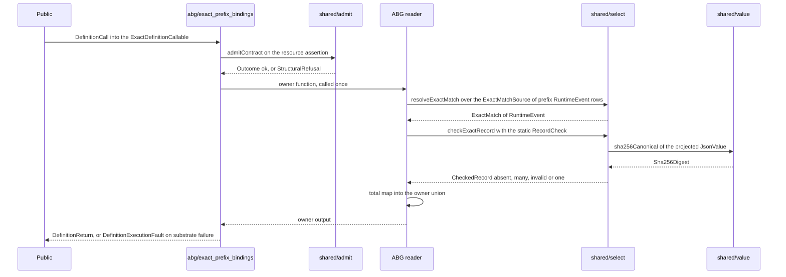
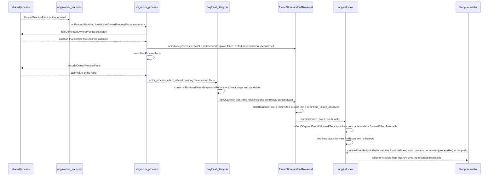
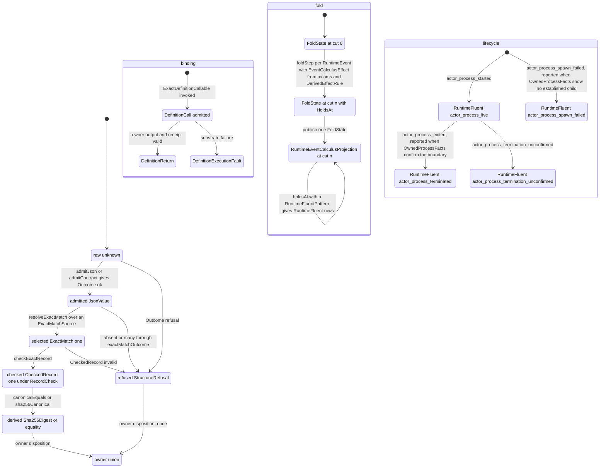
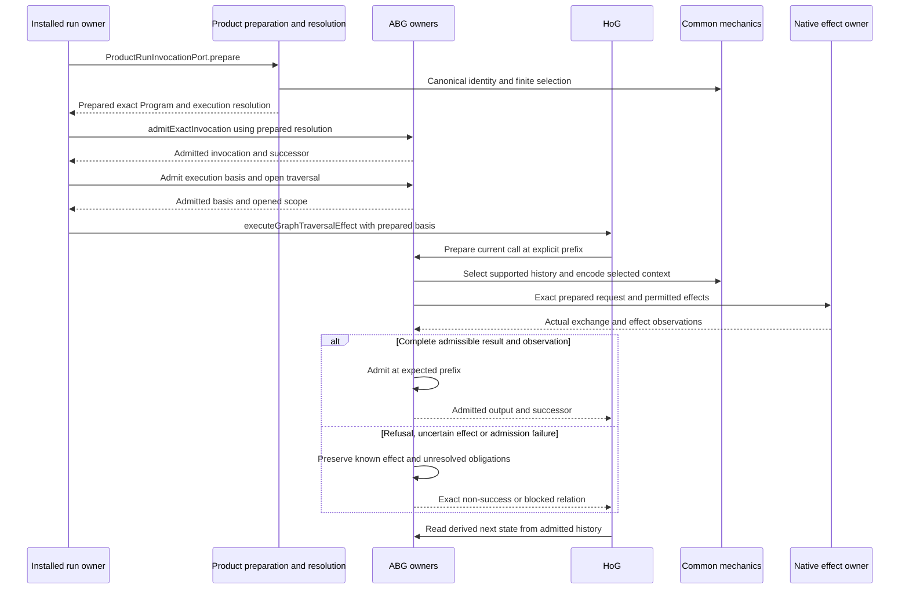
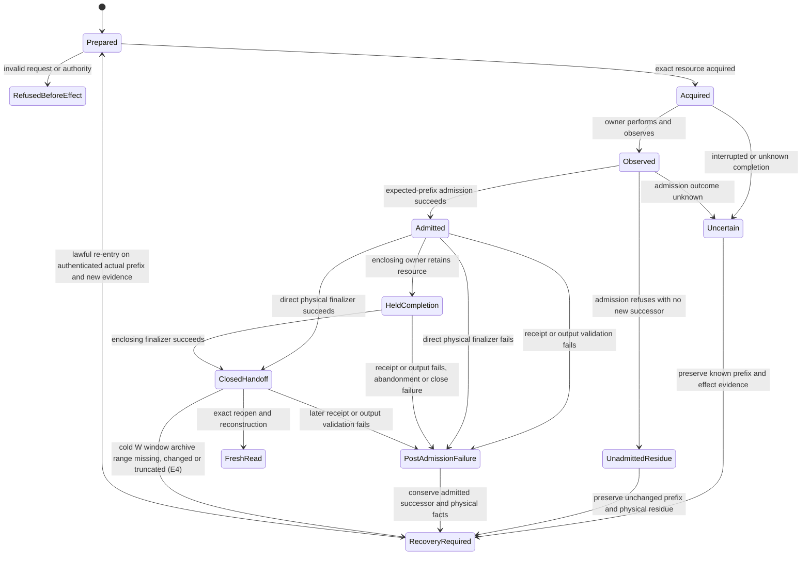

# ABIogenesis 5 Common Computational Capability Library

**Status:** active tenant design of the common computational library. Its decisions, change record and delivery evidence live in [T-287](../../../../.ai-workspace/tickets/active/T-287-deliver-abiogenesis-5-feature-waves.md).

**Selection:** the Product's [common-library prerequisite](../../../../specification/PRODUCT.md#common-computational-library-prerequisite) makes this library design the first ABG activity. The intended asset is a common computational basis from which features are composed, reducing independent solutions to equivalent computational problems. Explicit obligations determine what execution must establish; execution determines the actual outcomes.

**Authority:** [Product](../../../../specification/PRODUCT.md), [requirements](../../../../specification/requirements/README.md), the [project frame](ABI5_PROJECT_REFERENCE_FRAME_BASIS.md), [realization constitution](ABI5_REALIZATION_CONSTITUTION.md) and [computational binding](ABI5_STDO3_COMPUTATIONAL_BINDING.md). The exact method is `stdo://releases/v3.0.4/`, manifest `102817a3f4bea4dca1d6fa0fc634b94404dd2ba82ba6d8c38b273402dda9f95b`, including [DESIGN_MODULE](stdo://releases/v3.0.4/standards/DESIGN_MODULE.md), [SPEC_METHOD §11](stdo://releases/v3.0.4/standards/SPEC_METHOD.md#11-build-tenant-binding) and [FOUNDATIONS](stdo://releases/v3.0.4/standards/FOUNDATIONS.md). No companion or moving methodology source is selected.

Retired sections: [history/ABI5_COMMON_COMPUTATIONAL_CAPABILITY_LIBRARY_DESIGN__RETIRED_SECTIONS.md](history/ABI5_COMMON_COMPUTATIONAL_CAPABILITY_LIBRARY_DESIGN__RETIRED_SECTIONS.md).

## 1. Selected asset and Product boundary

The common library consists of the operator-family modules, carriers, atoms and static compositions specified below; §2 names their locations. Direct typed imports are the consumption mechanism. No new root barrel, package export, runtime catalog, dispatcher, resource framework or `runPipeline` is selected merely to give the library one name.

The design covers the intended common capability basis across all fifteen selected Product families. The present installation, preparation, history and continuation path is an initial consumer and proof discriminator, not the boundary of the library. Under [Product’s compression boundary](../../../../specification/PRODUCT.md#common-computational-library-prerequisite), release work resumes only after the selected library meets the delivery conditions that boundary names. The atom families of §4 are inside that selected deliverable; none is automatically deferred to 5.1. Optional pure-helper contraction outside the deliverable retains Product’s later allocation. This finite selection is not an unbounded all-helper sweep.

The following decisions are selected:

1. One admitted computational relation is reused across equivalent instances. A feature name or Public definition key does not justify another algorithm.
2. Canonical bytes, exact coordinate equality, finite selection and closed structural mechanics have canonical implementations. Owner predicates and result interpretation remain explicit.
3. Product declaration resolution, GTL construction, HoG traversal, ABG event resources/history and native effect owners remain reusable libraries in their existing domains. Their semantic relations are not reimplemented inside a generic helper.
4. Existing Effect 3.22.1, exact owner schemas and Node mechanics remain the admitted foundation composition. No material new dependency is selected.
5. §10.1 orders consumer retirement. §10.4 records the owner distinctions the library preserves.
6. Each retained implementation increment must name its consumer replacements and complete affected path. Default to the common implementation. A retained variant needs a concrete supported input/caller for which that implementation changes the required outcome, with owner, falsifier and disposition. Missing equivalence evidence remains an open obligation; it does not justify retention. Preserve equality, failure and admission domains until their owner explicitly decides a correction. Moving code or counting fewer functions does not establish reduced proliferation.

The [published default governance/lifecycle library](T287_DEFAULT_GOVERNANCE_LIBRARY_DESIGN.md) remains ordinary declared GTL GraphFunctions and Programs. Its Executive, induction, design, testing and UAT roles use this lower realization library through GTL/HoG/Product/ABG owners. They do not become low-level library primitives. Likewise [capability_contracts.ts](../code/src/shared/capability_contracts.ts) describes existing public definition capabilities; the module and atom names of this document are library exports, not additional DS1 capability rows.

### 1.1 Design boundary

- **Inside:** `code/src/shared/`; the pure atoms now private in `abg/`, `product/` and `hog/`; the fold interior of [event_calculus.ts](../code/src/abg/event_calculus.ts).
- **Outside:** HoG traversal, the GTL term algebra, Event Store append, Product install and verify, and the actor transport protocol. The library owns none of their decisions.
- **Requirements:** unchanged. The design realizes [EVENTS-018](../../../../specification/requirements/abg/REQ-R-ABG3-EVENTS.md) (declared Event Calculus effects), [PROJECTION-001, -002 and -013](../../../../specification/requirements/abg/REQ-R-ABG3-PROJECTION.md) (deterministic, incrementally maintained projection; `HoldsAt` derived by replay including derived-fluent rules), and the BINDING and PUBLIC-CONTRACTS requirements cited by [constitution §16.7](ABI5_REALIZATION_CONSTITUTION.md#167-t-287-static-definition-binding-compression-amendment-record). Product, including its [5.0 compression boundary](../../../../specification/PRODUCT.md#50-compression-boundary), is unchanged.
- **Constitution:** the library realizes the eight operator signatures of [§5.6.1](ABI5_REALIZATION_CONSTITUTION.md#561-closed-operator-algebra) and stays inside [§5.6.2C](ABI5_REALIZATION_CONSTITUTION.md#562c-operative-static-definition-binding-algebra). `bindStaticOwner`, `bindExactPrefixRead` and `bindExactPrefixTransition` remain the complete binding algebra. The library adds no fourth combinator, registry, callback, controller, mode selector or runtime. Its atoms are pure functions below the binders, which §5.6.2C permits: "Family modules may statically compose their own imported leaves before passing one typed owner function to a combinator".
- **Decision completeness:** §10.2 takes the material decisions of this boundary. §10.6 names, for each row of §10.1, the relations that remain unresolved, who decides each and when. A row whose unresolved set is empty evolves with its implementation and tests; any other row is design-gated on the relations it names.

## 2. Library organization and dependency direction

Each library module realizes one operator family of §5.6.1. The role column uses the module taxonomy of DESIGN_MODULE §9.

| Module | Operator family | Role | Imports | Effect class |
|---|---|---|---|---|
| `shared/refusal.ts` | carrier | carrier | `value` (types only) | pure |
| `shared/value/` | `derive` over `JsonValue` | semantic kernel | `refusal` | pure |
| `shared/admit/` | `validate` | ingress | `refusal`, `value` | pure; Valibot and jsonc-parser as foundations |
| `shared/select/` | `select` | semantic kernel | `refusal` | pure |
| `public/binding/` | lift at Public | effect boundary | `refusal`, `admit`, `shared/effect_definition.ts`, and the owner contract tables through the Public family | constructs Effect programs; runs one only in `runExactDefinition` |
| `shared/process/` | `materialize` facts, not the effect | effect boundary | `value` | Node child process and timers |
| `abg/calculus/` | `project`: the fold and `holdsAt` | semantic kernel, ABG-owned | `shared/admit`, `shared/canonical_json.ts`, `shared/digests.ts`, `shared/immutable.ts`, `shared/refusal.ts`, `shared/select/`, `shared/value/`; `product/worksite_effect.ts`, `product/native_workspace_work.ts`; `abg/event_prefix.ts`, `abg/event_store.ts`, `abg/runtime_liveness_contracts.ts`, `abg/c_call_outcome.ts`, `abg/native_work_effect.ts` | pure; a memoized class as realization |
| `abg/exact_prefix_bindings.ts` | lift of `admit` and `transition` | effect boundary, ABG-owned | `public/binding/`, `abg/event_store.ts` | Effect |

The dependency direction is one order; a module imports only modules to its left:

```text
refusal <- value <- admit <- select <- process <- abg/calculus <- owner contract tables <- public/binding <- owner definition-binding modules <- entrypoints
```

Owner contract tables live in owner directories and are data; owner definition-binding modules live in owner directories and are Public-surface compositions; the import-direction lint (`npm run lint:imports`) applies to `shared/` and to three forbidden owner pairs. `abg/calculus/` departs from this order in one respect: its modules import the `product/` and `abg/` owner modules its Imports cell names. It imports nothing from its consumers: the liveness relation, the retry budget facts and the execution basis record law are calculus functions (§4.4). `npm run lint:calculus` (`scripts/check-calculus-boundary.mjs`) checks every import of `abg/calculus/` against this row's Imports cell, with no allow-list entry. The lint reads direct imports; two admitted modules import consumers in turn, `event_store.ts` the liveness owner (`:4410`) and `c_call_outcome.ts` the retry and liveness owners (`:123`, `:126`). The retry owner imports the liveness owner and not the reverse: `retry.ts:32` imports `projectRuntimeLivenessAtPrefix`, `captureNativeFrameBoundary`, `observeNativeFrameLiveness` and `createRuntimeLivenessEventValidator` from `runtime_liveness.ts`; `runtime_liveness.ts:18` imports `hasStructuralIdentityCompletedRouteCausation`, the structural-identity route join its admission composes with the relation, from `retry_progress.ts`. That module holds the retry progress projection over admitted events and the two route joins that read it; it imports neither owner, and `retry.ts` re-exports what it held. `npm run lint:imports` checks the three pairs (`runtime_liveness.ts` never imports `retry.ts`; `retry_progress.ts` never imports either owner). Both owners still reach each other through `c_call.ts`, which imports both and from which `retry_progress.ts` reads the C-call phase projections; closing that reach redraws an owner boundary and is Phase D's.

`shared/` imports nothing from `abg/`, `product/`, `hog/`, `gtl/`, `validator/` or `public/`. Three moves establish this direction:

1. `bindExactPrefixRead` and `bindExactPrefixTransition` move from [static_definition_bindings.ts](../code/src/public/binding/static_definition_bindings.ts) to `abg/exact_prefix_bindings.ts`.
2. [product/exact_match.ts](../code/src/product/exact_match.ts) moves to `shared/select/exact_match.ts`.
3. `shared/owner_contract_source_set.ts`, `shared/public_function_family.ts`, `shared/public_function_projections.ts`, `shared/definition_binding_mechanics.ts` and `shared/static_definition_bindings.ts` after move 1 move to `public/binding/`.

The location `product/exact_match.ts` that [constitution §10](ABI5_REALIZATION_CONSTITUTION.md#10-common-library-catalog) and [Table 5.6.3-B](ABI5_REALIZATION_CONSTITUTION.md#table-563-b---selected-leaf-instance-catalog) row `N06` give for exact-match cardinality is a realization coordinate, updated to `shared/select/exact_match.ts` when row 1 of §10.1 realizes move 2 (§10.7); the relation, role and prohibited role are unchanged.

The remaining operators stay with their owners. `traverse` stays in `hog/`. `admit` as append stays in [event_store.ts](../code/src/abg/event_store.ts). `transition` stays in its owner modules. `materialize` effects stay in Product install and verify and in ABG actor transport. The library never owns an owner decision ([FS-17](ABI5_REALIZATION_CONSTITUTION.md#55-axioms); the last prohibition of §5.6.2C).

[event_store.ts](../code/src/abg/event_store.ts) also derives the C2 prefix correspondence. `durableCutCorrespondsToValidatedPrefix(cut, view)` admits the cut's rows and the view's bodies to `JsonValue` and compares them. For an exact registered cut bound to the owner's events, with the owner open, a holding result is recorded on the owner's cut index under the cut's coordinate digest and the view's exact prefix digest, and a later cut of the same boundary with a view of the same digest reads it. A copied, captured, closed-owner, other-store or selection-bound cut, a view whose digest is refused, and every refusal take the comparison, with the physical read the cut needs. The record grants no append, prefix or currentness authority, and no admission path reads it (T-290 C-13).

Three derived facts of an immutable admitted prefix are recorded once in the owner's own index and read thereafter: the C2 check (TD-08), the C2 correspondence of an exact registered cut (above, T-290 C-13), and the checked record of a contextual reader (§4.2, T-290 C-14). `checkedRecordAtPrefix` ([event_prefix.ts](../code/src/abg/event_prefix.ts)) keys the record by the cut's extent (`count:lastOrdinal`, so one ordered lineage's territory holds every cut of it), the reader's module constant (a `WeakMap` key) and `sha256Canonical` of the context's I-JSON key; the cut itself is the territory, so it is not part of the key. Only `one` is recorded; `absent`, `many` and `invalid` are acquired again, so every owner channel reproduces its first refusal exactly. A validation prefix and a key that is not I-JSON record nothing. The record grants no append, prefix or currentness authority, is not persisted, and does not outlive the territory; a prefix re-selected cold from the same array is a new territory. A reader over a caller's event array rather than a prefix has no territory and runs the check alone (`projectWorksiteFailureResultRequest`, [c_call_outcome.ts](../code/src/abg/c_call_outcome.ts)).

Existing shared modules take these places:

- [canonical_json.ts](../code/src/shared/canonical_json.ts), [digests.ts](../code/src/shared/digests.ts) and [immutable.ts](../code/src/shared/immutable.ts) are the existing members of the `value` family.
- [i_json.ts](../code/src/shared/i_json.ts), [admission_predicates.ts](../code/src/shared/admission_predicates.ts) and [references.ts](../code/src/shared/references.ts) hold the bodies the `admit` family replaces.
- [effect_definition.ts](../code/src/shared/effect_definition.ts) is the `shared/` member of the `binding` family. Its other members are in `public/binding/`: [definition_binding_mechanics.ts](../code/src/public/binding/definition_binding_mechanics.ts), [static_definition_bindings.ts](../code/src/public/binding/static_definition_bindings.ts) after move 1, and the Public family modules that call admission reads, `owner_contract_source_set.ts`, `public_function_family.ts` and `public_function_projections.ts`.
- [owned_process_lifetime.ts](../code/src/shared/owned_process_lifetime.ts) is the `process` family.
- [rooted_topology_partition.ts](../code/src/shared/rooted_topology_partition.ts) is a `derive` atom over canonical root-to-frame paths. `deriveCanonicalRootedTopologyPartition(sourceWitness, targetWitness)` returns the preserved common prefix, the exits inner-to-outer and the entries outer-to-inner, or one of `invalid_witness | topology_mismatch | basis_mismatch | root_mismatch | adjacency_mismatch`. Cycles, multiple-parent causal search, cross-basis topology, retry policy and HoG route choice are outside its domain.
- [path_confinement.ts](../code/src/shared/path_confinement.ts) is a `derive` atom over one path relation. `classifyPathRelation(relative(root, candidate))` is `same`, `outside` (absolute, `..`, or `..` and the platform separator) or `inside` (every other relation, a first segment such as `..x` or `...` among them); `pathWithin` (same or inside) and `pathStrictlyWithin` (inside) answer over the class, and each caller keeps its own treatment of the root itself. It reads no filesystem: callers resolve, realpath and lstat under their own rules. Its lanes run on POSIX only; its win32 verdicts (the separator `\` and the absolute relation across drive roots) hold by construction, not by run.
- The Public contract modules (`public_function_contracts.ts`, `public_invocation.ts`, `operation_definition_coordinate.ts`, `capability_contracts.ts`) and the `index.ts` barrel keep their roles, hold no atom of this design and obey the same import direction.

**Foundations.** Exact-pinned Effect 3.22.1 under [constitution §10.1.1](ABI5_REALIZATION_CONSTITUTION.md#1011-effect-3221-decision-ledger), Valibot, jsonc-parser and Node `crypto` and `child_process` are the admitted foundation composition. The library adds no dependency. A new parser, scheduler, runtime or package re-enters foundation selection (DESIGN_MODULE §5, Capability and foundation selection) before construction; incumbency alone selects nothing.

## 3. Irreducible carrier set

The library has one expected-failure carrier:

```ts
type StructuralRefusal = Readonly<{
  kind: "structural_refusal";
  stage: "validate" | "select" | "derive";
  code: string;             // closed per family, listed in §4
  path: readonly string[];  // JSON pointer segments where known
  evidence: Readonly<Record<string, JsonValue>>;
}>;
type Outcome<A> = Readonly<{ kind: "ok"; value: A }> | StructuralRefusal;
function ok<A>(value: A): Outcome<A>;
function refused(outcome: unknown): outcome is StructuralRefusal;
function andThen<A, B>(outcome: Outcome<A>, next: (value: A) => Outcome<B>): Outcome<B>;
```

The sequencing export is named `andThen`, not `then`, because a module namespace with an export named `then` is a thenable, so `import()` of the module never settles while static imports still work.

Admitted domain: the pure layer, `validate`, `select` and `derive`. Process facts reach the log as their owner's terminal event and, on a failure, inside the admitted failure's diagnostic subject, not through this carrier (§9.3). A `StructuralRefusal` carries no owner meaning ([FS-11](ABI5_REALIZATION_CONSTITUTION.md#55-axioms)). An owner maps it into its own union exactly once at the owner boundary. A binder maps the refusal of its own `admitContract` call to its existing resource or receipt fault (§4.5); no other `StructuralRefusal` crosses `DefinitionExecutionFault`. Defects keep `throw`; expected refusals never do.

| Carrier | Standing | Reason |
|---|---|---|
| `JsonValue` | prime | identity of every canonical comparison and digest |
| `Sha256Digest` | prime | identity of admitted bytes |
| `StructuralRefusal`, `Outcome<A>` | prime | the one expected-failure carrier of the library |
| `ExactMatch<T>` | prime | the `select` codomain: `absent`, `one`, `many` |
| `RuntimeEvent`, `RuntimeFluent`, `RuntimeFluentPattern`, `EventCalculusEffect`, `RuntimeEventCalculusProjection` | prime, ABG-owned | the [Event Calculus IACS](ABG_EVENT_CALCULUS_IACS.md); `EventCalculusEffect` is the type of its `RuntimeEventCalculusEffect` row; `RuntimeEventCalculusProjection` publishes one `FoldState` at a prefix cut and is the one prime name of the fold's result |
| `DerivedEffectRule` and its table `ROOT_DERIVED_RULES` | prime, ABG-owned | the realization of the IACS's `RuntimeDerivedFluentRule` |
| `OwnedProcessFacts` | prime | the one process-termination evidence carrier: observed once by its owner, handed in memory to the owner that reports it, reported once as one process terminal event and, on a failure, admitted once, encoded, as the failure's diagnostic subject; never re-observed, serialized beside the log or read back from a second store (§9) |
| `DefinitionCall`, `DefinitionReturn`, `ExactDefinitionCallable`, `DefinitionExecutionFault` | prime | the §5.6.2C ABI |
| `ExactMatchSource<T>`, `RecordCheck<E, P>`, `CheckedRecord<E, P>`, `FoldState`, `HoldsAt`, effect rows, `FoldState` internals (transition cache, probe and interruption facts) | subordinate | parameters or derived views: `FoldState` is the fold carrier behind `RuntimeEventCalculusProjection` and `HoldsAt` its map from fluent ref to `RuntimeFluent`; the promotion test fails for each: no independent identity, admission or lifecycle |

No table row adds a peer type.

**Lifecycle.** Library carriers are values: constructed, read and discarded. `foldStep` advances a `FoldState`; `forkAt` copies it at a cut; it is recomputed from the event log, never persisted as truth. `ROOT_EVENT_CALCULUS` and `ROOT_DERIVED_RULES` are declared at module construction and change only by design re-entry. `OwnedProcessFacts` is produced once per launch and handed in memory to its owner, which reports one process terminal event from it; on a failure, its encoding is admitted once with the failure (§9.3).

## 4. Atomic function families

Each family is one typed family with closed variants. The signatures instantiate §5.6.1. Counts are `grep` censuses over `code/src`; they identify retirement targets, not semantic coverage.

### 4.1 `validate`: `shared/admit/`

| Atom | Signature | Replaces | Codes |
|---|---|---|---|
| `isRecord` | `(value: unknown) => value is Readonly<Record<string, unknown>>` | 2 definitions, 32 inline bodies, 5 typed aliases in `admission_predicates.ts` | guard |
| `hasExactKeys` | `(value: object, keys: readonly string[]) => boolean` | 5 NUL-joined bodies | guard |
| `admitJson` | `(raw: unknown) => Outcome<JsonValue>` | the throwing path of `i_json.ts` for new callers | the seven `IJsonAdmissionFailureCode` values: duplicate key, invalid framing, invalid Unicode scalar, malformed JSON, non-finite number, non-I-JSON value, unsafe integral number; total over its declared domain: a Proxy (refused by `types.isProxy` before any read, at every container, prototype and constructor), a cycle, nesting past 512 containers and a throw from an inspection read of a non-Proxy exotic object (a module namespace's uninitialized binding) are each `non_ijson_value` at the member, and no input throws; the domain excludes a host object whose interceptors forward reads to a Proxy (a vm context's global over a Proxy sandbox), which no engine check sees; a shared container is admitted once per path, so the work is the size of the detached tree returned |
| `admitContract` | `<T>(schema: v.GenericSchema<T, T>, raw: unknown) => Outcome<T>` | inline `v.safeParse` in `bindStaticOwner`; owner sites as touched | `contract_mismatch` with `path`, and nothing else. In the gate form, `admitJson` admits the raw first, and an I-JSON refusal is `contract_mismatch` at its member's path, with the I-JSON code as the issue. `safeParse` then reads the original raw. So an identity-checking schema sees the caller's value, and no code of the raw runs: no member is an accessor and no container is a Proxy, over `admitJson`'s declared domain. A throw from the schema is `contract_mismatch` at the root, with the thrown class as the issue and no member of the thrown value read |
| `admitRef` | `(value: unknown) => Outcome<string>` | the `requireRef` throw | `blank_ref` |

A plain record or array of any realm is admitted by structure (D12). A record's prototype is `null` or a realm's `Object.prototype`; an array's is a realm's `Array.prototype`. A prototype counts as a realm's only when its own data `constructor` is a function named `Object` or `Array` whose own data `prototype` is that same object, with a `null` prototype above an `Object.prototype` and such an `Object.prototype` above an `Array.prototype`; any other prototype is refused. A prototype confers nothing: admission copies own data members into fresh ordinary containers.

Ingress collapse (DESIGN_MODULE §3): `unknown` enters the pure layer only through this family. A `derive` or `select` export whose input is `unknown` is a defect of the library. `isRecord` refines only the outer shape; members stay `unknown` until their owner's schema narrows them. The throwing entry of `i_json.ts` is a lift over `admitJson`, kept for the callers whose contract is the throw (§10.2, D4).

### 4.2 `select`: `shared/select/`

| Atom | Signature | Replaces |
|---|---|---|
| `resolveExactMatch` | `<T>(values: ExactMatchSource<T>, predicate: (v: T) => boolean) => ExactMatch<T>` | existing, moved down; 213 inline `length === 1` sites migrate as touched |
| `exactMatchCardinality` | `(length: number) => "absent" \| "one" \| "many"` | the count decision for already selected arrays |
| `onlyExactMatch` | `<T>(selected: readonly T[]) => ExactMatch<T>` | 2 local `one()` helpers; returns the closed union, never `T \| null` |
| `exactMatchOutcome` | `<T>(match: ExactMatch<T>) => Outcome<T>` | lifts `absent` and `many` to `select` refusals for sequential composition |
| `checkExactRecord` | `<E, P, C = void>(match: ExactMatch<E>, check: RecordCheck<E, P, C>, context?: C) => CheckedRecord<E, P>` | the private checked-record helpers; ABG instantiates `E = RuntimeEvent` for its 74 readers; the eight contextual readers pass typed context data (T-290 C-14) |

```ts
type RecordCheck<E, P, C = void> = Readonly<{
  project: (event: E, context: C) => Outcome<P>;
  digest: null | Readonly<{ expected: (event: E, value: P, context: C) => Sha256Digest; actual: (value: P) => Sha256Digest }>;
}>;
type CheckedRecord<E, P> =
  | Readonly<{ kind: "absent" }>
  | Readonly<{ kind: "many"; values: readonly E[] }>
  | Readonly<{ kind: "invalid"; event: E; reason: "record_projection" | "record_digest" }>
  | Readonly<{ kind: "one"; event: E; value: P }>;
```

`ExactMatch<T>` realizes the §5.6.1 `select` codomain: `one` is `exact`, `many` is `ambiguous`. Selection preserves every occurrence, predicate order and predicate exception; it has no early exit, deduplication, default or first-match substitution. `checkExactRecord` is `select`, then `validate`, then `derive`, composed once. The owner supplies `project` and `digest` as a module constant per reader, never as a runtime argument (§5.6.2C). A contextual reader's check takes typed context `C`: data the call supplies (an I-JSON value or a frozen owner record such as digests, a cut, a cursor or a basis row), never a function. `project` and `digest.expected` read it; `digest.actual` reads the projected value alone. With the default `void` the check reads the event alone, and the two-argument form is the base form. A context mismatch is the owner's `record_projection` or `record_digest`; `CheckedRecord` has no further kind. Over an immutable admitted prefix ABG records a reader's `one` outcome once, in the prefix's own computation (`checkedRecordAtPrefix`, [event_prefix.ts](../code/src/abg/event_prefix.ts); §2), and every later identical read returns it (T-290 C-14). The digest leg runs after projection (D2). Both malformed null-digest partitions, a non-record singleton and an unencodable record, yield `invalid`.

### 4.3 `derive`: `shared/value/`, domain `JsonValue` only

| Atom | Signature | Replaces |
|---|---|---|
| `canonicalJson`, `writeCanonicalJson` | existing | none |
| `canonicalEquals` | `(left: JsonValue, right: JsonValue) => boolean` | 12 `sameCanonical*` bodies and 39 inline comparisons |
| `sha256Canonical`, `sha256Bytes` | existing | none; an inline comparison of a computed digest against a stored digest stays `===` on the branded string; a comparison that digests both sides is `canonicalEquals` |
| `writeCanonicalRecord` | `<T>(entries: readonly (readonly [string, T])[], writeMember: (member: T, key: string, sink: CanonicalJsonSink) => void, sink: CanonicalJsonSink) => void` | none: it is the record walk of `canonicalRecordDigest` and of the three record writers that produce plan and replay digests (`abg/retry.ts` `completedRetryProgressPlanDigest`, `abg/c_call.ts` `pendingInteractionBodyDigest`, `abg/replay.ts` `writeReplayBody`), each keeping its own member writing in `writeMember`; their bytes and digests are unchanged (TD-15) |
| `canonicalRecordDigest` | `(value: JsonRecord) => Sha256Digest` | 2 record-digest copies; equal to `sha256Canonical` over the same record |
| `deepFreeze`, `isDeeplyFrozen` | existing | none |
| `presentMember` | `<T>(value: T \| undefined) => T` | none: it throws the canonical writer's TypeError for an absent member; used only where an absent member of a selected set must fault the owner rather than drop from the set, as the O-TYPE row states (§10.3); home `shared/canonical_json.ts`, re-exported by `shared/value` |

Equality takes no encoder parameter: an `encode` argument would be a runtime-supplied function. Installed equality with an owner codec is `canonicalEquals(a, b)` after both sides pass `admitJson`; the two comparisons that run on the installed Product's own `canonicalJson`, `sameStructure` (`public/installed_definition_call_transport.ts:144`) and `sameJson` (`public/installed_public_definition_call.ts:65`), stay (§10.1 row 3). The two native composite comparisons are ingress questions, decided per site (D3), not equality variants. `writeCanonicalJson` and `writeCanonicalRecord` write to an explicit synchronous sink; a sink exception propagates after partial output and is not a complete encoding.

### 4.4 `project`: `abg/calculus/`, ABG-owned

```ts
type HoldsAt = ReadonlyMap<string, RuntimeFluent>;   // fluentRef -> fluent
type FoldState = Readonly<{ holds: HoldsAt; ordinal: number; /* transitions, probe and interruption facts */ }>;
type DerivedEffectRule = Readonly<{
  ruleRef: string;
  appliesTo: readonly RuntimeEvent["kind"][];
  derive: (state: FoldState, event: RuntimeEvent, dependencies: readonly RuntimeEvent[]) => EventCalculusEffect;
}>;
const ROOT_EVENT_CALCULUS: AxiomTable;                  // existing
const ROOT_DERIVED_RULES: readonly DerivedEffectRule[]; // terminal Run census, per-process cleanup, liveness, actor process lifecycle
function effectOf(state: FoldState, event: RuntimeEvent, dependencies: readonly RuntimeEvent[]): EventCalculusEffect; // pure, closed over both tables
function foldStep(state: FoldState, event: RuntimeEvent, dependencies: readonly RuntimeEvent[]): FoldState;           // pure, closed over both tables
function holdsAt(state: FoldState, pattern: RuntimeFluentPattern): readonly RuntimeFluent[];
```

The axiom table declares the effects indexed by event kind: an entry reads the event, its declared dependencies and the fold's own facts that `axiomEffectOf` receives as `AxiomFoldContext` (`abg/calculus/axioms.ts:1857`, `:1866`), the admitted source cut and the probe and interruption scopes that earlier fold steps recorded. The rule table declares every contextual effect; each rule reads the fold state before the event. Both are module constants; no caller supplies an axiom or a rule. `effectOf` and `foldStep` read both tables from their own module, so their exported signatures take no axiom or rule parameter. Each rule's `derive` is a module-owned function fixed when the table is declared, not a runtime-supplied callback ([FS-17](ABI5_REALIZATION_CONSTITUTION.md#55-axioms)); the constitution's typed Event Calculus projection admits closed module law and prohibits caller axioms ([§10](ABI5_REALIZATION_CONSTITUTION.md#10-common-library-catalog)). The law is the two tables. The published native runtime observation contract (`contracts/schemas/native-runtime-observation.json`) embeds the axiom table alone, as member `eventCalculus` (`scripts/generate-product-manifest.mjs:145`), so the rule-owned fluents are not in it; no runtime consumer reads that contract.

The liveness rule evaluates the liveness relation, `nativeLivenessRelationHolds` (`abg/calculus/liveness.ts:496-504`). The relation decides whether a native probe, interruption or threshold observation has its exact admitted source and threshold relation (P0-P5, T1-T3, O1-O4, S1-S5, M1-M4, M6, M7). Its declared dependency is the fold state before the event, the event and the cut before it. It reads `actor_process_live` of the started process through the caller's read: the fold passes its own `holds` (`rules.ts:105`) and the liveness owner passes `runtimeFluentHoldsAtPrefix` at the relation's cut (`runtime_liveness.ts:49-50`). It reads the cut through the calculus's memoized index of that cut (`RuntimeLivenessReconstruction`, `liveness.ts:347-584`), as `axiomEffectOf` reads the admitted source cut: the occurrence's declarations, the scope's earlier observations and samples, and for a threshold the whole cut its `evaluatedPrefixDigest` names. A prospective candidate's validation prefix names its admitted predecessor (`runtimeEventValidationBase`); `livenessReconstruction` forks the predecessor's reconstruction at that cut (`forkAt`), as `eventCalculusDerivation` forks the Event Calculus derivation. The fork indexes only the candidate's own rows and reads every row, declaration, sample and fold through the base cut from the base; it copies a base fold before extending it and never advances or writes the base, so a refused sibling or a rolled-back transaction leaves the admitted reconstruction unchanged. Terminal and process-start queries read identity buckets of the cut (the occurrence's actor, Run, graph call, frame or CCall), and context declarations read the `related:` bucket of the compared aggregate, so another Run's rows are not read for an occurrence; each query keeps its predicate. Two derivations it reads are calculus functions over admitted events. The execution basis record law (`abg/calculus/execution_basis_record.ts`, `projectExactExecutionBasisRecordAtPrefix`) checks one `basis_admitted` record against its recorded raw-input and basis digests; the invocation truth owner's `projectExactExecutionBasisAtPrefix` delegates to it. The retry budget facts (`projectRuntimeRetryBudgetFacts`, `liveness.ts:805-840`) derive from `c_call_opened`'s `retryPath`, one digest-checked `retry_attempt_opened` and one digest-checked `retry_progress_recorded`. The budget shape check (S2, `liveness.ts:603-609`) has two roles: it checks the derived budget, and it is the only check on a budget a caller supplies (the CCall closure, `retry.ts:5334-5338`, and the public `deriveRuntimeLiveness` and `projectRuntimeLivenessAtPrefix`). The relation is boolean; it returns the structural-identity route joins it needs (M5) as obligations and decides none of them. The rule refuses the step with its one message when the relation is false (`rules.ts:104-107`). The liveness owner's admission validator is the relation composed with the owner's structural-identity join (`structuralRoutesHold`, `runtime_liveness.ts:53-55`), at `validateRuntimeLivenessEventAtPrefix` (`event_store.ts:4091`) and at the retry frame join (`retry.ts:705`). Admission refuses everything the fold refuses and, in addition, a frame observation whose structural route causation fails, so an admitted log never holds one.

`RuntimeEventCalculusDerivation` is the memoized realization of `foldStep`, with `forkAt`. Its `advance` (`abg/event_calculus.ts:243`) applies each new event in place with `applyStep` (`abg/calculus/fold.ts:213`), the in-place form of `foldStep` (`:275`), to the one working state the derivation owns, and copies no fold state; each step reads its dependencies from the cut before the event by the exact selection (`eventCalculusDependencies`, `abg/event_calculus.ts:92`), for every prefix kind, and the derivation carries nothing beside the prefix, so a fork advanced from a cut folds as its base did; `forkAt` copies once for the fork (`workingFoldState`, `:155`); readers read the owned state, with the class caching transitions; `applyStep`, `workingFoldState` and `frozenFoldState` are internal exports of `fold.ts`. `applyStep` applies each clip pattern with `applyClip` (`:194`), also an internal export: an exact pattern, `name` and `identity` both set, reads the one held fluent keyed by its ref (`ownedExactRuntimeFluentPatternRef`, `abg/calculus/axioms.ts:1731`), and a wildcard enumerates `holds`; the visit counter in `t287-calculus-fold` (`:299`, `:316`) holds the exact clip at one visit for 8 and for 2048 unrelated held fluents, while the wildcard's visits grow with them. The exact point query is `runtimeFluentHoldsAtPrefix` (`abg/event_calculus.ts:334`), which answers whether one fluent holds at a prefix from `fluentAt` without building a projection; a list consumer reads the held projection (`held`, `:281`) and asks `holdsAt` over it; an exact point query, including every reader of one §4.4 lifecycle fluent of one process, reads `runtimeFluentHoldsAtPrefix`; `t287-calculus-fold` (`:395`, and `:462` for the lifecycle names) holds the exact read equal to the projection's point query at every cut. Agreement between the class and the pure fold is proof obligation P-FOLD, which is PROJECTION-002's live and cold agreement stated as a test.

`abg/replay.ts:1413` puts the held fluent set into the replay body. The body's digest is the replay state witness, computed by the replay owner for every guard it derives (`projectRuntimeReplayGuard`) and for every complete ReplayState, streaming each historical row from the facts the derivation's loops projected, and stored as `replayStateDigest` in route and judgment payloads and as `sourceReplayDigest` in the invocation source-result basis. A reader that compares and persists no witness reads one of the owner's two digest-free projections, `projectRuntimeReplayStatus` (the guard's members without `replayRef` and `replayDigest`) or `projectRuntimeReplayRouteRefsAndCCalls` (those members with the Run's route refs and CCall rows in the replay's order); each runs the guard's derivation and validation and computes no witness, and neither is in a barrel or persisted. The witness states derived state under the calculus law in force when the route or judgment is proposed or, for `sourceReplayDigest`, when the source-result basis is admitted, so a law change under D1 moves it at every cut that change affects. Every comparison of the witness in `code/src` (`abg/traversal_route.ts:4431-4432` and `:5365`, `abg/c_call.ts:7048-7049`, `abg/c_call_outcome.ts:1522`, `abg/fan_out.ts:222`, and the complete-output check `abg/replay.ts:207`) checks a value built in the same process against the current replay; both values are computed under the same law. No admission, reopen or cold-replay path compares a stored witness with a recomputation, so a stored witness is never re-read against a new law, and a route or judgment admitted under a prior law is neither re-admitted nor re-checked. History reopens unchanged after a law change under D1, and no prior law is retained.

The rule `actor_process_lifecycle` decides the Actor, Process and Run lifecycle for one actor invocation. Its inputs are admitted events only; it takes no `OwnedProcessFacts`. The owner reports exactly one process terminal event from its facts (§4.6), and the rule folds that event. The inputs: `S`, the process started (`actor_process_started`); `T`, a process terminal (`actor_process_exited` or `actor_process_spawn_failed`); `U`, termination unconfirmed (`actor_process_termination_unconfirmed`); `G`, a signal requested (`actor_process_signal_requested`); `O`, a timeout observed (`actor_process_timeout_observed`); `A`, an actor terminal (`actor_invocation_closed` or `actor_invocation_failed`); `R`, the matching Run's terminal. `G` and `O` carry the facts from which the fold derives `signalSequence` and `timedOut` (D5). Its formulas:

```text
processLive            = S and not T
terminationUnconfirmed = not T and U
cleanupPending         = not A and (T or U or (R and formerlyActiveActor))
```

`formerlyActiveActor` holds when the invocation's actor is in the matching Run's census of actors for which `actor_process_active` or `actor_process_live` held. The cleanup token frontier is the matching Run stop. The realization's R branch (`abg/calculus/rules.ts:174-185`) has no `not A` term: the Run stop carries no actor reference and the fold state holds no process-to-actor relation. The term is vacuous on admitted prefixes: the owner appends an actor terminal only after a process terminal (`abg/actor_process.ts:1344`, `:1391`), the actor projection treats an actor terminal without one as a defect (`:629-630`), and a process terminal ends both `actor_process_live` and `actor_process_active`, so no process in R's census has its actor terminal held. The rule initiates `actor_process_terminated(processRef)` from `actor_process_exited`, which the owner reports only for a confirmed boundary after an admitted start (`abg/actor_process.ts:1331`). Its falsification cases are the two derivations it replaces: counterexample A, the cleanup reading of the actor projection, which reads the rule's fluents through `runtimeFluentHoldsAtPrefix` (`abg/actor_process.ts:637-642`); and counterexample B, a terminal Run census that counts only processes still live, which `terminal_run_census` keeps for `actor_cleanup_live` alone (`abg/calculus/rules.ts:47`) while this rule's census initiates `actor_cleanup_pending` (`:174-185`). The axiom table (`abg/calculus/axioms.ts:208-250`) holds no entry for `actor_process_live`, `actor_process_terminated`, `actor_process_termination_unconfirmed` or `actor_cleanup_pending`; this rule (`rules.ts:133-189`) initiates and terminates all four, so each lifecycle fluent has one producer.

The lifecycle fluents are closed: `actor_process_spawn_failed`, from the axiom table, and `actor_process_live`, `actor_process_terminated`, `actor_process_termination_unconfirmed` and `actor_cleanup_pending`, from this rule. A lifecycle question asks whether one of these fluents holds for one process or actor invocation.

The rule also checks the copied `terminationConfirmed` against `actor_process_terminated` at the same cut. Under L the copy is in `actor_result_artifact_observed` and in `c_call_evidenced` with evidence class `probabilistic_transport` (`abg/event_store.ts`, the L table); these events are checked inputs, not decision inputs. P artifacts and P evidence carry no copy, so the check derives nothing for them (D5). The fluent wins. A disagreement initiates the diagnostic fluent `terminationConfirmed_copy_disagrees(processRef)`. No prefix is refused for it, so existing history reopens unchanged.

The rule produces fluents inside the one fold. `actor_process.ts`, `replay.ts`, `runtime_liveness.ts` and every other reader of a lifecycle fact read them from the fold: a point query through `runtimeFluentHoldsAtPrefix` with the exact fluent `constructRuntimeFluent({ name, identity })`, a pattern query through `holdsAt` with `{ kind: "runtime_fluent_pattern", name, identity }`. Four consumers that had to agree become one producer and its readers, as PROJECTION-013 requires.

### 4.5 Lift: `public/binding/`

`bindStaticOwner` lives in `public/binding/`, and `runExactDefinition` and `runEffectProgram` in `shared/effect_definition.ts`; all three keep their fault surface. `bindStaticOwner` consumes `admitContract` in place of inline `v.safeParse`. It maps a refused resource assertion to its existing `invalid_resource_assertion` fault and a refused receipt to its existing `invalid_resource_receipt` fault ([static_definition_bindings.ts](../code/src/public/binding/static_definition_bindings.ts), lines 47 to 58 and 66 to 77). The inner predicate changes; the faults a caller observes do not. `bindExactPrefixRead` and `bindExactPrefixTransition` live in `abg/exact_prefix_bindings.ts` and specialize `bindStaticOwner` as §5.6.2C states. Each binder is higher-order only at module construction; every captured owner function, schema and packet is a direct import. Exactly one `Effect.run*` site exists.

### 4.6 Process facts: `shared/process/`

`createOwnedProcessLifetime` and `OwnedProcessFacts` are the existing physical mechanism for worker, command and HTTP progression, probing, bounded confirmation and drain. The family adds three pure functions:

```ts
function hasConfirmedOwnedProcessBoundary(facts: OwnedProcessFacts): boolean;
// facts.scopeAbsence === "absent" && facts.directExit !== null
function classifyOwnedProcessTerminal(facts: OwnedProcessFacts): "spawn_failed" | "exited" | "unconfirmed";
// "spawn_failed" when facts.scopeAbsence === "absent", facts.noChildEstablished and facts.launchFailure !== null;
// otherwise "exited" when hasConfirmedOwnedProcessBoundary(facts); otherwise "unconfirmed"
function encodeOwnedProcessFacts(facts: OwnedProcessFacts): JsonValue;
```

The owner of a process boundary reports exactly one of three terminal outcomes from its facts, once:

- a spawn failure when no child was established (`scopeAbsence` is `"absent"`, `noChildEstablished` holds and `launchFailure` is set);
- an exit when `hasConfirmedOwnedProcessBoundary` holds after an admitted start;
- termination unconfirmed otherwise.

`classifyOwnedProcessTerminal` is that three-outcome report. The worker owner and the command and HTTP adapters branch on it, so no adapter keeps its own formula. The worker owner reports the outcomes as `actor_process_spawn_failed`, `actor_process_exited` with `status` and `signal`, and `actor_process_termination_unconfirmed` (`abg/actor_process.ts:1323-1340`); a spawn failure after an admitted start, and an exit or unconfirmed termination without one, are defects. The command and HTTP adapters report the same three outcomes in their result (§9.3): on the helper route `terminationConfirmed` is `classifyOwnedProcessTerminal(facts) !== "unconfirmed"`. A spawn failure has no child to clean up, so it reports `terminationConfirmed: true` with status 127; a group probed absent without an observed exit reports `unconfirmed`. `hasConfirmedOwnedProcessBoundary` is the one test for "the owned process is gone" at the physical observation. A launch with no established child is never a confirmed boundary. The classification selects which outcome the owner reports; it is not a lifecycle read, which only `holdsAt` answers (§9.1).

The remaining members of the facts (`firstError`, `launchFailure`, `cleanupElapsedMs`, `probeCount`, `signalAttempts`, `closeObserved`, `streamsDisposed`, `drainExpired`) are attribution evidence. `encodeOwnedProcessFacts` is the one encoding of the facts as admitted evidence, used by every route (§9.3). `OwnedProcessFacts` is not JSON: `launchFailure` and `firstError` are `Error`, and `cleanupDeadlineNs` is `bigint`. The encoding has one fixed form:

- every member of `OwnedProcessFacts` keeps its name;
- an `Error` becomes `{ name, message, code, errno, syscall, path }`, each member a string or `null`; `stack` is omitted, because it is unbounded and not canonical;
- the `bigint` becomes `{ "kind": "bigint", "value": "<base-10 digits>" }`;
- `null` stays `null`; booleans, numbers and strings pass through.

The lifetime hands its terminal facts in memory to the owner that reports them; it neither throws nor writes them. Protocol, timeout and result policies stay with each adapter. The family creates no scheduler, retry policy or process authority.

The lifetime's closed material cases:

| Case | Required mechanical distinction | Owner consequence |
|---|---|---|
| Launch refused or failed with no established child | Preserve launch evidence; do not invent an exit or process identity. | No completed work result follows; any known residue remains attributable. |
| POSIX owned process group | Launcher exit or pipe close is distinct from evidence that the owned group is absent. | Confirmed termination requires the selected group and exit relation; still assess performed work. |
| Windows owned child | Use the supported child-completion contract and identify its scope. | Do not relabel child completion as POSIX group absence or unproved descendant termination. |
| Absolute or inactivity deadline, or cancellation | Preserve the triggering cause, the ordered TERM, grace and KILL requests and their actual outcomes. | Timeout or a signal request does not prove termination, rollback or nonperformance. |
| Confirmation, drain, probe or observer failure | Return uncertainty and any known exit, output and signal facts; release known local handles and timers as permitted. | Preserve the cleanup obligation; withdraw dependent currentness when post-effect state is unknown. |
| Process terminated, output missing or invalid, or semantic assessment negative | Preserve termination and output or effect evidence as separate facts. | Reobserve the affected worksite; refuse or unresolve the result as the existing owner requires. |

## 5. Higher-order composition with laws

| Category | Library combinator | Laws | Owner of anything beyond |
|---|---|---|---|
| unit, lift | `ok`, `exactMatchOutcome`; `Effect.succeed` at the binder | `andThen(ok(a), f) = f(a)` | none |
| sequential | `andThen`, Kleisli composition over `Outcome` | associative: `andThen(andThen(o, f), g) = andThen(o, a => andThen(f(a), g))`; refusal-absorbing: `andThen(r, f) = r` for every refusal `r`; identity: `andThen(o, ok) = o` | Effect `flatMap` for the lifted layer, existing |
| parallel, applicative | none | none | `C.batch`, graph fan-out and fan-in |
| fold | `foldStep` | `fold(L ++ s) = foldStep*(fold(L), s)`; cold equals warm at the same cut | ABG |
| retry, recovery | none | none | `C.retry`, the HoG retry lifecycle |
| recursion, fixed point | none | none | `workflow.C`, the HoG recursion lifecycle |
| projection | `holdsAt`, `checkExactRecord` | read-only: no outcome of a projection is an admission | ABG and Product owners |

Authority law for every row: a composed function has no more authority than its inputs and constituents (FS-11; DESIGN_MODULE §5, Authority model). Nothing here reads a prefix, appends an event, selects a target or decides a continuation. The [seven C constructors](../../../../specification/requirements/gtl/REQ-L-GTL3-C-ALGEBRA.md) keep their GTL and HoG owners; the library adds no constructor and no traversal algorithm.

Falsifier for the sequential row: an `andThen` whose refusal branch is not the identity. Falsifier for the fold row: an admitted prefix split `L ++ s` where `fold(L ++ s)` and `foldStep*(fold(L), s)` differ, or a cut, or a fork at a cut advanced to a later cut, where cold replay and the warm projection differ.

## 6. Prime atoms, admitted domains, falsifiers

| Atom | Admitted domain | Falsifier |
|---|---|---|
| `canonicalEquals` | two `JsonValue`s: finite numbers, `-0` as `0`, keys sorted by code unit | equal under RFC 8785 and false, or unequal and true |
| `sha256Canonical` | `JsonValue` | digest differs from the hash of the `canonicalJson(v)` bytes |
| `isRecord` | `unknown` | a non-null, non-array object returning false |
| `hasExactKeys` | own enumerable string keys against a key list | sets equal under code-unit order and false; or a NUL-containing key colliding |
| `admitJson` | `unknown`, less a host object whose interceptors forward reads to a Proxy | an I-JSON value nested at most 512 containers deep refused, a non-I-JSON value admitted, any input that throws, or any Proxy trap or getter that runs |
| `admitContract` | `unknown` with a strict Valibot schema, less `admitJson`'s excluded class | `safeParse` success with a refusal, or failure with `ok`; a trap or getter of the raw that runs, at the gate or after it; a throw that escapes; or an outcome other than `ok` or `contract_mismatch` |
| `resolveExactMatch` | finite source and total predicate | cardinality disagreeing with the filter length |
| `checkExactRecord` | `ExactMatch<E>` with a static `RecordCheck` and, for a contextual check, typed context data | `one` when `project` refused or the digests differ; a check or a context supplied as a function at the call; a recorded `one` that a fresh acquisition of the same prefix would not reproduce |
| `effectOf`, `foldStep` | an admitted event in prefix order with its declared dependencies | a prefix split where the fold law of §5 fails; a cut, or a fork at a cut advanced to a later cut, where cold replay and the warm projection differ; or an effect differing from the expected-effect table of counterexample A or B (§4.4) |
| `holdsAt` | a `FoldState` at an admitted prefix cut and a pattern `{ kind: "runtime_fluent_pattern", name, identity }` | any module outside `abg/calculus/` that decides one of the lifecycle fluents of §4.4 (`actor_process_spawn_failed`, `actor_process_live`, `actor_process_terminated`, `actor_process_termination_unconfirmed`, `actor_cleanup_pending`) from a copied payload field, from the presence of an event kind in a prefix, from its own recomputation over the log or from a second store, instead of calling `holdsAt` with a pattern naming that fluent or `runtimeFluentHoldsAtPrefix` with that exact fluent (`constructRuntimeFluent({ name, identity })`), which reads the same fold's recorded transitions at the prefix; the owner's report of a terminal outcome from its physical observation (§4.6) is not such a reader |
| `classifyOwnedProcessTerminal` | `OwnedProcessFacts` from one lifetime | an outcome other than the three-case formula of §4.6, or an adapter that keeps its own formula |
| `encodeOwnedProcessFacts` | `OwnedProcessFacts` from one lifetime | a member renamed or dropped; an `Error` encoded other than as `{ name, message, code, errno, syscall, path }` with string or `null` members; a `stack` member present; a `bigint` encoded other than as `{ "kind": "bigint", "value": "<base-10 digits>" }`; a changed `null`; or a second encoding of the facts in any adapter |
| `andThen` | any `Outcome` | the laws in §5 |

Whole-family Prime contraction. No atom duplicates another's domain: digest comparison is native `===` on a branded string and is not an atom. No atom adds an authority centre: all are pure and read nothing. The fold is the only admitted source of "is this actor process gone": a reader asks `holdsAt` with a pattern, or `runtimeFluentHoldsAtPrefix` for one exact fluent at a prefix, which answers from the same fold's recorded transitions (`fluentAt`) without materializing the held set; for a helper-run process the answer is a projection of its admitted leaf result or failure (§9.3). The atoms in this table replace roughly 400 private bodies by census.

## 7. Three views

The three views name the same twenty-one carriers, the named rows of §3: `JsonValue`, `Sha256Digest`, `StructuralRefusal`, `Outcome`, `ExactMatch`, `ExactMatchSource`, `RecordCheck`, `CheckedRecord`, `RuntimeEvent`, `RuntimeFluent`, `RuntimeFluentPattern`, `EventCalculusEffect`, `RuntimeEventCalculusProjection`, `DerivedEffectRule`, `FoldState`, `HoldsAt`, `OwnedProcessFacts`, `ExactDefinitionCallable`, `DefinitionCall`, `DefinitionReturn`, `DefinitionExecutionFault`. No view adds a carrier the others lack. Effect rows and the `FoldState` internals are unnamed subordinate parts and are not drawn. The domain view uses the standard stereotypes `prime-conformant` and `subordinate` (DESIGN_MODULE §7, Domain model) and places the ABG-owned carriers in the `ABG` namespace.

### Domain view


### Sequence view

One checked-record read through a prefix-read binding:



One process failure recovered from the log (§9):



### State view



The views carry the same carriers and transitions. The cross-view axiom matrix is the design-gate owner's to run.

## 8. Three accounts per family

| Family | Algorithmic | Informational | Computational |
|---|---|---|---|
| derive | one canonical traversal (`writeCanonicalJson`); a hash over its parts | RFC 8785 equality on `JsonValue`; a digest identifies admitted bytes | linear in value size; equality may stream both sides to one comparator without a second string, proved byte-equal by P-EQUAL |
| validate | jsonc-parser tree walk; Valibot `safeParse`; own-key sort | the ingress contract: what the owner may assume afterwards | linear; foreign input parsed once |
| select | one filter or one indexed lookup | cardinality before value; no first-match authority | full filter or preselected count, declared per call |
| project | pure fold step; a memoized class with `forkAt` | `HoldsAt` is the only current truth; rules are declared law | incremental suffix fold; cold equals warm (P-FOLD); selected body views are transient and released after the consumer |
| lift | three binders; one runner | refusals are owner values; faults are substrate | one Effect program per Public call; no nested runner |
| process | one lifetime per launched process; deadline, grace, drain | termination evidence with uncertainty preserved | Node child process and timers; handles released on every path |

## 9. Recovery from the event log

### 9.1 The law

A runtime fact passes through three layers, and the law differs per layer:

1. **Physical observation.** A process boundary is observed once, by its owner (`createOwnedProcessLifetime`), into immutable `OwnedProcessFacts`. The owner hands those facts in memory to the actor that admits them. That handoff is permitted and required. Re-observing, serializing or re-reading the facts inside the program is not.
2. **Admission.** The owner admits the observation as one process terminal event (`actor_process_spawn_failed`, `actor_process_exited` or `actor_process_termination_unconfirmed`) on the success and the failure path alike. On a failure, the encoded facts are admitted with the failure as its diagnostic subject (§9.3). Admission is the only point at which an observation becomes history in the admitted log `L`.
3. **Derived state.** Lifecycle questions about actor processes, over the fluents §4.4 closes, and Run questions such as whether a Run may close, are answered from the fold of `L` through `holdsAt` or, for one exact fluent at a prefix, through `runtimeFluentHoldsAtPrefix`, which reads the same fold's recorded transitions. Helper-run processes have no actor-process fluents; their lifecycle question is a projection of the admitted leaf result or failure subject (§9.3 item 4). Derived state is never recomputed from copied payload fields and never read from a second store. Both readers answer admitted questions only; neither replaces the physical observation of layer 1.

What is forbidden is a second store of observations, written by one interface and read back by another as evidence or truth without a binding in `L`. A failure file beside the attempt archive, with an inspector that reads it back, is such a store. Its only justification is the case where admission itself fails, a store-failure model the owner has not selected. An artifact bound by its digest in `L` and read back for verification against that digest is referenced evidence, part of `recover(P, L, referencedEvidence)` below, and is permitted.

The law realizes Product's [live-state law](../../../../specification/PRODUCT.md#live-state-recovery-and-valid-reuse):

```text
L_next = L ++ newlyCommittedEvents
S_next = foldStep(S, newlyCommittedEvents)
recover(P, L, referencedEvidence) == committedRuntimeState(S)
```

Product permits layer 1 and binds layer 3: "Ordinary internal handoffs use its established state; they do not reconstruct or reauthenticate the accumulated history merely because control crosses a function or role boundary", and "Derived state is discardable and reproducible from the one admitted history; it is never an independent authority." A5-F10 binds the same: "replay, not caller memory, derives the result, next execution state, and explanation of workspace change." [Constitution §4.1](ABI5_REALIZATION_CONSTITUTION.md#41-distribution-and-risk-proportionality) binds the realization the same way: internal program interfaces preserve coherent immutable state and applicable owner-established facts, crossing a function, module or role boundary alone introduces no serialization or historical reconstruction obligation, and machinery whose sole justification is an unselected deployment or threat model is removed. [FS-13](ABI5_REALIZATION_CONSTITUTION.md#55-axioms) states the reconstruction consequence: "Process-local objects may be evidence but not required authority."

A transport file across a real spawn boundary is lawful: the helper child's `task.json`, `launch.json` and `result.json` cross a process boundary, the parent reads each once and admits it, and no second consumer reads it back as truth.

### 9.2 Worked example: process termination

The fact "the child process is gone" is the `actor_process_lifecycle` rule's fluent `actor_process_terminated(processRef)`. The log carries its primitive events: the one process terminal event the owner reports (`actor_process_spawn_failed`, `actor_process_exited` or `actor_process_termination_unconfirmed`), the signal and timeout events, and the actor terminal. The rule initiates the fluent from `actor_process_exited`, which the owner reports only for a confirmed boundary after start. Every reader calls `runtimeFluentHoldsAtPrefix(prefix, constructRuntimeFluent({ name: "actor_process_terminated", identity: processRef }))` on the prefix in hand. The boolean field `terminationConfirmed` stays in the event payloads and result artifacts that record it. The rule checks it against the fluent at fold time: the fluent wins, a disagreement is recorded as `terminationConfirmed_copy_disagrees(processRef)`, and no prefix is refused (§4.4). No lifecycle reader consumes the field (D5); the copy-consistency validators of form 4 below read it inside a candidate and decide no lifecycle fluent.

The realization holds the fact in four forms:

1. Computed once at the edge by the `shared/process/` atoms (`shared/process/facts.ts:15`, `:21`): in the worker transport (`abg/worker_transport.ts:465`, `:555`), in the owner's report and its artifact premise (`abg/actor_process.ts:1323`, `:1123`) and in the helper's command and HTTP reports (`implementation/worksite_command_helper.ts:879`, the command report's `terminal`, and `:1247`, the HTTP probe's `terminal`, from which `:1256` sets its `terminationConfirmed`).
2. Recorded as a boolean field: `worker_transport.ts:601` and `:633` into the transport observation; `abg/actor_process.ts:1160` into the actor observation that becomes an event payload (`abg/event_store.ts:301` and `:732` list the field); `abg/c_call.ts:2106`, `:3857` and `:6737` into the classified observation and the result artifact. On the helper route the Product command-result contract declares, lists, validates and copies the field (`product/worksite_command_execution.ts:530`, the `terminationConfirmed` declaration, `:1728`, `terminationConfirmed` in the command result's exact keys, `:1744`, its boolean check, and `:1765`, its copy), as do `implementation/contracts.ts:92` and `validator/qualification_contracts.ts:389`.
3. Read through `runtimeFluentHoldsAtPrefix` with the exact fluent `actor_process_terminated(processRef)`: `abg/c_call.ts:2025` and `:6629`, `abg/replay.ts:2458`, `abg/invocation_admission.ts:521-522`, and `abg/worksite_construction_recovery.ts:55-57`, used at `:248` and `:283`.
4. Checked inside a candidate by the copy-consistency validators, which read the candidate's own fields, take no prefix and decide no lifecycle fluent: `abg/actor_process.ts:495-536`, `abg/transport_contracts.ts:72` and `:77`, and `validator/qualification.ts:53`. On the helper route the helper's `main` guards on its own command and HTTP results (`implementation/worksite_command_helper.ts:1501`, `command.terminationConfirmed`, and `:1514`, the HTTP probe's `process.terminationConfirmed`), whose field the classifier of form 1 sets.

Under P, the `probabilistic_transport` evidence payload, `actor_result_artifact_observed` and the worker transport archive omit the field of form 2; the live transport result and the live actor observation keep it (D5). `abg/transport_contracts.ts` `projectDurableActorObservation` is the one durable projection of the live actor observation; the artifact producer, the qualification `observationDigest` producer and the cold J join share it.

`exitObserved`, `timedOut` and `signalSequence` sit beside `terminationConfirmed` in the same payloads and follow it: where the copy is absent, the owner's lifecycle computation over the primary process events derives each (D5).

### 9.3 Process failure facts

An actor process reaches `L` through its owner's terminal event and, on a failure, through the admitted failure's diagnostic subject:

1. The worker transport hands the final `OwnedProcessFacts` to the actor through `onProcessFinalized` (`abg/worker_transport.ts:459`). Inside that callback the owner reports exactly one process terminal event (§4.6; `abg/actor_process.ts:1323-1340`), so the event the lifecycle rule folds is in `L` on the success and the failure path alike. The actor retains the facts as `finalProcessFacts` (`abg/actor_process.ts:1322`).
2. Every refusal after finalization carries the retained facts: the carrier refusal (`abg/actor_process.ts:1374`) and the refusal of the outer catch (`:1417`), which sees `finalProcessFacts` because the actor declares it before the outer `try`. `refuseActorProcessEffect` takes the encoded facts as its fifth parameter, and the refusal carries them as member `processFacts` (`JsonValue | null`): `encodeOwnedProcessFacts(finalProcessFacts)`, or `null` when no facts were handed back, as on the two invocation refusals before launch. Its own `diagnosticRef` stays the class reference `diagnostic://abiogenesis/actor-process/<code>@5`.
3. The refusal reaches `failCCall` (`hog/ccall_lifecycle.ts:557`, through `failActorProcessEffect` at `:231-239`) as the candidate. At that branch the C-call passes, as the diagnostic reference, `constructRuntimeFailureDiagnosticRef({ stage, candidate: refusal })` (`abg/runtime_failure.ts:84`). `stage` is `leaf-effect-<ordinal>`, the string `failCCall` passes unchanged to `failTraversal`, so the reference encodes the exact subject `failTraversal` admits, `{ stage, candidate }` (`hog/traversal_failure.ts:87`). `admitRuntimeFailure` retains a `data:` reference only when it decodes to that subject (`abg/runtime_failure.ts:239-241`, `:100-105`), and the evidence projection checks it again (`:127`). A reference that encodes the facts alone fails that check. The retained subject is the refusal with its `processFacts`, so the encoded facts are in `L` inline, in the admitted `runtime_failure_observed`. No reader keys on the class reference: in the tracked `code/src` and `test_env` sources, `diagnostic://abiogenesis/actor-process` occurs only in `refuseActorProcessEffect`.
4. Helper-run processes, the command and HTTP processes of `implementation/worksite_command_helper.ts`, run inside the helper child and have no `actor_process_*` events; on the helper route their facts, encoded once by `encodeOwnedProcessFacts` at the throw site, enter `L` through the admitted failure's diagnostic subject, as member `processFacts` of the cleanup failure or of the failure thrown when the lifetime records a first error after launch (§10.6 row 6). The helper's `main` publishes that subject, `{ failureClass, taskRef, taskDigest, attemptRef, command | request | observation, diagnostic: { name, message }, processFacts }`, with `predicate: { ordinal, predicateId }` on the two HTTP classes, as the helper artifact's `failure` disposition (member `failure`, on that disposition only). The subject is bound to the next undone operation of the completed prefix, and the artifact constructor refuses any other subject. A command class names `task.commands[commandResults.length]` with no predicate observed: `command_failed` carries that declared command, and `command_cleanup_unresolved` carries its process observation, whose declared members equal the command's. On the command route the first-error class, `command_failed`, is a lifetime-error channel after spawn that no declaration reaches (post-close repair G). A spawn error establishes no child and is the lifetime's `launchFailure`, not a first error (`shared/owned_process_lifetime.ts:273-278`). A first error comes only from a stream error on the parent's end of the child's stdio (`:293`), which no child behavior causes; from a child `error` with a pid, which Node emits only for a failed `kill` or IPC send, where the host signals the group through `process.kill` (`:84`) and swallows its throw (`:195`); from an observer that throws (`:216-218`), and `runCommand`'s observers (`implementation/worksite_command_helper.ts:843-857`) throw for no declared value; from a stream `destroy` in `complete` (`:207`), which throws for none; or from the attach step (`implementation/worksite_command_helper.ts:861`), which throws only for a null stream, which needs `EMFILE` in the helper itself, or for a non-positive timeout, which the Product refuses. The class is kept as that channel (owner ruling, 2026-10-24): its reach is the lifetime-error set just listed, which no declared task causes, so no declaration reaches it and D15's artifact arm is unchanged. An HTTP class requires every command complete and names, through `predicate`, `task.outcomePredicates[predicateObservations.length]`, which is an `http_response_exact`; the declared-request members its carrier holds equal that predicate's. `http_probe_failed` carries the declared request whether or not the port was observed; the cleanup observation's `request` is `null` when the port was never observed, so the carriers alone cannot name the predicate. For every disposition `main` then prints its acknowledgment, the `taskRef`, `taskDigest`, `attemptRef`, `helperArtifactRef` and `helperArtifactDigest` of the published artifact, waits for the write to complete, and only then rethrows a failure, so the helper still exits non-zero. The worker returns that acknowledgment unchanged whatever the helper's exit: the renderer's instruction states that a nonzero helper exit after the acknowledgment is an observation. The parent accepts the exchange only as a successful transport with the one planned Bash invocation; after it reads, validates and byte-checks the artifact, and before it reads the disposition, it requires the acknowledgment's `helperArtifactRef` and `helperArtifactDigest` to equal the artifact's `artifactRef` and `artifactDigest`, and refuses otherwise with `result_contract_failure`. On the `failure` disposition it admits the subject through `admitJson` and returns the `helper_failure` leaf failure whose `diagnosticRef` and `resultCandidate.diagnosticRef` are `constructRuntimeFailureDiagnosticRef(subject)`, item 3's mechanism, so the admitted `c_call_result_admitted` carries the subject inline and `readRuntimeFailureDiagnosticSubject` reads it cold. A thrown error alone never reaches `L`. On success the command result's existing members (`exitStatus`, `processSignal`, `timedOut`, `signalSequence`, `terminationConfirmed`) are the admitted leaf result's members (`result.json`, read once by the parent and admitted by `c_call_result_admitted`); the encoding is not a `result.json` member; and the lifecycle question is answered by projecting that admitted event, not by `holdsAt`.
5. If `admitRuntimeFailure` itself throws (`abg/runtime_failure.ts:237`, `:281`), the facts are lost with the Run's failure and the physical state stays unknown. Nothing changes on that path, and nothing is written beside `L`.
6. Failure inspection is a composition of existing projections; no dedicated inspector exists. For an actor process it is the exact read `runtimeFluentHoldsAtPrefix` of each of its lifecycle fluents at the prefix, with `projectRuntimeFailureEvidenceAtPrefix` (`abg/runtime_failure.ts:112`) for the encoded facts on a refusal (item 3) or the transport artifact at its admitted digest for the encoded facts on a receipt (item 7). For a helper-run process it is the admitted leaf result or failure subject (item 4). It reads no file other than that digest-bound artifact. `process-failure.json` is not used.
7. When the carrier admits a reported outcome as a receipt, an exit or a no-child launch failure that reaches `admitTransportArtifact` (`abg/actor_process.ts:1121`), the encoded facts enter referenced evidence as member `processFacts` of the transport artifact `${label}-transport.json`. The worker transport writes that artifact (`abg/worker_transport.ts:643`), and the admitted `actor_result_artifact_observed` binds its digest as `transportDigest` and `artifactDigests.transport`. The observation event payload is unchanged. Reconstruction (`abg/worksite_construction_recovery.ts:285`) verifies the member against the bound digest as it verifies the rest of the artifact, and checks it against the artifact's exit. A transport artifact recorded before this member exists reads as facts not recorded; reconstruction decides on the exit members it already compares and on `actor_process_terminated`; a present member is verified in full (D8).

Leaf owner failures, which are not process facts, take the same inline route. A leaf owner failure caught at the boundary keeps its first cause inline: at the F_D boundary (stages `authority_verification`, `implementation_load` and `implementation_invocation`) and at the F_P completion after the effect (stage `implementation_completion`, reason `thrown` for a synchronous throw and `rejected` for a rejected Promise), the `implementation_exception` failure's `diagnosticRef` and `resultCandidate.diagnosticRef` are `constructRuntimeFailureDiagnosticRef({ diagnosticClassRef, computeRegime, implementationRef, inputDigest, stage, reason, cause })` (`implementation/leaf_invocation_port.ts:561`), with the cause sanitized by `sanitizeUndispatchedOwnerError` and the native error's own message (8192 UTF-16 code units, truncation flagged), and `readRuntimeFailureDiagnosticSubject` reads it cold (`t287-runtime-failure-diagnostic`). A returned value that admission refuses or the validator rejects, or whose validation throws, is the `malformed_return` failure through the same producer, at stage `implementation_invocation` (F_D) or `implementation_completion` (F_P) (`malformedOrAdmitted`, `implementation/leaf_invocation_port.ts:605`): a refusal gives reason `refused` and cause `{ at, atTruncated, reason }` of the refusal, a rejection gives reason `refused` with `at` `""` and a reason naming the regime's candidate, and a validator throw gives reason `thrown` with the sanitized cause.

Retry route refusals take the same inline route. `admitRetryAttempt` (`abg/retry.ts`) refuses `route_mismatch` inside the route transition's transaction, over the staged prefix that holds the just-staged retry route, which the transition then rolls back. The refusal carries `diagnosticRef`, `constructRuntimeFailureDiagnosticRef({ code: "route_mismatch", reason, retryDepth, cause })`:

- `reason` is the declared C.retry frontier's exit, one of sixteen closed reasons, or how an eligible frontier differs from the attempt (`frontier_not_eligible`, `next_attempt_mismatch`, `current_cursor_mismatch`, `eligibility_route_mismatch`).
- `retryDepth` is the depth whose frontier exited.
- `cause`, present only on `historical_routes_unprojectable`, is the first admitted route's replay failure, read inside the transaction and retained by `retainCaughtCause` (`abg/event_contract_profiles.ts`), the read the F_D boundary and the F_P completion use.

No other refusal carries the member, and the frontier and route projections stay nullable. The `retry-resume` and `structural-transition-<ordinal>` HoG sites (`hog/retry_lifecycle.ts`, `hog/structural_transition.ts`) pass `constructRuntimeFailureDiagnosticRef({ stage, candidate })`, item 3's mechanism, so the admitted `runtime_failure_observed` retains the candidate whole, the nested refusal and its reference, under the digest `failTraversal` computes over the same subject, and `readRuntimeFailureDiagnosticSubject` reads it cold after close and reopen (`t287-runtime-failure-diagnostic`). As at item 3, the evidence row names no `diagnosticClassRef` for it. The other four retry recording sites record the class reference alone.

### 9.4 Held suspensions

`HeldWorkflowSuspension` (`hog/traversal_completion.ts`), the `HeldParentTraversalSuspension[]` input of `rehydrateParentReturnFrames` (`hog/parent_rehydration.ts`), carries `parentGraph`, `parentClosureContract`, `parentCCall`, `parentGraphInput`, `parentInput` and `childInput`, and `rehydrateParentReturnFrames` rebuilds the workflow return frames from it. Under §9.1, holding established state in memory across an internal handoff is permitted, and rebuilding derived state from copies instead of the fold is not. Every field is an event in the log, a definition input bound by ref and digest, or a re-derivation of the two (traced at T-290 C-6): `sourceCursor` is the admitted cursor that `c_call_opened` names by `cursorRef` and `cursorDigest`; `application` is the definition's template application selected by the CCall's admitted `batchRef`. A held completion carries no suspension (T-290 C-17): a held workflow or recursion child folds to the child's own hold, and the parent lineage of a hold is read from the log at the hold's cut. The one ingress that builds a suspension, the construction resume (`hog/entry.ts`), builds one workflow suspension from the reopened log and consumes it in the same call (`preflightParentReturns`, then `rehydrateParentReturnFrames`): an internal handoff. `rehydrateParentReturnFrames` uses a carried body only after checking it against the digest the log binds (the closure contract by ref and digest). No Public operation resumes an F_H hold: `abg.operation.interaction.respond` has packets and no binding; its binding, when selected, derives the frames from the log and selects a recursion `application` by the evaluator CCall's admitted `compositionRef`.

## 10. Retirement order, decisions and proofs

### 10.1 Retirement order

| Row | Change | Retires (census) | Depends on |
|---|---|---|---|
| 1 | `shared/refusal.ts`; the three moves of §2 | the three upward imports | nothing |
| 2 | `shared/admit/`: `isRecord`, `hasExactKeys`, `admitJson`, `admitContract`, `admitRef` | 5 NUL-joined bodies, 5 typed record aliases, 32 inline guards as touched, inline `v.safeParse` in `bindStaticOwner` | nothing |
| 3 | `shared/value/`: `canonicalEquals`, `writeCanonicalRecord`, `canonicalRecordDigest` | 12 `sameCanonical*` bodies, 39 inline comparisons, 2 record-digest copies; the 3 record writers that produce plan and replay digests route their envelope through `writeCanonicalRecord` byte for byte (TD-15), and the installed-codec pair stays on the installed Product's encoder | row 2, for ingress of `unknown` comparands |
| 4 | `shared/select/`: `exactMatchCardinality`, `onlyExactMatch`, `exactMatchOutcome`, `checkExactRecord` | 2 local `one()` helpers, the private checked-record helpers, then the private algorithms of the 74 readers | row 1 |
| 5 | `abg/calculus/`: `effectOf`, `foldStep`, `holdsAt`, `ROOT_DERIVED_RULES` with its four rules; `advance` rewritten over `foldStep` | the inline census, cleanup and liveness branches in `advance`; the lifecycle re-derivations in `actor_process.ts`, `replay.ts` and `runtime_liveness.ts`; every reader of a copied lifecycle field | D1 |
| 6 | `shared/process/`: `hasConfirmedOwnedProcessBoundary`, `classifyOwnedProcessTerminal`, `encodeOwnedProcessFacts`; the worker owner and the command and HTTP adapters report the three terminal outcomes through the classifier; every actor refusal after finalization carries the encoded facts, and the C-call failure branch admits them inline as the diagnostic subject (§9.3); the helper adapters carry them in the admitted leaf result, or in the failure subject the helper publishes as its artifact's `failure` disposition and the parent carries inline as the leaf failure's diagnostic reference; every actor-process lifecycle reader on `holdsAt` | the divergent scope-absence reading in command and HTTP; the refusals that drop the retained facts; every read of `terminationConfirmed` and its derivable siblings outside the rule, and the derivation in `replay.ts` from the presence of `actor_process_exited`; the fields stay recorded (D5) | row 5, D5 |

Rows 1 to 4 and 6 are each one `realization_refactor` under this design. Row 5 moves contextual effects from `advance` into the declared rule table and is a `design_reframe` of the Event Calculus realization. Rows 1 to 4 remove bodies and add only the atoms of §4; row 5 removes four lifecycle derivations and adds one table. §10.6 states which rows co-evolve and which are design-gated.

### 10.2 Decisions

- **D0, process failure facts.** The owner reports one process terminal event from its facts. On a failure, the encoded facts enter `L` as the admitted failure's diagnostic subject, by the route of §9.3 and under the layers of §9.1. The facts pass in memory only from their observer to the owner that reports them. If the failure's admission fails, the facts are lost with the Run's failure. No failure file is written beside the attempt archive, and no inspector reads one back.
- **D1, contextual effects.** `ROOT_DERIVED_RULES` carries every contextual Event Calculus effect: the terminal Run census, per-process cleanup, liveness and the actor process lifecycle. `advance` holds no contextual branch. The liveness rule evaluates the calculus liveness relation (§4.4) and calls no module outside the calculus; the liveness owner's admission composes that relation with the structural-identity route join. This realizes the IACS's `RuntimeDerivedFluentRule`.
- **D2, digest order.** The digest leg of `checkExactRecord` runs after projection: `expected(event, value)` and `actual(value)` consume the projected value.
- **D3, composite comparisons.** The two native composite comparisons are ingress questions, not equality variants: no equality variant or encoder parameter exists for them. Each is decided at its own ingress site when row 2 or row 3 of §10.1 realizes that site: its owner admits each side to `JsonValue` through `admitContract` or `admitJson`, or refuses. The decision is recorded with that site's change; D3 does not close O-TYPE as a whole.
- **D4, throwing I-JSON entry.** The throwing entry of `i_json.ts` is a lift over `admitJson` (admit, then throw on refusal). It remains for the callers whose contract is the throw (nine sites after TD-16: `validator/raw_admission.ts`, `product/worksite_command_execution.ts` four times, `abg/event_store.ts` twice, `abg/project_read_ports.ts`, `implementation/worksite_command_execution.ts`) and inside `admitIJsonText`; a caller that consumed only the refusal reads `admitJson`'s outcome, which is total (a cycle, nesting past 512 containers and a proxy-trap throw are refused `non_ijson_value`; C-3, 2026-10-24), and keeps no `catch` for it; a guard that remains at such a site encloses other work and names it. New callers use `admitJson`.
- **D5, payload copies.** The `actor_process_lifecycle` rule derives `actor_process_terminated` and checks a recorded `terminationConfirmed` copy against it at fold time; the fluent wins, a disagreement initiates `terminationConfirmed_copy_disagrees(processRef)`, and no prefix is refused. Every reader uses `holdsAt`. The store recognizes exactly two contract digests, L and the current P (`abg/event_store.ts`, `isKnownRootEventContractDigest`); the copies leave only P.
  - P `c_call_evidenced` with evidence class `probabilistic_transport` omits `terminationConfirmed`, `exitObserved`, `timedOut` and `signalSequence`; a reinserted member matches no contract variant. Its cold projection (`abg/c_call.ts`, `projectAdmittedActorTransportLifecycle`) reads `timedOut` from the one `actor_process_timeout_observed` row, `signalSequence` from the ordered `actor_process_signal_requested` rows, `exitObserved` from the recorded process terminal `actor_process_exited` and `terminationConfirmed` from `actor_process_terminated`; a partial set refuses, and an absent set requires a P artifact. Direct exit and confirmed owned termination stay separate values: a spawn failure yields neither, and an unconfirmed boundary records no actor terminal, so the projection has no value for it. The stable failure source keeps its members, with these derived values. `projectAdmittedTransportEvidenceLifecycle` exposes the four values and the actor terminal of one admitted evidence row through the same projection.
  - The worker transport archive omits `timedOut`, `exitObserved` and `terminationConfirmed`; its `timeoutClass` and encoded `processFacts` determine them. The live transport result carries them. Construction recovery (`abg/worksite_construction_recovery.ts`) accepts an archive with all three copies or with none, the latter only with `timeoutClass: null` and encoded facts.
  - P `actor_result_artifact_observed` omits the four copies; a reinserted member matches no contract variant. `abg/transport_contracts.ts` owns the one typed pure projection: `projectDurableActorObservation` removes exactly `RETIRED_ACTOR_LIFECYCLE_COPY_KEYS` from the full live observation, and `durableActorObservationOfArtifact` reads an artifact's durable body under that event's own profile, with no copy under P and all four, the exact L preimage, under L. The artifact producer (`abg/actor_process.ts`) persists the projection under P. `implementation/qualification.ts` digests the same projection as the J source `observationDigest`, because an authenticated assessment completion follows current-profile dispatch; the cold J join (`abg/qualification_proof.ts`) digests `durableActorObservationOfArtifact` of the persisted artifact. The live observation, `implementation/contracts.ts` `ProbabilisticWorkerObservation`, the live carrier validator `validateActorProcessCarrierPair` and the full probabilistic candidate digest (`abg/probabilistic_result.ts`, matched in `abg/c_call.ts`) keep all four members.
  - The CCall projection reads a P artifact through `durableActorObservationOfArtifact` and compares a live candidate's `exitObserved` and `terminationConfirmed` with the owner values; L artifact copies keep their original agreement. Construction recovery rebuilds its live carrier from the durable artifact body and `projectAdmittedTransportEvidenceLifecycle` over the Result's exact transport evidence, whose actor terminal is the selected failure terminal; it supplies no default value.
  - L keeps its exact table, its artifact copies, its optional evidence copies and their fold check. The changed P descriptor changes the P digest ([event-contract compatibility](T287_NATIVE_EVENT_CONTRACT_COMPATIBILITY_DESIGN.md#2-exact-immutable-profiles)): a store stamped with a predecessor P digest stays with its original owner and does not reopen under this cut. New current-profile proof uses a fresh successor store.

### 10.3 Owner obligations

| Obligation | Required owner decision and affected proof |
|---|---|
| O-TYPE | Decided at every cast site whose value feeds `canonicalEquals`, `canonicalRecordDigest`, `writeCanonicalRecord`, `sha256Canonical`, `canonicalJson` or an `admit*` atom (D3, D11). Each site takes one of three decisions, or keeps its cast until the contract or channel change it needs. (T) typed: the value is `JsonValue`-compatible by its static type or by its owner type declared as an alias; no cast and no runtime change. (I) admitting ingress: the value entered through an admitting validator, and a typed guard narrows it where the type does not flow. (A) admitted at the site: an `unknown` value passes `admitJson` at the site, and a refusal takes the site's own channel (`false` for a predicate, the owner's refusal value, or the owner's fault). An absent member is refused on the same channel, except where that refusal would only drop one element from a set the owner selects from; there `presentMember` throws as the canonical writer throws for `undefined`. At the four result-event lookups a `c_call_result_admitted` event without `value` is not a candidate (D13). No moved casts, omitted data or unproved `JsonValue` intersections. A subject that carries an owned runtime object instead of its JSON coordinate is a contract change, not a cast. The five lifecycle failure subjects carry the typed projection of their transition with the outcome's own durable coordinate and selection (D14); no cast remains. The plan introduces no private structural equality in place of a `canonicalEquals` call; the forward task's cover vector compares through `canonicalEquals` over the admitted vector. A constructor admits a caller's typed array at its ingress, before an `.every`, `.some` or `Set` check reads it, and validates, compares and carries the admitted value, so a hole is refused instead of being skipped by the check and written as absent by the canonical writer. `product/worksite_command_forward.ts` realizes this for `bindingCoverEventRefs` and `snapshotSources` in the task constructor and `protectedObservations` in the request constructor; the class beyond that module is TD-14 of the debt register (`T-290`). A record of another realm is admitted by structure (D12). Strict compile-negative lazy-view and function-member cases remain rejected. The universe of these decisions is every cast of the three forms `as JsonValue`, `as unknown as JsonValue` and `as Readonly<Record<string, JsonValue>>` (also through `as unknown`) whose type resolves to the `JsonValue` alias of `shared/canonical_json.ts`, in `code/src` at the TD-14 commit: of repair C's 2,951 census rows 2,607 are decided and unchanged, 289 are decided with the site changed, 55 were kept and none is new, one cast outside C's textual matcher joins the kept 55, and the 56 take (T) 39, (I) 2, (A) 0 and (P) 15, so that 16 casts remain after TD-15 + TD-16 discharged the nine (T) held at `shared/` and at the C2 context pin (the 15 (P) and one (I) under `stop: channel`) and every one of the 56 whose value reaches a method receiver, a callee outside `code/src` or a `Map` is traced by hand to its sink or its last use. Sixteen further casts of the three forms entered `code/src` after that census (T-287 C-14, C-18a, M-5b and R2-c) without a decision; T-287 O1 decided and realized them ((T) 7, (I) 3, (A) 6; the sites, sinks and realizations in the O1 record), so the census of the three forms at O1's cut is the sixteen this row keeps, every one decided (the seven array-typed casts in `code/src`, `as JsonValue[]` and `as unknown as JsonValue[]`, all present at the census commit, are outside the three forms). |
| O-RESOURCE | The seven self-comparison encodability probes and unknown `requiredSlot` or coordinate inputs require existing checked data or resource and handle premises, preserving absent, false, null and error outcomes. An equality probe is not admission. |
| O-SHAPE | Shallow guard bodies retired into `isRecord` and the seven shape-wrapper consumers preserve unknown members until the actual schema or member owner narrows them. No recursive validator runs at each read. The seven local `isJsonRecord` guards of `abg/c_call_outcome.ts`, `abg/traversal_route.ts`, `abg/c_call.ts`, `abg/execution_basis.ts`, `abg/traversal_cursor.ts`, `hog/workflow_lifecycle.ts` and `hog/recursion_lifecycle.ts` are retired into `isRecord`, which selects the record member of a `JsonValue` argument and leaves the members of an `unknown` argument `unknown`. The `unknown` ingresses are narrowed to their typed sources, not admitted: every argument of the two lifecycle guards is statically JSON (`ExecutableTraversalCompletion.resultValue`, `RuntimeEvent.payload`, the action-evaluation record and a string-member failure literal), and `hasExactWorksiteCommandLeafSourceAtDurablePrefix` takes `JsonValue`, the domain of its one caller's `Readonly<Record<string, JsonValue>>` input. |
| O-CODEC | Restored unknown event bodies remain for later Event Store validation; truthful parser and data types do not move event admission into a shallow check. |
| O-SCHEMA | Decided at the raw owner boundary (D10). `admitInstalledProductInput` (`product/semantics.ts:557`, through `admitInstalledProductInputValue` at `:540`, admission at `:505` in `detachedProductInput`) and the leaf runtime's `validateContractValue` (`:650`, admission at `:654`) admit each value through `admitJson` before the Product's guard, which receives the detached admitted value; a refused value takes the method's existing channel, `null` or `false`. These two methods carry every external dispatch of `admitInput` and `validateContractValue` (`:553`, `:656`); a built-in provider's composition calls `admitInput` only inside the provider, behind the boundary. The I-JSON domain applies to Product input and contract values at that boundary, and to a GTL rule's `config` at its parse (`gtl/declarations.ts:50`, TD-14): a function, an accessor, a non-plain prototype, a non-finite or unsafe integral number and a lone surrogate are refused there. The (A) sites of O-TYPE apply the same domain at the site (D11); no other ingress takes a stricter policy. The default-library shallow custom JSON schema (`jsonRecord`, `product/default_library.ts:56`) stays shallow behind the boundary; the nullable project-read adapter takes `JsonValue | undefined`. The concrete collided-key refusal stays selected. |
| O-KEY | Each NUL-joined body retired into `hasExactKeys` binds its owner's valid, collided and noncollided outcomes and actual refusal. For `product/default_library.exactKeys`, valid existing results remain true and the collided or inherited `basis`/`judgment` form is rejected. The private key-set bodies of `abg/traversal_transition.ts` and `abg/artifact_truth.ts` are retired into `hasExactKeys`; an expected list with a repeated key refuses, and no caller's expected list carries one. |
| E04 | Outside the library: a new parser or filesystem traversal capability needs exact node, path, link, partial-write and archive-domain foundation and cost evidence. The Product payload inventory and the execution-root inventory remain distinct contracts. |

### 10.4 Owner distinctions the library preserves

| Subject | Distinction and preservation obligation |
|---|---|
| Product declaration closure (`product/declaration_closure.ts::locateRequired`) | `select` may decide eligible multiplicity; `all.length === 0 → absent`, and no eligible result → `missing_dependency`, stay Product-owned. Dependency closure, source provenance and executable resolution stay with Product resolution. No generic graph or dependency algorithm is added. |
| Definition bindings and installed run entry | Consume the three binders where their exact domain fits; keep irreducible Product and ABG composition. A custom body is removed only after its physical effects, receipt and currentness and refusal branches have an exact binder correspondence. |
| Event body storage and native instruction assembly | Distinct codec and context-selection contracts. Codec reconstruction restores every logical field; context projection conserves required sources, role qualifications, actual current input and readable content. Body savings cannot justify semantic omission. |
| `deepFreeze`, I-JSON capture, event capture and immutable closure | Distinct alias, admission and lifetime relations, composed explicitly. No universal `immutable<T>` brand or cache. Detached value, recursively frozen inspection, owner-authenticated value and current observation remain separate predicates. |
| Runtime history prefixes and held event resources | An owned prefix (`selectRuntimeEventPrefixFromStore`, `selectOwnedRuntimeEventPrefix`, `projectOwnedRuntimeEventPrefixAtDurablePrefix`, `readOwnedRuntimeEventPrefixAtDurablePrefix`, `selectActiveRuntimeTransactionHistoryAtDurablePrefix`), a complete validated output and a raw or copied coordinate are distinct inputs. These callers borrow the owned prefix, its extent (`runtimeEventPrefixExtent`), its `run:`/`related:`/`id:`/`kind:` indexes, envelope selection (`indexedRuntimeEventEnvelopes`) and `runtimeEventPrefixDigest`: traversal cursor admission over the held transaction's durable predecessor; the per-successor construction-intent continuation, its re-entry and the selected-action and pending-execution operations; parent-return rehydration; the liveness, route, open-call, C_Call, continuation and execution-basis projections; native work reacquisition (`authenticateOwnedNativeWorkReacquisition`) and instruction assembly (`authenticateOwnedNativeInstructionAssemblyBasis`); invocation admission and its source-result rehydration; effectful invocation truth, which selects its construction-continuation operations and their bases through the shared public-operation classification and keeps the global malformed-pair, duplicate and complete-pair checks over those facts; the invocation execution truth, which reads the `abg.operation.run.invoke` class for its global Run pair check; frame-scope liveness retry facts, which select through `basis:` envelopes and answer a null C_Call scope with the absent budget after the prefix extent check; the F_H continuation projection (`projectFhEffectfulPublicInvocationFacts`, `abg/fh_continuation_projection.ts`), which reads the `abg.operation.interaction.respond` and `abg.operation.run.continue` classes, checks each open F_H continuation's opening against its execution basis and root invocation at its owner cut, and returns `invalid_history` naming the operations when either class has an F_H member, since no F_H operation has an owner row in 5.0. The shared public-operation classification is one selector vocabulary, `public-operation:<operationId>` and `public-continuation:<continuationKind>` on `public_operation_admitted` and `construction-operation:<operation event>` on a construction-continuation `basis_admitted`, assigned by `runtimeHistorySelectorKeys` for live append and cold decode alike; each consumer keeps its own Run, F_H or construction join predicate, the global refusals stay history-wide rather than Run-local, a missing operation has an empty class, and orphan or mixed-arm construction uses remain keyed by their referenced operation; project-read preparation; the semantic-revision, requirement-handoff, result-assessment and self-conformance readers; the worksite file-replace pre-effect read under `requireCurrent`; the witness run-stopped Run-identity read; worksite command forwarding, whose historical source is a pure projection and whose current relation checks ancestry as the current cut through the source's last event by extent and owned-cut identity or `runtimeEventPrefixDigest`, and selects unique producers through `basis:` envelopes and dispatch, failed-successor and consumption facts through `kind:`, `related:` and `payload:` indexes, and reads the closed-construction retained vector through the worksite revision owner's internal `RuntimeEventPrefix` overload of `projectClosedConstructionRetainedVector`; worksite construction recovery, which selects CCall, process, chunk and result facts through `related:`, `id:`, `kind:` and `payload:` indexes and keeps chunk order, foreign-parent refusal, archived bytes and current cursor and binding checks; witness admission, which asserts the held store at the packet coordinate and borrows that store's owned cut for its duplicate, basis, Run and member facts; the witness profile-transition read, which takes the profile schedule and boundary event from the successor's owned cut, and the successor-event read through `id:`; the retry resume, which reads the route-to-attempt ordinal interval of the successor's owned cut, and the retry input, whose explicit entry reads its prefix fresh; the runtime-failure Run prefix and receipt replay; the materialization and result post-effect tail checks, which require the successor extent to equal the predecessor extent plus one and read the tail by index; and the catalog-application logical-prefix relation, which compares the current prefix cut through the earlier last event with the earlier prefix by extent and `runtimeEventPrefixDigest`. `projectOwnedPrefixArtifactTruth` is the exact artifact-truth reader at the environment projection and at the invocation, materialization, release-snapshot and Product read consumers; `projectExactPrefixArtifactTruth` remains the copied-projection cold reconstruction; qualification proof acquires each execution source through `projectOwnedPrefixArtifactTruth` and borrows its owner prefix (`runtimePrefixFromOwnedArtifactTruth`), and the materializing adapter `runtimePrefixFromArtifactTruth` is retired. Semantic stage and job instruction assembly, the semantic stage and revision actors, revision selection and the leaf semantic-authority check borrow `authenticateOwnedSemanticStageBasis` and `authenticateOwnedSemanticJobBasis`; the materializing adapters `authenticateSemanticStageBasis` and `authenticateSemanticJobBasis` and the complete-subject wrappers `projectJobRevisionSubject` and `projectRevisionSelectionSubject` are retired. The historical revision-bridge origin and preparation cuts and the worksite binding-projection cut select the exclusive predecessor of their admitted boundary event through `validatedRuntimeEventPrefixBeforeEvent`. Selected-Run replay tests full-prefix membership through the `id:` envelope index; The complete-history runtime-truth wrapper is retired: the fresh-process retained-projection proof and its tests select the direct replay owner `projectOwnedRuntimeTruthAtDurablePrefix`, each fresh child consumes its reopened owner's authenticated prefix, and complete values exist only at that proof boundary through `writeRuntimeEventPrefixValue` and `materializeRuntimeReplayGuard`; no per-call prefix-pair adapter remains. `readOwnedRuntimeEventPrefixAtDurablePrefix` is the explicit fresh read: it borrows only an actively owned selection, and a copied or closed-owner coordinate is authenticated cold. `projectOwnedRuntimeEventPrefixAtDurablePrefix` and `projectOwnedPrefixArtifactTruth` are pure historical projections: the exact coordinate's retained immutable authenticated selection serves them after its owner closes, and an unbound or copied coordinate is authenticated cold. The construction-intent continuation reads the Run-open envelope before any Run body. A complete validated prefix remains only where a named export publishes it (the complete-mode `admitTraversalTransition`, `admitCompletedRetryTraversalTransition` and `admitBlockedRetryTraversalTransition`, `abg/traversal_route.ts`) or where a pure-memory store has no durable history. The witness attestation hashes the complete canonical event chain as its declared output. Qualification proof carries the owned source prefix and selects its CCall, result, judgment, evidence, Run and actor joins (`abg/qualification_proof.ts`) through `related:`, `id:`, `kind:`, `run:` and `payload:resultRef:` indexes with unchanged predicates; the exported consumer projection returns its owner without the prefix. Its derivation scope outlives one cut of the lineage, so a decided graph owner and admitted CCall state are retained only under the exact cut that decided them; a cut not yet asked delegates current truth and refusal to the indexed execution-basis, opened-carrier and admitted-CCall owners, and immutable declaration reconstruction is reused across cuts. Borrowing reduces repeated history passes and does not make a call materialization-free. Candidate liveness validation forks the admitted reconstruction rather than rebuilding it per candidate, and the public-operation consumers read only their classified bodies; the fork's measured work is index additions (`add`) plus inherited filter predicate visits of its layered reads (`RuntimeLivenessReconstruction.layered`), compared with the rebuild's index additions, and is not total row work. For one flat owned admitted base and one probe candidate per validation fork, with V filter predicate visits, at most one fork-own member per queried key and at most V merges, the layered filter and merge outputs write at most 3V references and the candidates add at most two index memberships each; the proof records V, the fork count and the bound computed from them (V = 14 and four forks give at most 42 reference writes, at most 50 with the memberships, against 699 rebuild index additions). Array objects are a separate unit with a separate source-expression bound (at most two per one-base layered call plus V, and two own buckets per fork: 620 and 8 for 607 layered calls); warmed base arrays, bytes, CPU and whole allocation are not bounded or claimed; the global pair checks still read every classified operation of the history, which is the information they require. Raw/copied coordinates, genuine cold reopen and stale, foreign or rolled-back selections keep their authentication and refusals. The maintained SDK setup acquires one event resource, borrows its current selection for every history-dependent call through `runInstalledDefinitionCallWithResource`, closes once, and closes at the held durable prefix on failure; lifecycle and fresh reads reopen the close handoff cold. |
| Installation and artifact admission | Reuse the ordered composition [install_definition_bindings.ts](../code/src/product/install_definition_bindings.ts) → `installProductInResolvedLock` → [admitProductInstallInResolvedLock](../code/src/abg/environment_admission.ts) → exact artifact projection and receipt. Physical success may precede admission refusal. A previously admitted install is reused only under its original identity and support. |

### 10.5 Proofs

ASSURANCE §13 whole-path proofs are marked.

- **P-EQUAL:** `canonicalEquals(a, b)` equals `canonicalJson(a) === canonicalJson(b)` over a generated `JsonValue` corpus including `-0`, nested keys out of order and empty containers. The positive C2 path with materialization kept reaches the production comparison of `exactC2SourceEnvironment` (`abg/execution_basis.ts`; both sides admitted and then compared inside it) through its owner in `t287-worksite-command-execution` (`:407`): `admitExecutionBasis` (`abg/execution_basis.ts:1921`) and `hasExactWorksiteCommandLeafSourceAtDurablePrefix` (`:993`) call it, and the C2 invocation whose source-result basis is the C1 result closes only when it returns `true`.
- **P-INGRESS:** no `derive` or `select` export takes `unknown`; `tsc --noEmit` plus the signature grep over `shared/value/` and `shared/select/` at the library's close; no lint script checks it.
- **P-KEYS:** `hasExactKeys` agrees with set equality on own string keys; a NUL in a key is the counterexample the retired bodies fail.
- **P-SELECT:** `resolveExactMatch` cardinality equals the filter-length classification for every source kind.
- **P-RECORD (whole path):** both malformed null-digest partitions yield `invalid`; the execution-basis adapter maps `invalid` to its existing refusal, by reading: `projectExactExecutionBasisAtPrefix` maps every result other than `one` to `null` (`abg/calculus/execution_basis_record.ts`, the owner boundary where `absent`, `many` and `invalid` are the existing `null`), and no lane reaches its negative.
- **P-FOLD:** for every admitted prefix in the T120 and replay fixtures, `advance` and `foldStep*` yield identical `holds`, `clippedFluentRefs` and `declippedPatternRefs`; the cold fold equals the warm projection at every cut, and a fork at any cut, advanced to any later cut, equals the warm projection there in `holds`, `clippedFluentRefs`, `declippedPatternRefs` and effect rows, for validated, streaming and owned sources; the exact dependency selection gives the same transitions as every prior event. Streaming advancement no longer copies the fold state per `advance` call: N single-event advances keep one owned state and agree with one batched advance and the cold fold at every cut, and `forkAt` is the one copy of it.
- **P-LIFECYCLE (whole path):** counterexamples A and B as tests over the rule, with their expected-effect tables. Two negatives on the worker route. A no-child launch failure yields `actor_process_spawn_failed` in `L` and the admitted `actor_result_artifact_observed` whose bound transport artifact carries the encoded facts as `processFacts`; `holdsAt` reports `actor_process_spawn_failed` and no `actor_process_terminated`. An error after launch with unresolved cleanup (`scopeAbsence` not `"absent"`, `firstError` set) yields `actor_process_termination_unconfirmed`, the refusal carrying `processFacts`, and, at `failCCall`, the admitted failure whose retained diagnostic subject is that refusal; `holdsAt` reports `actor_process_termination_unconfirmed` and no `actor_process_terminated`. Neither reads a file other than the digest-bound transport artifact. Helper-run processes have no `actor_process_*` events. On the command and HTTP routes the no-child launch failure yields the admitted leaf result whose existing members (`exitStatus` 127, `terminationConfirmed` true) carry the outcome, and the error after launch with unresolved cleanup yields the failure subject with the encoded facts; the encoded facts travel on the failure subject only, and the lifecycle answer is a projection of that admitted result or failure. The no-child launch failure is the same whether Node reports it asynchronously, as the child's `error` event the lifetime records as `launchFailure`, or synchronously: for every errno but `EACCES`, `EAGAIN`, `EMFILE`, `ENFILE` and `ENOENT`, `spawn` throws its errno exception before any child or lifetime exists. At the command launch (`implementation/worksite_command_helper.ts:827-835`) and the HTTP launch (`:1155-1168`) one producer, `noChildLaunchObservation` (`:754`), turns that throw into the observation the asynchronous launch failure gives: `exitStatus` 127, `terminationConfirmed` true, `timedOut` false, no signal, no cleanup signal, empty stdout and the error's message in stderr; the command result then observes its declared reports as any other (`commandResult`, `:789`), and the HTTP probe carries the port file `absent` with issue `process_exited_before_port`, `request` and `response` null (`httpProbeObservation`, `:1093`). Any other throw from `spawn` is rethrown. Two installed cases in `t287-worksite-command-execution` declare a mode-755 file of bytes in no executable format and with no shebang, so `spawn` throws `ENOEXEC` (the modes in `launchFailureMode` at `:1427`, the checks in `assertLaunchFailureAdmitted` at `:1470`): the declared command (`:1590`), whose `process_exit` predicate observes 127 against its declared 0, and the launch of an `http_response_exact` predicate after a completed command (`:1594`), whose probe observes no response against its declared 201. In each the helper exits 0 with its acknowledgment, the artifact's disposition is `success`, the stderr is `spawn ENOEXEC`, the hook records no lifetime for the launch, and the parent binds the acknowledgment to the artifact and admits the observation through `c_call_result_admitted`. Before this repair the throw escaped the helper's `main`: the helper exited 1 with no artifact and no acknowledgment, and the parent answered `transport_identity_mismatch`. The command route's second negative is `t287-lifecycle-failure-carrier` (`:337`); the HTTP route's is `t287-owned-process-lifetime` (`:500-501`, `:547`). The helper route's whole path is proved on the installed path for three of the four helper failure classes, each induced by its declared task, in `t287-worksite-command-execution` (`installedC2Case`, `assertHelperFailureAdmitted` at `:239`, the per-class checks in `assertHelperFailureMode` at `:1340`, the modes in `helperFailureMode` at `:1305`): `command_cleanup_unresolved` (`:1151`), whose one command exits 0 with its scope unresolved; `http_probe_failed` (`:1405`), whose declared request method is no HTTP token, so the probe's request raises an owner error after the port that the probe hands to the launch's lifetime as its first error; and `http_cleanup_unresolved` (`:1409`), whose launch answers once and exits 0 with its scope unresolved. A module hook in the helper process records each process's facts beside its spawn arguments and leaves only the named process's scope unresolved. In each case the installed helper prints its acknowledgment and exits non-zero with its class's message; the controlled worker relays that one stdout line unchanged; the parent binds it to the published artifact and reaches `c_call_result_admitted` with result class `failure` and class `helper_failure`; and its `diagnosticRef`, read cold, is the artifact's subject of that class, bound to the next undone operation of the completed prefix (the command at `(0, 0)`; the `http_response_exact` predicate at `(1, 1)`), whose `processFacts` equal the failed process's own facts and, in the two HTTP cases, which run a second process, differ from the validation command's. `command_failed` is not driven: no declaration makes a command's lifetime record a first error. A spawn error establishes no child and is the lifetime's `launchFailure` (`shared/owned_process_lifetime.ts:273-278`), the no-child launch failure above, and the helper reads only `firstError` (`implementation/worksite_command_helper.ts:865`); §9.3 item 4 lists the channels that no declaration reaches. The class reaches an artifact only in the synthetic subject case (`:1187`). Over a second failed artifact from the same installed helper, `assertHelperFailureExchanges` (`:308`) admits the relayed acknowledgment as `helper_failure`, refuses a coherent acknowledgment that names another artifact with `result_contract_failure`, and refuses an exchange whose transport did not succeed with `transport_identity_mismatch`. A copied `terminationConfirmed` that disagrees with `actor_process_terminated` yields `terminationConfirmed_copy_disagrees` and refuses no prefix. No module outside `abg/calculus/` decides a lifecycle fluent except through `holdsAt` or `runtimeFluentHoldsAtPrefix`, the two readers of the one fold.
- **P-FH-PAIR:** one fresh immutable RAW vector, each row stamped by `projectRuntimeEventFromValidatedHistory` and selected by `selectValidatedRuntimeEventPrefix`, carries a root invocation record whose one capability grant is an explicit `interaction.respond.approve` grant that passes `isCapabilityGrantValue` and binds the record's actor, workspace binding and policy. The invocation, execution-basis, Run-binding, pending-carrier, held-fluent and open-continuation readers each fail one row before their cut and hold at it, in that order, with no construction intent. Over the seed, `projectFhEffectfulPublicInvocationFacts` returns `valid` with no F_H fact, and `projectEffectfulPublicInvocationTruthAtPrefix` returns the response ref and an unused ref as `available` and the root's own invocation as `duplicate`. A root without the response grant opens the same hold. A repeated read, a fresh frozen clone and unrelated RAW growth keep the values. The seed plus one hand-built `fh_interaction_responded`, `fh_interaction_resume_admitted`, `continuation_abandoned` or F_H `continuation_superseded` row is refused by the fold (`deriveRuntimeHeldFluentProjection`) and is `invalid_history` to the F_H fact owner. An orphan F_H response operation is `invocation_pair_invalid` to the complete-pair owners. The proof is the two "RAW F_H hold seed" cases and the complete-pair case of `test_env/tests/t287-single-address-space-consolidation.test.mjs`. The seed is conditional reader data: current root admission accepts only the direct-invoke grant, so the seed and its grant are not current root admission, Event Store admission, held or owned authority, Public commit, dispatch or resume, a physical cold reopen or installed F_H qualification.
- **P-BIND:** the three binders typecheck after the `admitContract` substitution and keep their fault surface: a refused resource assertion or receipt yields the same `DefinitionExecutionFault` code as before. Exactly one `Effect.run*` site remains.
- **P-LAYER:** `npm run lint:imports` finds no upward import from `shared/`; `abg/calculus/` departs from the order of §2 as §2 states. `npm run lint:lifecycle` (`scripts/check-lifecycle-boundary.mjs`) checks the last sentence of P-LIFECYCLE: outside `abg/calculus/` a lifecycle fluent name appears only as the `name` of a pattern passed to `holdsAt` or of an exact fluent passed to `runtimeFluentHoldsAtPrefix`, each constructor only under its own reader, and only the process owners read `scopeAbsence` or `directExit`. The lint's name set is the four fluents the rule produces and `terminationConfirmed_copy_disagrees`; `actor_process_spawn_failed` shares its name with the owner's process terminal event kind, which eleven event-kind sites outside `abg/calculus/` name, so the lint does not guard it (C-2, 2026-10-24) and the axiom table stays its only producer. Its allow-list names exact lines in two classes: the Run quiescence name table (`abg/replay.ts`) and the check of the digest-bound transport artifact's encoded facts (`abg/worksite_construction_recovery.ts`).

### 10.6 Decision completeness per row

For each row of §10.1, `U(B)` is the set of material relations still unresolved (DESIGN_MODULE §5, Proportional design sequencing). A row whose `U(B)` is empty co-evolves: design, implementation and tests evolve together and reconcile before closure. Otherwise the named relation is decided by its owner before retained implementation establishes it.

| Row | `U(B)` | Decided by, and when | Sequencing |
|---|---|---|---|
| 1 | empty: the `catalog_addition_proposal` for the failure carrier, with its constitution §10.1 cost ledger (§10.7), was accepted through the [constitution §16.14](ABI5_REALIZATION_CONSTITUTION.md#1614-t-287-common-library-operator-family-amendment-record) record at step 2 (commit `69132360f`); placement of call admission: `public/binding/`, above the owner contract tables, decided by the Executive at step 2 (2026-10-22) because `admitExactDefinitionCall` reads the instantiated family, whose digests range over the whole owner set | the constitution owner accepted the addition and the Executive decided the placement, both at step 2 | co-evolution |
| 2 | the ingress answer at each native composite comparison site this row touches (D3); the ingress or refusal decision for the default-library shallow custom JSON schema and the nullable project-read adapter (O-SCHEMA) | the owner of each site, when this row realizes it; the answer is recorded with that site's change | design-gated at those sites; co-evolution elsewhere |
| 3 | the ingress answer at each native composite comparison site this row touches (D3) | the owner of each site, when this row realizes it | design-gated at those sites; co-evolution elsewhere |
| 4 | empty | none | co-evolution |
| 5 | the emission premise: every `actor_process_exited` in an existing prefix was reported for a confirmed boundary after start, which initiating `actor_process_terminated` from that kind assumes. If the premise holds, that effect depends on the kind alone and belongs in the axiom table under D1; if an existing prefix breaks it, the rule keeps the effect and needs the context that separates the two cases; the replay state witness under the law change (§4.4): `replayStateDigest` and `sourceReplayDigest` witness derived state under the law in force when the route or judgment is proposed or, for `sourceReplayDigest`, when the source-result basis is admitted, every comparison of the witness checks a proposal built in the same transaction against the current replay and no path compares a stored witness with a recomputation, so history reopens unchanged and no prior law is retained, decided by the Executive at step 6 (D7, 2026-10-22). The emission premise holds at every emitter (`actor_process.ts:1317-1340`, exclusive through `processTerminalEvent`): an `actor_process_exited` initiates `actor_process_terminated` given the admitted start, with no guard on a prior `actor_process_termination_unconfirmed`; that sequence is produced by no emitter and reads, in a synthetic store, as a late confirmation under `not T and U` (D9 reversed by the whole-diff review, 2026-10-23). The start context keeps the effect in the rule table. | ABG, from the emission history of `actor_process_exited`, before the rule is retained; the Executive decided the witness relation at step 6 | design-gated on D1: retained only after the design gate accepts D1 with this design |
| 6 | empty: the site of §9.3 item 3, the C-call failure branch, where the inline diagnostic reference is built, ratified by the Executive at step 7 (2026-10-22); at that site the traversal failure result's `diagnosticRef` and `message` (`hog/traversal_failure.ts:51-52`, `:62-66`) become the inline reference in place of the class reference, and no reader keys on the class reference; the `catalog_addition_proposal` for the process atoms, with its cost ledger (§10.7), accepted through the [constitution §16.14](ABI5_REALIZATION_CONSTITUTION.md#1614-t-287-common-library-operator-family-amendment-record) record at step 2 and extended to the third atom, `classifyOwnedProcessTerminal`, at step 7; the helper route: the facts enter `L` as the members the command result already carries (`exitStatus`, `processSignal`, `timedOut`, `signalSequence`, `terminationConfirmed`, and the unconfirmed-scope diagnostic in `stderr`), the three-outcome report is `classifyOwnedProcessTerminal`, and the helper's cleanup failure (`implementation/worksite_command_helper.ts:894`; the HTTP probe's at `:1266`) and its two error-after-launch failures (`:871` command, `:1242` HTTP) carry `encodeOwnedProcessFacts` of the failing process's facts as member `processFacts` of their subject, which `main` publishes as the helper artifact's `failure` disposition and the parent carries inline as the `helper_failure` leaf failure's diagnostic reference (D15); the subject is bound to the next undone operation of the completed prefix, the two HTTP subjects naming their predicate (§9.3 item 4); the helper prints its acknowledgment for every disposition before its exit, the worker returns it regardless of the helper's exit, and the parent binds the acknowledgment to the artifact before it reads the disposition; no Product output contract changes, and the lifecycle question is a projection of the admitted leaf result or failure subject (§9.3 item 4) | the Executive ratified the site and decided the helper route at step 7; the constitution owner accepted the addition at step 2 | co-evolution |

### 10.7 Catalog disposition

Each function this design adds or moves declares one disposition under [constitution §10.2](ABI5_REALIZATION_CONSTITUTION.md#102-new-algorithm-rule), against the relations of the [§10 catalog](ABI5_REALIZATION_CONSTITUTION.md#10-common-library-catalog) and the neutral mechanics of [Table 5.6.3-B](ABI5_REALIZATION_CONSTITUTION.md#table-563-b---selected-leaf-instance-catalog).

| Functions | Disposition | Relation |
|---|---|---|
| `canonicalJson`, `writeCanonicalJson`, `sha256Canonical`, `sha256Bytes`, `deepFreeze`, `isDeeplyFrozen` | `catalog_reuse` | canonical value serialization, canonical digest, immutable carrier construction (`N01`, `N02`, `N04`) |
| `canonicalEquals`, `writeCanonicalRecord` | `catalog_extension` | canonical value serialization (`N01`) |
| `canonicalRecordDigest` | `catalog_extension` | canonical digest (`N02`) |
| `admitJson`, `admitContract`, `admitRef`, `isRecord`, `hasExactKeys` | `catalog_extension` | strict schema and I-JSON admission (`N05`) |
| `resolveExactMatch` | `catalog_reuse`, moved by move 2 of §2 | exact-match cardinality (`N06`) |
| `exactMatchCardinality`, `onlyExactMatch`, `exactMatchOutcome`, `checkExactRecord` | `catalog_extension` | exact-match cardinality (`N06`); `checkExactRecord` composes it with `validate` and `derive` |
| `effectOf`, `foldStep`, `holdsAt`, `ROOT_DERIVED_RULES` | `catalog_extension` | typed Event Calculus projection: closed module law, no caller axioms |
| `bindStaticOwner`, `bindExactPrefixRead`, `bindExactPrefixTransition` | `catalog_reuse`; the last two moved by move 1 of §2 | static exact definition-binding algebra |
| `deriveCanonicalRootedTopologyPartition` | `catalog_reuse` | canonical rooted-topology partition |
| `StructuralRefusal`, `Outcome`, `ok`, `refused`, `andThen` | `catalog_addition_proposal` | none: the library's one expected-failure carrier |
| `hasConfirmedOwnedProcessBoundary`, `classifyOwnedProcessTerminal`, `encodeOwnedProcessFacts` | `catalog_addition_proposal` | none: subprocess mechanics (`N11`) stay with their owners |

The two addition proposals state the recurrence they replace and their law and contract in §3 to §6, their substrate, owner seams and authority-neutral role in §2 and §5, the deletion of equivalent helpers in §10.1 and their proof in §10.5. No catalog relation holds a failure carrier or a process-fact function, so neither extends one. The candidate and total-lifecycle-cost ledger of constitution §10.1 accompanies each with the coding plan of its row, and neither is coded before its acceptance.

Move 2 is a `realization_refactor` ([constitution §16](ABI5_REALIZATION_CONSTITUTION.md#16-amendment-rule)): it changes the location column of the §10 exact-match row and of `N06` from `product/exact_match.ts` to `shared/select/exact_match.ts`, and its amendment record lands in the constitution when row 1 realizes the move. Catalog extensions and additions are catalog law, a `design_reframe` under the same rule; their amendment records land with the rows that realize them.

### 10.8 Retained-owner carriage for prospective native work (RC7)

Root selection `rc7-overhead-author-01` admits this `design_reframe` of the
native carrier realization. Product WHAT is unchanged: CCALL-018 requires the
exact task/current input, causal producer and authority, not a copy of the task
inside each output; INSTRUCTION-ASSEMBLY-019/020/022 require exact accessible
material and reject repeated bodies without a declared need; EVENTS-002/003/030
and PROJECTION-001/002/004/025/026 require replay reconstruction, distinct
observations, exact provenance and reuse of established facts. Each admitted
task, input and body has one owner. Consumers reach it through that owner.

| Relation | Owner | Realization |
|---|---|---|
| R1 Result before copy | `product/native_workspace_work.ts` | A prospective `native_workspace_work_observation` or `native_workspace_work_failure` carries no `before` field. The pre-work context is `task.context`; consumers read it there. `changedPaths`, scope, binding, authority-basis and bound checks compare `after` with `task.context`. A retained value that carries `before` stays valid under its original contract only when `before` equals `task.context` and its digest covers that original body; it is never restamped as a new-contract value. |
| R1 Result task copy | `product/native_workspace_work.ts`, `abg/native_worksite_execution.ts` and the consumers in the native cone | A prospective observation or failure carries `inputDigest`, the digest of its CCall's admitted input, and no `task`. `projectNativeWorkspaceWorkResultTaskAtPrefix` and `projectNativeWorkspaceWorkSourceAtPrefix` resolve the task as the `rawInputValue` of the Result event's own execution basis (`projectExactExecutionBasisAtPrefix(event.basisId)`), require `rawInputDigest` and `inputDigest` to equal the task digest, and then apply `nativeWorkspaceWorkObservationMatchesTask` or `nativeWorkspaceWorkFailureMatchesTask`. A crossed basis or digest refuses. Pure relations that receive only the Result bind its exact identity; the ABG owner supplies the resolved task to every task-dependent derivation (`sourceTask`). A retained value that carries `task` keeps its original contract and digest. Downstream `sourceNativeWork` embeds the Result, so it also carries no task. |
| R2 Unchanged after bytes | `product/worksite_effect.ts` `WorksiteContextBodyMember`, `abg/event_prefix.ts` | An unchanged after entry is an `admitted_member` that references either the predecessor member it already held or the admitted basis-input holder `{basisRef, basisDigest, path: ["context","entries",i]}` of its own CCall. Changed and new bytes are born inline once in the Result. `basis_admitted` rows index their inline task-context bodies under the existing native-context-body key. `resolveWorksiteContextBodyAtPrefix` resolves a basis member through the held `basis_admitted` row, checks `basisDigest`, and applies the existing malformed/missing/pending/foreign/tampered/stale/denied refusals. A cross-Run source use declares the basis-held members of its selected Result. |
| R3 Binding raw input | `abg/instruction_assembly.ts`, `abg/execution_basis.ts` | The persisted `envelope.nativeBasis.executionBasis` is the execution-basis coordinate without `rawInputValue`. `rawInputAdmissionRef`, `rawInputDigest`, `basisRef` and `basisDigest` remain. Authentication rehydrates the complete basis through `rehydrateExecutionBasisAtPrefix` at the bound predecessor prefix and requires coordinate equality; a supplied complete basis still requires complete equality. Current or progressed input remains the `projectTraversalInputAtPrefix` result. |
| R4 Contracts and history | owning HOW, generated contracts | Prospective shapes are generated from canonical source. Retained RC6/N2/N3 rows keep their original values, digests and physical codec versions. A mixed join between a retained value and a prospective one is explicit at its owner. |
| R5 Read population | `abg/project_read_definition_bindings.ts` | `populateRunReadAtDurablePrefix` passes the coordinate its `projectOwnedPrefixArtifactTruth` call acquired to `prepareRunReadAtDurablePrefix`, so `prepareRead` borrows that artifact truth's owned prefix instead of capturing and decoding the same raw prefix again. Raw, copied and deserialized coordinates still acquire once; the acquired identity lives only in its owner. |
| R6 Successor caller | maintained `test_env/uat/runner.mjs` | Fresh reads construct both run-read calls over `caller.state.environment.prefix` while it is coordinate-equal to the current close handoff, through the existing `refresh` relation; otherwise they refresh from the current handoff. Each read crosses its own fresh CLI process. The retained command record references its `.stdout`/`.stderr` files by size and digest instead of embedding them, and `fresh-readback.json` references each complete retained outcome instead of serializing the projection twice. The trusted bootstrap's `checkInstalledIdentity` is exported unchanged: `invokeLifecycle` calls it before and after its cold run, and an ordinary acquired-resource SDK caller uses the same checker. No second checker, transport mode or controller is added. Operator campaign controls are outside this owner. |

No compact Public mode, v4 codec, reference-patch grammar, store, cache,
serializer or compatibility layer is added. The C2 command task embeds the
prospective native Result, so the renderer member pin in
`gtl/worksite_command_execution.ts` names the compiled
`build/code/src/product/worksite_command_execution.js` of the changed
`product/worksite_command_execution.ts`: 119249 bytes,
`sha256:b43945f5d9d0dd383bc502ad37974eb8ab50582247af0c93df8149c3193e8790`,
renderer span bytes 109164 to 111596. The renderer text and its span digest
`sha256:1fcd71846ed7a57571a96bf3bb6475aeaba3d4f89eafb121969c157904a896bf` are
unchanged; only the member length, digest and span offsets move. The generator
compares the packaged member and span bytes with this declaration before
publication and refuses any difference.

Test consumers in the native cone reach the task the same way: the two
default-library cold cases read it through
`projectNativeWorkspaceWorkResultTaskAtPrefix` and check it against the
`rawInputValue` of the Result's own `basis_admitted` row. They locate a body
holder by its member: `basisRef` selects the admitted basis, `resultRef` the
admitted Result. A retained original Result keeps its task and Result holder.

Affected proof for R1, R2, R6 and this pin is one finite set over a real
compile, generation and lifecycle guard of the exact source: native publication
against the generated manifest (one case), the C1 consumers (three), the two
default-library cold cases and the maintained runner setup (one). The cold
cases decide the actual parent/child/cursor composition, W outside R,
currentness, pending-execution resume and cross-Run retained-source body
lineage; the C1 cases are regressions. Unchanged relations reuse their prior
passing observations. Whole installed R1/R2 composition, matched performance
and qualification are not claimed by this design.

### 10.9 Held session over one acquired event resource (RC7 HS01)

Root selection `rc7-held-session-author-01` admits this `realization_refactor`.
Product WHAT is unchanged. EVENTS-002/003/030 and PROJECTION-001/002/004/025/026
require reuse of established facts at one exact prefix. A durable prefix
coordinate is identity at a process boundary. It is not an in-process access
handle. Inside one process the held `AcquiredAbgEventResource` is that handle.
§10.8 R5 and R6 stay current until the final held-session proof below closes.
This section supersedes them only at that point.

| Relation | Owner | Realization |
|---|---|---|
| R-A Held acquisition | `abg/definition_event_resource.ts` | One caller session acquires one outer resource: `new_abg_event_resource` at setup, or `reopen_abg_event_resource` over a close handoff. `selectAcquiredAbgEventResource(resource, prefix)` publishes the current selection. Every borrowed call names that exact selection object. A copy, a stale predecessor selection, a selection of another resource and a selection of a closed resource refuse through `assertAcquiredAbgEventResourceSelectionCurrent` before any owner runs. `acquireAbgEventResource(selection)` marks the borrowed copy. `completeAbgEventResource(borrowed, prefix)` returns `abg_event_resource_completion` and its successor selection. It never closes the outer owner. Only the session owner calls `closeAbgEventResource` on the outer resource, once, at the session's end or failure. If that close refuses, the owner calls `abandonAbgEventResource`. `recoverInterruptedAbgEventResource` remains the interruption path. |
| R-B Borrowed read | `abg/project_read_definition_bindings.ts`, `abg/exact_prefix_bindings.ts`, `public/installed_public_definition_call.ts` | The run-read `run_result` and `run_replay` resource assertion admits `ReopenedAbgEventResourceInput`: a reopen assertion or a current held selection. `bindExactPrefixRead` validates either form with `validateAbgEventResourceInput`. The kernel acquires the resource, reads at `resource.entryPrefix` and completes it through `completeAbgEventResource(resource, resource.entryPrefix)`. That call closes a reopened resource and returns its reopen receipt. A borrowed resource receives a completion whose successor prefix equals the entry prefix. A read never appends. The receipt schema admits the reopen receipt or that completion. `exactReadReceipt` checks the completion against the selection with `acquiredAbgEventResourceCompletionCorresponds` and requires the same prefix. `constructInstalledRunReadCall` accepts the same input. Population projects artifact truth through `abgEventResourceInputPrefix`. A held selection's prefix is owner-bound, so its population decodes no history. Result and replay value, producer, projection basis, source identity, request, selectors and historical declarations are unchanged. The legacy non-run read binding stays reopen-only, because acquired-mode transport skips its call admission. |
| R-G Held caller | maintained `test_env/uat/{public-setup,runner}.mjs` | The session holds the setup resource past setup. It invokes the lifecycle start and its ordinary `run_result` and `run_replay` in the same process through `runInstalledDefinitionCallWithResource(selection, call)`. The worker environment is scoped into `process.env` for the call and restored afterward. Non-result calls keep `expectResult:false`. Each completion successor becomes the current selection. A call completion is not a close handoff. Populations read the held selection's prefix. Oracle reads, the fixed Testing source derivation and warm reads use the held prefix. The session closes the outer resource once at the qualification boundary. The genuine cold `run_result` and `run_replay` then cross fresh CLI processes over that close handoff with the same selectors. The caller compares the warm and cold value, producer and projection basis. CLI metadata is recorded only for these cold operations. Failure closes at the held durable prefix or abandons. A refused repeat setup acquires and closes nothing. The R6 hash-equal object splice and the exact-object `refresh(readSource)` argument are removed. `refresh()` projects the current prefix. |

**Responsibilities.** Stale, foreign, copied and closed selections refuse at the
transport identity check or owner currentness assertion. They append nothing.
Interrupted and closed outer resources keep their existing recovery and
reopen paths. A cold reopen still acquires, decodes once and closes.

**Measurement before retirement.** Test-mode observation counters in
`abg/event_store.ts` count `decodeRuntimeHistoryDescriptor` calls and folded
rows, `reopenEventStore` calls, cold-branch entries of
`readOwnedRuntimeHistoryAtDurablePrefix`, and physical history bytes read. They
are internal snapshots. They change no admission, event or projection authority
and are not exported from `abg/index.ts`. The `RC7 HS02:` cases in
`t287-exact-prefix-projection-reuse.test.mjs` cover the smallest installed
fixture. They measure the counters and RSS in four phases: acquisition, warm
calls, warm reads and selected cold proof.

**Deletion predicate.** Capture, borrow or refresh plumbing may be deleted only
when no cold, interrupted-recovery, body-holder, historical-cut or provenance
consumer remains. A zero warm counter does not prove that predicate. The only
plumbing this section displaces is the R6 splice and the `refresh(readSource)`
argument. `DurableHistoryDerivation.capture`, `selection` and
`activeSelection`, and §10.8 R5's artifact-truth prefix pass, keep their cold
consumers: raw or deserialized handoffs, reopen, recovery, body holders and
historical cuts. They are retained unless the measured lane shows otherwise.

**Held coverage and cold residuals.** R-B holds six reads: `run_status`,
`run_result`, `run_replay`, `run_gaps`, `graph_call_result` and
`graph_call_replay`. Twelve reads stay cold, reopen-only: `graph_call_status`,
the five `*_evidence` reads, `workspace_replay`, `interaction_replay`,
`continuation_replay`, `c_call_replay`, `workspace_gaps` and
`run_lawful_actions`. A held session reaches them only across a close
handoff. This section claims no held coverage for them, and no migration of
them is selected.

**Proof.** The proof is one held session over the installed fixture. It covers
multiple warm calls and held `run_result` and `run_replay`. It shows one
initial acquisition, zero added decodes and reopens during warm calls and
reads, no append and an unchanged prefix during reads. It also covers stale,
copied, foreign and closed refusals, outer close, abandonment and recovery, and
complete warm/cold equality at one committed boundary. The `RC7 fixed
admission:` case runs through the maintained caller. Its six direct `RC7 fixed
proof:` cases are regressions.

**Maintained readback binding (HS2).** R-G's `runReadbacks` in
`test_env/uat/runner.mjs` binds the runtime's `abg` owner with `product` and
`api`. The typed terminal check is `abg.isAbgTypedTerminalResult`. The `RC7
fixed admission:` case calls that helper through `heldReadbacks` before the
outer close and `freshReadbacks` after it. It compares the typed terminal,
value, producer and projection basis of the two reads. A hand-built read or
mock does not count for this relation. The S4 installed byte-growth gate stays open.
No performance or acceptance claim is made.

**Setup Program binding, refusal diagnostics and fixture migration (HS3).**
Root selection `rc7-held-session-author-03`, `realization_refactor`. R-G's held
session opens with one setup Program binding. The binding is chosen before
`workspace-bind`, so `productRoot` is the chosen Program owner's install root
(`T287_DEFAULT_GOVERNANCE_LIBRARY_DESIGN.md`, Setup Program binding). The
`RC7 fixed admission:` case selects `library`. `runner.mjs`, the lifecycle
start and the maintained harness keep the `consumer` default. Fixed Testing,
the derived source, UAT and both readbacks run on that one binding and one held
resource.

A blocked integration Run must be diagnosable from its retained test output
alone. Before cleanup, each affected integration assertion reports one bounded
record: the receipt's `exitCode`, `outcomeKind`, `disposition` or refusal `code`
and `issuePaths`, and the `failure` stage and code. The record also lists each
admitted refusal or failure event in the call's own event rows
(`child_preparation_refused`, `runtime_failure_observed`,
`actor_invocation_failed`, `run_stopped`). Each listed event gives its kind,
ordinal, event id and GraphFunction, plus the payload's `stage`, `code`,
`failureClass`, `disposition`, `childGraphFunctionRef` and a truncated owner
`message`. Raw task, context, provider output, credentials and CLI metadata are
not copied. The record is read through the ABG event owner at the call's prefix.
It adds no event or authority.

The native-workspace-work component fixture uses the carried dependency
relation (`T287_NATIVE_WORKSPACE_WORK_DESIGN.md`, Declared typed assessment).
The relation is unchanged. The assembly basis keeps the native Program
publication as `publication`. It carries the contract-declaring publication as
`assessmentPublication`. Its owner supplies the call's admitted resolution row
as `resolution`, the declaring install with its lock coordinates, and a
resolved lock. The lock holds one row for the declaring owner, one row for the
resolution's GraphFunction owner and the declaring owner's `requires` edge when
the two owners differ. Positive cases assemble through that carriage. Omitted,
crossed-owner, crossed-lock and unselected-contract carriages refuse before
dispatch. Ordinary constructor tasks keep their original fixture. The installed
same-Run relation stays with the `RC7 assessment dependency:` case. The
controlled lock is component evidence only.

### 10.10 Bounded stdout windows and pre-decision flush (RC7 HS03)

Root selection `rc7-stdout-window-author-01` admits this `design_reframe` with
Q2/Q3 defaults; `rc7-stdout-window-author-03` adds the explicit window witness,
its cold archive check and exact profile compatibility (E-F, E-G). Product
liveness, timeout and effect meanings are unchanged
(REQ-R-ABG3-PROJECTION-016/017). Only the admission cadence and witness of
window-profile stdout observations change. One `actor_process_stdout_observed`
row and at most one activity probe are admitted per bounded window instead of
per chunk.

| Relation | Owner | Realization |
|---|---|---|
| E-A Archive bytes and window boundary | `abg/worker_transport.ts` `runProcess` | The stdout archive created by `executeWorkerTransport` is opened once. Each captured chunk's UTF-8 bytes are written with `writeSync` at the running archive length, which is the chunk's archive offset. Stderr is unchanged. An observer selects window mode by declaring `classifyStdoutChunk`. Without it, as for raw transport callers (`runWorkerTransport`), every chunk reaches `onStdoutObserved(chunk)`. In window mode, `classifyStdoutChunk(chunk)` returns the actor-clock capture `elapsedMs`, `progress`, `result` and `turnBoundary`, and may return `segments`: the chunk partitioned in order at the turn boundaries it completes, each segment carrying its chunk-relative end and its own `progress`, `result` and `turnBoundary`. Without `segments` the chunk is one segment of the aggregate class. The transport refuses segments that do not partition the captured characters and bytes in order. Each segment is appended to the pending window at its own archive offset; a segment ending at a turn boundary closes that window at that exact byte position, and the next segment of the same capture opens the next window. One captured string coalescing two complete records therefore yields two windows, and a noise-only tail after a boundary carries no qualifying time. The inactivity lease is renewed only when some segment's `progress` or `result` holds, as before. The pending window records its archive offset, byte length, first and last capture time, last qualifying capture time and result capture time. It closes on whichever comes first: a chunk that completes a structured turn boundary (a complete `assistant`, `user` or `result` record, counted by the shared incremental classifier), or 30000 ms of actor clock after the window's first capture. A chunk arriving at or after that bound first closes the older window. A transport monotonic deadline, cancelled with the lease timers, closes a quiet window. Closing takes the window before emission, then `fsyncSync` the archive descriptor, then calls `onStdoutObserved(text, window)` once. A write or fsync failure fails the owner permanently, so no later close delivers a reference. |
| E-B Scope-owned flush | `abg/event_store.ts` | At start, the transport hands the observer one `flush` capability. The actor binds it to its actor scope with `bindNativeStdoutWindow(store, actorInvocationRef, flush)` and unbinds it on completion. `flushNativeStdoutWindow(store, actorInvocationRef)` requires an active transaction. It stages the scope's pending window through `flush` and records the returned restore function in that transaction. `admitNativeRuntimeLivenessEvent` calls it for the candidate's `payload.actorInvocationRef` before reading the prefix and validating the candidate. Frame and CCall candidates carry no actor scope, and another actor's window has another key, so no scope flushes another scope's window. A rolled-back transaction runs its restore functions in reverse, returning each taken window ahead of newer pending bytes. A committed transaction discards them. Archive fsync happens inside the enclosing transaction, before the staged row. The event log keeps one fsync per transaction. |
| E-C Window observation | `abg/runtime_liveness.ts` `stageNativeStdoutWindow` | Inside the active transaction at the actor's durable predecessor, the window admits one row under the W contract (E-G): `streamOrdinal` is one plus the process's admitted stream rows at the staged cut, `byteLength` is the window's archive byte length, `chunkDigest` is `sha256Canonical` of the exact archive range, and `stdoutWindow` is the witness `{ kind: "stdout_archive_window", archiveOffset, firstCaptureElapsedMs, lastCaptureElapsedMs, lastQualifyingElapsedMs }` copied from the transport's `WorkerStdoutWindow`. The witness keeps the captured last qualifying time even after an absolute interruption; the probe input is null then. Staging refuses a witness whose `archiveOffset` is not the sum of the process's earlier stdout row lengths at the staged cut, whose clocks are not ordered first ≤ qualifying ≤ last, or whose probe sample differs from its captured qualifying time. E1 probes then pass through the existing probe relation, staged as `stageRuntimeActivityProbe`: `stdout` `activity` at the last qualifying capture time, and, when the window holds a result, `structured_output` `artifact_pending`. Both probes observe the one row, and the probe relation gives one underlying observation one time, so both carry the last qualifying capture time. A result qualifies, so it is captured at or before that time; a window whose result lies after it is refused. A noise-only window admits no probe and renews no lease. After an absolute threshold interrupts supervision, rows are still admitted and activity probes are not. |
| E-D Threshold entry | `abg/runtime_liveness.ts` `admitRuntimeThreshold` | Before the decision transaction, one transaction at the old predecessor calls `flushNativeStdoutWindow` and commits. Its durable successor, or the old predecessor when nothing was pending, opens the decision transaction. The decision still reads `selectActiveRuntimeTransactionHistoryAtDurablePrefix(..., { durableOnly: true })`, so it sees committed window activity and never transaction-local staging. `runtime_threshold_not_reached` returns that successor. `actor_process` adopts the returned successor on both branches. The threshold candidate's own common-ingress flush then finds nothing pending. |
| E-F Cold window adoption (E4) | `abg/event_store.ts` `coldStdoutWindowArchive`; range/path relations in `abg/transport_contracts.ts` | The one shared decode of a cold acquisition (`decodeRuntimeHistoryDescriptor`, used by `reopenEventStore`, `recoverInterruptedEventStore` and `readOwnedRuntimeHistoryAtDurablePrefix`) and the byte-array sibling `readRuntimeEventsAtDurablePrefix` observe each decoded row. For a W row only, `actor_transport_binding_admitted` supplies `archiveRoot` and `paths.stdout`, `actor_process_started` joins the process to its binding, and each witnessed stdout row's range is read once: the file must satisfy `isAdmittedActorArchiveFile` (canonical, in-root, regular, single-link), the witness offset must equal the process's running stdout length, and the bytes at that range must satisfy `archiveRangeMatchesStreamRow` (exact length, fatal UTF-8, `chunkDigest`). Any miss throws inside the decode, so the acquisition refuses before history is granted; the caller's existing cleanup closes descriptors and leaves the log unchanged. Worksite construction recovery reuses the same two relations and keeps its specialized authorization. Warm active selection, held owners and the pure fold never read an archive; L, RC6 and S2 rows carry no witness and read none. |
| E-G Exact profiles | `abg/event_contract_profiles.ts` `constructRootEventContractProfiles`; tables in `abg/event_store.ts` | One classifier maps an exact digest to its exact table and independent capabilities, and refuses any other digest; no digest falls back to L or to the latest profile. L `sha256:fc3a…` (unstamped, lifecycle copies, no native liveness); RC6 `sha256:5b35…` (stamped, lifecycle copies, binding without `configuredIdentity`, native liveness); S2 `sha256:3bcc…` (stamped, copy-free, `configuredIdentity`, native liveness); W (S2 plus the witnessed stdout variant, `profileRef` `abg.event-contract.root/p6-stdout-window-witness@1`, identity bound by canonical regeneration). RC6 and S2 tables are rebuilt from the same constructors and must reproduce their pins at load. Readers ask capabilities of the row's own stamp: `lifecycleCopies` for D5 representation, `nativeLiveness` for probe, threshold and frame/CCall liveness folds, `stamped` for undispatched evidence and witnessed boundaries, `stdoutWindowWitness` for E-F. A cold schedule fixes its profile at the first row; a retained witnessed L boundary keeps its original RC6 or S2 target and profile ref; a new boundary, a new store and new native liveness admission use W only. Old RC6/S2 stores read cold and fold with their original rows, event identities and payloads; no restamp, P-to-W migration or old-P native continuation exists. |
| E-E Actor glue | `abg/actor_process.ts` | The actor, which dispatches only on a store on the current profile, declares `classifyStdoutChunk` through the existing stream observer and samples `elapsed()`. For Claude structured output it returns the observer's `classifyChunk(chunk)` segments: the shared incremental decoder records each completed boundary's chunk-relative end with the progress count and final output standing there, and classifies each segment against the standing at the previous segment end. No second parser is used. For `plain_text`, any bytes are progress and there is one segment. It binds the flush. `onStdoutObserved(text, window)` stages the window in the active transaction (the flush path) or in its own transaction at `successorPrefix` (turn boundary, interval, drain). `consumedStdoutEventRefs` are the actor process's admitted stdout rows at the terminal's cut. Per-chunk stdout rows recorded on L are read as recorded. |

**Clock.** Capture times are `actor_process` actor-clock samples taken at
classification. The probe carries the last qualifying capture time, never the
last byte, flush or admission time. The witness persists the window's first
and last capture times and its last qualifying capture time separately; the
transport's own monotonic deadline clock closes quiet windows and is not
persisted. Adding the witness changes the current contract digest, so W is a
new exact profile (E-G) and the S2 profile stays readable at its pin.

**Lifetime.** Window state lives inside `runProcess`. The pending window drains
with closure `drain` after process completion and before `onProcessFinalized`,
so every stdout row precedes `actor_process_exited`. A drain failure becomes
the finalization error, and finalization still runs. The descriptor closes
after finalization. The existing archive-equals-observed digest check still
runs afterwards.

**Reentrancy.** Emission re-enters the common ingress through the window's own
probe. The window was taken before emission, so the nested flush is a no-op. A
flush never opens a transaction. Only E-D and the transport-initiated closes
open one, and neither runs inside another.

**Cold refusal (E4).** E-F refuses a W window whose archive range is absent,
different or truncated at every cold acquisition path. Archive bytes are
fsynced before their row is staged (E-A), so a referenced range exists when
its row commits; a failed archive write or fsync references nothing.
Historical per-chunk rows keep their identities and contract at their cuts.
Nothing is migrated.

**Per-chunk path.** The transport's per-chunk path serves raw transport
callers (`runWorkerTransport` without `classifyStdoutChunk`); the actor always
declares windows. W keeps the unwitnessed per-chunk stdout variant for direct
stream owners; an actor window row always carries its witness.

**Internal declarations.** `nextNativeProcessStreamOrdinal` and
`nextNativeStdoutArchiveOffset` are actor-internal and `@internal`, like the
`RuntimeEventPrefix` they take, so the stripped declaration closure references
no stripped type.

**Proof.** The selected cases are authored in their existing owners:
`RC7 HS03 actual-stream:`, `scopes:` and `historical:` in
`t287-calculus-fold.test.mjs`, `timeout:` and live `archive:` in
`m5-worker-transport.test.mjs`, cold `archive:` and the RC6/S2 `historical:`
cases in `m5-event-store-reopen.test.mjs`, and `actor successor:` in
`t287-lifecycle-failure-carrier.test.mjs`, which drives the actual
`invokeActorProcessWithAssembly` with a real store and real liveness owners,
forces `runtime_threshold_not_reached` with a pending window and requires the
next actual admission at the returned durable successor. The actual-stream case replays a bounded
recorded chunk sequence through the real transport. Recorded
qualifying-activity and decision chronology is replayed through the real store
under the current owners. Metadata limits stay explicit: no turn boundaries,
noise capture times or archive bytes are reconstructed. The `archive:` cases
drive the real transport and the shared observer's `classifyChunk` over
controlled coalesced, mixed, noise and turn-boundary captures; they check each
window's archive range, length and digest at its one reference, a failed
archive write or fsync, and the final partial-window drain. The `timeout:`
case drives a real worker past its inactivity deadline and checks that the
pending partial window drains before finalization with its last qualifying
capture time. Missing, changed and truncated archive bytes are refused by the
existing cold owners (E4). Each case is proof only when its selected lane passes
on the final frozen source. No timing, release or qualification claim follows.

### 10.11 Constructed-call reference preservation (RC8 REF-01)

Root selection `rc8-reference-preservation-01` admits this
`realization_refactor`. Product WHAT is unchanged: [Live State, Recovery And
Valid Reuse](../../../../specification/PRODUCT.md#live-state-recovery-and-valid-reuse)
requires owners to consume established facts with their exact subject and
basis, and internal call boundaries create no new semantic proof obligation.
PUBLIC-CONTRACTS-009/010 fix the declared defaults, the invocation identity
and the owning semantic function; CATALOG-014/017/029/030 fix coherent owner
readiness, exact idempotence, eventless construction and separate ABG runtime
truth. An established object here is one exact in-process value whose owner
produced it as its own admission output and established its deep immutability
once. Its identity carries that fact. A copy, a different object of equal
content, a mutable object or a serialized form is new data and takes the
owner's full admission. A frozen input proves immutability only; it is not
evidence that the input equals any schema's output. No relation adds a store,
trust registry, wrapper library, event or runtime authority, and none skips a
currentness, effect or semantic check.

```mermaid
sequenceDiagram
  participant C as checkedInstalledCall
  participant M as definition_binding_mechanics
  participant T as native transport
  participant B as bindStaticOwner
  participant K as Catalog owner
  participant R as run owner / Product prepare
  C->>M: establishExactDefinitionCall(call, declaration)
  M-->>C: canonical admitted invocation, deep immutability once, recorded
  C->>R: establishCanonicalProductInput(population payload, canonical payload)
  C-->>T: frozen call carrying that canonical invocation
  T->>B: established call by reference (no detach, no reattachment)
  B->>M: admitExactDefinitionCall: recorded canonical invocation returns itself
  B->>K: catalog / catalogView member: owner fact by identity, before any gate
  B->>B: remaining members: admitContract, canonical outputs and defaults
  B->>R: invocation, request, Catalog and view are the constructed and setup objects
  R->>R: readyCatalogs and view hit; canonical request payload is the recorded Product input; guard runs on it
```

| Relation | Owner | Realization |
|---|---|---|
| X1 Construction establishes the canonical invocation | `public/installed_public_definition_call.ts` `checkedInstalledCall`; `public/binding/definition_binding_mechanics.ts` `establishExactDefinitionCall` | The constructor builds the call exactly as before and hands it to `establishExactDefinitionCall` with the selected member's declaration. That runs the existing full `admitExactDefinitionCall` once and keeps its output: the canonical invocation with every schema default applied (a raw start without `fhMode` admits to `fhMode: "direct"`), whose request is the value its `requestDigest` names. One walk establishes that output's deep immutability: it freezes every own data container and descends through containers that are already frozen, which `deepFreeze` does not. An accessor, a symbol key or a non-plain prototype refuses establishment, and the constructor returns its original call on the ordinary path. Otherwise it returns a frozen call carrying the canonical invocation and the original resources, and the owner records that invocation against the selected definition and the declaration's request schema. The recorded object is the admission output; the raw input is never recorded. The walk runs at construction only. The canonical request schema rebuilds every container of the input payload (`jsonValueSchema` array and record branches), so the canonical request's input payload is a new object, not the value population admitted; X2 hands that exact nested payload to the Product input owner at this constructor. |
| X2 Population detaches new input once | `product/run_invocation_operation.ts` `populateProductRunInvocation`; `product/semantics.ts` `admitInstalledProductInput` | Population admits the caller's input value through `admitInstalledProductInput` before it builds the request. That admission's `admitJson` output is a detached tree of fresh containers; the owner deep-freezes it and records it. The request and the `input_contract` slot carry that admitted value, so a caller's later mutation, including a mutable member under a frozen shell, cannot reach the call. Digests are canonical and unchanged. A later `admitInstalledProductInput` of a recorded value skips `admitJson` and still calls the Product's own `admitInput` guard. Any other value takes `admitJson` as before. **Constructor handoff.** `constructInstalledStartCall` is the only call site of the internal `establishCanonicalProductInput(admitted, canonical)` in `product/semantics.ts`. It calls it once after `checkedInstalledCall` returns an established call (`isEstablishedDefinitionCall`), passing the input payload population placed in its request (`request.input.value` for `start`, `request.input` for `invoke`) and the payload at the same path of the established canonical request. Preconditions, each checked by identity or one shallow test: `admitted` is a value this owner recorded; `canonical` is the payload of an invocation that `establishExactDefinitionCall` recorded and deep-froze (the call site passes it from that call), so it is the canonical schema's output for a request whose payload was `admitted`; `admitted` and `canonical` are distinct frozen objects (a primitive payload is never recorded; its admission is constant-size). On those preconditions the owner records `canonical`; it performs no `admitJson`, no walk and no digest or content comparison. A failed precondition records nothing, and the real consumer then admits the payload as any other value. The real consumer's `admitInstalledProductInput` of the canonical request payload is then a reuse, and the Product guard still runs on that exact object. A call established outside this constructor, including a raw, deserialized, copied or test-built call passed directly to `establishExactDefinitionCall`, is not handed off: its canonical payload is new data to this owner and takes one `admitJson`. No raw, frozen, digest-equal or structurally equal object is recorded. Construction work is unchanged and remains: one population `admitJson` copy of new caller input, the one canonical call admission that rebuilds the payload containers, and the one establishment walk. |
| X3 Native transport carries established calls | `public/installed_definition_call_transport.ts` | A candidate whose invocation is recorded (X1) and whose call and resources shells are frozen is carried by reference: no `structuredClone`, no retained-verifier reattachment. The held path keeps its selection identity, currentness and bound-prefix checks first; an eventless bound call whose bound prefix is not the selection's own prefix object keeps the detaching path. Every other candidate, including every raw, deserialized, copied, stale, foreign or shell-mutable call, is detached exactly as before. Owner admission runs synchronously inside the callable before the first await, so the owner never observes a later caller change. The fact belongs to the invocation object, not to the shell: a frozen rebox that keeps the recorded invocation is carried by reference, and its resources still meet X4 member by member. |
| X4 Static binder consumes owner member facts | `public/binding/static_definition_bindings.ts` `bindStaticOwner`; `abg/exact_prefix_bindings.ts`; `owner_bindings/run_invocation.ts` | `admitExactDefinitionCall` returns a recorded canonical invocation itself. A binder may receive, at module construction, a static table naming for some members of its strict-object resource schema the existing owner predicate that recognizes that owner's established values (`EstablishedResourceMembers`, a type declared beside the binder ABI). The prefix binders forward the table unchanged. The run binders name `isAdmittedReadyGraphFunctionCatalog` for `catalog` and `isAdmittedGraphFunctionCatalogView` for `catalogView`, both from `product/catalog.ts`. The binder reads the plain, non-Proxy resources shell by own data descriptors and asks each named predicate before any JSON copy, schema run or frozen walk. A member that the predicate accepts is passed by identity. When no member is accepted, or the shell has an accessor, a non-enumerable or symbol key, an unknown key, a Proxy or another prototype, the whole shell takes `admitContract` unchanged. Otherwise the remaining members are admitted together through `admitContract` with the same strict key law and I-JSON gate, and the output is assembled in the schema's entry order from the accepted members and that admission's output, so transforms and schema-created defaults are the canonical ones. Every refusal maps to the existing `invalid_resource_assertion` fault. No member value, frozen state or member-schema identity is retained or inferred by the binder; a binder without a table admits exactly as before X4. Receipt and owner-output admission are unchanged. |
| X5 Product consumers hit by identity | `product/catalog.ts`, `product/execution_resolution.ts` | `admitGraphFunctionCatalog` records a ready Catalog under its canonical readiness basis only after `isDeeplyFrozen` holds at construction; `isAdmittedReadyGraphFunctionCatalog(value)` holds exactly for such a Catalog (`ownedCatalogs` membership, then `readyCatalogs.get(value.readinessBasis) === value`). `narrowGraphFunctionCatalog` records a view it constructs over such a Catalog, once deeply frozen at construction; `isAdmittedGraphFunctionCatalogView` holds exactly for those views. Each owner-built value is the I-JSON canonical value of the run binder's structural member contract. Unchanged relations: `admitGraphFunctionCatalog(catalog.readinessBasis)` hits `readyCatalogs`, the reconstructed Catalog is the input Catalog, and `narrowGraphFunctionCatalog` returns the retained view, so neither canonical comparison runs. Catalog/view coherence and installed module content verification per resolution remain owner checks. |
| X6 Worker plan copies | `abg/worker_transport.ts` `prepareWorkerTransport` | The plan reuses a contract or response schema it already owns, or a supplied one that is frozen and deeply frozen when first seen, by identity. A mutable caller contract, schema or argument list is still copied and frozen, so the M5 Q23 prepared-plan stability is unchanged. |

**Retired inference.** The RC8 stage-02 binder retained any deeply frozen
member it had admitted under a member schema and later returned that raw
member, or a raw member found deeply frozen, in place of the schema's output.
Arbitrary member-schema identity is not an input-only or identity-preserving
law: a transform, a schema-created default or a non-enumerable raw member
changes the canonical outcome. That inference and its member and partial-schema
memo are removed. Only the owner predicates of X4 and the recorded canonical
invocation of X1 carry reuse.

**Counters.** Observation-only test-mode counters, `@internal` and not
exported from any barrel, count work at its actual site:
`observeDefinitionCallWork` (full call admissions, invocation establishments
and their deep-immutability walks, recorded-invocation reuses, binder resource
gate runs, members passed through that gate, members accepted by an owner
predicate, and per member key the gate passes as `gated.<key>`),
`observeDefinitionTransportWork` (transport detaches, which `structuredClone`
the whole call, retained-verifier reattachments into a detached clone, and
established carries), `observeCatalogWork` (full Catalog admissions on a
`readyCatalogs` miss and view constructions on a view miss),
`observeExecutionResolutionWork` (full-Catalog and view canonical
comparisons), `observeProductInputWork` (Product input `admitJson` copies) and
`observeWorkerTransportCopyWork` (plan contract and schema copies and first
deep-frozen checks). `observeRunPreparationSubjects` holds weak references to
the last prepared invocation, request, Catalog and view so a test can compare
identities. None selects, caches or changes an admission. A retained-verifier
reattachment is a reference assignment into a clone; it is not native module
or declaration loading or linking, which these counters do not observe.
`admitJson` and `admitContract` calls by owners other than the binder are not
counted; the binder count is the only gate site on this path that receives the
resources.

**Retained work.** Raw and CLI cold ingress, I-JSON and contract admission of
new or changed data, owner currentness, prefix and effect checks, Product
semantic guards, Catalog/view coherence and installed content verification
keep their full paths. Setup establishes the Catalog and view once; the first
and every later binder call over them reuses them through the X4 owner facts,
with no binder JSON copy, schema run or frozen walk of either. §10.9's held
reads and twelve cold residuals are unchanged.

**Proof.** `t287-owned-call-reference.test.mjs` drives the real
constructor, native transport, static binder and run owner over one held
installed session. From the first post-setup call, the prepared invocation
and its request are the constructed canonical objects, the Catalog and view
are the setup objects, and there are zero transport detaches and
reattachments, full call admissions, binder gate passes of `catalog` or
`catalogView`, Catalog admissions, view constructions, canonical Catalog
comparisons and Product input copies. A raw start without `fhMode` establishes
to the canonical `direct` request whose digest its invocation names, and the
real run owner receives that request. Against canonical `admitContract`, the
binder keeps a member transform and a schema default with and without an
owner-accepted member, and refuses a non-enumerable member. A frozen rebox
reuses its recorded invocation and owned Catalog; a frozen structural copy of
the Catalog earns no fact and takes the gate and full Catalog admission. A
shallow-frozen input shell with a mutable member is detached at population and
cannot change the call. Copied and mutable calls still detach and admit. The
`binding`, `catalog`, `invocation`, `worker` and `held` lanes are
regressions; the M5 Q23 prepared-plan case is the mutable-input falsifier
for X6. Matched installed measurements and the CPU profile belong to the
separate operator assignment.

### 10.12 Owner-held immutable folds (RC9 OWN-01)

§10.9–§10.11 hold the call, the session and the plan; RC9 applies the same
rule to two owner folds over immutable rows or bytes and to the final worker
contract. Each fact is an owner-local derived value, never persisted, never
admission, and never outliving its territory. No cache framework, registry,
lifetime or Public value is added.

**O1 Execution-basis row fact.** `execution_basis_record.ts` checks one
admitted `basis_admitted` row (raw input `admitJson`, raw digest, body digest)
and returns the full checked record. Exact-prefix membership and match
cardinality stay outside the fact: each call resolves its own match at its own
cut, so an earlier cut lacking the row is `absent` and more than one matching
row is `many` before any retained fact is consulted. Only a `one` outcome is
retained; a refused or malformed row is checked again. A validation view, a
foreign history and a raw or copied prefix check cold.

**O1 lifetime (RC10).** Retaining the full record, and the decoded
`basis_admitted` body in `RuntimeHistory`, is disposable computation owned by
the existing run operation scope, not runtime status. Each run owner in
`owner_bindings/run_invocation.ts` (`runInvocationOwner`,
`runCurrentIntentOwner`, `runSelectedActionOwner`,
`runPendingExecutionOwner`) acquires its event resource and then opens one
basis retention handle with `Effect.acquireRelease` inside its existing
`Effect.scoped` (`retainExecutionBasisLifetime`). The handle names exactly one
admitted execution invocation, the identity its `basis_admitted` rows carry.
A start acquires it only after a successful `invocation_admission_receipt`,
before graph and basis construction, for the actual admitted invocation
(`admission.invocationRef`) on the store history of the returned current
successor (`admitted.successorPrefix`). That Product-derived, ABG-admitted
identity is distinct from the Public request identity
(`call.invocation.invocationRef`, kept as the admission's
`publicRequestInvocationRef`), which no basis row carries and which opens no
handle; a start refused before invocation admission opens none. Each
continuation keeps its existing handle on the store history of its acquired
entry coordinate for the prepared original invocation (not the public
continuation operation's own invocation ref). The scope lifetime below is
unchanged. A
basis row is eligible only when its `invocationRef` is held by an open handle
of that exact store history generation; descendant bases inherit the parent's
invocation through the existing actual relation, so they are eligible under
the same handle. Handles are counted per invocation, so disposing one scope
removes only entries no other open scope holds. The finalizer releases the
handle on every exit: result, refusal (including refusal before a basis
exists), runtime failure, defect, interruption and nonterminal held/gap
return. Release is computational disposal; it declares no semantic closure,
and a later continuation reacquires from admitted history. Historical, replay
and cold reads, an old retained prefix and a reopened resource open no handle,
so they never mint retention; without a handle the row is checked cold and the
history keeps its basis body only in the consumer-local selected-body map.
For an operation whose body is one synchronous stack that consumer is the
whole operation. The operation hold has one owner, `withAbgOperationHold`
(`definition_event_resource.ts`). The operation runs its body through it with
the resource it acquired or was handed. The hold on that resource's active
history (`holdOperationBodies`) opens before the body, and the release runs
when the body returns or throws. That return is where the operation ends, for
a reopened resource and for a borrowed one alike. A body the operation selects
is read from its location and authenticated once, and the last release drops
it. The ABG reads (`runReadKernel`, `binding`), the witness admission
(`witnessOwner`), the release evidence read (`releaseReadOwner`) and the
workspace binding (`bind`) run through it. An operation whose body awaits
opens no hold. Rollback and physical close dispose the operation hold too; it
is not O1 retention, no O1 gauge counts it, and
`t287-held-operation-bodies.test.mjs` measures its physical body reads.
Rollback (`RuntimeHistory.truncate`) and physical close or abandonment
(`releaseDurableOwnership`) dispose every handle and retained root of that
history; a disposed handle releases nothing and cannot re-register. Active
identity and work reuse are preserved for repeated reads inside an open scope;
strict reference identity for completed historical calls is intentionally not
retained, while equality and refusal are. The bound is that completed
operations hold nothing: retained rows are the eligible basis rows of
currently open scopes, which for arbitrary child graphs may exceed the number
of open invocations. Strict child-level eviction is not selected. No global
registry, WeakRef, tombstone ledger, hostile-host requirement or heap bound is
claimed; caller-held returned values stay alive with their caller.

**O2 Workspace environment body.** `environment_admission.ts` retains the
invariant environment body (authority basis, binding candidate and binding,
installs, lock, ProductSet) or its refusal in the owner artifact projection's
lineage territory, keyed by the exact binding coordinate and the artifact
dependency extent: the ordered admission digests of the artifact rows the
derivation reads. The cut is not in the key. Each call returns a fresh frozen
wrapper with the requested `prefix` and `artifactTruth`. An unrelated append
keeps the extent and borrows the body; an admitted binding, install, lock or
other artifact row changes it and derives again. Artifact truth still checks
availability at every requested cut. A copied or raw artifact projection is
fully validated and derives cold.

**O3 Installed verification (open).** No installed content fact is carried.
Physical installed verification (`installedProductContentMatches`) remains a
dependency at every consumer and effect boundary that performed it before RC9:
each resolution's module acquisition (`prepareInstalledProductModules`), every
leaf semantics runtime content check (leaf port construction and each leaf
authorization), each nested semantics load of the leaf port, and each Public
`product.verify`. A content change in the install is refused at the next of
those boundaries. Reuse of a verification result is OPEN as a separate T287
performance follow-up because no valid reuse lifetime is resolved; this
section makes no zero-read or once-per-resolution claim.

**O4 Final worker contract.** `actor_process.ts` deep-freezes the final native
transport contract and its argument template where it is produced, so the
plan owner's X6 borrows it. Command, environment, governed endpoint and prompt,
model, cwd, limits and archive coordinates remain per-occurrence inputs; no
runtime-constant plan is retained, and a mutable contract is still copied.

**Observation.** Observation-only counters, exported from no barrel, count
actual work: `observeExecutionBasisRowWork` (row admissions, body digests),
`observeWorkspaceEnvironmentWork` (body derivations),
`observeInstalledContentWork` (verifications, `lstat`, directory lists, file
hashes, graph-carrier reads). They select, cache and change nothing.
`observeRuntimeHistoryBasisRetention` reports the O1 owner gauges of one store
history: open handles, `retainedRows` and `retainedPayloadBytes` of checked
records, and `historyBasisBodies` and `historyBasisPayloadBytes` of retained
basis bodies. Payload bytes are the logical UTF-8 length of the canonical JSON
of the row's `rawInputValue`, recorded once at insertion; no snapshot rescans
rows, and none of these is heap, RSS or allocation size. Heap observations are
reported separately by the proof.

**Proof.** `t287-held-owner-fold-reuse.test.mjs` drives the real owners for
O1, O2 and O4: first validation once, completed-call cold equality, earlier cut,
copied and malformed rows, rollback-free cold equality, unrelated append and
binding change, copied projection, configuration variation and owner output
equivalence. Its held installed Runs carry each returned successor selection.
For O3 it observes physical verification in every Run and every Public check,
and, after a disposable install content change, the first content check of an
actual resolution's retained leaf semantics verifies physically and refuses, as
does a new resolution.
`t287-held-basis-lifetime.test.mjs` drives the O1 lifetime. Before any manual
handle, the first actual start Run of the existing single-root,
single-deterministic-leaf language fixture measures basis row work around only
its `runInstalledDefinitionCallWithResource` call, excluding call construction
and observers, and expects exactly one row admission and one body digest; owned
selection metadata then shows exactly one new `basis_admitted` row and zero
retention. That count is this fixture's prediction, not a general
per-invocation bound, and no manual handle can establish it. Manual handles
then probe gauges inside an open handle, overlapping handles and historical
reads that mint nothing; each completed operation releases to zero; physical
close (`closeAbgEventResource`) disposes every handle and retained root, and a
closed coordinate opens nothing. Actual rollback disposal
(`RuntimeHistory.truncate` after a failed append) is not driven, so it is
unproved by this test. A fifty-call workload mode is separately selected.
The W2 owner-chain source check rejects only the removed legacy root seams and
judges no call-local collection; owner facts rest on behavioral owner proof.

## 11. Source-to-library-to-outcome paths

These are reconstructible design paths, not executed traces. Route labels:

| Label | Modules | Operator |
|---|---|---|
| `admit`, `value`, `select`, `binding`, `calculus`, `process` | the library modules of §2 | per §2 |
| `partition` | [rooted_topology_partition.ts](../code/src/shared/rooted_topology_partition.ts) | derive |
| resolution | Product [declaration_closure.ts](../code/src/product/declaration_closure.ts), [execution_resolution.ts](../code/src/product/execution_resolution.ts), [implementation_resolution.ts](../code/src/product/implementation_resolution.ts), [installed_module.ts](../code/src/product/installed_module.ts) | owner derive and select |
| history | ABG [event_prefix.ts](../code/src/abg/event_prefix.ts), [runtime_history.ts](../code/src/abg/runtime_history.ts), [runtime_derivation.ts](../code/src/abg/runtime_derivation.ts), [replay.ts](../code/src/abg/replay.ts) | owner project |
| store | ABG [event_store.ts](../code/src/abg/event_store.ts), [definition_event_resource.ts](../code/src/abg/definition_event_resource.ts) | admit |
| codec | ABG [event_body_encoding.ts](../code/src/abg/event_body_encoding.ts) | owner derive |
| assembly | ABG [instruction_assembly.ts](../code/src/abg/instruction_assembly.ts), [execution_basis.ts](../code/src/abg/execution_basis.ts); Implementation [contracts.ts](../code/src/implementation/contracts.ts), [leaf_invocation_port.ts](../code/src/implementation/leaf_invocation_port.ts) | owner derive and project |
| effect | Product [verify_product.ts](../code/src/product/verify_product.ts), [install_product.ts](../code/src/product/install_product.ts), [workspace_operations.ts](../code/src/product/workspace_operations.ts), [materialization_operations.ts](../code/src/product/materialization_operations.ts); ABG [worker_transport.ts](../code/src/abg/worker_transport.ts), [actor_process.ts](../code/src/abg/actor_process.ts); Implementation [worksite_command_helper.ts](../code/src/implementation/worksite_command_helper.ts) | materialize |

| Path | Current source route and common capabilities | Outcome and irreducible remainder |
|---|---|---|
| Exact install and later reuse | [install binding](../code/src/product/install_definition_bindings.ts) → `admit`, `value` and `binding` request and resource checks → store acquisition → effect: Product verification and install → ABG environment admission → history and `calculus` artifact projection → resource receipt. Later resolution consumes the exact valid installed dependency. | Physical installed candidate, admission result and usable resolved install are distinct. An existing same-content install with another occurrence must be lawfully reused or refused under owner rules; it cannot be relabeled to satisfy a new invocation. |
| Installed graph invocation and native work | [run owner](../code/src/owner_bindings/run_invocation.ts) → `binding` and store → resolution → ABG invocation admission → [HoG fold](../code/src/hog/graph_execute.ts) → assembly: exact current-input preparation → effect: actor and worksite execution with `process` facts → mandatory owner observation and assessment → ABG result admission → `calculus` current facts → next declared consumer. | Reuses the same value, selection, binding, resource and history mechanisms across producer and consumer. GTL topology, each leaf's declared regime (F_D, F_P or F_H) with the operation contract and admitted grant that carry its authority, actual observed work and independent assessment remain distinct. |
| Retry/continuation | history and `calculus` exact current prefix → [GTL source path](../code/src/gtl/source_path.ts) → `partition` → [ABG retry](../code/src/abg/retry.ts) constructs predecessor-linked progress and route candidates → store atomic admission → same HoG traversal → `calculus` fresh projection. | Reuse the same partition for production and route verification. Target selection, retry allowance, attempt lineage, child/parent meaning and terminal closure remain owner decisions. |

### Sequence view: prepared native work



The entry shown is the admitted path: [Product preparation](../code/src/product/run_invocation_operation.ts) resolves the execution selection; the [installed run owner](../code/src/owner_bindings/run_invocation.ts) handles its refusal, calls `admitExactInvocation`, establishes the execution/opened-traversal basis and only then enters HoG. A preparation, admission or opening refusal returns through that owner before traversal, preserving the actual prefix. HoG's later GTL term/source-path resolution is a different operation.

The “common mechanics” participant groups static calls, not a service. A semantic assessment may be required before admission; no library return substitutes for it. Known physical residue and the actual admitted prefix remain distinct even when later output/receipt validation fails. Required unavailable evaluation is a missing result, not a completed negative or indeterminate assessment.

### State view: physical resource and admitted truth



This is the combined relation, not a new persisted state machine. Read-only acquisition may complete unchanged without performing a semantic transition. Pure library atoms and Product resolution do not require ABG lifecycle events. `RefusedBeforeEffect` is valid only when no relevant effect occurred. `UnadmittedResidue` applies only when the attempted admission established no successor; a refusal accompanied by admitted diagnostic events preserves that actual successor.

[Static binders](../code/src/public/binding/static_definition_bindings.ts) execute the owner before validating receipts and owner output. The run owner's `finish` passes its computed final prefix to [`completeAbgEventResource`](../code/src/abg/definition_event_resource.ts), which either completes a borrowed held resource or calls `closeAbgEventResource`. Receipt/output failure after admission, direct-finalizer failure and later held-finalizer failure therefore preserve the admitted successor. Physical close may itself have occurred before a receipt becomes unavailable or invalid. Recovery conserves those known facts and any unresolved physical state, reacquires the actual admitted prefix when needed, and never infers rollback, successful handoff or permission to repeat native work from a missing receipt.

Cross-view checks bind the same identities, typed handoffs, authority, effect order, current/historical support and resource owner. Whole-family Prime review considers identity, topology, lifecycle, admission, effects and closure as well as functions and carriers.

## 12. Finite coverage and execution obligations

The finite coverage unit is a library family or owner route × concrete consumer mapping × material case partition. A counterexample in that domain re-enters the shared relation and every affected consumer, rather than authorizing a feature-local fork. New domains require explicit admission; no universal source-wide exhaustiveness is claimed.

| Obligation set | Finite cases and falsifiers |
|---|---|
| V1 values, equality and selection: `admit`, `value`, `select` | Each declared value/refusal variant; missing/extra/NUL-containing keys; unsafe/non-finite numbers; sparse versus admitted dense arrays; already-frozen shell/alias behavior; equal/unequal canonical text and ref/digest pairs; zero/one/multiple/duplicate matches; throwing predicate/sink. Falsifier: changed admitted input set, output byte, multiplicity, failure channel or identity. |
| V2 static composition: `binding` | Each of three binders; exact/wrong packet, resource and receipt; unchanged read; same-store successor; held completion; owner success/refusal/fault/interruption; malformed output after effects. Falsifier: second owner call, new fallback/controller, erased resources, changed effect order or lost residue. |
| V3 algebra and structure: `partition` and HoG | All seven C constructors and each retained graph relation through its owning proof; partition identity/ancestor/descendant/lateral and all five refusal codes; retry bounds/attempt lineage, child result/foldback, batch partial/unstarted cases. Falsifier: hidden callable constructor, duplicate walker or mismatched source-to-execution edge. Existing proof is reused only on unchanged support. |
| V4 exact resolution: resolution | Empty/multi-Program view and exact execution selection; absent/ambiguous/wrong owner/missing dependency; immutable same-input reuse, copied/mutated input and changed dependency; call-local preparation versus next-call fresh acquisition. Falsifier: catalog presence treated as authority or a stale/foreign closure consumed. |
| V5 history, resource and codec: history, `calculus`, store, codec | Held/warm versus copied/cold; current versus historical; relevant versus unrelated history growth; exact/scope-crossed/profile-changed prefix; committed/prospective/rolled-back state; selected versus complete bodies; raw/v1/v2; inline/reference including missing/forward/foreign/chained/mixed references; close/abandon/poison/failed append. Falsifier: different logical truth, missing full output, retained unbounded decoded history or reused invalid support. |
| V6 context and effect: assembly, effect, `process` | Current producer input versus entry input; available/missing/stale/over-bound required content; role/source qualifications; native success/invalid output/timeout/unavailable actor; POSIX versus Windows evidence; physical success with failed ABG admission; required post-observation unavailable; retained producer with failed consumer preparation. Falsifier: context omission, attributed wrong result, false termination, invented rollback/currentness or unperformed assessment reported as a result. |
| V7 whole path and cost | One selected actual installed producer→consumer path, retained work, close/reopen and fresh read, plus its negative/partial-effect discriminator. Record startup/acquisition counts, bytes read/hashed/encoded/written, decoded bodies, selector/suffix work, live/peak memory, native calls, wall/CPU time and material install/temp footprint. Falsifier: savings only move repeated work to another stage, changed source/basis, or endpoint proof omits the failing boundary. |

V1 to V7 are execution and assessment obligations; this design records no executed test, build, native call or measurement. The existing [computational binding's evidence boundary](ABI5_STDO3_COMPUTATIONAL_BINDING.md#7-computational-realization-and-whole-path-work) and prior source/component proofs retain their exact subjects. They do not become STDO 3 installed qualification by citation.

For method assessment, declare the predicate and support first. A valid evaluation that proves wrong/missing/crossed submitted basis falsifies admissibility. An attempted evaluation whose own required basis is incoherent is `invalid_basis`; a performed admissible evaluation with insufficient evidence is `indeterminate`; an evaluation not performed because its actor/tool is unavailable has no result. Runtime refusal/transport tags, host exit codes and physical termination do not map globally to method results or Product completion.

### All fifteen Product families

| Family | Library routes | Owner outcome retained |
|---|---|---|
| A5-F01 | `admit`, `value`, `select`, `binding`; resolution; store; effect, `process` | Exact verification/install/workspace and pure readiness catalog. |
| A5-F02 | `admit`, `value`, `select`, `partition`; resolution | Complete retained GTL typing, raw admission, serialization and Program law. |
| A5-F03 | `select`, `binding`, `partition`; resolution; history, `calculus`; store; assembly; effect, `process` | Every retained graph/C/traversal relation with exact call and parent/child conservation. |
| A5-F04 | `admit`, `value`, `select`, `binding`; history, `calculus`; codec; assembly; effect, `process` | Declared context, actual attributed F_P output and admission integrity. |
| A5-F05 | `admit`, `value`, `select`, `binding`; resolution | One typed Public definition authority and exact derived projections. |
| A5-F06 | `select`, `binding`; resolution; history, `calculus`; store; effect, `process` | Thin installed SDK/CLI; no adapter continuation controller. |
| A5-F07 | `admit`, `value`, `select`, `binding`; resolution; history, `calculus`; store; codec; assembly; effect, `process` | Distinct One Surface authorities, fresh evidence and admitted consequence. |
| A5-F09 | `admit`, `value`, `select`, `binding`; resolution | Pure catalog readiness/narrowing and exact callable/start membership. |
| A5-F10 | `admit`, `value`, `select`, `binding`, `partition`; history, `calculus`; store; codec; assembly; effect, `process` | ABG causal runtime truth, currentness, continuation and closure. |
| A5-F11 | `admit`, `value`, `select`, `binding`; resolution; history, `calculus`; store; codec; assembly | Authentic independent self-conformance and explicit uncovered obligations. |
| A5-F13 | `admit`, `value`, `select`, `binding`; resolution; store; effect, `process` | Source-blind native operation through the same Public owners. |
| A5-F14 | every library module and owner route, as traversed | Independently authored installed mechanics/live F_P witness and oracle. |
| A5-F15 | `admit`, `value`, `select`, `binding`; resolution; history, `calculus`; store; codec; assembly; effect, `process` | Exact candidate/law/assessment subject and sole qualification authority. |
| A5-F16 | `admit`, `value`, `select`, `binding`; resolution; history, `calculus`; store; effect, `process` | Immutable publication, installed-RC proof and actual human acceptance. |
| A5-F17 | every library module and owner route, as traversed | Original source→working outcome→independent evaluation→consequential correction. |

This routes coverage without claiming every occurrence consolidated or every family qualified. F08/F12, native human response/resume and other [reserved 5.1 behavior](../../../../specification/PRODUCT.md#50-and-51-release-boundaries) are not reintroduced. Full Data Mapper delivery and all seven sandbox workloads are not additional library or 5.0 release gates.

## 13. Conformance claimed and not claimed

Claimed: functional bias (immutable carriers, one explicit failure carrier, ingress collapse, small transforms, no effectful helper that decides meaning); atomic families with closed variants; higher-order categories named with laws; Prime atoms with domains and falsifiers; an irreducible carrier set with its promotion test; three accounts; three views; the recovery law of §9; constitution axioms FS-11, FS-12, FS-13, FS-15, FS-17, FS-18, FS-19 and FS-20 respected (no registry, no callback, no fourth binder, no foundation reproduction; Effect reused through the existing ABI only); ODD §11.5B (no library surface owns traversal, actor invocation, retry, event append or closure).

Not claimed: the design-gate verdict, which is the owner's; any runtime proof; measured savings; installed outcomes; L5 delivery or release.
