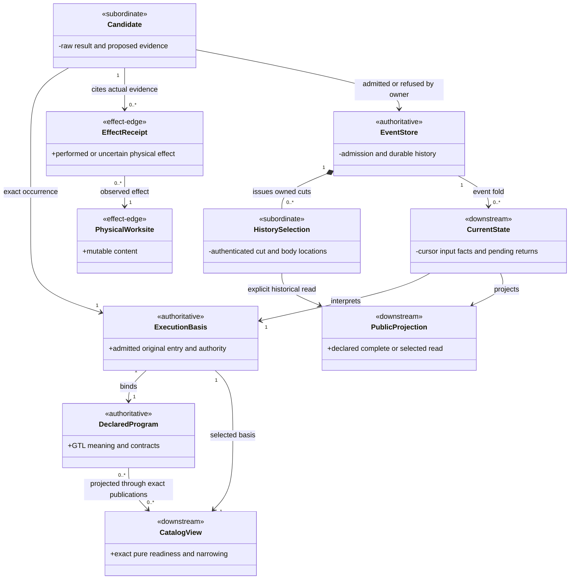
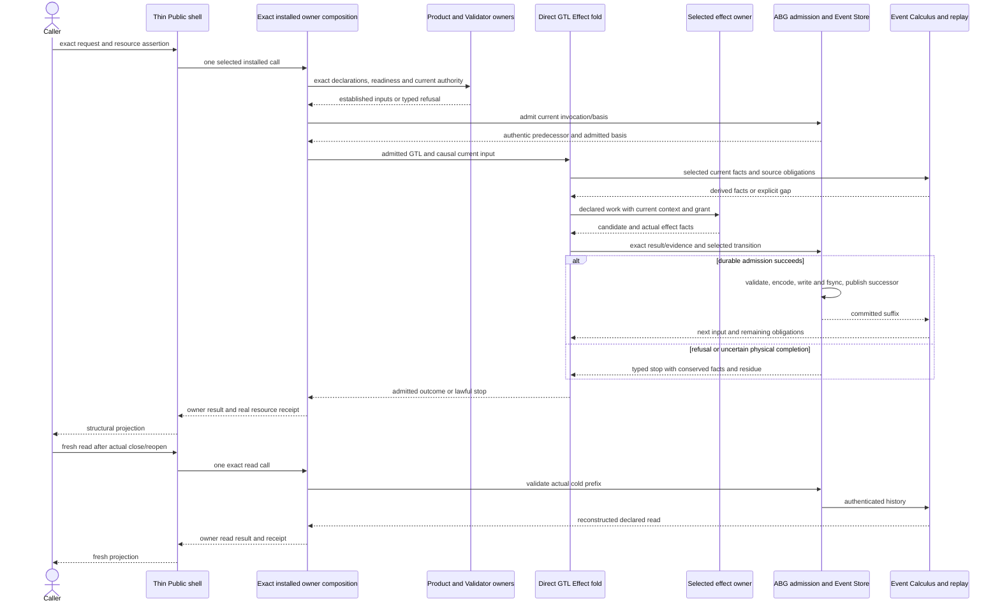
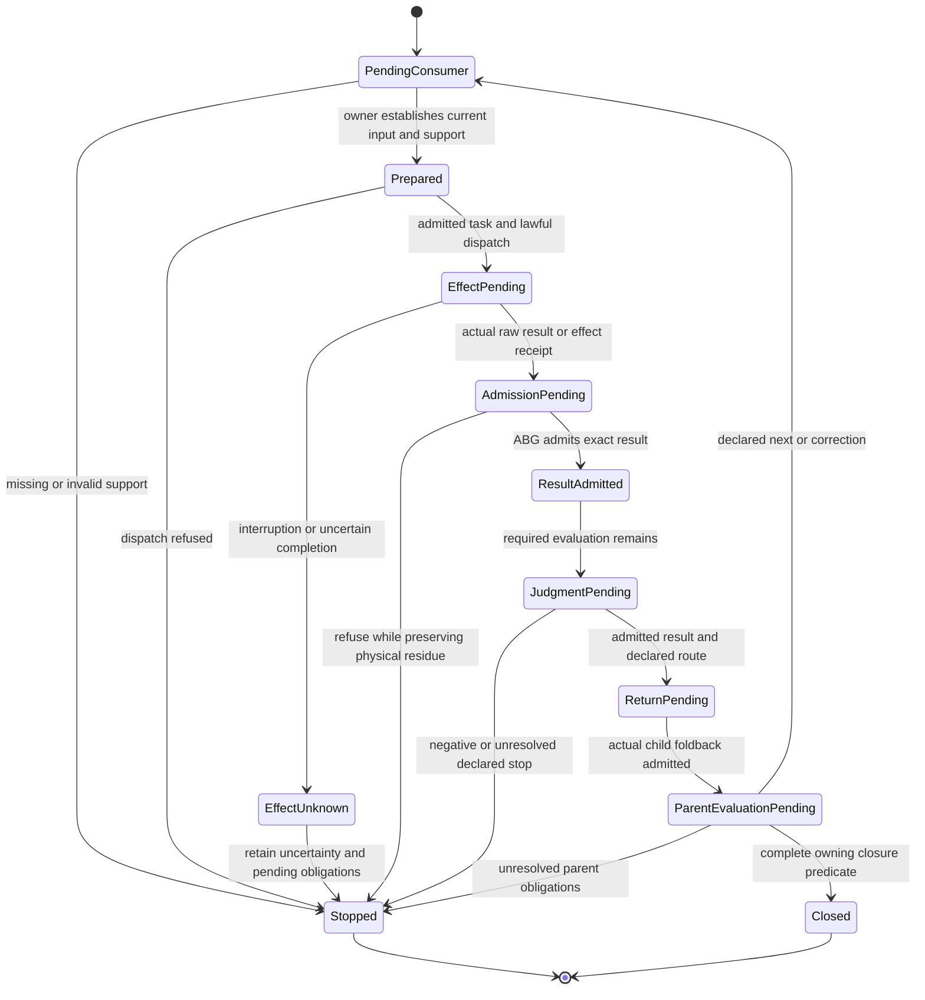

# ABIogenesis 5.0 STDO 3 Computational Binding

**Status:** computational design basis. The [preceding exact reconciliation](../../../../.ai-workspace/work/T287_STDO3_RECONCILIATION_01/disposition.md) is accepted; the current library-design extension has its own [exact assessment and disposition](../../../../.ai-workspace/work/T287_COMMON_COMPUTATIONAL_LIBRARY_DESIGN_01/activation.md). No whole-Product conformance, installed qualification or release claim.

**Authority:** the Product owner's 2026-10-21 request for thorough STDO 3 application, under GOAL-035/T-287. The [activation and exact initial basis](../../../../.ai-workspace/work/T287_STDO3_RECONCILIATION_01/activation.md), [computational assessment](../../../../.ai-workspace/work/T287_STDO3_RECONCILIATION_01/calculus-assessment.md) and its separate Writer activation bind this document's construction. Final acceptance requires the Executive's disposition of independent assessment on the exact combined document delta.

**Method:** the immutable `stdo://releases/v3.0.1-rc.1/` selected by [stdo_abiogenesis.json](../../../../stdo_abiogenesis.json), manifest SHA-256 `60356364a412dbde8cffe68fe0eda4e2749b0162acce93495534eee13b223df8`. No companion model or moving method source is selected.

## 1. Purpose and bounded claim

This is the TypeScript tenant's explicit binding from the [ABIogenesis 5.0 Product](../../../../specification/PRODUCT.md), its requirements and retained obligations to the existing computational calculus, and from that calculus to its execution environment. It applies [SPEC_METHOD §11](stdo://releases/v3.0.1-rc.1/standards/SPEC_METHOD.md#11-build-tenant-binding) and the already adopted [DESIGN_MODULE](stdo://releases/v3.0.1-rc.1/standards/DESIGN_MODULE.md) profile. It adds no language, interpreter, compiler, runtime, schema, controller or universal accounting mechanism.

The owner's clarification makes the [common computational capability library](ABI5_COMMON_COMPUTATIONAL_CAPABILITY_LIBRARY_DESIGN.md)
the first concrete design activity. This calculus supplies the library's
obligations, admitted operations and composition laws. The library design
factors current computations into reusable capabilities with actual
foundation, owner and consumer bindings so new feature work composes an
established computational basis. Coverage and explicit obligations guide that
factoring; execution and independent assessment establish actual outcomes.
§4 binds the eight operator classes to the exported atoms and modules that
realize them.

The binding names all fifteen selected Product families for coverage. Its active design reconciliation is the causally connected preparation, definition reuse, authenticated history, current-state projection, native-material, retained-work and continuation boundary. Other accepted boundaries retain their owning design and evidence. Their presence in the routing table is not a new acceptance of every implementation or proof.

The selected finite decisions are:

1. Preserve the Product's GTL graph/C algebra, direct HoG traversal, ABG admission/Event Calculus and exact owner seams. Effect 3.22.1 supplies internal execution composition; it does not become a Product program language.
2. Treat Catalog/view as pure, reproducible readiness/narrowing over exact immutable inputs. They have no ABG event lifecycle. The affected [M03 ontology and views](M03_DIRECT_GTL_TRAVERSAL_BEHAVIOR_DESIGN.md) are reconciled to that current Product law.
3. Keep current derived execution facts and authenticated history metadata separate from full decoded historical bodies. Request complete historical/public output explicitly; do not silently narrow its contract.
4. Reuse immutable established facts and completed producer work only under exact dependency/applicability law. Reuse does not transfer semantic ownership, grant new effects, substitute required assessment or prove current worksite state.
5. Preserve physical success, ABG admission, semantic evaluation and enclosing completion as separate relations, including their partial failures.
6. Evaluate the existing cleanup as one real installed producer-to-consumer path. Component proofs remain reusable within their scope; they do not close that joined path.
7. Keep evidence and unresolved material choices explicit. A disputed semantic relation is resolved at its existing owner before dependent retained implementation; code may not choose its own authority.

The [Product release allocation](../../../../specification/PRODUCT.md#50-and-51-release-boundaries) remains fixed. Standalone Consensus, dedicated observer/tuner, native human response/resume and runtime graph generation do not become new 5.0 obligations. Full Data Mapper delivery and all seven sandbox workloads are not additional release gates. Correctness defects in applicable generic runtime relations remain Product defects regardless of which workload exposed them.

## 2. The two bindings and three accounts

The requirements calculus is the Product's permitted outcomes, prohibitions, authority and conservation/qualification obligations, decomposed by [requirements](../../../../specification/requirements/README.md). The computational calculus is the following existing closed GTL/operator/owner relation and its declared effects and resource behavior. The execution binding is the selected TypeScript/Node implementation with its exact installed dependencies, native effect owners, probabilistic workers and explicitly required human decisions.

| Account | This binding's concrete subject | What its evidence cannot substitute for |
|---|---|---|
| Algorithmic | Resolve exact declarations; prepare current input/context; traverse a declared C term; execute its owner seam; admit result/evidence; fold/advance or stop; project and recover. | A correct sequence does not prove that supplied data has the right identity, authority or meaning. |
| Informational | Product `T/P/B/S/W/L`, declaration and invocation identity, current versus entry input, candidate versus admitted result, exact source/current-use relation, effect evidence, judgment and closure. | Matching structure or hashes cannot by itself establish semantic sufficiency or current physical truth. |
| Computational | Node/TypeScript functions and data structures, Effect fold, native resources/agents, durable encoded rows, indexes, selected body acquisition, prompts and measured work. | An efficient implementation or a physically completed effect does not prove admission, application success or release acceptance. |

These accounts instantiate [FOUNDATIONS, Accounts of a construction](stdo://releases/v3.0.1-rc.1/standards/FOUNDATIONS.md#accounts-of-a-construction). Each mapping states the preserved relation: canonical serialization and codec reconstruction preserve exact logical values; current-state folding preserves the selected admitted state; context presentation preserves selected material and qualifications while its semantic sufficiency remains separately judged. No approximate transformation is selected here. An approximate successor must first declare its adequacy relation and end-to-end bound at the affected owner.

### Execution environment

The source tenant is [the TypeScript package](../package.json), currently requiring Node `>=20`, TypeScript `5.9.2`, exact Effect `3.22.1`, and its exact lockfile. Qualification records the actual Node/platform/dependency/package identities; the engine range is not evidence for every compatible platform. TypeScript supplies local type checks, raw admission handles erased values, and Validator supplies the non-lowering whole-Program judgment.

The [realization constitution](ABI5_REALIZATION_CONSTITUTION.md#561-closed-operator-algebra) owns selected technology and owner lifting. Pure owner functions remain pure functions; Promise/physical owners are totalized at their own boundary; the package's Effect host membrane executes the composed installed callable. Resource Scope owns physical cleanup, not semantic closure. The supported physical model is the declared trusted developer installation and existing resource contracts, including exclusive held Event Store ownership and cold reconstruction. Unsupported outside edits during ownership cannot be treated as supported concurrent writes.

Native agents receive the selected current input, exact frame/context, contracts and capability envelope through the declared implementation/transport seam. Their internal solution strategy has no ABG authority. Model/tool availability, response-contract adherence, process termination and physical observation are operational assumptions to challenge on the selected installed path. Missing support yields its declared stop rather than a hidden fallback.

Required independent assessment and actual human Product acceptance remain distinct operations. A human who executes a tool is not thereby an `F_H` adjudicator; an LLM author is not independent merely because it has another actor label. The Product's 5.1 native response/resume allocation does not remove the human release decision required for 5.0.

## 3. Ontology and carrier projection

This slice derives from Product [identities](../../../../specification/PRODUCT.md#product-identities), [execution/context calculus](../../../../specification/PRODUCT.md#execution-and-context-calculus), the corrected [M03 ontology](M03_DIRECT_GTL_TRAVERSAL_BEHAVIOR_DESIGN.md#4-candidate-ontology), [M05 expansion](M05_DIRECT_GTL_TRAVERSAL_EXPANSION_DESIGN.md#3-ontology-delta), [Event Calculus derivation](ABG_EVENT_CALCULUS_RUNTIME_LAW_DERIVATION.md), and [continuation design](T287_PENDING_CONSUMER_CONTINUATION_DESIGN.md). The earlier Public control-plane ontology is explicitly invalidated for 5.0 and supplies no current 27/7/19 acceptance.

| Subject/carrier family | Owner and admitted domain | Read, transition and retirement |
|---|---|---|
| Immutable Product, ModulePublication, Program, GraphFunction, Graph and contracts | Product/GTL/publisher declarations and Validator judgments. One exact admitted Program owns topology and callable membership; a materialized Graph remains within its Program/invocation. | Pure reads; changed declared meaning yields a new exact basis. Runtime projections cannot mutate declarations. |
| Verified artifact, install, ProductSet, lock and WorkspaceBinding | Existing Product/install/binding owners. Stable workspace authority and exact installed identity are distinct from physical worksite content. | Physical acquisition verifies required facts; changed binding constituents require re-entry. An ordinary content edit creates an observation, not a new binding. |
| ReadyGraphFunctionCatalog, view, declaration closure and ProgramValidation | Exact binding, lock, verified installs and supplied publications. Readiness and narrowing do not widen declared authority. | Pure construct/read/reconstruct/discard; no runtime create/update/retire events. Changed dependency invalidates only the affected construction/evidence. |
| Invocation/ExecutionBasis, grants and occurrence coordinates | ABG/owning admission joins exact Program, current request and applicable authority. Actor identity and available capability are insufficient. | Admitted immutable facts; new authority or new invocation follows its own owner. Original entry input remains distinct from progressed current input. |
| RuntimeEvent and authenticated predecessor/prefix | ABG-admitted, ordered causal history and exact applicable event-contract profile. | Expected-prefix append; no in-place semantic rewrite. A historical cut remains historical; a current effect uses the current applicable predecessor. |
| Current cursor/input, active calls, HoldsAt facts, unresolved returns and dependencies | Derived `S` from the exact admitted history and declarations. | Incremental suffix fold, pure read, cold reconstruction, discard. No independent persistent authority or private lifecycle. |
| Candidate, owner receipt, admitted Result and Judgment | Candidate, observation, runtime admission and evaluation are distinct owner stages. | Preserve exact producer, call, actor, basis and assessment status; a new consumer does not relabel old work as its own. |
| Mutable worksite, observation and physical receipt | Declared effect owner plus ABG-admitted evidence. Physical state changes independently of immutable binding. | Observe under current grant; perform only declared effects; unknown post-effect state invalidates dependent currentness without inventing rollback or successor observation. |
| History/body locations, codec coordinates, scope indexes and prospective validation view | Subordinate mechanics of the existing Event Store/prefix owners; no independent truth identity or public operation. | Reconstruct from authenticated bytes; scoped selection; body reads verified once per generation and kept by the owner as a projection of the immutable history, never authority; rollback/close/poison invalidation as specified by the owner, the kept bodies going with the generation. A copied coordinate cannot confer the owner's acquisition. |
| DefinitionCall/Return, owner semantic union, DefinitionExecutionFault and PublicOutcome | Existing concrete owner and installed binding. Semantic output, resource receipt and host failure remain distinct. | One bound invocation; no caller-selected callback/handler, fourth binding combinator or Public orchestration. |

Subordinate payloads inherit their owner's lifecycle; no extra peer entity is implied by this table. The authoritative IACS remains the existing [M03 family set](M03_DIRECT_GTL_TRAVERSAL_BEHAVIOR_DESIGN.md#7-irreducible-architectural-carrier-set), its [M05 delta](M05_DIRECT_GTL_TRAVERSAL_EXPANSION_DESIGN.md#5-irreducible-architectural-carrier-set-delta), and exact owner-specific later amendments. The history representation refines the Event Store/prefix/replay realization. It does not promote `RuntimeHistory`, body metadata or codec records into a second store or ABG aggregate.

## 4. Closed operation and composition signature

### Existing operator classes

The eight operator classes of [constitution §5.6.1](ABI5_REALIZATION_CONSTITUTION.md#561-closed-operator-algebra) are the signatures of exported functions; the class name is not a new callable or semantic atom. Named atoms in named modules realize each class. The [common library design](ABI5_COMMON_COMPUTATIONAL_CAPABILITY_LIBRARY_DESIGN.md#4-atomic-function-families) owns the library atoms and their laws; each owner keeps its exact type, basis and refusal family.

| Class | Typed relation | Module | Realizing atoms | Admitted-domain decision |
|---|---|---|---|---|
| `select` | finite sequence × predicate → absent / exact / ambiguous | `shared/select/` | `resolveExactMatch`, `exactMatchCardinality`, `onlyExactMatch`, `exactMatchOutcome` | Preserve multiplicity until zero/one/many is known; never first-match, set-collapse or fallback authority. `ExactMatch<T>` realizes the codomain: `one` is exact, `many` is ambiguous. |
| `validate` | raw/declaration subject × exact contract → admitted validation / refusal | `shared/admit/` | `admitJson`, `admitContract`, `admitRef`, `isRecord`, `hasExactKeys` | Refuse before prohibited construction/effect; no silent repair. Local, raw and whole-Program checks retain distinct domains. `unknown` enters the pure layer only through this module. |
| `derive` | exact immutable inputs → immutable value / refusal | `shared/value/`; `shared/rooted_topology_partition.ts` | `canonicalJson`, `writeCanonicalJson`, `canonicalEquals`, `sha256Canonical`, `sha256Bytes`, `writeCanonicalRecord`, `deepFreeze`; `deriveCanonicalRootedTopologyPartition` | Pure Catalog/view/closure/planning relation; no mutable-tail lookup or runtime event. |
| `transition` | owner state × command × authority → candidate / refusal | owner modules, such as `abg/retry.ts`; lifted by `abg/exact_prefix_bindings.ts` | owner transition functions, such as `planRetryRuntimeFailureTransition`; lift `bindExactPrefixTransition` | Candidate is not a performed effect or durable fact. |
| `admit` | exact applicable predecessor × candidate × evidence → successor/admitted value / refusal | `abg/event_store.ts`; lifted by `abg/exact_prefix_bindings.ts` | `admitRuntimeEventTransactionAtExpectedPrefix`; lift `bindExactPrefixTransition` | Existing owner decides its complete enclosing relation. ABG runtime facts use expected-prefix atomic admission; other owners do not inherit that authority. |
| `traverse` | admitted GTL × cursor/current input × basis → proposal / completion / refusal | `hog/graph_execute.ts` | `executeGraphTraversalEffect` | HoG consumes the original Program/materialized Graph. ABG joins the outcome to the lawful continuation. |
| `project` | immutable truth/authenticated prefix × supported selector → typed view / refusal | `abg/calculus/`; lifted by `abg/exact_prefix_bindings.ts` | `effectOf`, `foldStep`, `holdsAt`; lift `bindExactPrefixRead` | No projection writes truth, chooses a live tail implicitly or supplies its own admission witness. `effectOf` and `foldStep` are closed over `ROOT_EVENT_CALCULUS` and `ROOT_DERIVED_RULES`; no caller supplies an axiom or a rule. `holdsAt` is the only reader of a lifecycle fact. |
| `materialize` | admitted physical operation × target/grant → receipt/manifest / refusal or substrate fault | `product/install_product.ts` and ABG actor transport for the effect; `shared/process/` for its facts | `installProductInResolvedLock`; `createOwnedProcessLifetime`, `hasConfirmedOwnedProcessBoundary`, `encodeOwnedProcessFacts` | Physical effect and semantic admission remain separate. Collision, failure and residue follow the existing owner contract. |

`checkExactRecord` (`shared/select/`) is a static composition of `select`, then `validate`, then `derive`, not an atom of one class.

The generic binding algebra stays exactly `bindStaticOwner`, `bindExactPrefixRead` and `bindExactPrefixTransition`, fixed at module construction by direct owner imports and exact schemas. Their declared roles are structural admission, one owner invocation and exact receipt validation. They do not select semantic policy, sequence a new workflow, decide currentness, acquire a rival catalog or translate owner refusal into a host failure. `bindStaticOwner` lives in `shared/binding/`; `bindExactPrefixRead` and `bindExactPrefixTransition` live in `abg/exact_prefix_bindings.ts`.

### Seven C constructors

The constructor domain is the exact Product/requirement signature in [C-ALGEBRA](../../../../specification/requirements/gtl/REQ-L-GTL3-C-ALGEBRA.md), represented by [c_algebra.ts](../code/src/gtl/c_algebra.ts) and traversed by HoG:

| Constructor | Composition law and closed material cases |
|---|---|
| `C.of` | One exact declared locus/fibre/contract/owner. Distinguish valid result, expected refusal, malformed output, substrate failure and uncertain performed effect. |
| `C.id` | Preserve the actual value and its applicable basis; introduce no result, evidence, authority or physical effect. |
| `C.compose` | The previous admitted output through its declared transfer satisfies the next input. Preserve identity, type/cardinality, order, authority, evidence and refusal. The Product-declared associativity does not erase intermediate effect/admission boundaries. |
| `C.edge` | Transform, evaluate and consequence remain explicit. Negative/unresolved evaluation follows its declared consequence; it cannot become a default success. |
| `workflow.C` | Exact published GraphFunction membership and invocation contract; child entry, result, foldback and parent re-evaluation remain visible. Child completion alone cannot close its parent. |
| `C.batch` | Preserve declared children, identities and collection cardinality; each consumes its own authority. Complete-vector and partial-stop/unstarted cases remain distinct; no partial vector masquerades as full output. |
| `C.retry` | Repeat only the declared bounded interior under admitted retry policy, attempt lineage and consumed allowance. A missing result does not establish an undispatched effect; retry does not mean graph recursion or new work authority. |

The graph domain remains `edge`, `compose`, `substitute`, `recurse`, `fan_out`, `fan_in`, `gate`, `promote`, `identity` and `same_object`, under [COMPOSE](../../../../specification/requirements/gtl/REQ-L-GTL3-COMPOSE.md), [RECURSE](../../../../specification/requirements/gtl/REQ-L-GTL3-RECURSE.md), [SUBSTITUTE](../../../../specification/requirements/gtl/REQ-L-GTL3-SUBSTITUTE.md) and [M05 graph projection](M05_DIRECT_GTL_TRAVERSAL_EXPANSION_DESIGN.md#61-graph-algebra-projection). Program typing/validation owns which combinations are admitted. Recursion conserves termination/bounds, child/parent relation and foldback; substitution preserves declared compatibility; fan-out/fan-in conserve each child and its exact join; gates/promotion cannot widen authority; identity/same-object preserve the declared identity relation. This binding introduces no extra constructor to repair a missing case.

The continuation range is the Product's next unit, same-unit retry, declared recursive call, parent foldback, re-entry/reprice, typed human hold, yield/block or terminal projection. Every selected route is an admitted instance of that range. Native response-driven F_H resumption remains outside 5.0 qualification; applicable declared holds and truthful blocked handoffs remain required.

### Composition and refinement

Keep pure owner atoms as `A → B | OwnerExpectedRefusal`. Physical/Promise atoms are lifted through the selected Effect boundary into typed success, expected owner value or exact substrate fault. Static bind conserves the input/output and required capability relation; it does not choose topology or semantic meaning. Effect's capability composition does not mint an authority grant.

For the selected invocation, use [§5.6.1A's operative graph correspondence](ABI5_REALIZATION_CONSTITUTION.md#561a-operative-computational-realization): every reachable semantic/control/effect vertex and edge maps to an accepted C relation, owner port, Effect edge, ABG admission or Event Calculus/replay projection, and every required accepted relation has its operative path. Multiple batch/retry/recursive occurrences are lawful. An unmapped hidden coordinator remains invalid even when renamed, moved or wrapped in Effect.

The correspondence, actor regime and Product use of Kleisli/monadic terms are not a new claim that the entire tenant is a proved category-theoretic functor. A further categorical claim requires [FOUNDATIONS' formal demonstration](stdo://releases/v3.0.1-rc.1/standards/FOUNDATIONS.md#4-algebra), including arrow equality and preservation. No such new claim or mandatory a_c artifact is selected here.

## 5. Operation results and method predicates

The runtime's domain values stay in their owning contracts. A method evaluation records its predicate, exact subject/basis and one core result; the binding does not rewrite runtime unions to the method core. The following are closed interpretation cases for this selected boundary:

| Operation/evaluation predicate | Outcome and cause | Core result and conservation |
|---|---|---|
| Exact subject is admissible under contract/basis | All required relations established | `satisfied`; this establishes that admissibility only. |
| Exact submitted subject is admissible under contract/basis | The evaluation has its own valid contract and authoritative expected basis, and establishes a violated type, cardinality, membership, authority or other applicable constraint; this includes a wrong, missing, stale or crossed basis inside the submitted request when that law decides the violation | `falsified`; retain the typed refusal and known counterexample. Invalid submitted content does not invalidate an otherwise valid negative admission evaluation. |
| Exact subject is admissible under contract/basis | Evaluation is attempted, but its own required subject/support or governing basis is unavailable, stale, crossed or incoherent, so it cannot support that evaluation | `invalid_basis`; identify the evaluator's unusable support. This is distinct from evaluating a submitted request's invalid basis against known valid law; no effect may rely on the unusable support. |
| Applicable property is established by selected evaluation | Evaluation is actually performed on an admissible basis, but its admissible evidence is insufficient to decide the property, including observed uncertainty about effect completion | `indeterminate`; retain what is known, pending evidence and any actual residue. |
| A required property was to be assessed | The required assessment is not performed because its actor/tool is unavailable, with no sufficient applicable assessment already available | No result for that assessment; retain an explicit coverage gap. A separately performed availability or operation-failure evaluation may have its own predicate/result, but it does not supply the missing assessment. |
| Selected evaluation is within the activated frame | Requested judgment requires a different undeclared capability/domain | `out_of_frame`; route to the owning evaluator without granting it authority by referral. |
| Declared measurement was executed, attributed and admitted | Authentic measurement/result meets that operation contract, including a negative test result | `satisfied` for measurement. The separate predicate “application meets tested criterion” is `falsified` when the criterion is disproved. |
| Declared physical install completed | Exact physical receipt establishes completed effect | `satisfied` for that physical act only. A subsequent ABG refusal leaves “installation admitted” non-satisfied under its actual cause. |
| Current task is complete | All selected completion evidence, judgments and return/closure obligations are established | `satisfied`; otherwise evaluate the exact missing/negative/basis cause. Parsing, transport success, child success and process exit do not decide this predicate. |
| Declared 5.0 obligation applies | Current Product explicitly allocates that obligation to 5.1 | The applicability predicate is `falsified`; a design `not_applicable` verdict satisfies only the declared “met or excluded” disjunction, never implementation conformance. |

A constructor such as `blocked`, `refusal`, `failure`, `result` or exit code is insufficient to choose a core result without its cause and predicate. A concrete owner result with multiple possible causes must retain the distinguishing cause before the corresponding evaluation is relied on. An unperformed assessment has no result; it is not a sixth value. In particular, raw F_P output, an F_D process label and a human actor name are not evaluations.

For example, an admission evaluator with the exact expected lock can falsify
the admissibility of a request naming a different lock. If the evaluator cannot
acquire its own authoritative expected lock, its attempted evaluation instead
has `invalid_basis`. An evaluator that actually examines admissible effect
evidence but cannot determine completion returns `indeterminate`. If the
required evaluator never runs because its declared tool is unavailable, that
assessment has no result; a stopped invocation record does not fill its gap.
These cases preserve both the actual operation/effect facts and the separate
semantic predicate being evaluated.

[AXIOMATIC_CALCULUS §5](stdo://releases/v3.0.1-rc.1/standards/AXIOMATIC_CALCULUS.md#5-traversals-and-functor-kinds) owns its own traversal and functor-kind vocabulary. Its F_D kind classifies total deterministic processing. That classification identifies no ABG construction, admission or effect leaf by itself; an operation's F_D standing is its row in [the deterministic kind under the selected edition](#the-deterministic-kind-under-the-selected-edition). An optional a_c representation binds operation kind, domain, authority and result meaning explicitly; equal spelling is no import.

The source/runtime-wide enumeration of every owner refusal constructor and its consuming method predicate is not certified complete by this table. That is an affected-path proof obligation where a concrete operation will be relied on. It cannot be replaced by a blanket “all errors are falsified” mapping.

### The deterministic kind under the selected edition

**Import.** This tenant uses common F_D, `urn:stdo:concept:axiomatic-calculus:f-d`, as [ODD §5](stdo://releases/v3.0.1-rc.1/standards/ODD.md#probabilistic-compute) imports it: by exact edition, from [AXIOMATIC_CALCULUS §5](stdo://releases/v3.0.1-rc.1/standards/AXIOMATIC_CALCULUS.md#5-traversals-and-functor-kinds) in `stdo://releases/v3.0.1-rc.1/`, manifest SHA-256 `60356364a412dbde8cffe68fe0eda4e2749b0162acce93495534eee13b223df8`, under the Product's [regime table](../../../../specification/PRODUCT.md#compute-and-authority) (`PRODUCT.md:530-539`). The Product's F_D meaning is the common kind's. An operation is F_D when it declares `f_B: D_B -> Outcome_B` over a closed domain with its exact basis, declares every material computational state and dependency, carries a termination argument, and gives exactly one declared outcome for each domain input. An F_D operation is created under an admission owner, and its authority is the grant in that lineage: the operation contract and the admission record of its creation carry what it may do, and the kind label adds none. The `F_D` regime that a GTL boundary, implementation descriptor or arm declares is a claim this section disposes, not a standing. Under [AC-015](stdo://releases/v3.0.1-rc.1/standards/AXIOMATIC_CALCULUS.md#ac-015-functor-classification) no invocation qualifies as F_D on an unestablished claim.

**Owners.** The code names three owners. They hold their authority by their contracts and grants, never by a regime label:

- Product admission: [admission_authority.ts](../code/src/product/admission_authority.ts) `validateAdmissionCapabilityBasis`, `admitCapabilityEnvironment` and `withAdmissionAuthority`, and [catalog.ts](../code/src/product/catalog.ts) `admitGraphFunctionCatalog`. The physical install `installProductInResolvedLock` ([install_product.ts](../code/src/product/install_product.ts)) is an effect; it enters runtime truth only through ABG's `admitProductInstallInResolvedLock` and `admitArtifact` ([environment_admission.ts](../code/src/abg/environment_admission.ts)).
- ABG admission: the event transaction at an expected or durable prefix, `admitRuntimeEventTransactionAtExpectedPrefix` and `admitRuntimeEventTransactionAtDurablePrefix` ([event_store.ts](../code/src/abg/event_store.ts)); evidence, result and judgment admission, `admitEvidence`, `admitResult` and `admitJudgment` ([c_call.ts](../code/src/abg/c_call.ts)) with `admitCCallResult` and `admitCCallJudgment` ([c_call_outcome.ts](../code/src/abg/c_call_outcome.ts)); and route admission, `admitTraversalTransition` through `admitTraversalTransitionInActiveTransaction` to `admitRoute` ([traversal_route.ts](../code/src/abg/traversal_route.ts)).
- Closure: `constructionDeltaForAdvance` in [traversal_route.ts](../code/src/abg/traversal_route.ts). Under the construction authority that `selectAdmittedConstructionAuthority(…, "evaluateAction")` selects ([execution_basis.ts](../code/src/abg/execution_basis.ts)), it admits the Product `evaluateAction` result, its `EdgeFulfillmentLedger` and `EdgeClosureDecision`, as the route's `actionEvaluationAdmission` member (kind `admitted_action_evaluation`), which carries the `edgeClosureDecision`. That member is the admitted `evaluate_action` fold in which [A5 of ODD §11.5D](stdo://releases/v3.0.1-rc.1/standards/ODD.md#115d-constructive-evaluation-and-yield-loop) places closure truth, and [replay.ts](../code/src/abg/replay.ts) re-validates it.

"F_D authority" in this tenant's design records names the grant an F_D operation carries from its lineage, its creation under an admission owner, never authority held by the kind label. This reading applies to the M03 F_D authority placement derivation, its first-slice IACS and structural carrier diagram, the M03 construction-pressure package derivation and [ADR-042](adrs/ADR-042-deterministic-handling-must-not-structurally-block-governed-fp.md). A5 as 3.0.1 states it governs, and those records stay as written. A conformance gate over method artifacts is the declared admission gate of [ODD §11.7A](stdo://releases/v3.0.1-rc.1/standards/ODD.md#117a-conforming-agentic-development): its own contract and grant decide what it may admit, and its F_D claim is this section's disposition (row 10b for this tenant's self-conformance and qualification assessments).

**Disposition.** Each class below claims F_D in code or declaration. The row is what the evidence shows under [RELEASE §9](stdo://releases/v3.0.1-rc.1/standards/RELEASE.md#deterministic-kind-migration). Eligible requires a termination argument stated from code, dependencies declared in code or contract, and one typed outcome per input; the finite cases in [the deterministic contract examples](stdo://releases/v3.0.1-rc.1/standards/examples/DETERMINISTIC_CONTRACTS.md) are the pattern.

| Class | Realization owner | Profile | Totality | Material dependencies | Outcomes | RELEASE §9 row | Evidence |
|---|---|---|---|---|---|---|---|
| 1. Typed value admission | [admit/json.ts](../code/src/shared/admit/json.ts) `admitJson`; [admit/contract.ts](../code/src/shared/admit/contract.ts) `admitContract`, `admitRef`; [admit/record.ts](../code/src/shared/admit/record.ts) `isRecord`, `hasExactKeys` | Admission. Evidence contract: the caller's I-JSON shape or Valibot schema. Grant: none of its own; the caller's admission owner decides what the admitted value may be used for. | `admitRef`, `isRecord` and `hasExactKeys` decide from one primitive or own-key read. `admitJson` refuses a Proxy (`types.isProxy`, true for a revoked proxy too) before any inspection read, at every container and at every prototype and constructor the realm check reads, and refuses an accessor member by its descriptor; it bounds the path by `open` (a cycle is refused) and `NESTING_BOUND` 512. On an object that is not a Proxy every remaining read is an engine internal method that runs no user code (`Object.getPrototypeOf`, one `Reflect.ownKeys`, one `Object.getOwnPropertyDescriptor` per key, `Array.isArray`); a module namespace's uninitialized binding throws ReferenceError from the engine and is refused. The recursion is a finite walk of the root-to-leaf paths and terminates; a shared container is admitted once per path. The declared domain excludes a host object whose interceptors forward reads to a Proxy (a vm-contextified global over a Proxy sandbox), which no engine check sees. `admitContract` gates the raw with `admitJson`, so it terminates where `admitJson` does and refuses every non-I-JSON raw as `contract_mismatch` at the member's path; `safeParse` then reads the original raw, which after the gate has no accessor member and no Proxy at any container, so no code of the raw runs; every schema throw is caught and typed. | The input, module constants, Valibot and the owner's schema; no trap or accessor code of the input. | A detached, deeply frozen `JsonValue` or the schema's output, else exactly one typed refusal (`non_ijson_value`, `contract_mismatch`, `blank_ref`). No input throws. | Eligible for `admitJson`, `admitContract`, `admitRef`, `isRecord` and `hasExactKeys` over the declared domain: the four at `ee7c49721` (T-290 C-15), `admitContract` in the gate form at `6071e6936` (T-290 C-15b). | `t287-common-computational-library` (the C-15 cases: a Proxy at the root, a member and an array refused with no trap run; a throwing and a looping trap not entered; the `admitContract` case restated over the gate form at C-15b: a Proxy raw at the root and below it and an accessor raw refused with no trap or getter run, a throwing schema and a throwing `v.custom` typed, an identity-checking schema admitting the original raw); code reading |
| 2. Canonical value, digest, equality and exact selection | [canonical_json.ts](../code/src/shared/canonical_json.ts) `canonicalJson`, `writeCanonicalJson`; [digests.ts](../code/src/shared/digests.ts) `sha256Canonical`, `sha256Bytes`; [value/equality.ts](../code/src/shared/value/equality.ts) `canonicalEquals`; [value/record.ts](../code/src/shared/value/record.ts) `writeCanonicalRecord`, `canonicalRecordDigest`; [select/exact_match.ts](../code/src/shared/select/exact_match.ts) `resolveExactMatch`, `exactMatchCardinality`, `onlyExactMatch`, `exactMatchOutcome`; [select/exact_record.ts](../code/src/shared/select/exact_record.ts) `checkExactRecord`; [immutable.ts](../code/src/shared/immutable.ts) `deepFreeze`, `isDeeplyFrozen` | Evaluation. Subject: the admitted value or finite source. Reads: that argument and, for `checkExactRecord`, the typed context data the call supplies. Outputs: the derived bytes, digest or verdict; no witness. Writes: none, except that `deepFreeze` freezes its own argument. Stops and results: the outcome column. Authority: none. Invalidation: a change to the canonical-JSON or digest law. | The domain is the admitted `JsonValue` that row 1 returns (detached, frozen, acyclic, at most 512 deep) and a finite source. Recursion is structural over that finite value. `resolveExactMatch` passes once over the finite source with the caller's predicate; its admitted domain is a finite source and a total predicate ([library §6](ABI5_COMMON_COMPUTATIONAL_CAPABILITY_LIBRARY_DESIGN.md#6-prime-atoms-admitted-domains-falsifiers)), and a predicate exception propagates. `checkExactRecord` runs `select`'s finite match, then the reader's module-constant `project`, then its digest leg, each at most once. Its context is data (an I-JSON value or a frozen owner record), never a function, so the check terminates where the reader's module-constant legs terminate over that data; an exception from either leg propagates. The ABG per-prefix record (`checkedRecordAtPrefix`, [library §2](ABI5_COMMON_COMPUTATIONAL_CAPABILITY_LIBRARY_DESIGN.md#2-library-organization-and-dependency-direction)) caches a `one` outcome under the reader's constant and the context key and changes no outcome. | The value or source argument, the caller's predicate, the reader's module-constant check and its typed context data, module constants and the `node:crypto` SHA-256 import. No clock, filesystem or shared mutable state. | One canonical byte string, digest, boolean, record check or exact-match cardinality (`absent`, `one` or `many`) per input. A non-finite number is outside the admitted domain; the `TypeError` guard marks that boundary. | Eligible, on the admitted domain. | `t287-value-equality`, `t287-select-family` |
| 3. Event Calculus fold and point query | [calculus/fold.ts](../code/src/abg/calculus/fold.ts) `effectOf`, `applyStep`, `foldStep`, `applyClip`, `holdsAt`, `workingFoldState`; [calculus/axioms.ts](../code/src/abg/calculus/axioms.ts); [calculus/rules.ts](../code/src/abg/calculus/rules.ts) `deriveLiveness`; [calculus/liveness.ts](../code/src/abg/calculus/liveness.ts) `nativeLivenessRelationHolds`, `projectRuntimeRetryBudgetFacts`; [calculus/execution_basis_record.ts](../code/src/abg/calculus/execution_basis_record.ts) `projectExactExecutionBasisRecordAtPrefix`; [event_calculus.ts](../code/src/abg/event_calculus.ts) `eventCalculusDependencies`, `runtimeFluentHoldsAtPrefix`, `deriveRuntimeEventCalculusProjection` | Evaluation. Subject: the admitted prefix. Reads: the prefix and the module tables. Outputs: a fold state, truth value or projection; no witness. Writes: identity-keyed memos only. Stops and results: the outcome column. Authority: none; consumers act under their own contracts. Invalidation: a change to the root event contract or the axiom and rule tables. | One step per event over a finite admitted prefix. Each step applies a finite effect list from module-constant axiom and rule tables. `applyClip` only deletes from a finite map. `deriveLiveness` evaluates the calculus liveness relation over the fold state before the event, the event and the cut before it; the relation reads the recorded `elapsedMs`, not a clock, and checks finitely many earlier rows of the finite cut. `WeakMap` memos keyed by identity cache derived values without changing outcomes. | The admitted prefix under its root event contract and the module-constant tables. These modules read no clock, filesystem or dynamic import. The `performance.now` reads in `runtime_liveness.ts` belong to the observers `captureNativeFrameBoundary` and `observeNativeCCallLiveness`, which are effects outside this row. | One fold state, fluent truth value or projection per admitted prefix. A `TypeError` guard fires only for an event outside the root contract, or for a native liveness observation without its exact admitted source and threshold relation (`calculus/rules.ts:104-107`); admission, the relation composed with the structural-identity join, keeps both out of the domain (`event_store.ts:4091`). | Eligible. | `t287-calculus-fold`, `m5-event-store-reopen` |
| 4. Replay derivation and guard witness | [replay.ts](../code/src/abg/replay.ts) `replayValidatedRuntimeEventPrefix`, `projectRuntimeReplayGuard`, `writeRuntimeReplayGuardValue` | Evaluation. Subject: the admitted prefix. Reads: the prefix only. Outputs: the replay projection and the guard witness value that `writeRuntimeReplayGuardValue` serializes. Writes: none; persisting the witness is the caller's separately authorized effect. Stops and results: the outcome column. Authority: none. Invalidation: a change to the prefix, the root contract or the replay rules. | One structural pass over a finite admitted prefix. Closure members are re-validated against their recorded route. Each check returns a typed value or throws its `TypeError` guard for an event outside the root contract. | The prefix argument and module constants. `replay(store, scope)` reads a held store; that read is the store's, and `replay` is not in this row. | One replay projection or guard witness per admitted prefix. | Eligible, for the prefix-taking functions. | `t287-route-reconstruction`, `m5-event-store-reopen` |
| 5. Route, evidence, result and judgment admission, and the closure fold | [traversal_route.ts](../code/src/abg/traversal_route.ts) `admitTraversalTransition`, `admitTraversalTransitionInActiveTransaction`, `admitRoute`, `constructionDeltaForAdvance`, `actionEvaluationProjection`, `edgeClosureDecision`; [c_call.ts](../code/src/abg/c_call.ts) `admitEvidence`, `admitResult`, `admitJudgment`, `completeRejectedCCall`; [c_call_outcome.ts](../code/src/abg/c_call_outcome.ts) `admitCCallResult`, `admitCCallJudgment`; [closure.ts](../code/src/abg/closure.ts) `admitOwnedScopeClosure` | Admission under ABG's grant. Evidence contract: the root event contract and the staged route, evidence, result and judgment candidates. Closure admits the `evaluateAction` result as the route's `actionEvaluationAdmission` member, the admitted `evaluate_action` fold. | The checks are finite over the staged prefix, candidate and route. Each refusal returns before any candidate is built. The construction is finite over the checked inputs and the batch: the later candidates of a route or closure batch are factories over the earlier events, for causation. | Declared for every owner. The event time is the admission basis's `eventTime` (`RuntimeAdmissionBasis`), sampled once by the caller at the call that opens the transaction (HoG's `admissionBasis` and `workflowBasis` per phase) and passed in: `admitEvidence`, `admitResult`, `admitJudgment` and `completeRejectedCCall` (`c_call.ts`), `admitRoute` (`traversal_route.ts`) and `admitOwnedScopeClosure` (`closure.ts`) take `basis.eventTime`. Where a caller passes the traversal's seed (the CCall opening, the scope opening, the cursor, the child basis, the actor intent and append), the owner takes one sample at its own opening and passes it to the construction. No sampler call remains inside a transaction body in the ten modules (16 openings, 3 HoG seeds, the sampler's definition). The event store hashes the candidate, `eventTime` and `admissionOrdinal` included, into `eventId`. The append is the store's effect. | Admitted events or one typed refusal. The same inputs, the declared time included, yield the same admitted events. | Eligible. Realized by T-291 M-6 (`ae84e2099`) and T-290 C-18a (`a0829a298`): 22 of the 29 in-transaction construction samples became a declared input at M-6; the route's four and the rejected-call completion's three at C-18a, once the two lane bases that omitted the member their declared type requires carried a fixed `eventTime` (`t287-undispatched-diagnostic:298`, `retained-route-cursor-transition:116`; an arrangement, not an assertion). Outside the row: HoG's seed bases at the continuation entry and `failTraversal`, and its separate bases inside the retry and F_H hold transactions (M-6 findings 2 and 3), are T-287 D0's HoG census. | Code reading (`event_store.ts` `eventId` construction; the M-6 sites census; C-18a's exit grep, `sampleNativeEventTime()` 27 to 20 in the tree, none inside a transaction body); the M-6 base instrumentation over 2,719 transactions (no reader depends on distinct times within one transaction; no two candidates in a transaction with a native sample differ only in `eventTime`; `eventId` hashes the ordinal); `t287-route-reconstruction`, `t287-r4-aba-retry`, `t287-event-calculus-owner-continuation`, `t287-calculus-fold`, `t287-undispatched-diagnostic` (7/7) and `retained-route-cursor-transition` (its base first error) equal before and after at C-18a; the M-6 lane set equal at M-6 |
| 6. Graph materialization and Program validation | [materialize.ts](../code/src/gtl/materialize.ts) `deriveMaterializedGraphShape`, `materializeGraph`; [validator/validation.ts](../code/src/validator/validation.ts) `validateProgram`, `validatePublication`; [validator/graph.ts](../code/src/validator/graph.ts) `validateGraph`; [graph_construction.ts](../code/src/gtl/graph_construction.ts) `graphTemplateDiagnostics` | Evaluation (validation) and derivation (materialization). Subject: the declaration and its materialization basis. Reads: those only. Outputs: a validation result or graph value. Writes: the brand and the shape cache. Stops and results: the outcome column. Authority: none; Program admission is ABG's. Invalidation: a change to the declaration, the basis or the validator law. | Structural recursion over finite declarations. The source-path loops are bounded by path length. `validateProgram` maps every throw to an invalid result. | The declaration, its materialization basis and module constants. `materializeGraph` writes the process-local brand `materializedGraphs` and the shape cache `materializedShapes`, its declared writes. On a cache miss, `retainedMaterializedGraphShape` returns `null` and the caller reconstructs the shape in full. `isMaterializedGtlGraph`, which reads the brand, is not in this row. No filesystem, clock or dynamic import. | One validation result or materialized graph per declaration. A materialization `TypeError` fires only for a declaration outside the validated domain. | Eligible. | `m5-c-algebra-validation`, `r7-graph-validation-basis`, `t287-gtl-graph-law` |
| 7. Artifact verification, dependency lock and install-tree match | [verify_product.ts](../code/src/product/verify_product.ts) `verifyProduct`, `readArchiveMembers`; [environment.ts](../code/src/product/environment.ts) `resolveProductArtifacts`, `constructResolvedProductLock`; [declaration_exports.ts](../code/src/product/declaration_exports.ts) `linkNativeContractSet`, `compilerBasis`, `installedToolchainProductContentDigest`; [install_product.ts](../code/src/product/install_product.ts) `installedProductContentMatches`, `listInstalledPayloadFiles` | Evaluation. Subject: the artifact file's bytes, read once, or the install root. Reads: the artifact file once; the executing toolchain's identity, as an input; the toolchain's bundled compiler and its declaration libraries; the install tree, as an observation outside the check. Outputs: a verification receipt or lock. Writes: the memo `resolvedProductEnvironments`. Stops and results: typed refusals. Authority: none; Product admission (row 8) consumes the result. Invalidation: a change to the artifact bytes, the executing toolchain or its compiler. | Established. `verifyProduct` reads the artifact once (`readFile`) and decides over those bytes: one in-process `gunzip` and one walk of the USTAR blocks (`readArchiveMembers`) yield the member list, the manifest, `package.json`, the payload and the capability graph, and the walk ends at the end-of-archive block or stops with its reason (empty directory members are listed and dropped by the inventory filter). `resolveProductArtifacts` and `linkNativeContractSet` take the executing toolchain's identity as an input; `constructResolvedProductLock` and the `resolve` definition binding each read it once. Both type-checks run over a finite file set: the declaration files the artifact's exports name, held in memory, and the toolchain's own libraries under `compilerDependencyRoots` (213 payload files); `createClosedHost` and the resolution hooks confine reach, the compiler options do not. The bundled checker (TypeScript 5.9.2) bounds each checked node: instantiation depth 100 and count 5e6, a conditional tail of 1e3, unions of 1e5, relation depth 100 and complexity. The install-root walk (`listInstalledPayloadFiles`) is an observation the operation makes after its check, not part of the check. | Declared: the artifact bytes, read once and bound by `expectedArtifactDigest`; the executing toolchain's identity, an input, with the link refusing `incompatible_dependency` when it is not the selected toolchain; the compiler, that toolchain's bundled module inside the same payload digest; the install tree's current state, read as an observation (§6). Named: the type-check inside `verifyProduct` runs under whichever toolchain executes, the receipt does not record which, and only the link compares (recording it is a `VerifyProductRequest` or result change, the owner's); the two parameters are required since T-290 C-18a (`a0829a298`), the three component lanes passing one read each, and the executing manifest is read by one `product/` reader (`readExecutingToolchainIdentity`, `declaration_exports.ts`), of which `installedToolchainProductContentDigest` is the null-on-failure projection; the confinement assumes no symbolic link under the toolchain roots (none exists; `installProduct` refuses them in installed trees). | One typed verification or lock outcome or refusal per input. A walk failure refuses `artifact_unreadable` with the reader's reason; a member the walk did not find refuses at its stage's code. `payload_unreadable` and the graph read's `catalog_mismatch` arm stay declared and are no longer produced, because the inventory equality precedes them. | Eligible: realized by T-291 M-4 (`e9e74fb74`), under the owner's ruling of 2026-10-25 (realization only, no lock change, no fuel or deadline bound). | Code reading; `t287-wave2-installed-product-verification` (the walk's refusal mapping), `t287-installed-dependency-lock`, `m5-s06-prime` (`incompatible_dependency`), the compose scenario |
| 8. Product capability admission | [admission_authority.ts](../code/src/product/admission_authority.ts) `admitAdmissionCapabilityBasis`, `admitCapabilityEnvironmentOutcome`, `withAdmissionAuthority`; the throwing wrappers `validateAdmissionCapabilityBasis`, `admitCapabilityEnvironment`, `admissionAuthoritySlots` | Admission under the Product's grant. Evidence contract: the verified artifact, the executing toolchain manifest and the current durable prefix. | Established. Each deterministic check is finite over the observations before it: the parsed authority and data basis; the acquired current prefix coordinate; the artifact truth and environment at it; the verified artifact; the executing toolchain identity (manifest digest and product content digest). The steps run in the base's order, each observation taken only once the checks before it pass. | Declared as observations under the operation's effect contract, in the order the operation surfaces them: physical verification (`verifyProduct`, row 7) or the owner's retained verification; the held store at its acquired current prefix (`assertHeldEventStoreAtDurablePrefix`) and, for live admission, that prefix's currentness (`assertDurableRuntimePrefixCurrent`); the executing `product-toolchain-manifest.json`, read once per admission. No process-local memo (the `executingOwnerArtifacts` WeakSet is gone). A store, log or file failure is the effect's failure. | An admitted capability basis or environment, or one admit-family typed refusal (`StructuralRefusal`, stage `validate`, `evidence.reason` the surfaced message; 14 refusal constants for the base's 15 throw sites). `admitCapabilityEnvironment`, `validateAdmissionCapabilityBasis` and `admissionAuthoritySlots` map a refusal once (`admissionRefusalError`) to the `TypeError` they threw before; `withAdmissionAuthority` maps it to the `resource_admission` fault, whose message is that error's string. | Eligible. Realized by T-291 M-6 (`ae84e2099`): observations split from deterministic checks that return typed refusals; the executing install bound by manifest digest and product content digest (M-5 finding 5); every Public operation's refusal shape unchanged (the new lane and `steel-basic-cli-public`'s base receipt). At T-290 C-18a (`a0829a298`): the `resource_acquisition` fault's stage, code and message ride in the `resource_admission` fault's message as canonical JSON instead of `[object Object]` (the lane's fifth case). At T-290 C-18b (`811bb8f85`): admission's `observeExecutingToolchainIdentity` calls the one `product/` manifest reader, `readExecutingToolchainIdentity`; the two lanes that substituted admission's `node:fs/promises` (`t287-conformance-owner-reuse`, `witness-reprice-mechanics.mjs`) substitute `declaration_exports.js` instead. The `ValiError` cause is no longer attached to the data-basis refusal; no reader read it. | Code reading; `r4-catalog-admission` (6/6/0/0) and `t291-m6-admission-refusal-surface` (five surfaced strings, four refusal arms and the acquisition fault, 5/5/0/0); `r5-invocation-admission` (2/2/0/0 at T-290 C-18b `811bb8f85`; red at the base from M-6 through C-18a), `witness-reprice-definition-binding` (15/15/0/0 at C-18b), `witness-run-stopped-definition-binding` (7/7/0/0 at C-18b) and `t287-w2-05-install-catalog-owner-chain` (1/1/0/0 at C-18b); `steel-consumer-authority`, `steel-consumer-declaration` and `t287-declared-testing-capability`, equal before and after; `t287-conformance-owner-reuse`, `t287-selected-action`, `t287-installed-qualification-conservation` and `t287-retained-installed-consumer` red at their owner-held input checks through C-18b (reasoned skips at C-19). The arms that need a live store at a non-current prefix or a tampered executing manifest are checked by code reading only |
| 9a. Governance choice, fold and parent projection | [implementation/default_library.ts](../code/src/implementation/default_library.ts) `projectGovernanceChoice`, `foldGovernanceWork`, `evaluateGovernanceParent` over [abg/default_library.ts](../code/src/abg/default_library.ts) `projectGovernanceChoice`, `projectGovernanceFold`, `projectGovernanceParent`; declared F_D by [gtl/default_library.ts](../code/src/gtl/default_library.ts) | Evaluation. Subject: the admitted prefix and leaf input. Reads: those and the basis's GraphFunction declarations. Outputs: a choice, fold state or parent state. Writes: none. Stops and results: the outcome column, `null` included. Authority: none; ABG admits the leaf result. Invalidation: a change to the prefix, the library declarations or the registered selection. | One finite pass over the admitted prefix and the declared input. The three functions contain no `throw`. They return `null`, the declared no-outcome value, for an input outside the accepted shape, and `projectGovernanceChoice` also returns `null` for a throw from registered-selection resolution. A throw from a helper reaches the leaf port, which types it as `implementation_exception`. | The admitted prefix and the leaf input. | One choice or `null`, one fold, or one parent evaluation per input. | Eligible. | `t287-default-library`, `t287-default-library-fulfillment` |
| 9b. Governance preparation leaves | [implementation/default_library.ts](../code/src/implementation/default_library.ts) `prepareGovernanceSelection`, `prepareGovernanceNativeTask`, `prepareObservedTestingTask`; declared F_D by [gtl/default_library.ts](../code/src/gtl/default_library.ts) | Construction under the leaf descriptor's grant, declared F_D. Evidence contract: the governance state, plus a worksite observation the contract does not declare. | Reads are bounded by `maxFiles` and `maxBytes` in `observeWorksiteContext` and `observeWorksiteSubject`, but the outcome depends on what the mutable worksite holds when it is read. | Undeclared as inputs: the worksite's current files, read through [abg/default_library.ts](../code/src/abg/default_library.ts) `currentContext`, `observeWorksiteContext` and `observeWorksiteSubject`. | One task or refusal per pair of input and worksite state; the worksite state is not in the declared domain. | Construction Eligible; the leaf Pending on one stop. Subject: the governance state and the admitted worksite observation (`observeGovernanceWorksite`, the three leaves' only worksite read, admitted by `contextMatches`, bounded by `maxContextFiles`, `maxContextBytes` and the selected paths). Termination: one finite pass; the construction is a finite projection. Dependencies: the declared input, the admitted prefix and the observation the result carries, bound by the deterministic evidence's output digest and re-derived at result admission. Outcome: one task or refusal per (input, prefix, admitted observation); per declared input alone the leaf still has one outcome per worksite state, because it performs the observation itself. Stop: admitting the observation as its own evidence row before construction needs a new evidence-candidate kind, an event contract (owner question 15, T-287 D0 disposition, 2026-10-27). | Code reading; `t287-default-library`, `t287-default-library-fulfillment`, `t287-declared-testing-capability`, `t287-governance-covered-source-use` |
| 10a. `workflow.C` arm openings | [c_call.ts](../code/src/abg/c_call.ts) `openWorkflowCCallLocus` (openings with `regime: "F_D"` and `armId: "arm://abiogenesis/workflow.C@5"`) and the foldback `admitWorkflowChildFoldbackUsing` | Construction: the opening and foldback of a child traversal under the CCall owner's grant. The `F_D` label covers the arm's opening and foldback checks; the child traversal is composed under [AC-016](stdo://releases/v3.0.1-rc.1/standards/AXIOMATIC_CALCULUS.md#ac-016-typed-composition), which keeps both traversal identities. | The F_D claim covers the arm's opening checks (`openCCall`, `openWorkflowCCallLocus`, `admitPreparedCCallOpening`) and its foldback checks (`admitWorkflowChildFoldbackUsing`). Both are finite over the selected prefix and their declared inputs, synchronous, and yield one admission or one typed refusal; the claim is stated at `openWorkflowCCallLocus`. The child traversal runs between them in HoG as its own traversal, under its own rows. | Opening: the selected prefix, the execution basis, the scope, the proposal and the declared contracts. Foldback: the prefix, the parent CCall, the child execution basis and scope, and the child's admitted terminal truth at the prefix. The child traversal's dependencies are the child's, not the arm's. | The CCall opened (two events) or one typed open refusal; the child foldback admitted (one `child_foldback_admitted` event carrying the parent's and the child's identities) or one typed foldback refusal. | Eligible. Realized by T-291 M-6 (`ae84e2099`): the census found the arm's checks separate from the child's run (the opening synchronous over the prefix; the child in HoG between `Abg.openCCall` and the foldback admit; the foldback synchronous, the child's outcome entering only as admitted terminal truth at the prefix; the reconstruction functions pure), and the code states the scope at the opening and the foldback. The recorded `regime` value is unchanged. | Code reading (the M-6 census; the scope statement at `openWorkflowCCallLocus` and `admitWorkflowChildFoldbackUsing`); `d2-workflow-step` (8/8/0/0 at T-290 C-18b `811bb8f85` with the evidence root set; skipped before it under the activation's command); `t288-workflow-scope-conservation` retired at C-18b as a predecessor differential (C-5 stop 2), so the arm's evidence is the code reading and `d2-workflow-step` |
| 10b. Program-declared F_D leaf implementations | [leaf_invocation_port.ts](../code/src/implementation/leaf_invocation_port.ts) (stages `authority_verification`, `implementation_load`, `implementation_invocation`; the catalog admission decided as the first step of `authority_verification` and carried as `LeafExecutionOccurrence.qualificationCatalogs`); [validator/qualification_catalogs.ts](../code/src/validator/qualification_catalogs.ts) (`admitInstalledQualificationCatalogs`, `readInstalledQualificationRuleCatalog`: the install-rooted read for the port, the run operation, the self-conformance basis and ABG's verdict projection); the leaves that `gtl/*.ts` Programs declare F_D (requirement handoff, self-conformance, semantic revision publication, worksite, Consensus, default library); the qualification assessment leaves in [implementation/qualification.ts](../code/src/implementation/qualification.ts) | Per leaf. An assessment leaf (self-conformance, qualification) is an evaluation: subject its assessed input, reads its declared input and the catalogs admitted on its occurrence, output the typed assessment or its typed failure with deterministic evidence, no writes, no authority (ABG admits the result), invalidated by a change to its input or catalogs. A construction leaf has its descriptor's contract and grant. | Termination is established per leaf from code (T-291 M-5) and the loop claims are read in full (M-5b): Consensus' role recursion runs submitter to reviewer once; `validator/validation.ts`'s `visit` is structural; the `abg/semantic_*` walks advance a decreasing ordinal or a visited set; `admitRuntimeThreshold` has no loop. The port types every outcome, sets no deadline or fuel (the owner's ruling of 2026-10-25), and returns an F_D leaf's typed failure with its deterministic evidence. Totality over the admitted input, by read class: the catalogs are inputs at every caller in the tree; `readSelfConformanceCatalog`, the semantics provider and the run operation take the executing package's admitted catalogs (T-290 C-18a, `a0829a298`); the two defaults of `validator/qualification.ts`, reached only by export-map members called without catalogs, keep the module-relative read until T-290 C-18b, because the isolated-copy lanes' partial package cannot be admitted as the executing package (Material dependencies); the five command-limit leaves read `selectedWorksiteCommandExecutionLimits` (one reader since C-18a, `abg/actor_process.ts`, each caller validating; `NativeIntake` as the value's entry point, a declared input key and the owner's question 7; `NativeConstruction` and the three native semantic task leaves as a gate over limits their input carries, a basis member at the two construction sites in T-287 D0 with that question, since a `NaN` limit cannot enter a basis and `t287-native-semantic-job` asserts the raw reader); the live-worksite observations of eight leaves are row 9b's class (T-287 D0); the worksite selection and preparation leaves and `prepareObservedTestingTask` read the ambient `HOME`, `TMPDIR`, `LANG`, `LC_ALL` and `PATH` on `environmentEntries`' record branch, captured at preparation (T-287 D0 with the C2 pin's re-declaration, the owner's question 8: the renderer's built bytes are pinned by `gtl/worksite_command_execution.ts:36-39`, and the capture as a basis member needs a declared input key at the six prepare and select leaves); `abg/semantic_job.ts:303` compares a whole-file read with a live observation (row 9b's class); every other whole-file read is compared to a digest the input or the event log records. | Declared: the admitted implementation set and install root; the leaf's input and its occurrence's durable prefix; the coverage and rule catalogs, admitted once per owner install at `authority_verification` by `validator/qualification_catalogs.ts` (the rule catalog against its public-contract asset digest `abg.asset.qualification.rule-catalog`, coverage through `manifestDigest` and `productContentDigest`) and carried as `LeafExecutionOccurrence.qualificationCatalogs` to every qualification leaf, the native and judgment-time operations, the owner projection and the F_P preparation; the run operation admits the rule catalog from the executing package's admitted catalogs (T-290 C-18a; at M-5b it read the selected Program's install, which a foreign Program lacks); the verdict projection, given none, admits them from the owner install its durable prefix records (one admission reads the install's 5,313 payload locators, 67.8 MB, in about 0.1 s; one memo per install identity per process since C-18a, `admitQualificationCatalogsOnce`, a refusal not retained). Remaining module-relative catalog read: the two defaults of [validator/qualification.ts](../code/src/validator/qualification.ts), reached only by the `./abg` and `./validator` export-map members called without catalogs (T-290 C-18b, with the isolated-copy support carrying the full payload). `readSelfConformanceCatalog` and the semantics provider read the executing package's catalogs, admitted once per process (`executingQualificationCatalogs`, C-18a). The ambient command limits and environment reads are named under Totality. | One typed leaf outcome per invocation that returns. A catalog whose bytes differ from what the verified install records is `implementation_exception` at `authority_verification`, reason `refused`, cause `{at, atTruncated, reason}` naming the catalog and both digests (F_D); an F_P leaf observes it as `thrown` with the reason (the undispatched profile admits a cause for `thrown` only). An F_D qualification leaf's typed failure arrives with its failure class. | Pending. Realized by T-291 M-5 (`661294535`) and M-5b (`94e923d75`): the catalogs admitted at the authority stage and carried on the occurrence, every in-tree caller in the grant passing them, the F_D failures' evidence, totality classified by read class. T-290 C-18a (`a0829a298`): `readSelfConformanceCatalog`, the semantics provider and the run operation read the executing package's catalogs; one memo; one command-limit reader. Remaining: the two defaults of `validator/qualification.ts` (T-290 C-18b, with the isolated-copy support); the command limits (`NativeIntake` a Program declaration, the owner's question 7; the four gate leaves a basis member, T-287 D0); the ambient environment reads (the C2 pin and the declared keys, the owner's question 8; T-287 D0). The live-worksite observations of eight leaves and `abg/semantic_job.ts:303` are row 9b's class (T-287 D0). | Code reading; the census of 131 catalog-taking calls; `t287-qualification-law` (the admission case, intact and tampered for each catalog, `refused` with its cause; a typed F_D failure through the port with its evidence); `t287-qualification-scopes`, `t287-malformed-gtl-gate`, `t287-native-runtime-gate`, `t287-native-structural-gates`, `t287-qualification-contraction`, `t287-installed-qualification-conservation` and the other 77 lanes, compose and `t287-retained-installed-consumer` equal before and after |

The table has twelve rows: ten eligible (1, 2, 3, 4, 5, 6, 7, 8, 9a, 10a), two pending (9b, 10b) and none unresolved. Actor and process execution, worksite mutation and native work are effects under their own operation contracts (§6), not rows. HoG traversal composes rows and is not one. The GTL conformance corpus and the serialization schema's regime enum are schematic contracts with no implementation to qualify; under RELEASE §9 their use binds the kind and operation contracts when instantiated.

**Migration record.** The old basis is `stdo://releases/v3.0.0-rc.1/`, manifest SHA-256 `069285ad5a79d59ca2dd835e34a54b3e537b0eeef99c29994b18c339dbe62232`. Its clauses are AXIOMATIC_CALCULUS §5, where `F_D` classified deterministic evaluation or proof over declared properties, and ODD §5 Probabilistic compute, where `F_D` was `urn:stdo:concept:graph-native-odd:f-d`, now historical and no alias. The new basis is `stdo://releases/v3.0.1-rc.1/`, manifest SHA-256 `60356364a412dbde8cffe68fe0eda4e2749b0162acce93495534eee13b223df8`, with the clauses cited above. The applicable row for each class is the table's. Rows 1, 2, 3, 4, 5, 6, 7, 8, 9a and 10a map to common F_D with their unchanged operation profiles (row 1 since T-290 C-15b, row 7 since T-291 M-4, rows 8 and 10a since T-291 M-6, row 5 since T-290 C-18a). Rows 9b and 10b keep only their lawful standing on the old basis while it applies and gain no successor F_D standing until their remediation is done. The runtime default-library snapshot keeps the old basis until T-287 D0. Retained Runs and qualification evidence keep their original exact bases; current URN lookup does not reinterpret them.

## 6. State, effects and partial completion

The governing state equations remain [Product Live State, Recovery And Valid Reuse](../../../../specification/PRODUCT.md#live-state-recovery-and-valid-reuse):

```text
L_next = L ++ newlyCommittedEvents
S_next = foldStep(S, newlyCommittedEvents)
recover(P, L, referencedEvidence) = committedRuntimeState(S)
reusable(a) = admitted(a) ∧ dependenciesRemainValid(a) ∧ applicableToCurrentUse(a)
```

They bind the same declarations and committed cut. Historical equality does not make an old observation current. Progressed input and its causal producer remain separate from original `B.entryInput`. Ordinary internal handoffs consume established current state; cold acquisition, explicit history and actual invalidation retain their necessary reconstruction.

The complete selected execution-phase partition is the existing [Event Calculus phase projection](ABG_EVENT_CALCULUS_RUNTIME_LAW_DERIVATION.md#complete-phase-projection), specialized here to its effect/admission duty:

| Frontier | Remaining owner work and lawful stop |
|---|---|
| Declared consumer, no task admitted | Prepare exact current input and support; missing material is a gap/refusal. Do not restart the producer merely to recreate this boundary. |
| Preparation failed before task admission | Preserve its actual failed result if admitted and exact source/cursor. Reprepare only under selected changed support or applicable correction/allowance; no blanket retry. |
| Task admitted, dispatch proven absent | Existing authorized dispatch may proceed after current mutable dependencies are checked. An absence inferred solely from no Result is insufficient. |
| Effect active, interrupted or completion uncertain | Wait, observe or block through existing owners. Preserve uncertainty and withdraw dependent currentness over the writable scope; no duplicate effect or invented rollback. |
| Physical effect/raw result exists, admission pending | Admit or refuse that exact material under its owner. Physical success cannot force admission, and admission refusal cannot erase the physical effect. |
| Result admitted, judgment/transfer pending | Reuse exact Result/call/actor. Perform required judgment or route; a failed Result does not supply a success handoff. |
| Child completed, foldback not admitted | Perform only the eligible declared return against the actual child result/closure and parent binding; do not rerun the child to rebuild process-local state. |
| Foldback admitted, parent evaluation pending | Consume exact progressed parent input; perform its remaining evaluation/route before closure. |
| Local remainder discharged | Close only that remainder under its complete predicate. Other task/Run obligations can remain. |
| Missing/conflicting causal, effect or phase facts | Retain known facts; return unknown/invalid or obtain the required evidence. File presence, elapsed time and diagnostics do not invent a missing phase. |

Fresh work reusing a historical result and exact pending-execution resumption are distinct [continuation domains](T287_PENDING_CONSUMER_CONTINUATION_DESIGN.md#governing-distinction). A replacement Run keeps its own identities and explicit causal linkage, preserves consumed bounds and underlying work authority, and never rewrites a terminal predecessor as active.

For the physical store, the complete selected commit sequence is owner candidate validation, staged encoding/index/profile/hash state, native append/write and fsync, then publication of the admitted successor. Failed write/fsync restores the prior owned extent; failed restoration poisons ownership. Tentative body-source eligibility never survives rollback. Close/poison ends the applicable live correspondence; a real close/reopen receipt enables cold reconstruction. Separate admitted owner returns remain separate durable boundaries; no generic transaction swallows their partial-failure surfaces. [Constitution, held resource law](ABI5_REALIZATION_CONSTITUTION.md#held-abg-event-resource-staging-and-physical-publication).

For physical installation followed by event admission, the install owner and ABG remain separate. An already completed physical target is preserved as actual residue when admission refuses. The latest [237/continuation17](../../../../.ai-workspace/work/T287_SANDBOX_UAT_RUN_02/operator/library-joint-proof-237/continuation-17/return-02.md) reached exactly that stop. The next activation must select lawful reuse of the actual completed installation or a genuinely changed-pair entry. This document grants no automatic retry, overwrite or weaker identity guard.

## 7. Computational realization and whole-path work

This is the [UP-019](stdo://releases/v3.0.1-rc.1/standards/DESIGN_MODULE.md#computational-realisation-projection-up-019) projection of the preceding meanings:

| Material duty | Semantic disposition | Realization decision, role and source |
|---|---|---|
| Immutable declaration resolution and validation | Existing accepted Product/GTL/Validator relation | Consume and optimize existing owners; retain deeply immutable exact Catalog/View closure results and call-local installed module acquisition. [declaration_closure.ts](../code/src/product/declaration_closure.ts), [execution_resolution.ts](../code/src/product/execution_resolution.ts). Changed physical acquisition is not replaced by an old process cache. |
| History selection and scope/cause lookup | Existing Event Store/prefix relation | Optimize using authenticated envelope/scalar metadata, causal indexes, physical body locations and the verified bodies of the current generation in the same owner. [runtime_history.ts](../code/src/abg/runtime_history.ts), [event_prefix.ts](../code/src/abg/event_prefix.ts). This role selects; it grants no admission or new lifecycle. |
| Current-state Event Calculus/replay | Existing event interpretation | Incremental fold over newly committed suffix; retain current facts/dependencies, acquire historical bodies when selected. [Event Calculus design](ABG_EVENT_CALCULUS_RUNTIME_LAW_DERIVATION.md#operational-fold-and-historical-output). Complete requested ReplayState/events remain complete outputs. |
| Durable body encoding | Existing exact logical event meaning | Adapt physical representation only. [T289 v1 body slots](T289_IMMUTABLE_INSTALL_EVENT_BODIES_DESIGN.md#native-basis-input-and-ccall-result-physical-bodies-t-287--rc1) cover input/result; [payload topology v2 extension](M03_PAYLOAD_LEDGER_EVENT_TOPOLOGY_DERIVATION.md#native-definition-material-in-durable-event-rows) adds the exact native-definition field bundle. Old “two slots” describes v1, not the later entire codec. |
| Context/source/current-use selection | Existing frame/context and source authority | Consume current input, exact selected bodies and owner-proven source correspondence. Share exact accessible definition material while preserving role, qualifiers, residuals and effect permissions. [Default governance](T287_DEFAULT_GOVERNANCE_LIBRARY_DESIGN.md#covered-current-use-correspondence-and-native-testing-reacquisition), [pending consumer](T287_PENDING_CONSUMER_CONTINUATION_DESIGN.md). |
| Common proof preparation | Existing install/bind/catalog/current-call owner relations | Adapt the canonical caller, not semantic owner law. Preparation is not dispatch; no helper invents ABG events or completion. The [shared helper](../test_env/uat/continuation.mjs) remains test support. |
| Traversal and installed bindings | Existing GTL/HoG/ABG and Product owners | Consume the selected Effect foundation and three static binding combinators; no additional semantic dispatcher, runner, catalog or registry. |

Similar maps, folds or append-only sequences are only commonization candidates. A differing key, authority, ordering, mutation, concurrency, lifetime, failure or retention law is evaluated before sharing. Where laws agree, use the existing common mechanism or record the operational reason for a separate realization; never relabel the shared semantic relation as local new truth. No new general library is selected by this reconciliation.

### Exact representation and reuse cases

The affected finite domain includes:

- immutable native versus copied/foreign mutable declaration inputs;
- owned live prefix, complete explicit validated array and prospective validation view;
- unchanged warm use, changed consumed authority/definition/observation, cold reopen and poisoned/rolled-back ownership;
- current narrow projection versus requested complete historical/public output;
- inline legacy rows, v1 input/result body references and v2 native-definition references;
- genuine source/current-use evidence versus copied receipt or manufactured basis;
- retained completed producer work, exact pending consumer and fresh new work.

The owner is selected by the existing public/typed contract, not a new mode field. Prospective validation may inspect a checked candidate prefix but cannot acquire admitted-history or Source authority. Copying a live coordinate uses the owning cold/validation path where supported; it does not reconstruct a nominal owner witness from shape.

Codec reconstruction satisfies exact logical event/value/digest equality over its admitted domain. Earlier inline source eligibility is same-stream and owner-established; missing, forward, foreign-slot, changed, chained or mixed unsupported references refuse. Native-definition sharing is separate from input/result cross-slot sharing. Encoded physical byte coordinates are obtained from actual rows, never by serializing expanded events. Rollback removes tentative eligibility.

### Workload, lifetime and measurement boundary

The joined path is:

`Public entry → exact installed resolution → current source/input/context preparation → HoG/owner work → native effect → measurement/result/judgment admission → selected correction/foldback → close/reopen → fresh Public read`.

Measure supported workload in declaration/closure size, event/envelope count, encoded/logical byte size, selected causal-scope extent, current obligations, prompt/body size, batch width/recursion depth and explicit requested output size. A source specimen or one heap observation establishes only its measured dimensions.

| Measure | Unit and boundary | Required distinction |
|---|---|---|
| Initialization and recovery | elapsed milliseconds and bytes read from exact cold acquisition to readiness/reconstructed state | Cold necessary validation versus ordinary unchanged handoff. |
| Selection and validation | rows/keys examined, body reads and bytes acquired per owner call and complete selected path | Constant accessor calls are not proof of constant underlying scan cost. |
| State/body lifetime | live/current metadata, selected body bytes and retained heap/RSS observations from preparation through handoff/close/reopen | Requested complete output may live with its caller; incidental retained historical bodies must not become mandatory live state. Sampling is not an allocation/peak proof. |
| Rendering and transport | exact input/output/context bytes, available declared token measure and transport records at the actual worker boundary | Context completeness and accessibility versus presentation size; no inferred model capacity. |
| Persistence | actual encoded bytes, append/fsync operations and committed suffix per transaction | Logical identities versus physical byte correspondence; no repeated full readback merely to count work. |
| External work and assurance | elapsed time and recorded model/tool/human effort within each selected operation | Separate framework processing, native computation, communication, review and waiting. |

No universal capacity threshold or complexity bound is introduced. Before capacity qualification the selected activation declares the supported workload, available actor/resource envelope and any acceptance limits from Product/owner authority. If those are absent, a capacity claim stays open. The known design law remains usable: ordinary handoff work does not grow with unrelated history without a named dependency, and every complete-history operation names its extent.

## 8. Whole-family Prime and three-view reconciliation

For this boundary the complete candidate family includes declaration/basis identity, readiness, invocation and effect authority, current-input transfer, runtime admission, history representation, current-state/recovery, source reuse, continuation, foldback and closure. The contraction decisions are:

| Candidate responsibilities | Decision and preserved distinction |
|---|---|
| Verify/resolve/install/bind/catalog preparation | Share lawful pure mechanics where equivalent; keep verification, physical effect, binding authority and pure readiness separate. No common “prepare” authority absorbs them. |
| Several exact-prefix reads | Existing parameterized projection/selection families, with exact scopes and output contracts; no second event store or universal untyped query. |
| Live/cold/prospective prefix representations | One admitted-history meaning with different proof/operational roles; prospective candidates are expressly not admitted history. Their private correspondence is subordinate. |
| Native input/result/definition bodies | One storage codec owner with closed typed slots and supported compatibility, preserving each event's distinct identity/causality; no separate body authority. |
| New work, exact continuation and retry | Preserve distinct admitted domains and failure/effect predicates. Shared mechanics cannot turn them into one “resume” mode. |
| Producer/consumer, child/parent and measurement/judgment | Preserve separate semantic roles, independence and return obligations; do not reduce them to one success bit. |
| Semantic candidate, physical receipt, event admission and replay | Preserve all owner boundaries. Generic Effect/binding/history mechanics transport or implement them but do not own them. |

These decisions preserve all retained meaning and authority; no semantic loss is accepted. They constrain the affected family and realization projections. They do not declare a fresh exhaustive Product-wide Prime census. Full realization-to-atom mapping and inspection of every reachable affected edge remain proof obligations before that implementation boundary closes.

The larger domain/sequence/state projections remain the corrected [M03 three views](M03_DIRECT_GTL_TRAVERSAL_BEHAVIOR_DESIGN.md#9-three-view-behavioral-design), [M05 views](M05_DIRECT_GTL_TRAVERSAL_EXPANSION_DESIGN.md#7-three-view-projection) and later owner amendments. Current Product release allocation and operative constitution govern any historical slice/deferred table. The following compact views bind the current cleanup seam; labels describe existing roles or derived phases, not new runtime types.

### Domain view

A CatalogView may contain zero or many Programs, and one Program may appear in
zero or many views. The separate ExecutionBasis relations select one exact
Program and one exact view for an admitted execution; they do not narrow the
shared CatalogView domain or make an empty view executable.



### Sequence view

The Public participant is the existing thin shell; Binding is one statically closed owner composition. This view does not put constituent ordering in Public. The selected-effect participant realizes only its declared seam.



### State view

These phases project existing occurrence/result/continuation/closure truth. They do not add a serialized state machine or imply automatic retry on any arrow.



An active stopped occurrence does not silently return to `Prepared`; any new work or exact continuation uses its separately admitted relation. Complete failure closure and application satisfaction remain different predicates.

### Cross-view assessment targets

| Relation | View correspondence and owning enforcement | Current claim |
|---|---|---|
| One Program/owner path | DeclaredProgram/ExecutionBasis; single installed call; HoG phases. Product/GTL/Validator, exact binding and §5.6.1A enforce. | Design decision conserved; full source reachability proof remains bounded to its actual assessed subject. |
| Catalog is pure | CatalogView downstream, Product readiness in sequence, absent from runtime states. Product F01/F09 and catalog owners enforce. | Concrete stale M03 projection repaired; independent design assessment required. |
| Candidate/effect/admission separation | Candidate/EffectReceipt/EventStore; explicit admission alternative; AdmissionPending/EffectUnknown. Existing effect/admission owners enforce. | All declared partial cases routed; actual joined path remains unqualified. |
| Current state/history/body lifetime | HistorySelection subordinate and CurrentState downstream; selected reads and cold reconstruction. Store/prefix/EC owners enforce. | Source/component evidence exists; integrated lifetime/growth claim remains open. |
| No premature completion | Result, judgment, return and parent states remain separate. GTL consequence, ABG closure and library semantic owners enforce. | Design predicates fixed; native correction/restart exit evidence still required. |
| Reuse preserves ownership | Exact basis/source in domain and preparation; no automatic restart arrow. Existing source/current-use/continuation owners enforce. | Unchanged installed preparation and affected continuation must be proved on the chosen pair. |

These are declared claims with explicit evidence standing, not a fabricated all-pass axiom matrix. The final review returns core values for each applicable changed relation and their conjunction. Missing evidence or unresolved applicability is not `not_applicable`.

## 9. Finite Product coverage and release joins

The Product remains the owner of exact meaning and completion. This routing covers every selected family, using its existing computational owners:

| Family | Requirements/design and computational owner route | Required evidence boundary |
|---|---|---|
| A5-F01 install/workspace/catalog | [INSTALL](../../../../specification/requirements/product/REQ-P-INSTALL.md), [CATALOG](../../../../specification/requirements/product/REQ-P-CATALOG.md); Product verify/resolve/install/bind and pure readiness, ABG actual install/binding admission | S01 plus changed preparation/identity/partial-effect proof on exact installed candidate. |
| A5-F02 language/validation | [GTL requirements](../../../../specification/requirements/gtl/REQ-L-GTL3-LANGUAGE.md), C/type/contracts and Validator; serialization is not lowering | S02 retained language cases and malformed/refusal cases. |
| A5-F03 graph/C/traversal | [PROGRAM-TRAVERSAL](../../../../specification/requirements/mapping/REQ-M-GTL3-PROGRAM-TRAVERSAL.md), C algebra and M05; one HoG fold/ABG joins | S02/S03, seven constructors, graph and conservation matrix with current release applicability. |
| A5-F04 probabilistic integrity | [INSTRUCTION-ASSEMBLY](../../../../specification/requirements/abg/REQ-R-ABG3-INSTRUCTION-ASSEMBLY.md), [TRANSPORT](../../../../specification/requirements/abg/REQ-R-ABG3-TRANSPORT.md); candidate/evidence/result owners | Actual F_P context/output/effect path and malformed, unattributed, contradictory or incomplete output refusal. |
| A5-F05 one public authority | [PUBLIC-CONTRACTS](../../../../specification/requirements/product/REQ-P-PUBLIC-CONTRACTS.md), static definition binding | All retained public projections agree with one typed source; changed generated/publication subject rechecked. |
| A5-F06 thin SDK/CLI | Same public contracts and constitution §5.6.2C | One installed invocation per request; automatic continuation and truthful stop; no public controller. |
| A5-F07 One Surface | [FN-COMPOSITION](../../../../specification/requirements/abg/REQ-R-ABG3-FN-COMPOSITION.md), [M05 §12](M05_DIRECT_GTL_TRAVERSAL_EXPANSION_DESIGN.md#12-s03-one-surface-governed-evidence-fold) | S03 retains four separate semantic authorities, fresh observations, intent/invocation and closure. |
| A5-F09 catalog semantics | CATALOG and Product current tool/runtime split | Pure read/narrow/apply, exact call/start and empty/ambiguous cases; no runtime catalog truth. |
| A5-F10 event truth | [EVENTS](../../../../specification/requirements/abg/REQ-R-ABG3-EVENTS.md), [PROJECTION](../../../../specification/requirements/abg/REQ-R-ABG3-PROJECTION.md), [CONTINUATION](../../../../specification/requirements/abg/REQ-R-ABG3-CONTINUATION.md) | Live/cold same-cut truth, effect uncertainty, partial admission, continuation and correction; changed codec/history proofs. |
| A5-F11 self-conformance | [SELF-CONFORMANCE](../../../../specification/requirements/product/REQ-P-SELF-CONFORMANCE.md), [F11 target](T287_F11_REUSABLE_QUALIFICATION_LIBRARY_TARGET_DESIGN.md) | Genuine independently warranted owning assessments over exact specification/design/realization/proof subject; no self-minted green. |
| A5-F13 native independence | PUBLIC-CONTRACTS, native SDK/CLI and installed owner exports | S06 source-independent native use; marketplace host parity is not added to 5.0. |
| A5-F14 mechanics proof | [SCENARIOS](../../../../specification/requirements/product/REQ-P-SCENARIOS.md) and corrected M03 root | External minimal deterministic test plus live F_P path through actual installed package; no built-in Hello Product. |
| A5-F15 exact qualification | [QUAL](../../../../specification/requirements/product/REQ-P-QUAL.md), F11 and sole AF22 | All required owning results on one exact pre-RC subject/law basis, then distinct exact installed-RC qualification. |
| A5-F16 immutable release | QUAL and Product [release scenario](../../../../specification/PRODUCT.md#abg5-s07-exact-qualification-and-release) | Qualified unchanged bytes through AF25, immutable RC, fresh install and actual human acceptance of that same RC; no renamed final cut. |
| A5-F17 downstream lifecycle | SCENARIOS, default governance and pending-consumer designs | S06 original selected source/oracle → actual behavior → independent measurement → targeted correction → fresh evidence, preserving residuals. Full Data Mapper remains separate. |

The proof domain is finite constructor/variant/guard coverage plus declared recursive composition and exact selected scenarios. It is not enumeration of every graph walk or an assertion about every possible LLM outcome. Mandatory S01/S02/S03/S06 and the all-family qualification join remain on one exact installed pre-RC candidate; S07 keeps its separate release subjects.

## 10. Remaining decisions, proof and completion boundary

The latest source work supplies substantial bounded progress: definition reuse and installed composition have finite returns; runtime history/current-state source cut34 has source/component evidence; native-body codec components conserve complete logical values. Their original subjects and method bases remain unchanged. This document does not requalify them as STDO 3 results.

The current blocking relation in [237/continuation17 return-02](../../../../.ai-workspace/work/T287_SANDBOX_UAT_RUN_02/operator/library-joint-proof-237/continuation-17/return-02.md) is install identity/admission before native Testing/C2, with physical installation residue preserved. Source44 and the frozen original producer/consumer evidence remain exact inputs within their stated derivations; new source or a new invocation label is not permission to repeat completed preparation.

Before dependent runtime work, the selected activation resolves these material unknowns at their existing owners:

| Open item | Required decision or evidence | Dependent claim withheld |
|---|---|---|
| Exact next installed preparation | Identify the already completed/admitted physical pair and its authentic reusable current-use relation, or a genuinely changed pair under existing identity law; bind residue disposition. | Permission for another preparation/effect attempt and native joined proof. |
| Complete current Source/currentness/native path | Actual owner-produced Source and scope, correct advancing input, complete native context, authentic measurement/result/judgment, failure-to-repair route and close/reopen. | Whole cleanup lifecycle success. |
| Supported capacity claim | Bind workload/resource envelope and limits, then observe complete-path work/lifetimes under material growth. | Broad capacity/performance acceptance; a component heap observation is insufficient. |
| Full affected Prime/path correspondence | Map changed realization units/edges to retained atoms and roles; inspect all affected alternate paths, partial-failure boundaries and invalidators. | Complete affected implementation-conformance/Prime closure. |
| Qualification joins | All fifteen families, applicable conservation/negative proofs, actual owning F11 assessments and sole AF22 on one exact current method/subject. | Pre-RC eligibility and RC publication. |

The reconciliation can close as an independently assessed design and work-selection result while these execution/qualification claims remain open. It cannot claim that the entire existing implementation is decision-complete merely because this document exists. An unresolved semantic choice that would admit materially different identity, authority, lifecycle, effect or closure behavior blocks its dependent retained implementation; an already fixed lawful design with unproved realization selects focused realization/proof work instead.

The immediate work order follows the current T-287: first design the common computational capability library, then apply its selected relations to the affected preparation/reuse and STDO environment boundaries. Subsequent realization proves one installed consequential correction/restart path with whole-path resource observations, closes remaining current-candidate obligations, then obtains genuine exact qualification and immutable RC acceptance. Existing lawful results are reused; a changed relation triggers only its affected reproof. Further non-authoritative helper compression does not become an extra 5.0 release gate once Product correctness and authority conditions hold.
