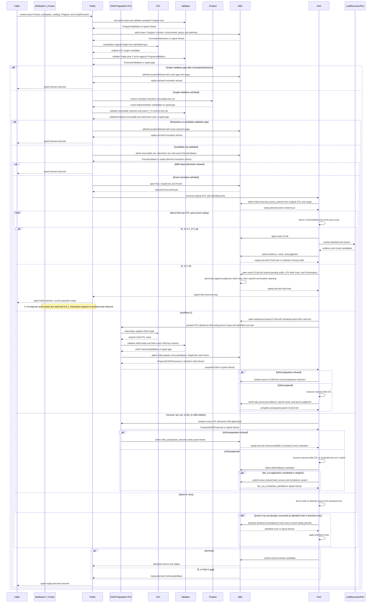
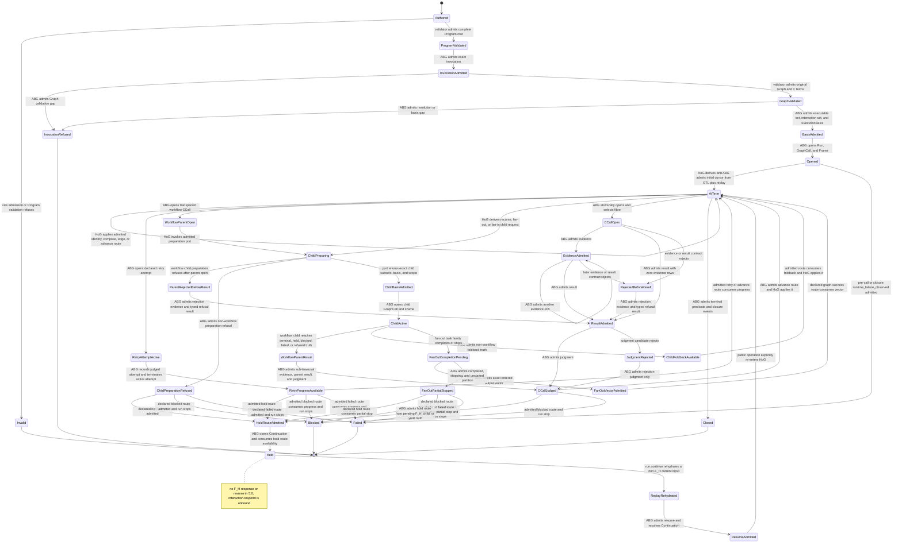
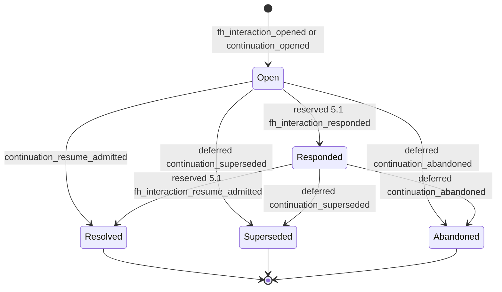
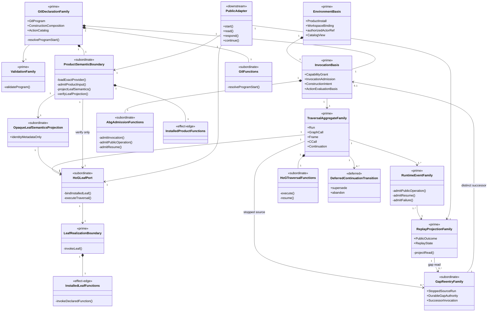
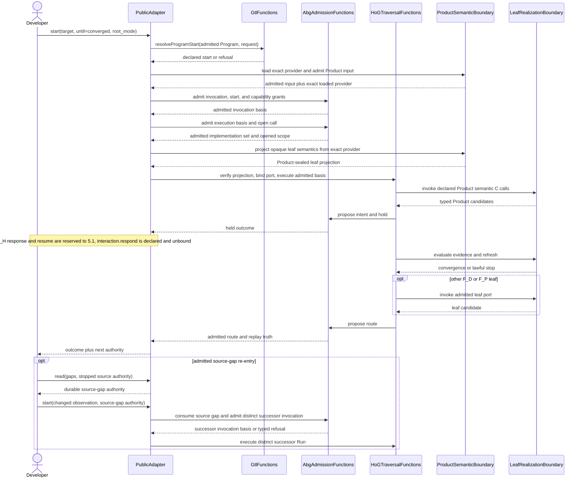
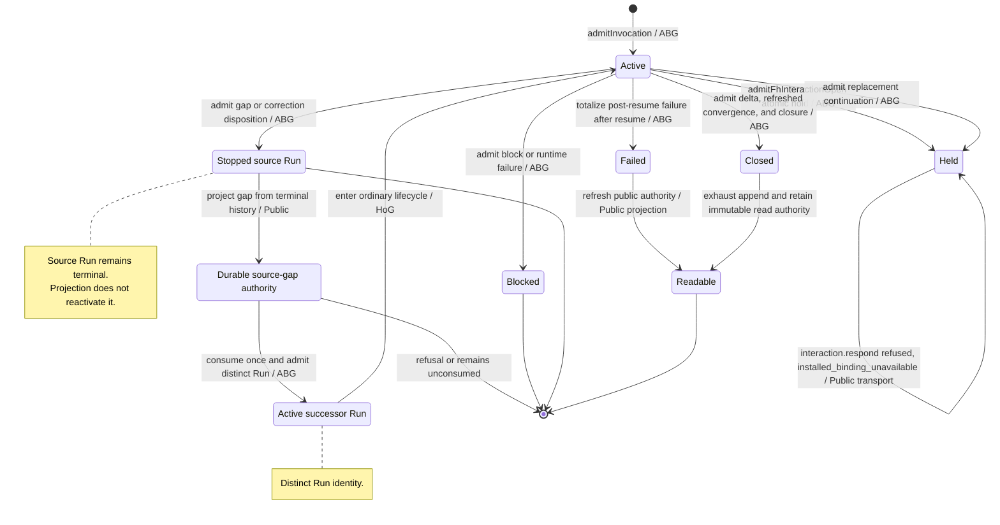

# M05 Direct GTL Traversal Expansion Design

**Status**: M5 base accepted at `d6da4269`; T-270 Section 12 is accepted at
exact candidate `8865ccff`; the replacement S05 design and realization are
accepted at `283325aa` and `1ddc802d`. Sections 14.1 and 14.2 are the selected
S06 boundary under T-281. Sections 14.3 through 14.7 are superseded S04
discovery material; the replacement S04 design is parked.
**Date**: 2026-07-22
**Section 12 updated**: 2026-07-26
**Historical accepted parent design**:
`M03_DIRECT_GTL_TRAVERSAL_BEHAVIOR_DESIGN.md`, accepted SHA-256
`9faeb41ddac839edc9cd2ccb83ae11b05bb54d32168fc35e74a1a9cfb97e92f0`
**Accepted S03 parent projection**: same direct-GTL architecture with STDO
`v2.2.0` qualification identity and the T-270 narrow Product leaf-verifier
dependency reconciled, SHA-256
`39b396c7d58b0e9e2a4c288baedb78462657210d1dac892bcf2a7045c63c1a85`
**Accepted S03 M05 semantic subject**: SHA-256
`b385ce64745cdb531d8002719d0a3a6f36995c6b8f2418e76eaecdaf46ef15a5`
at candidate `8865ccff`
**Product boundary**: accepted `A5-F02`, `A5-F03`, `A5-F04`, `A5-F07`,
`A5-F08`, `A5-F09`, `A5-F10`, and `A5-F14`; Sections 14.1 and 14.2 close the
S06 portability portion of `A5-F13` and `A5-F17`
**Scenario boundary**: accepted `ABG5-S02`, `ABG5-S03`, and `ABG5-S05`;
Sections 14.1 and 14.2 advance `ABG5-S06`
**Work owner**: T-281 under T-270
**Sequencing**: co-evolution inside the decisions fixed here; a newly exposed
material authority or lifecycle ambiguity returns to design before promotion

## 1. Decision

M5 extends the installed M4 root into a generic direct traversal without a
compiled execution carrier.

```text
admitted GTL Program and materialized Graph
  -> non-lowering validation of graph and C terms
  -> ABG-admitted invocation, executable-resolution set, and F_H contract set
  -> HoG cursor derived from the original GTL value plus replay
  -> direct traversal of graph relations and seven C constructors
  -> declared implementation port at each F_D/F_P leaf or admitted F_H interaction boundary
  -> ABG evidence, result, judgment, route, continuation, and closure admission
  -> replay-derived state and public outcome
```

The accepted M3 authority split remains unchanged:

- GTL owns graph topology, C terms, callable relations, contracts, and routes.
- The validator owns closed static judgments and never lowers GTL.
- Product projection proposes exact implementation matches from the admitted
  catalog.
- ABG admits invocation, executable matches, F_H contract rows, runtime facts,
  and closure.
- HoG traverses the original admitted GTL and applies only ABG-admitted routes.
- Implementations own F_D/F_P leaf interiors only.
- Public SDK and CLI transport public operations and project replay truth.

No generated program, compiled C plan, normalized executable declaration,
feature runner, implementation selector, scheduler, or controller is added.

## 2. Scope And Non-Scope

### In scope

1. The seven-constructor C declaration family:
   `C.of`, `C.id`, `C.compose`, `C.edge`, `workflow.C`, `C.batch`, and
   `C.retry`.
2. Graph traversal over declared nodes and vectors, including child
   GraphFunction traversal and declared GraphFunction applications.
3. A complete per-invocation executable-resolution set and a distinct complete
   F_H interaction-contract set admitted before HoG enters the graph.
4. General C-call locus identity across source path, task ordinal, attempt,
   retry path, and graph-call lineage. Compute fibre remains selected interior
   truth and never enters C-call identity.
5. Deterministic and probabilistic leaf ports plus a distinct typed external
   human-hold boundary that invokes no implementation.
6. Durable event-log reopening sufficient for same-run continuation.
7. Data-driven traversal and fibre-substitution proof rows.
8. Removal of the current GTL and validator dependency on Product utility
   modules.

### Boundary ownership beyond base traversal

| Boundary | Disposition and owner |
|---|---|
| One Surface semantic program and F_H interaction policy | accepted S03 basis under T-270; completed T-272 is retained evidence |
| complete public projection and downstream flavored catalog | deferred to S06/T-281 |
| observer and tuner | deferred to S04/T-268 |
| qualification and release | deferred to T-247 and T-248 |

The generic carriers and lifecycle required by those slices are in scope.

### Requirement trace for this delta

| Boundary | Governing requirement or accepted design |
|---|---|
| transparent workflow parent call | `REQ-L-GTL3-C-ALGEBRA-006`; `REQ-R-ABG3-CCALL-013` |
| executable versus F_H leaf identity | `REQ-L-GTL3-C-ALGEBRA-010`; `REQ-R-ABG3-CCALL-003` |
| authoritative durable continuation | `REQ-R-ABG3-CONTINUATION-001..014`; `REQ-P-POLICY-024`, `-031..033` |
| ordered batch and fan-out | `REQ-L-GTL3-C-ALGEBRA-007`; `REQ-L-GTL3-HOF-009..012` |
| durable append-context reopening | `REQ-R-ABG3-EVENTS-024`, `-027`, `-028` |
| fan-out completion and partial stop | `REQ-L-GTL3-HOF-010`; `REQ-R-ABG3-EVENTS-002`, `-011` |
| continuation ingress authority | `REQ-P-POLICY-024`; `REQ-R-ABG3-EVENTS-031` |
| child module topology | accepted M3 design Section 8 dependency law and Section 9.2 operation composition |
| event and replay closure | `REQ-R-ABG3-EVENTS-002`, `-004`, `-011`, `-018`, `-024`, `-029` |

## 3. Ontology Delta

This is an affected slice of the accepted M3 Ontology. The M3 Prime families
remain authoritative. M5 adds variants and relations inside those families; it
does not add a peer authority.

### 3.1 Entities And Relationships

| Identity | M3 family | Authority | Relationship |
|---|---|---|---|
| `CProgramTerm` | `GtlDeclarationFamily` | GTL | One closed discriminated term built from exactly seven constructors. |
| `CLeafTerm` | `GtlDeclarationFamily` | GTL | One `C.of` locus with role, fibre, arm, carriers, and judgment refs. An F_D/F_P leaf carries an executable requirement; an F_H leaf carries an interaction requirement. |
| `ExecutableLeafRequirement` | `GtlDeclarationFamily` | GTL | Stable F_D/F_P requirement key over the locus, binding, and executable seam contracts. |
| `InteractionLeafRequirement` | `GtlDeclarationFamily` | GTL | Stable F_H requirement key over the locus, interaction kind, actor-capability, request, response, and continuation contracts; it has no implementation binding. |
| `GraphTemplate` | `GtlDeclarationFamily` | GTL | Complete immutable graph with boundary nodes, nodes, vectors, contexts, rules, effects, tags, and one C term at each compute locus. |
| `GraphFunctionApplication` | `GtlDeclarationFamily` | GTL | One declared graph relation for composition, substitution, recursion, fan-out, fan-in, registered selection, re-entry, promotion, identity, or same-object identity (`gtl/contracts.ts`, `GraphFunctionApplication`; `gtl/serialization_contracts.ts`, `GRAPH_APPLICATION_SCHEMA`). |
| `ValidatedTraversalDeclaration` | `ValidationFamily` | validator | Exact static judgment over Program, GraphFunction, materialized Graph, C terms, contracts, and implementation declarations. |
| `AdmittedImplementationSet` | `InvocationBasis` | ABG | Complete one-to-one admitted resolution for every statically reachable F_D/F_P leaf key under the validated root; child bases consume exact graph-local subsets. |
| `AdmittedInteractionSet` | `InvocationBasis` | ABG | Complete admitted F_H interaction-contract rows for every statically reachable F_H key; no row is executable. |
| `ChildTraversalPreparationPort` | `InvocationBasis` | stateless operation composition over GTL, validator, and ABG owner ports | Total preparation of one GTL-declared child into validated Graph, exact admitted child subsets, ExecutionBasis, and opened scope; it neither selects the child nor re-resolves Product catalog truth. |
| `TraversalCursor` | `TraversalAggregateFamily` | HoG under admitted scope | Subordinate position derived from original GTL plus replay; never authored or published as a program. |
| `TraversalStep` | `TraversalAggregateFamily` | HoG proposal | One derived structural step: pass identity, enter term, open leaf, enter child, start task, retry, advance graph, hold, or terminal. |
| `LeafExecutionPort` | `LeafRealizationBoundary` | admitted implementation seam | Exact `F_D` or `F_P` function addressed by one admitted resolution; no event or transition authority. |
| `HumanInteractionBoundary` | external actor, outside the IACS | direct or lawfully proxied F_H | Receives an attributed request and returns a response candidate; it is not an implementation binding or executable port. |
| `RouteCandidate` | `TraversalAggregateFamily` | declared implementation or HoG proposal | Candidate consequence constrained to GTL-declared routes. |
| `AdmittedRoute` | `RuntimeEventFamily` | ABG | Canonical event truth accepting one route on current replay and authority basis. |
| `FanOutCompletion` | `RuntimeEventFamily` | ABG | Frame-local authoritative completion truth with disjoint `complete_vector` and `partial_stop` variants; Vector is never an aggregate. |
| `Continuation` | `TraversalAggregateFamily` | ABG | Authoritative run-local open obligation. The complete target algebra names open, resolved, superseded, and abandoned. An F_H continuation has one lifecycle row, its `fh_interaction_opened` opening, and projects as open (`projectFhContinuations`, `abg/fh_continuation_projection.ts`); human response and same-Run resumption are reserved to 5.1, and the fold refuses an F_H continuation that carries a responded, resume-admitted, abandoned or superseded row (`eventCalculusEffectRefs`, `abg/calculus/axioms.ts`). |
| `ContinuationBasis` | `ReplayProjectionFamily` | ABG replay | Downstream held cursor, response contract, authority, and event-log identity derived from admitted events. |
| `ReopenedEventStoreContext` | `RuntimeEventFamily` | ABG event-store boundary | One exclusive live append context seeded from a verified existing durable log without restamping historical events. |
| `ReplayState` | `ReplayProjectionFamily` | downstream | Complete state derived only from admitted events. |

### 3.2 Invariants And Cardinality

1. A `CProgramTerm` has exactly one constructor discriminant.
2. A `C.of` has one C-call spine. `C.id` has none. Structural constructors do
   not fabricate C calls.
3. `C.compose` is canonically flat: construction flattens nested composition
   syntax into one ordered non-empty term family while preserving each original
   leaf. `C.compose` and `C.edge` preserve exact carrier continuity.
4. `workflow.C` names one admitted child GraphFunction and is one transparent
   parent C call. ABG opens and selects that parent C call before child
   preparation. The child GraphCall and Frame remain under the same run. Child
   completion, block, failure, refusal, or hold becomes `sub_traversal`
   evidence followed by exactly one parent result and judgment for that
   attempt. Preparation rejection totalizes the already-open parent C call.
5. `C.batch` contains a non-empty ordered task family with equal outer carrier
   and per-task result cardinality. Each task retains its own C-call, result,
   and judgment. The batch ref groups ordered per-task rows; it is not a
   synthetic aggregate call or result.
6. `C.retry` has a positive budget and repeats the same declared term with a
   fresh positive attempt coordinate. Retry is not graph recursion.
7. Every reachable `F_D` or `F_P` effectful leaf has exactly one admitted
   implementation resolution before HoG entry. Zero or multiple matches
   refuse. An `F_H` leaf instead has one declared interaction and response
   contract and no implementation resolution.
8. An executable requirement key is the stable digest of Program,
   GraphFunction, GraphFunction digest, program locus, role, fibre, arm,
   binding, and executable seam contract refs. An interaction requirement key
   replaces binding and executable contracts with interaction kind,
   actor-capability, request, response, and continuation contract refs. The
   key families are disjoint and exhaustive.
9. The validated transitive root declares complete executable and interaction
   key sets. Child validation declares exact graph-local subsets of both.
   Child basis admission requires equality against matching rows already
   admitted in the corresponding root set. Missing, extra, cross-family,
   drifted, or ambiguous rows refuse before child HoG entry.
10. Fibre substitution changes only the leaf interior, evidence class, and the
    applicable executable or interaction requirement. Topology, source path,
    C-call spine order, and continuation law remain unchanged.
11. A HoG cursor is reproducible from `(admitted GTL, opened scope, replay)`.
   Ambient process memory cannot be required for continuation.
12. A route is applicable only when declared by the current GTL boundary and
    admitted by ABG against current replay.
13. Once a C call opens, every success, failure, malformed result, admission
    rejection, child outcome, or hold completes the inherited M3 spine for that
    attempt through one result-admitted row and one judged row. Only pre-call
    refusal may terminate without a C call. A resumed child or F_H obligation
    uses a fresh attempt coordinate and cannot append a second result to the
    completed pending attempt.
14. Public outcome is replay projection. A worker, test, CLI, or implementation
    cannot author result, continuation, or closure truth.
15. Durable reopening preserves every historical canonical envelope byte,
    `eventId`, payload digest, and admission ordinal. Historical ordinals are the
    unique gap-free sequence `1..n`; the reopened live context owns the same
    sink and stamps its first new event at `maxOrdinal + 1`. Reopening never
    truncates, rewrites, reorders, or re-admits historical truth.
16. Fan-out completion is exactly one discriminated ABG admission. A complete
    variant contains every task exactly once in input ordinal order and one
    contract-valid output vector. A partial-stop variant partitions the input
    tasks into completed rows, exactly one stopping task/ordinal, and exact
    unstarted rows, and contains no output vector.

### 3.3 Lifecycle Completeness

| Entity | Initial | Lawful next states | Terminal or refusal |
|---|---|---|---|
| authored GTL | authored | raw admitted, invalid | invalid |
| admitted GTL | admitted | validated, semantic gap | invalid or unresolved |
| invocation basis | raw input and Program validated | invocation admitted, Graph materialized and validated, executable and interaction sets admitted, exact basis admitted | `invocation_refused` after invocation admission; typed refusal before it |
| traversal | opened | at term, at leaf, child, retry, next node, held | blocked, failed, closed |
| C call | atomically opened and fibre selected | evidenced, result admitted, judged | judged success, failure, refusal, pending, blocked, or escalation; never stranded |
| child traversal | opened | traversing, folded back | blocked, held, failed, closed |
| fan-out completion | declared ordered tasks | task truth accumulating | complete vector admitted or partial stop admitted |
| continuation | opened from admitted hold | open: an F_H continuation has one lifecycle row (`projectFhContinuations`, `abg/fh_continuation_projection.ts`) | no 5.0 F_H terminal: human response and same-Run resumption are reserved to 5.1, and the fold refuses responded, resume-admitted, abandoned and superseded rows for F_H (`eventCalculusEffectRefs`, `abg/calculus/axioms.ts`) |
| durable event store | absent or verified historical log | exclusive append context open | append context closed or reopen refused |
| run | active | active, held, blocked, failed | closed or stopped with an admitted terminal disposition |

The affected entity closure is explicit below. Immutable declaration and
judgment carriers retire by supersession or invocation completion, not mutation.

| Entity | Create / admit | Read / project | Transition / execute | Retire / terminal |
|---|---|---|---|---|
| `CProgramTerm` | GTL constructor or raw admission | validator and HoG read original term | HoG folds without rewriting | declaration version supersedes |
| `CLeafTerm` | `C.of` or raw admission | validator derives one executable or interaction key | exact admitted port or F_H hold | owning term supersedes |
| `ExecutableLeafRequirement` | GTL declaration and validation | Product resolves and ABG admits matching row | exact admitted implementation only | invocation terminal or declaration supersession |
| `InteractionLeafRequirement` | GTL declaration and validation | ABG admits exact non-executable contract row | F_H request (hold) admission only (`holdOwnedInteraction`, `hog/interaction_lifecycle.ts`; `admitOwnedFhInteractionHold`, `abg/continuation.ts`); response admission is reserved to 5.1 | continuation terminal or declaration supersession |
| `GraphTemplate` | GraphFunction publication | materialization and validation | pure materialization only | GraphFunction version supersedes |
| `GraphFunctionApplication` | GTL graph algebra | validator and HoG read relation | HoG proposes only declared child/route work | owning declaration supersedes |
| `ValidatedTraversalDeclaration` | validator closed judgment | Product, ABG, and audit read exact digest | never executes | invocation ends or subject digest changes |
| `AdmittedImplementationSet` | ABG admits exact validated root set | root and child basis admission read keyed rows | never selects or executes | invocation terminates |
| `AdmittedInteractionSet` | ABG admits exact validated root interaction set | root and child basis admission read keyed rows | never invokes a human or HoG | invocation terminates |
| `ChildTraversalPreparationPort` | operation application binds owner functions once | HoG calls it with a GTL-selected child and admitted parent sets | GTL materializes, validator judges, ABG admits; Product is not called | returns one prepared child or typed refusal |
| `TraversalCursor` | HoG derives from GTL, scope, and replay | HoG reads current derived position | replaced only after an admitted event/route | next cursor or terminal event supersedes |
| `TraversalStep` | HoG derives one total step | ABG evaluates candidate against scope | HoG executes only after required admission | accepted, refused, or superseded by newer replay |
| `LeafExecutionPort` | package plus implementation binding admission | HoG addresses exact admitted port | implementation realizes F_D/F_P interior | call or invocation terminates |
| `HumanInteractionBoundary` | GTL declares callout and ABG admits hold | public projection renders pending interaction | no 5.0 return path: `interaction.respond` is declared and unbound, and the transport refuses it with `installed_binding_unavailable` (`selectedCallable`, `public/installed_definition_call_transport.ts`) | the hold stays open; response, rejection, abandonment and supersession are reserved to 5.1 |
| `RouteCandidate` | HoG or declared implementation proposes within GTL route set | ABG evaluates against replay | never applies itself | admitted, refused, or superseded |
| `AdmittedRoute` | ABG admits canonical route event | replay projects route truth | HoG deterministically applies exact admitted route | next admitted route or terminal event supersedes it |
| `FanOutCompletion` | ABG admits one closed completion variant | replay projects ordered vector or partial-stop facts | only a later declared route may consume it | owning frame or run terminal |
| `Continuation` | ABG admits an opening lifecycle event | replay projects exactly one run-local member | no 5.0 operation advances an F_H continuation: `interaction.respond` is unbound (`selectedCallable`, `public/installed_definition_call_transport.ts`) and `run.continue` has the members `current_intent` and `selected_action`, which continue construction continuations (`RUN_OPERATION_CONTRACTS`, `product/run_operation_contracts.ts`) | an F_H continuation has no 5.0 terminal; the fold refuses responded, resume-admitted, abandoned and F_H superseded rows (`eventCalculusEffectRefs`, `abg/calculus/axioms.ts`) |
| `ContinuationBasis` | replay derives open obligation (`projectFhContinuations`, `abg/fh_continuation_projection.ts`) | public read consumes the exact basis; no 5.0 `run.continue` member consumes an F_H basis (`RUN_OPERATION_CONTRACTS`, `product/run_operation_contracts.ts`) | never invokes HoG itself | run terminal in 5.0; resolution, supersession and abandonment of an F_H basis are reserved to 5.1 |
| `ReopenedEventStoreContext` | ABG validates an existing log and acquires exclusive append ownership | replay and event admission read the exact seeded prefix | new events append at the next ordinal only | context closes; historical log remains immutable truth |
| `ReplayState` | pure fold of admitted event log | HoG and public projections read | never writes events or executes work | superseded by a longer valid prefix |

### 3.4 Authority Matrix

| Function | Proposer | Evaluator | Verifier | Executor | Projector | Admitter / truth owner | Retirement |
|---|---|---|---|---|---|---|---|
| construct C or graph relation | GTL author | TypeScript and validator | validator | pure GTL constructor | validation report | raw admission and closed static judgment | declaration supersession |
| resolve leaf implementation | Product catalog projection | validator | ABG basis checks | none | invocation replay | ABG; F_D and F_P only | invocation terminal |
| admit F_H interaction contracts | GTL plus validator | validator | ABG basis checks | none | invocation replay | ABG; F_H only | invocation terminal |
| prepare child traversal | HoG supplies only GTL-declared child ref and input | fixed operation-bound port invokes GTL and validator owners | ABG checks parent scope and exact root-set subsets | stateless port composition | prepared-child result | ABG owns admitted child basis and scope | child terminal or parent invocation terminal |
| derive next structural cursor | HoG | GTL relation plus replay | ABG scope identity | HoG after required admission | replay cursor | no new truth until route admission | next admitted event |
| realize leaf interior | admitted F_D or F_P implementation | result contract | ABG result checks | exact implementation port | replayed C-call | ABG | judged C call or invocation terminal |
| request or answer human work | HoG proposes declared hold (`holdOwnedInteraction`, `hog/interaction_lifecycle.ts`; `admitOwnedFhInteractionHold`, `abg/continuation.ts`); the human answer is reserved to 5.1 | declared interaction and response contracts | F_H authority and replay basis | external human only | continuation and public interaction views | ABG | the hold stays open in 5.0; resolution, rejection, abandonment and supersession are reserved to 5.1 |
| choose consequence candidate | declared implementation or HoG from declared relation | GTL route set | ABG current replay | none | route diagnostic | ABG | admission, refusal, or newer replay |
| apply transition | admitted route | GTL cursor relation | replay | HoG | replay cursor | ABG event is prior truth | next cursor or terminal event |
| admit fan-out completion | HoG submits task-result census | declared vector and task contracts | ABG checks exact ordinal partition and current replay | none | ordered vector or partial-stop projection | ABG | owning frame or run terminal |
| totalize post-open rejection | actual contract rejection | refusal and rejection contracts | current C-call spine | ABG appends only missing suffix | replayed rejected C-call | ABG | judged rejection |
| respond to hold | attributed F_H actor | declared response and capability contracts | none in 5.0 | none: `interaction.respond` is declared and unbound, and the transport refuses it with `installed_binding_unavailable` (`selectedCallable`, `public/installed_definition_call_transport.ts`) | pending interaction view | ABG | reserved to 5.1 |
| reopen durable truth | caller supplies existing sink and expected digest | canonical log grammar and event union | ABG validates immutable stamps, ordinal order, causation, scope, and exclusive append ownership | event store seeds one live context without emitting | replay prefix and next ordinal | ABG event-store boundary | context closes or reopen refuses |
| continue held run | admitted `run.continue` ingress names existing run/continuation, actor, capability, and input | declared continuation contract | ABG uses the reopened context to verify exact durable scope and public authority | `run.continue` explicitly re-enters HoG after resume admission | continuation and replay views | ABG | resolved or run terminal in this cut; superseded and abandoned remain deferred |
| close | HoG submits current judged terminal | closure predicate | replay and exact contracts | ABG appends closure transaction | replay and PublicOutcome | ABG | immutable terminal run |

## 4. Function And Composition Derivation

### 4.1 Atomic function families

| Family | Input -> output | Owner |
|---|---|---|
| `constructC` | typed constructor arguments -> canonical `CProgramTerm` | GTL |
| `rawAdmitProgram` | erased Program, GraphFunction, Graph, and C data -> admitted declarations or typed refusal | raw admission |
| `validateProgram` | admitted whole root -> Program validation or typed gap | validator |
| `materializeGraph` | admitted GraphFunction plus admitted input -> original GTL Graph candidate | GTL |
| `validateTraversal` | materialized Graph plus Program validation -> static Graph/C validation or typed gap | validator |
| `resolveImplementations` | catalog view plus reachable executable keys -> candidate set or typed gap | Product projection |
| `admitImplementationSet` | candidate set plus invocation basis -> admitted set or refusal | ABG |
| `admitInteractionSet` | validated reachable F_H contract rows plus invocation basis -> admitted non-executable set or refusal | ABG |
| `prepareChildTraversal` | GTL-declared child ref, admitted child input, parent scope, root executable set, and root interaction set -> prepared child with original Graph, validation, exact admitted subsets, ExecutionBasis, and opened scope, or typed refusal | stateless operation-bound port over GTL, validator, and ABG owner functions |
| `reopenEventStore` | existing durable log path, expected log digest, and immutable event-contract basis -> exclusive `ReopenedEventStoreContext` seeded with exact historical envelopes and next ordinal, or typed refusal | ABG |
| `deriveTraversalStep` | GTL plus scope plus replay -> structural step | HoG |
| `invokeLeafPort` | admitted F_D/F_P leaf input -> evidence and result candidates | implementation seam |
| `admitHumanHold` | declared F_H locus plus replay -> admitted hold event and continuation projection | ABG |
| `rehydrateContinuation` | reopened event-store context plus immutable Product/workspace/catalog/declaration basis and continuation identity -> owner-validated replay, ExecutionBasis, opened scope, cursor, and input, or typed basis-fork/refusal | ABG |
| `continueExecution` | admitted public `run.continue` operation, acting operator/capability, declared input, rehydrated scope, and admitted response when required -> resume admission and explicit HoG re-entry | public operation over ABG and HoG ports |
| `admitLeafTruth` | candidates plus contracts -> admitted C-call truth or rejection | ABG |
| `admitFanOutCompletion` | declared fan-out application, ordered task census, current replay, and candidate complete vector or partial stop -> authoritative discriminated completion event or typed refusal | ABG |
| `completeRejectedCCall` | opened C call plus current spine position plus actual admission rejection -> only the missing suffix: rejection evidence and typed refusal result before result admission, then rejection judgment; judgment only after result admission | ABG |
| `admitRoute` | route candidate plus current replay -> admitted route or refusal | ABG |
| `applyRoute` | admitted route plus GTL cursor -> next cursor | HoG |
| `rehydrateReplay` | reopened event-store context with verified historical prefix -> replay state | ABG |

### 4.2 Higher-order composition

`traverseC` is the direct fold over the original `CProgramTerm`. It composes
the atomic families above and is parameterized by admitted ports. It does not
produce or consume another program value.

`traverseGraph` composes `traverseC` with declared graph vectors and admitted
routes. `workflow.C`, recursion, fan-out, and fan-in reuse `traverseGraph` at a
child scope prepared through `ChildTraversalPreparationPort`. Batch and retry
reuse `traverseC` with task and attempt coordinates. None owns a parallel
runtime.

### 4.3 Whole-family Prime contraction

Candidate alternatives were:

1. one interpreter or runner per C constructor;
2. a lowered normalized execution plan;
3. one generic direct fold over the original GTL term;
4. feature-owned controllers for workflow, batch, retry, and recursion.

Only option 3 preserves one program identity and one traversal authority. The
M3 Prime set therefore remains eight families. This delta adds subordinate
variants to `GtlDeclarationFamily`, `InvocationBasis`, and
`TraversalAggregateFamily`; it adds no ninth authority family and no second
authoring surface.

## 5. Irreducible Architectural Carrier Set Delta

The accepted M3 IACS remains the complete eight-family carrier set. This table
classifies only M5 members and payloads inside those families; no row is a ninth
Prime family.

| Carrier | Parent M3 IACS family | Classification | Module | Purpose |
|---|---|---|---|---|
| `CProgramTerm` | `GtlDeclarationFamily` | `<<subordinate>> <<authoritative>>` | `src/gtl` | Original seven-constructor program data. |
| `GraphFunctionApplication` | `GtlDeclarationFamily` | `<<subordinate>> <<authoritative>>` | `src/gtl` | Original graph-algebra relation data. |
| `TraversalValidation` | `ValidationFamily` | `<<subordinate>> <<authoritative>>` | `src/validator` | Static closed judgment; never executable. |
| `AdmittedImplementationSet` | `InvocationBasis` | `<<authoritative>>` | `src/abg` | Invocation-bound complete executable-leaf realization basis. |
| `AdmittedInteractionSet` | `InvocationBasis` | `<<authoritative>>` | `src/abg` | Invocation-bound F_H request, response, capability, and continuation contract basis; never executable. |
| `ChildTraversalPreparationPort` | `InvocationBasis` | `<<effect-edge>>` | operation application over `src/gtl`, `src/validator`, and `src/abg` owner ports | Total child preparation without HoG-to-Product or HoG-to-validator dependency. |
| `TraversalCursor` | `TraversalAggregateFamily` | `<<subordinate>>` | `src/hog` | Derived, invocation-local position. |
| `TraversalStep` | `TraversalAggregateFamily` | `<<subordinate>>` | `src/hog` | Exhaustive direct-fold result. |
| `LeafExecutionPort` | `LeafRealizationBoundary` | `<<effect-edge>>` | `src/implementation` | Bound F_D or F_P leaf effect interior. |
| `HumanInteractionBoundary` | external actor, not IACS | `<<effect-edge>>` | external plus `src/abg` admission | F_H request and attributed response candidate; never an implementation port. |
| `AdmittedRoute` | `RuntimeEventFamily` | `<<authoritative>>` | `src/abg` | Accepted runtime transition event. |
| `FanOutCompletion` | `RuntimeEventFamily` | `<<subordinate>> <<authoritative>>` | `src/abg` | Frame-local complete-vector or partial-stop truth; never a Vector aggregate. |
| `Continuation` | `TraversalAggregateFamily` | `<<authoritative>>` | `src/abg` | Run-local open obligation and exact terminal lifecycle truth. |
| `ContinuationBasis` | `ReplayProjectionFamily` | `<<downstream>>` | `src/abg` | Events-only hold projection; an F_H continuation's response and successor fields are null in 5.0 (`ReplayContinuationState`, `abg/fh_continuation_projection.ts`). |
| `ReopenedEventStoreContext` | `RuntimeEventFamily` | `<<effect-edge>>` | `src/abg` | Exclusive append context over one verified durable event prefix; no new authority family. |
| `ReplayState` | `ReplayProjectionFamily` | `<<downstream>>` | `src/abg` | Events-only runtime projection. |

Canonical JSON, digest, immutable-value, and opaque-ref utilities move to
`src/shared`. They are pure implementation primitives, not Ontology carriers,
program meaning, or admission authority. `gtl` and `validator` may depend on
`shared`; `product` consumes them rather than owning them.

## 6. Direct Traversal Semantics

| Constructor | HoG relation | ABG truth |
|---|---|---|
| `C.of` | derive one leaf stop at exact term path and invoke exact admitted port | uniform C-call spine |
| `C.id` | pass admitted input unchanged | no C-call and no fabricated gate pass |
| `C.compose` | traverse the canonical flat term family in order, binding each admitted output into the next term | each child retains its own truth |
| `C.edge` | traverse transform, evaluate, consequence in declared order | ordinary child C calls; no edge runner |
| `workflow.C` | open one transparent parent C call, prepare/open/traverse the named child, then complete the parent attempt | child lineage plus `sub_traversal` evidence, one parent result and judgment, and admitted foldback; preparation rejection totalizes the parent spine |
| `C.batch` | traverse the declared non-empty task family in stable ordinal order; concurrency is optional realization | one C-call, result, and judgment per task plus a non-authoritative grouping ref and ordered per-task result projection; no synthetic aggregate result |
| `C.retry` | traverse wrapped term until success, non-retry disposition, or budget | fresh attempt identity, admitted retry route, retained prior evidence |

An `F_H` `C.of` follows the same C-call locus and selected-fibre event shape but
does not call `LeafExecutionPort`. Its request invocation completes the uniform
spine with a typed pending result and pending judgment, from which ABG event
truth opens the authoritative `Continuation` aggregate in one atomic batch
(`holdOwnedInteraction`, `hog/interaction_lifecycle.ts`;
`admitOwnedFhInteractionHold`, `abg/continuation.ts`). No 5.0 operation
answers or resumes it: `interaction.respond` is declared and unbound, and the
transport refuses it with `installed_binding_unavailable` (`selectedCallable`,
`public/installed_definition_call_transport.ts`). Human response and same-Run
resumption are reserved to 5.1. T-270 owns the current domain interaction
policy and exact continued GTL locus; completed T-272 records the retained
behavioral basis.

`workflow.C` follows the same parent-level law. It first opens a transparent
parent C call, then traverses its prepared child. A terminal child produces
`sub_traversal` evidence and the one parent result and judgment. A rejected
child preparation totalizes the parent call from the actual rejection. A held
child completes that parent attempt with pending evidence, result, and
judgment, and opens a continuation. Resumption uses a fresh positive parent
attempt coordinate, consumes the replay-derived child completion, and never
re-executes a closed child or appends to the prior pending C call.

The source path is a stable sequence of segments rooted at the graph node:

```text
node/<node-ref>/c
  /terms/<zero-based-ordinal>
  /transform | /evaluate | /consequence
  /tasks/<zero-based-ordinal>
  /term
```

The path is identity input, not a compiled node. HoG reads the term at that
path from the admitted materialized Graph each time it derives a step.

### 6.1 Graph algebra projection

The complete `GraphTemplate` preserves the constitutional Graph fields. Graph
algebra operations remain GTL constructors. Runtime traverses their resulting
declared relation; it does not infer or reconstruct the operation.

| Relation | GTL construction truth | Direct runtime meaning |
|---|---|---|
| `edge` | one explicit GraphVector between typed boundary nodes | traverse source locus, declared vector relation, then target locus |
| `identity` | graph or GraphFunction preserving one interface | pass admitted value with no fabricated check or effect |
| `compose` | one application relation and materialized composed graph with exact interface wiring | traverse declared left then right child relation |
| `substitute` | outer graph with one exact vector replaced by visible interface-compatible inner graph | traverse the resulting graph; provenance retains outer vector and inner graph refs |
| `recurse` | callable relation with termination, foldback, and positive bound | open child graph calls until admitted termination; foldback rebinds and re-evaluates parent |
| `fan_out` | element GraphFunction plus explicit ordered input/output vector relation | pure GTL materialization projects one `C.batch` task per admitted input member before child HoG entry; each task retains ordinal, member lineage, child GraphFunction, contracts, and enclosing C authority; ABG admits exactly one complete-vector or partial-stop event after task traversal |
| `fan_in` | reducer GraphFunction plus complete vector contract | invoke one child reducer only after complete vector admission |
| `promote` | explicit representation-boundary relation | apply the declared typed relation without changing semantic identity |
| `same_object` | exact identity witness | no runtime work; validator proves identity |

Composition, substitution, promotion, identity, and same-object are normally
resolved by typed construction and validation into the materialized original
GTL value. Recursion, fan-out, fan-in, and re-entry retain explicit runtime-visible
application declarations because they govern child traversal: HoG reads `recurse`
in `hog/recursion_lifecycle.ts` (`recursionApplication`), `fan_out` in
`hog/workflow_lifecycle.ts` (`fanOutApplicationForBatch`) and `re_enter` in
`hog/route_proposal.ts` (`proposeGraphSpanReentryRoute`); ABG admits their routes
in `abg/traversal_route.ts` (`recursionRouteCausation`, `hasFanOutRouteEvidence`
for `fan_out` and `fan_in`, `hasGraphSpanReentryRouteEvidence`).
Declaration closure retains the exact published source definitions of static
`compose` and `substitute` applications, with their uniquely reachable installed
owners, contracts, bindings, and closure declarations. That source dependency
does not require a callable Catalog row or add Program membership. Program roots
and runtime GraphFunction dependencies retain their original callable Catalog
checks. If one definition serves both roles, the callable checks apply regardless
of the order in which closure discovers those roles. Validator and materialization
continue to prove correspondence to the original composed or substituted graph;
source provenance is not a second executable plan or invocation grant.
Every child GraphFunction reachable through those declarations is included in
whole-root validation and the transitive executable and interaction censuses
before root HoG entry. Dynamic selection may choose only among that statically admitted
reachable set. A selected child is materialized and its exact call/frame basis
is admitted before child HoG entry; the root set is not a substitute for that
child invocation-local admission.

The mapping is decidable:

```text
keys(rootExecutableSet.rows) == rootValidation.transitiveReachableExecutableLeafKeys
keys(rootInteractionSet.rows) == rootValidation.transitiveReachableInteractionLeafKeys
childExecutableKeys == childValidation.reachableExecutableLeafKeys
childInteractionKeys == childValidation.reachableInteractionLeafKeys
childExecutableRows == rootExecutableSet.rows filtered by childExecutableKeys
childInteractionRows == rootInteractionSet.rows filtered by childInteractionKeys
keys(childExecutableRows) == childExecutableKeys
keys(childInteractionRows) == childInteractionKeys
```

Every filtered row retains its owning root-set ref and digest plus its typed
key. The child `ExecutionBasis` binds both root-set refs/digests, both exact
child-set digests, the child GraphFunction and materialization digests, and the
child validation ref. F_H rows never enter an implementation set. This is
invocation-local admission of already resolved declarations, not ambient
selection or a second implementation-resolution authority.

Child preparation preserves the accepted M3 topology. The stateless operation
application binds `ChildTraversalPreparationPort` once from the GTL
materializer, validator judgment, and ABG admission functions and supplies the
total port to HoG. HoG sends only the GTL-declared child ref, admitted child
input, parent scope, and admitted root sets. It receives one
`PreparedChildTraversal` or typed refusal. HoG never imports or invokes Product
or validator, Product never re-resolves the admitted root set during traversal,
and the port cannot select a child or author topology.

For fan-out, the ordered task declarations are fixed before the first task
enters HoG. After traversal, `admitFanOutCompletion` compares the declared input
cardinality against the full replayed task census. The `complete_vector` variant
requires one judged task row and one contract-valid output member at every
ordinal and admits the canonical ordered output vector. The `partial_stop`
variant requires exact completed, stopping, and unstarted partitions and
forbids an output-vector field. Either admission precedes any fan-in or graph
success route; only `complete_vector` can make those routes applicable.

### 6.2 Preserved M3 admission staging

M5 widens cardinality without collapsing the accepted M3 stages:

```text
raw input and complete Program root admitted
  -> ProgramValidation
  -> InvocationAdmission
  -> GraphFunction materialization from admitted input
  -> GraphValidation over the original materialized Graph and C terms
  -> Product proposes the complete reachable F_D/F_P implementation set
  -> validator checks declaration, package, and contract relations
  -> validator emits the complete reachable F_H interaction-contract set
  -> ABG admits both disjoint sets and the exact ExecutionBasis
  -> ABG opens Run, GraphCall, and Frame
  -> HoG enters the original GTL
```

A refusal after `InvocationAdmission` is admitted as `invocation_refused` and
projects through replay. A refusal before it returns the typed pre-invocation
result. Neither path can enter HoG. After a C call opens, an actual contract or
candidate rejection is totalized by `completeRejectedCCall`; direct transition
to `Blocked` or `Failed` without `result_admitted -> judged` is prohibited.

### 6.3 Durable continuation reconstruction

Durability belongs to the admitted event log and immutable declaration basis,
not to process-local brands, closures, weak sets, or object identity. Reopening
first constructs the event append context; continuation carriers are rebuilt
only inside that context.

`reopenEventStore` consumes an existing durable path, the expected complete-log
digest projected by the current `ContinuationBasis`, and the immutable
event-contract basis. A caller may echo that digest but cannot select another
one. The function:

1. opens the existing sink without create or truncate and acquires exclusive
   append ownership for the context lifetime;
2. reads the complete canonical JSON-lines prefix, requiring a terminal newline
   and rejecting a partial or non-canonical record;
3. validates every preserved envelope against the selected event union,
   recomputes its payload digest and event id using its preserved ordinal, and
   requires unique event ids plus the exact gap-free ordinal sequence `1..n`;
4. validates every historical causation ref against an earlier event in the
   same prefix and re-applies the canonical scope and cross-run rules;
5. compares the canonical prefix digest and file identity/length with the
   requested basis, then seeds one `ReopenedEventStoreContext` with those exact
   frozen historical envelopes and the same durable path; and
6. sets the live admission cursor to `maxOrdinal` (`0` for an empty existing
   log). The next candidate is store-stamped at `maxOrdinal + 1`, appended with
   append-only semantics, durably synchronized, and only then made visible to
   replay. Each append rechecks the owned file identity and expected prior
   length so a second writer or replaced sink fails closed.

No historical event passes through live admission, receives another stamp, or
is written again. Reopening itself emits no runtime event. It changes no fluent;
it validates and resumes the one canonical emitter context required to append
new truth. The context is operation-scoped and closes after its atomic admission
batch; a later public operation lawfully reopens the same verified prefix rather
than sharing ambient process state.

Initial invocation and later reopening are disjoint operations. Initial
invocation may create one absent sink with exclusive-create semantics. A
response or continuation operation must call `reopenEventStore` on that existing
sink and is forbidden from invoking the create-empty path.

An admitted `run.continue` public operation then supplies that reopened context,
the public-operation admission ref, continuation identity, expected run, acting
operator and capability, selected immutable Product/install/workspace/catalog
basis, and any declared continuation input. `rehydrateContinuation`:

1. replays exactly one run-local open `Continuation` with no resolved,
   superseded, or abandoned terminal event;
2. verifies its Product, workspace binding, catalog view, Program,
   GraphFunction, materialization, validation, executable-set,
   interaction-set, ExecutionBasis, Run, GraphCall, Frame, C-call, cursor,
   input, request, and response-contract refs and digests against the selected
   immutable declarations;
3. requires exactly one matching admitted response when the continuation kind
   requires F_H input;
4. verifies the `run.continue` public-operation event, acting operator,
   capability, continuation identity, and declared input against the open
   member and policy;
5. reconstructs fresh owner-issued `ExecutionBasis`, `OpenedTraversalScope`,
   cursor, and input carriers only after canonical body and digest equality;
   process-local branding is renewed evidence, never durable authority; and
6. appends `continuation_resume_admitted` for a declared non-F_H continuation
   kind before `run.continue` explicitly re-enters HoG; for F_H it appends
   nothing in 5.0, since `fh_interaction_resume_admitted` has no 5.0 producer
   and the fold refuses it (`eventCalculusEffectRefs`, `abg/calculus/axioms.ts`).

Missing bodies, log replacement, ordinal or stamp drift, stale or multiple open
members, wrong public operation, actor, capability, response contract, cross-run
identity, changed workspace/product/catalog authority, or another basis fork
refuses before HoG and appends no resume event. `interaction.respond` is
declared and unbound in 5.0: the transport refuses it with
`installed_binding_unavailable` (`selectedCallable`,
`public/installed_definition_call_transport.ts`).

## 7. Three-View Projection

### 7.1 Domain view

```mermaid
classDiagram
  class GtlDeclarationFamily {
    <<prime>>
    <<authoritative>>
    +Program
    +GraphFunction
    +Graph
  }
  class CProgramTerm {
    <<subordinate>>
    <<authoritative>>
    +constructorKind
    +inputCarrierRef
    +outputCarrierRef
  }
  class CLeafTerm {
    <<subordinate>>
    <<authoritative>>
    +executableOrInteractionKey
    +programLocusRef
  }
  class ExecutableLeafRequirement {
    <<subordinate>>
    <<authoritative>>
    +bindingRef
    +seamContractRefs
  }
  class InteractionLeafRequirement {
    <<subordinate>>
    <<authoritative>>
    +interactionKind
    +responseContractRef
  }
  class GraphTemplate {
    <<subordinate>>
    <<authoritative>>
    +nodes
    +vectors
    +boundaryInterface
  }
  class GraphFunctionApplication {
    <<subordinate>>
    <<authoritative>>
    +relationKind
    +operandRefs
  }
  class ValidationFamily {
    <<prime>>
    <<authoritative>>
    +TraversalValidation
  }
  class ValidatedTraversalDeclaration {
    <<subordinate>>
    <<authoritative>>
    +validationRef
    +reachableExecutableLeafKeys
    +reachableInteractionLeafKeys
  }
  class EnvironmentBasis {
    <<prime>>
    <<authoritative>>
    +CatalogView
    +ImplementationBindings
  }
  class InvocationBasis {
    <<prime>>
    <<authoritative>>
    +InvocationAdmission
    +ExecutionBasis
  }
  class AdmittedImplementationSet {
    <<authoritative>>
    +invocationRef
    +leafResolutionRefs
  }
  class AdmittedInteractionSet {
    <<authoritative>>
    +invocationRef
    +interactionContractRefs
  }
  class ChildTraversalPreparationPort {
    <<effect-edge>>
    -prepareDeclaredChild
  }
  class TraversalAggregateFamily {
    <<prime>>
    <<authoritative>>
    +Run
    +GraphCall
    +Frame
    +CCall
    +Continuation
  }
  class TraversalCursor {
    <<subordinate>>
    -termPath
    -taskOrdinal
    -attempt
  }
  class TraversalStep {
    <<subordinate>>
    -stepKind
    -sourceCursor
  }
  class LeafExecutionPort {
    <<effect-edge>>
    -invoke
  }
  class LeafRealizationBoundary {
    <<prime>>
    <<authoritative>>
    +F_D bindings
    +F_P bindings
  }
  class HumanInteractionBoundary {
    <<effect-edge>>
    -request
    -respond
  }
  class RuntimeEventFamily {
    <<prime>>
    <<authoritative>>
    +RuntimeEvent
  }
  class AdmittedRoute {
    <<subordinate>>
    <<authoritative>>
    +routeKind
    +sourceCursor
    +targetCursor
  }
  class FanOutCompletion {
    <<subordinate>>
    <<authoritative>>
    +completionKind
    +orderedTaskRefs
    +outputVectorOrStop
  }
  class RouteCandidate {
    <<subordinate>>
    <<effect-edge>>
    -routeKind
    -basisRef
  }
  class ContinuationBasis {
    <<downstream>>
    +heldCursor
    +responseContractRef
  }
  class Continuation {
    <<subordinate>>
    <<authoritative>>
    +continuationId
    +continuationKind
    +runId
    +causedByEventRef
  }
  class ReopenedEventStoreContext {
    <<effect-edge>>
    -durablePath
    -verifiedPrefixDigest
    -lastAdmissionOrdinal
  }
  class ReplayProjectionFamily {
    <<prime>>
    <<downstream>>
    +ReplayState
    +PublicOutcome
  }
  class ReplayState {
    <<downstream>>
    +runtimeStatus
    +currentCursor
  }
  class DeferredM5DomainPrograms {
    <<deferred>>
    +OneSurface
    +Consensus
    +ObserverTuner
    +PublicBreadth
  }
  GtlDeclarationFamily *-- CProgramTerm
  CProgramTerm *-- CLeafTerm : constructC
  CLeafTerm *-- ExecutableLeafRequirement : F_D or F_P
  CLeafTerm *-- InteractionLeafRequirement : F_H
  GtlDeclarationFamily *-- GraphTemplate : materializeGraph
  GtlDeclarationFamily *-- GraphFunctionApplication
  ValidationFamily --> GtlDeclarationFamily : validates
  ValidationFamily *-- ValidatedTraversalDeclaration : validateTraversal
  EnvironmentBasis --> GtlDeclarationFamily : supplies catalog truth
  InvocationBasis *-- AdmittedImplementationSet
  InvocationBasis *-- AdmittedInteractionSet
  InvocationBasis *-- ChildTraversalPreparationPort
  ChildTraversalPreparationPort --> GtlDeclarationFamily : materializes declared child
  ChildTraversalPreparationPort --> ValidationFamily : consumes child judgment
  ChildTraversalPreparationPort --> InvocationBasis : requests ABG admission
  AdmittedImplementationSet --> ExecutableLeafRequirement : resolves exact keys
  AdmittedInteractionSet --> InteractionLeafRequirement : admits exact keys
  TraversalAggregateFamily *-- TraversalCursor
  TraversalAggregateFamily *-- TraversalStep : deriveTraversalStep
  TraversalAggregateFamily *-- Continuation
  TraversalAggregateFamily --> InvocationBasis : consumes exact basis
  LeafRealizationBoundary *-- LeafExecutionPort
  TraversalCursor --> LeafExecutionPort : invokeLeafPort
  TraversalCursor --> HumanInteractionBoundary : emits declared F_H hold
  RuntimeEventFamily *-- AdmittedRoute
  RuntimeEventFamily *-- FanOutCompletion
  RuntimeEventFamily *-- ReopenedEventStoreContext
  RuntimeEventFamily --> Continuation : records lifecycle
  TraversalAggregateFamily *-- RouteCandidate
  RouteCandidate --> AdmittedRoute : admitRoute
  ContinuationBasis --> TraversalCursor : preserves held position
  Continuation --> ContinuationBasis : replay projects
  ReopenedEventStoreContext --> ReplayState : seeds exact historical prefix
  FanOutCompletion --> AdmittedRoute : enables declared route
  ReplayProjectionFamily *-- ContinuationBasis
  ReplayProjectionFamily *-- ReplayState
  ReplayState --> RuntimeEventFamily : rehydrateReplay
  DeferredM5DomainPrograms ..> GtlDeclarationFamily : later domain declarations
```



### 7.2 Sequence view

| Participant | Domain identity or boundary |
|---|---|
| Caller | explicitly external actor |
| Attributed F_H Actor | explicitly external actor |
| Public | stateless public operation transport; no semantic carrier or state |
| Child Preparation Port | stateless operation-bound composition of GTL, validator, and ABG owner functions; no selection or state |
| GTL | `GtlDeclarationFamily`; materializes the published GraphFunction template |
| Validator | `ValidationFamily` |
| Product | `EnvironmentBasis` catalog projection; proposes implementation matches |
| ABG | `InvocationBasis`, `TraversalAggregateFamily`, `RuntimeEventFamily`, and `ReplayProjectionFamily` |
| HoG | subordinate `TraversalCursor` and `TraversalStep` under `TraversalAggregateFamily` |
| LeafExecutionPort | effect edge under `LeafRealizationBoundary` |



### 7.3 Lifecycle view



The lifecycle view above projects the complete target continuation algebra.
An F_H continuation at head has one lifecycle row, its `fh_interaction_opened`
opening, and projects as open (`projectFhContinuations`,
`abg/fh_continuation_projection.ts`). Its responded, resumed, superseded and
abandoned edges are reserved to 5.1: the kinds are declared, and the fold
refuses an F_H continuation that carries one (`eventCalculusEffectRefs`,
`abg/calculus/axioms.ts`). Edges marked `deferred` or `reserved 5.1` have no
5.0 realization:



## 8. Cross-View Axiom Evaluation

| Axiom | Ontology evidence | Authority | Domain | Sequence | State | Native enforcement | Admission enforcement | Verdict | Gap owner |
|---|---|---|---|---|---|---|---|---|---|
| original GTL is sole program | C term and application relations | GTL | declaration family | direct fold | authored to validated | discriminated unions | validation digest and basis | pass | none |
| no compiled execution carrier | Prime contraction | GTL and HoG | no plan carrier | original term consumed | no plan state | import and type boundary | rival-authority mutation | pass | none |
| seven constructors exhaustive | C invariant | GTL | `CProgramTerm` | exhaustive fold | structural loop | `never` exhaustiveness | raw admission and validator | pass | none |
| C-call identity is fibre-free | C-call locus invariant | ABG | `CLeafTerm` plus traversal aggregate | fibre selected only after open | one locus through every fibre | identity tuple omits regime | C-call open/select admission | pass | none |
| executable selection and F_H contract admission precede traversal | disjoint requirement and set relations | Product proposes executable matches; validator declares F_H rows; ABG admits both | executable and interaction sets | both admitted before HoG | basis refused or opened | disjoint key unions | exact transitive equality for both sets | pass | none |
| child basis is exact and local without topology drift | preparation-port and child-set equality laws | stateless port invokes GTL, validator, and ABG owners | root sets plus child validation | HoG calls one admitted preparation port | ChildPreparing to ChildActive | typed total port | child ExecutionBasis binds both root and child set digests | pass | none |
| post-invocation gaps are runtime truth | preserved M3 staging | ABG | InvocationBasis and RuntimeEventFamily | public submits typed gap to ABG | InvocationAdmitted to InvocationRefused | no validator event writer | `admitInvocationRefusal` | pass | none |
| uniform C-call spine | lifecycle matrix | ABG | traversal aggregate | leaf admission | open to judged | shared CCall API | replay-order checks | pass | none |
| workflow.C has one transparent parent spine | workflow invariant and lifecycle | ABG | parent CCall plus child scope | parent opens before preparation and completes after child outcome | WorkflowParentOpen through CCallJudged | parent attempt identity | sub_traversal evidence and exactly one parent result/judgment | pass | none |
| post-open rejection adds only missing suffix | rejection lifecycle and authority row | ABG | rejection candidate under C call | stage-sensitive totalizer | rejected-before-result or judgment-rejected to judged | spine-position union | exactly one result and judgment | pass | none |
| batch and fan-out preserve task cardinality | C.batch and fan-out laws | GTL, HoG, ABG | ordered task declarations plus `FanOutCompletion` | GTL projects batch, HoG traverses tasks, ABG admits complete or partial census | one task spine each then one completion variant | stable ordinal task union | exact complete-vector or completed/stopping/unstarted partition; no vector on partial stop | pass | none |
| fibre substitution preserves shape | fibre invariant | GTL declaration | same term topology | same fold | same lifecycle | generic leaf variant | differential proof | pass | T-270 proof |
| worker cannot mint truth | authority matrix | ABG | effect-edge port | candidates returned | no direct closed edge | port lacks event methods | candidate admission | pass | none |
| F_H is not an implementation or ABG callback | disjoint key sets and authority matrices | human, separate public operations, and ABG | interaction requirement plus Continuation | invoke stops at the hold (`holdOwnedInteraction`); `interaction.respond` is unbound (`selectedCallable`) | Held; no 5.0 F_H successor state (`projectFhContinuations`, `abg/fh_continuation_projection.ts`) | no F_H implementation port and no ABG-to-HoG call | hold admission only; response and resume are reserved to 5.1 | pass | retained T-272 evidence under T-270 |
| child traversal is transparent | relationship inventory | HoG plus ABG | child lineage | child scope and foldback | ChildActive | typed child relation | child basis and replay | pass | T-270 implementation |
| continuation is authoritative and replay-constructible | Continuation aggregate, reopened store, and basis relation | ABG | open obligation plus downstream basis and exact historical prefix | reopen without restamp, verify public ingress, reconstruct, then separate resume and HoG re-entry | F_H open proven (`projectFhContinuations`, `abg/fh_continuation_projection.ts`); responded, resolved, superseded and abandoned are reserved to 5.1 for F_H and refused by the fold (`eventCalculusEffectRefs`, `abg/calculus/axioms.ts`) | preserved ordinals and owner constructors renewed only after equality | existing sink, max-plus-one append, immutable authority basis, and basis-fork refusal | pass for the F_H hold; F_H response and resume reserved to 5.1 | T-270 re-entry if Product selects supersede or abandon |
| continuation resume is actor-authorized | public-operation and continuation relations | public ingress plus ABG | `run.continue` admission, actor, capability, and input | public admission precedes same-run resume event | reopened through ResumeAdmitted | typed operation and capability refs | exact ingress event is causal input to resume | pass | retained T-272 evidence under T-270 |
| every new runtime fact has one event/effect law | RuntimeEventFamily delta | ABG | fixed event kinds and closed payload variants | append precedes downstream effect | every initiated active fluent has an explicit terminal consumer | closed event union | declared Event Calculus effect table and mutation proof | pass | none |
| public layer is not controller | unchanged M3 law | Product/ABG/HoG | no public Prime | one invoke call | no public private state | stateless operation types | public-controller mutation | pass | T-281 breadth |

## 9. Runtime Event And Replay Delta

M5 retains the accepted opening and closure kinds. The table below is the
complete target event delta and repeats existing opening kinds where their
fluent effects participate in the expanded lifecycle. Rows explicitly marked
`deferred` are not members of the selected S03 realization or proof and do not
claim current `RUNTIME_EVENT_KIND_VALUES` membership. The `fh_interaction_responded`
and `fh_interaction_resume_admitted` rows are declared at head with the effects
shown (`LEGACY_ROOT_EVENT_CONTRACTS`, `abg/event_store.ts`;
`ROOT_EVENT_CALCULUS`, `abg/calculus/axioms.ts`) and have no 5.0 producer:
human response and same-Run resumption are reserved to 5.1, and the fold
refuses an F_H continuation that carries either (`eventCalculusEffectRefs`).
The realized rows add no second envelope or event family. Every realized row carries
the canonical envelope, a store-assigned admission ordinal, `basisId`, `runId`,
`graphFunctionRef`, `materializationRef`, `graphCallId`, `frameId`,
`frameLineageId`, unique admitted `causationEventRefs`, and `correlationId`
where the aggregate exists. Event-sink acceptance durably appends the event
before the next effectful step observes it.

| Event kind | Aggregate and required closed payload | Required causal basis | Declared Event Calculus effects |
|---|---|---|---|
| `run_segment_opened` | existing `run` payload plus exact ExecutionBasis and opening public-operation refs | admitted basis and invocation | initiates `run_active(runId)` |
| `graph_call_opened` | existing `graph_call` payload plus child relation, parent frame, and parent cursor refs when this is a child | active run plus admitted GraphFunction/materialization basis | initiates `graph_call_active(graphCallId)`; the child variant also initiates `parent_waiting_on_child(childGraphCallId)` |
| `frame_opened` | existing `frame` payload plus exact GraphCall and frame-lineage refs | active GraphCall | initiates `frame_active(frameId)` |
| `traversal_cursor_entered` | `frame`; initial cursor ref/digest, original GTL declaration and materialization refs/digests, term path, input ref/digest, and opened scope refs | active frame plus validated original GTL | initiates `locus_active(cursorRef)` |
| `traversal_route_admitted` | `frame`; route ref/digest, route kind from `advance`, `retry`, `hold`, `blocked`, `failed`, or `terminal`, declaration ref/digest, source and optional target cursor refs/digests, applicable CCall/judgment and consumed-availability refs | current opened scope plus the judgment, child refusal/foldback, fan-out completion, retry progress, or structural declaration that permits the route (`abg/traversal_route.ts`, `admitTraversalTransition`) | every variant terminates `locus_active(sourceCursorRef)` and any named consumed-availability fluent; `advance` and `retry` initiate `locus_active(targetCursorRef)`; `hold` terminates `frame_active` and initiates `hold_route_admitted(routeRef)`; `blocked` and `failed` terminate `frame_active` plus exact active retry/hold fluents and initiate `frame_blocked(frameId)` or `frame_failed(frameId)`; `terminal` initiates `terminal_route_available(routeRef)` |
| `child_preparation_refused` | parent `frame`; application and child GraphFunction refs/digests, admitted child input ref/digest, preparation stage, exact validation gap or ABG refusal, source cursor ref/digest, and parent workflow CCall ref when present | active parent frame plus the exact preparation candidate and owner-produced gap/refusal | the non-workflow variant initiates `child_preparation_refusal_available(applicationRef)` for a later declared route; the workflow-parent variant initiates no free availability and instead becomes the direct cause of rejection evidence that totalizes the already-open parent CCall |
| `child_foldback_admitted` | parent `frame`; parent and child basis/GraphCall/Frame refs, closed child lifecycle disposition, child result/judgment/closure-or-stop refs, parent workflow CCall ref when present, foldback contract, source and candidate target cursor refs/digests | child close or stop event plus `parent_waiting_on_child` or parent CCall-open truth | terminates `parent_waiting_on_child(childGraphCallId)`; the non-workflow variant initiates `child_foldback_available(childGraphCallId)` for a later route or fan-out completion, while the workflow-parent variant becomes the direct cause of `sub_traversal` CCall evidence and initiates no free availability; the `stopped` variant also terminates still-active child GraphCall/Frame fluents, while the `closed` variant requires canonical close events already terminated them |
| `retry_attempt_opened` | `frame`; term path, task ordinal, positive attempt, retry path, declared budget and allowlist, prior judgment/route refs when present | initial term entry or admitted retry route | initiates `retry_attempt_active(attemptRef)` |
| `retry_progress_recorded` | `frame`; attempt ref, admitted result/judgment refs, retryability class, completed-attempt set, remaining budget | judged CCall for the exact attempt | terminates `retry_attempt_active(attemptRef)` and initiates `retry_progress_available(attemptRef)`; the next declared route consumes that fluent |
| `fan_out_completion_admitted` | parent `frame`; application, batch, input vector, contract and task refs; closed `completionKind`; `complete_vector` carries every ordered task CCall/result/judgment/output row plus canonical output vector ref/digest/body; `partial_stop` carries exact completed rows, one stopping ordinal/task/disposition/event, exact unstarted rows, and no output vector | all cited task judgments/foldbacks under the exact declared fan-out application and current replay | terminates every cited task `child_foldback_available` fluent; `complete_vector` initiates `fan_out_vector_available(applicationRef)`; `partial_stop` initiates `fan_out_partial_stop_available(applicationRef)`; a later declared route consumes the exact completion fluent, and no partial variant initiates vector truth |
| `continuation_opened` | `continuation`; continuation id, closed kind of `child_traversal`, `yield`, `retry`, or `external_input`, caused-by event, admitted hold-route ref, optional workspace reentry-link ref, held cursor ref/digest, remaining schedule or child refs, continuation-input contract, and complete Section 6.3 reconstruction basis | admitted hold route plus pending child/retry/yield truth in the same run; a replacement-run opening also cites the admitted workspace link | terminates `hold_route_admitted(routeRef)` and the cited `continuation_reentry_link_available` fluent when present; initiates `continuation_open(continuationId,runId)` and `frame_held(frameId)` |
| `fh_interaction_opened` | `continuation`; continuation id, kind `fh_interaction`, caused-by event, admitted hold-route ref, request and response contract refs, actor-capability ref, held cursor ref/digest, input ref/digest/body, executable and interaction set refs/digests, ExecutionBasis, Run, GraphCall, Frame, CCall, Program, GraphFunction, materialization, validation, Product, install, workspace, and catalog refs/digests | pending CCall judgment plus admitted hold route in the same run | terminates `hold_route_admitted(routeRef)`; initiates `continuation_open(continuationId,runId)`, `interaction_pending(continuationId)`, and `frame_held(frameId)` |
| `fh_interaction_responded` | `continuation`; actor and capability refs, response contract, response ref/digest and canonical admitted value, `interaction.respond` public-operation admission ref | exact open interaction plus admitted `interaction.respond` ingress in the same reopened store | initiates `continuation_response_available(continuationId)`; changes no traversal or terminal fluent |
| `continuation_resume_admitted` | `continuation`; durable prefix/replay digests, opened-event ref, `run.continue` public-operation admission ref, acting operator and capability refs, declared input ref/digest/body, verified reconstructed scope refs/digests, successor cursor and input refs/digests | exact open non-F_H member, admitted same-run `run.continue` ingress, valid current basis, and declared current input | terminates `continuation_open` and `frame_held`; initiates `continuation_terminated(continuationId,resolved)`, `frame_active(frameId)`, and `locus_active(successorCursorRef)` |
| `fh_interaction_resume_admitted` | `continuation`; durable prefix/replay digests, opened/responded-event refs, `run.continue` public-operation admission ref, acting operator and capability refs, declared input ref/digest/body, verified reconstructed scope refs/digests, successor cursor and input refs/digests | exact open member, admitted same-run `run.continue` ingress, valid current basis, and required admitted response truth | terminates `continuation_open`, `interaction_pending`, `continuation_response_available`, and `frame_held`; initiates `continuation_terminated(continuationId,resolved)`, `frame_active(frameId)`, and `locus_active(successorCursorRef)` |
| `continuation_superseded` (deferred) | target-only `continuation`; old member, response-state discriminant, accepted correction or reprice ref, and reason ref | unselected; requires a Product-authorized supersession operation | target-only effect; no current realization claim |
| `continuation_abandoned` (deferred) | target-only `continuation`; member, response-state discriminant, abandoning actor when present, prior terminal-cause event ref, and reason ref | unselected; requires a Product-authorized abandonment operation | target-only effect; no current realization claim |
| `continuation_reentry_link_admitted` (deferred) | target-only workspace link between an admitted supersession and replacement basis | unselected; depends on the deferred supersession transition | target-only effect; no current realization claim |
| `run_stopped` | `run`; closed disposition of `blocked`, `failed`, `operator_abort`, or `campaign_close`, exact still-open aggregate, cursor, retry, hold, parent-wait, availability, continuation-terminal, frame-state, CCall/judgment/route refs, and reason ref | admitted blocked/failed route or attributed operator stop in the same run; `runtime_failure_observed` remains its own accepted terminal path | terminates `run_active`, `graph_call_active`, every listed `frame_active`, `frame_held`, `frame_blocked`, `frame_failed`, `locus_active`, `retry_attempt_active`, `retry_progress_available`, `hold_route_admitted`, `parent_waiting_on_child`, child-refusal/foldback, and fan-out availability fluent; initiates `run_terminal(runId,disposition)` |
| `terminal_reached` | existing `frame` payload plus terminal-route ref and exact terminal predicate evidence | admitted `terminal` route under current replay | terminates `terminal_route_available(routeRef)` and initiates `terminal_admitted(frameId)` |
| `frame_closed` | existing `frame` closure payload | `terminal_reached` | terminates `frame_active(frameId)` and initiates `frame_closed(frameId)` |
| `graph_call_closed` | existing `graph_call` closure payload | final frame close | terminates `graph_call_active(graphCallId)` and initiates `graph_call_closed(graphCallId)` |
| `run_closed` | existing `run` closure payload | final GraphCall close | terminates `run_active(runId)` and initiates `run_closed(runId)` |

The effect declaration is a total function of the event kind and its closed
payload variant. Payload values parameterize fluent identities; they do not
select an undeclared effect family. Unknown kinds, unknown route or stop
variants, missing scope, missing causal predecessors, or an effect row absent
from this table refuse at event admission.

The pending C-call judgment, hold `traversal_route_admitted`, and matching
continuation-open event are one ordered atomic admission batch. The hold route
is constructed first and is therefore a valid cause of the continuation event;
neither becomes replay-visible unless the full batch is durably accepted. The
same atomicity rule applies to an admitted blocked/failed route and the
following `run_stopped`. A future path that selects abandonment must re-enter
this design and add its required atomic transition before claiming that target
behavior. This removes intermediate unowned hold or terminal states without
pretending the deferred event exists.

Child preparation reuses `basis_admitted`, `graph_call_opened`, and
`frame_opened` with the child refs and both exact child-set digests. Parent and
child leaf work reuses the canonical C-call spine. Successful aggregate closure
reuses `terminal_reached`, `frame_closed`, `graph_call_closed`, and
`run_closed`; their accepted M4 effects terminate their matching active
fluents. A blocked or failed selected S03 path emits `run_stopped` only after
its active continuation has resolved or the path has otherwise totalized that
continuation under currently admitted truth. General open-continuation
abandonment remains deferred. No terminal state is inferred from missing close
events.

The target cross-run supersession relation is retained as design history, not
current realization authority. If selected later, it must use workspace-scoped
payload linkage rather than forbidden cross-run event causation and must
re-enter T-270's boundary before implementation.

Replay validates the complete event union, canonical envelope, admission
ordinal, scope, causation, and declared effect relation before folding. It then
derives cursor, retry frontier, child foldback, open continuation, response,
run status, and public outcome only from admitted events plus immutable GTL and
Product declarations. A projector, worker, HoG cursor, or public operation
cannot write or repair these facts.

## 10. Implementation Projection

Implementation proceeds as one current-line evolution, not a donor merge:

1. move canonical JSON, digest, immutable-value, and opaque-ref primitives to
   `src/shared`; preserve M4 behavior;
2. add the typed C and GraphFunction-application declarations and constructors
   to `src/gtl`;
3. add raw admission and whole-root validation for those declarations;
4. generalize implementation resolution and `ExecutionBasis` from one root
   leaf to the complete executable set plus the disjoint F_H interaction set;
5. generalize C-call identity, transparent workflow parent spines, evidence
   classes, ordered batch task truth, and stage-total rejection;
6. bind `ChildTraversalPreparationPort` and replace root-only traversal with
   the exhaustive direct fold while retaining the M4 root as an ordinary
   one-leaf case;
7. extend the canonical ABG event union, Event Calculus, replay, fan-out
   completion admission, and existing-log append context with the exact Section
   9 delta;
8. add data-driven installed traversal and fibre-substitution proofs;
9. add live F_P only after RC5 B-001 transport behavior is re-adopted; and
10. expose operation-scoped durable reopen and continuation ports as retained
    T-272 evidence for T-270's accepted S03 reconciliation, without moving One
    Surface authority into traversal infrastructure; the F_H response port is
    reserved to 5.1 (`interaction.respond` is declared and unbound,
    `selectedCallable`, `public/installed_definition_call_transport.ts`).

Implementation may refine private function decomposition and TypeScript
generic spelling. It may not change the entities, authority, lifecycle,
cross-module topology, effect ownership, or absence rules above without design
re-entry.

## 11. Acceptance Conditions

This design delta is acceptable when review confirms:

1. all seven C constructors are direct GTL data and have one exhaustive HoG
   interpretation;
2. complete executable resolution and disjoint F_H contract admission precede
   HoG and no public or HoG selector exists;
3. retry, ordered batch tasks, transparent workflow parent spines, recursion,
   and graph transitions preserve exact lineage and ABG truth;
4. child preparation preserves M3 module topology and never re-resolves the
   admitted Product set during traversal;
5. an existing durable sink reopens without truncation or restamping, preserves
   historical ordinals, and stamps the next event at `maxOrdinal + 1`;
6. the authoritative Continuation lifecycle is replay-constructible,
   `interaction.respond` remains separate from `run.continue`, and every resume
   binds admitted public ingress, actor, capability, and declared input;
7. fan-out admits either one exact ordered output vector or one exact
   completed/stopping/unstarted partition and never projects partial success;
8. every added runtime fact has one canonical event, causal payload, and Event
   Calculus effect relation with no unconsumed active fluent;
9. shared primitives carry no semantic authority;
10. the three views project the same Ontology delta;
11. the M3 Prime family is contracted rather than expanded; and
12. no compiled plan, generated program, feature controller, or rival event
    path is constructible.

## 12. S03 One Surface Governed Evidence Fold

This accepted S03 delta retains T-272's completed evidence under T-270's S03
acceptance subject. It realizes the former deferred One Surface boundary
without changing the accepted authority split or adding a rival event family.

### 12.0 Boundary Reconciliation

This subsection is the design-reconciliation subject for T-270. Sections 1
through 11 remain the accepted traversal basis. The remaining Section 12
material is candidate evidence and is retained only where it agrees with this
derivation. Section 13 is selected independently under S05; Section 14 remains
outside the selected outcome.

The governing requirements are `REQ-P-POLICY-013`, `-023`, `-024`, and
`-029..033`; `REQ-R-ABG3-CONTINUATION-001..014`; and the construction,
event, replay, and closure requirements causally reached by the supported S03
path.

#### Ontology slice

Sections 12.1 through 12.10 are one selected S03 boundary. Their active
families are included here even where their detailed laws remain in the later
subsection. Earlier Sections 1 through 11 rows that name `superseded` or
`abandoned` continuation transitions describe the complete target algebra.
Neither transition is realized or claimed as proof in this S03 cut.

Subordinate payloads inherit the identity, lifecycle, and authority of the
family named below.

| Entity | Identity | Authority owner | Declare/create | Read/project | Update/transition | Delete/retire |
|---|---|---|---|---|---|---|
| Program semantic authority family: `GtlProgram`, `ConstructionComposition`, `ActionCatalog`, starts, public targets, and closure policy | Exact Program ref and canonical Program digest; one composition, one catalog, and a finite unique start/target set per Program version | Product owns semantic meaning; GTL carries it | Product publishes; validator admits static coherence | Program inspection and admitted `ExecutionBasis` | New immutable Program version only | Superseded by a separately admitted Program version; history retained |
| Environment basis: install, lock, ProductSet, WorkspaceBinding, catalog, and publication | Existing M3 immutable identities and digests; one exact ordered lock/ProductSet for one WorkspaceBinding | Product proposes; ABG admits runtime use | Existing verification, install, workspace, and catalog admissions | Public and replay project exact refs; Product and ABG consume exact values | New admitted basis, never in-place mutation | Existing release/install retirement law; not changed by S03 |
| Invocation policy and grant family | One policy binds trusted-developer authority, the workspace-selected actor, exact workspace authority basis, WorkspaceBinding, Program digest, compute fibres, and all validated F_H requirement rows; grants are the exact closed operation/capability projection | Workspace authority selects the actor; Product constructs policy and grants; ABG independently verifies and admits them | `constructRootInvocationPolicy`, `constructCapabilityGrant`, then root invocation admission | ABG resolves the exact admitted grant for each public operation | Immutable for one admitted root invocation | Exhausted with the invocation; no caller-minted actor or surplus grant is admissible |
| Observation and next-action family: snapshot, gap, basis, and projection | Immutable canonical values causally bound to one Program composition, workspace, obligations, catalog, frontier, and policy | Product functions own meaning; ABG owns runtime admission | Product `synthesizeModel`, `evalGap`, and `evaluateNext`; ordinary C-call admission | Product refresh and replay-derived public reads | Causally later admitted refresh value | Consumed by route, intent, stop, or terminal truth; historical values retained |
| Construction evaluation family: intent, evaluation basis, ledger, closure decision, and delta | One intent per admitted selected action and cursor; one fold/delta per intent | Product evaluates semantic candidates; ABG alone admits intent, fold, and delta truth | `construction_intent_selected`; ABG basis derivation; Product `evaluateAction`; ABG fold/delta admission | Replay, refresh, and public projection | Intent resolves only through matching delta or truthful stop | Retained as event history after run terminal |
| Traversal aggregate family: Run, GraphCall, Frame, C-call, and cursor | Existing M3/M5 aggregate identities; finite causal membership | HoG owns traversal; ABG owns aggregate and event truth | Existing open/admission functions | HoG consumes admitted scope; replay projects truth | Declared route and admitted transition only | Existing close/stop/failure law |
| Continuation and continuation-operation family | One run-local continuation plus unique public-operation invocation identities | ABG event truth | Atomic hold opens the F_H continuation (`holdOwnedInteraction`, `hog/interaction_lifecycle.ts`; `admitOwnedFhInteractionHold`, `abg/continuation.ts`); no 5.0 operation answers or continues it: `interaction.respond` is unbound (`selectedCallable`, `public/installed_definition_call_transport.ts`) and `run.continue` continues construction continuations (`RUN_OPERATION_CONTRACTS`, `product/run_operation_contracts.ts`) | Replay (`projectFhContinuations`, `abg/fh_continuation_projection.ts`) | An F_H continuation stays open in 5.0: human response and same-Run resumption are reserved to 5.1 | No 5.0 F_H terminal: the fold refuses responded, resume-admitted, abandoned and F_H superseded rows (`eventCalculusEffectRefs`, `abg/calculus/axioms.ts`) |
| Public continuation read family | No Public carrier: install, workspace, catalog, Program, graph, invocation, continuation and event-prefix identities are read from the admitted log at the reader's prefix; one closed read variant | Downstream Public projection only | Projected from ABG/replay truth at each read | `status`, `interaction`, `result`, `replay`, `lawful-actions`, and `gaps` | A longer admitted prefix is read again; nothing is replaced | Append authority exhausts at resolution; the admitted history stays readable |
| Product semantics provider and leaf projection | One publication binding and exact installed Product bytes; one operation-local provider; one opaque leaf-only projection sealed in Product's private registry from that exact loaded provider | Product module owns semantic invocation, the private mint, and projection provenance; published Product code owns domain meaning | `product.loadInstalledProductSemantics`, then Product's public `projectInstalledLeafSemantics` calls its unexported mint after exact install admission | Fixed Public composition consumes the provider; HoG uses one narrow Product verifier to inspect only an authentic opaque leaf projection through an internal port binder | Reloaded and reprojected from a newly admitted install only | Operation-local provider and projection are released after the call; publication binding retires with install/Product version |
| F_D/F_P leaf invocation port | One opaque install/publication/implementation-set bound port over one authentic Product leaf-semantics projection | HoG owns traversal use; implementation realizes declared leaf effect; ABG admits effect truth | Internal `bindInstalledLeafInvocationPort` from exact admitted basis and Product-minted projection | HoG invokes only the admitted resolved leaf | No mutation; a new basis creates a new projection and port | Operation-local port released after traversal |
| Route and disposition family: hold, gap, block, yield, re-entry, retry, correction, escalation, reprice, and terminal | Existing typed route identity bound to exact C-call judgment, cursor, and basis | Product selects semantic disposition where required; HoG proposes traversal route; ABG admits/applies runtime truth | Existing route constructors and admissions in Sections 1 through 11 plus 12.5 through 12.10 | Replay and public projections | One admitted route transition per consumed availability | Consumed by application or terminal run truth; event history retained |
| Gap/public re-entry family | Exact stopped gap authority plus one source-consumption basis | Product owns changed observation; ABG admits single successor invocation | `gap_stop` then a later `run.invoke(start)` with exact durable basis | `project.read(gaps)` and invocation rehydration | Source gap may be consumed exactly once | Consumed source remains historical and cannot authorize another successor |
| Runtime event and replay family | Existing canonical event refs, ordinals, causal refs, aggregate ids, and deterministic replay digest | ABG owns append truth; replay is downstream | Existing event admissions only; no S03 event family is added | Replay and public projection | Append-only longer prefix | Release/archive retention law; no in-place deletion |

Cardinality and authority invariants:

1. The trusted-developer `WorkspaceAuthorityBasis` selects exactly one
   `authorizedActorRef`. Policy, grants, root invocation, response, and
   continuation must repeat that actor. A locally supplied alternative label
   has attribution but no authority.
2. The admitted grant set is exactly one `run.invoke` grant plus one
   `interaction.respond` and one `run.continue` grant for each distinct
   Program-declared F_H capability. An all-F_D Program admits no F_H grant.
3. Actor identity, a capability string, a carrier digest, or possession of an
   old prefix is not authority. ABG independently verifies the exact policy,
   grant set, Program requirements, actor, operation, workspace, and durable
   event basis.
4. ABG admits a continuation public operation before resumed traversal; no
   5.0 operation evaluates an F_H response (`ProductSemanticsProvider`,
   `product/semantics.ts`). Refused authority therefore executes no
   installed Product or leaf code.
5. Product contract semantics are not leaf realization; F_H response semantics
   are reserved to 5.1, and the installed provider has no response member
   (`ProductSemanticsProvider`, `product/semantics.ts`). The provider is loaded
   and invoked through `src/product` (`loadInstalledProductSemantics`).
   Program-declared F_D/F_P semantic functions remain executable leaves and
   HoG reaches them only through a Product-minted opaque leaf-semantics
   projection, Product's narrow provenance verifier, and the internal
   `LeafInvocationPort` binder. The mint and authenticity registry remain
   private to Product. Structurally similar callbacks have no projection
   provenance and refuse.
6. A public read, response, continuation, or re-entry has one explicit durable
   authority carrier. Process state and caller knowledge do not change
   admissibility.
7. Both `root_mode = direct` and `root_mode = supervised` require
   `until = converged`. Public performs no repetition or semantic selection.

#### Functions, authority, and composition

The complete active S03 boundary-crossing authority model is:

| Function or transition | Proposer | Evaluator | Verifier | Admitter | Executor | Projector | Retirement owner |
|---|---|---|---|---|---|---|---|
| Publish and validate Program semantics | Product author | Product law | GTL validator | ABG admits exact Program basis for invocation | Product semantic functions | Program/catalog views | Product version authority |
| Construct root policy and grants | Fixed Public composition supplies admitted values | Product policy constructor | ABG compares with the workspace-selected actor, exact workspace, and ProgramValidation | ABG root invocation admission | not_applicable: authority construction has no external effect | Invocation/replay refs | Root invocation terminal |
| Admit public start/invocation | Public request | Product start relation | Validator and ABG basis checks | ABG | HoG after admission | Public outcome/replay | Run terminal |
| Load installed Product semantics and admit Product input | Fixed Public composition | Product publication binding and Product contract | Exact install admission, installed-byte verification, and selected input contract | Existing install/publication admission; input remains a candidate until invocation admission | Product semantic provider | not_applicable: provider is not public truth | Operation return or install retirement |
| Project and bind F_D/F_P leaf semantics | Product projects from the exact loaded provider; fixed Public composition passes the opaque value after invocation, implementation-basis, and open-call admission | Product-declared contract/judgment | Narrow Product-owned projection verifier plus exact install, publication, implementation set, and current bytes | ABG admits implementation basis before projection and port construction | HoG consumes the bound port; implementation leaf realizes the effect | ABG evidence/events/replay | Traversal return or install retirement |
| Synthesize observation and gap | Product Program | Product functions | Contract and exact basis checks | Ordinary ABG C-call admission | Installed Product leaf through HoG's admitted port | Replay/public read | Superseded by admitted refresh |
| Select next action or no-action stop | Product `evaluateNext` | Product policy | Exact basis, catalog, and Program checks | ABG result/judgment and route/intent admission | HoG applies admitted route | Replay/public lawful-actions or gaps | Consumed by intent/stop/terminal |
| Open F_H hold and continuation (`holdOwnedInteraction`, `hog/interaction_lifecycle.ts`; `admitOwnedFhInteractionHold`, `abg/continuation.ts`) | HoG hold proposal | Declared route/interaction law | ABG cursor and intent checks | ABG atomic hold batch | not_applicable: hold is admitted state | Replay (`projectFhContinuations`, `abg/fh_continuation_projection.ts`) | none in 5.0: F_H resolution is reserved to 5.1 |
| Admit continue operation; `interaction.respond` is declared and unbound (`selectedCallable`, `public/installed_definition_call_transport.ts`) | Developer request | Product invocation policy | ABG exact grant and durable duplicate checks | ABG before Product or HoG effect | not_applicable: admission is event truth | Replay over the admitted log | Invocation terminal |
| Evaluate evidence fold and refresh | Product Program | Product `evaluateAction`, then the same model/gap/next authorities | Exact intent, evidence, workspace, catalog, policy, and causal events | ABG action fold, delta, route, and closure admissions | Installed Product leaves through HoG's admitted port | Replay/public result and lawful actions | Run terminal |
| Admit gap stop and public re-entry | Product no-action projection or changed observation | Product `evaluateNext` and start relation | ABG exact stopped basis, ProductSet/lock, and single-consumption check | ABG | HoG only after successor invocation admission | Public gap/status/replay | Source gap exhausted after one successor |
| Apply retry or graph-span re-entry | Product-declared selector result | Product route meaning | HoG scope plus ABG C-call/judgment/bound checks | ABG | HoG | Replay route projection | Bound exhaustion or run terminal |
| Apply correction, escalation, yield, block, or reprice stop | Product semantic projection | Product policy | ABG exact evidence and route-basis checks | ABG | HoG applies admitted route where traversal continues | Replay/public stop projection | Run terminal or lawful successor |
| Project immutable reads | Public read request | Closed read variant | Exact event-prefix rehydration from the admitted log | not_applicable: reads append no truth | Public projector | Public outcome | A longer admitted prefix is read again |
| Supersede or abandon continuation | Future Product operation | Unselected | Unselected | Unselected | Unselected | Replay if later selected | `Gap: T-270 re-entry when Product selects either transition` |

The complete discovered atomic-function family is dispositioned below.
Subordinate helpers inherit the row's owner.

| Discovered functionality | Entity | Atomic function or template | Higher-order composition | Effect class | Required authority | Disposition |
|---|---|---|---|---|---|---|
| Resolve public start | `GtlProgram` | `resolveProgramStart` | public-start validation | pure | admitted Program plus Product-declared target policy | derived; retain in `src/gtl` |
| Construct root policy | `InvocationPolicyBasis` | `constructRootInvocationPolicy(workspace, Program, validatedInteractionRows, fibres)` | root invocation construction | pure | admitted workspace and exact validated Program | derived; retain in `src/product` |
| Construct actor-operation authority | `CapabilityGrant` | `constructCapabilityGrant(policy, actor, operation, capability)` | closed grant-set construction | pure | exact Product policy and one Program requirement row for F_H operations | derived; retain in `src/product` |
| Verify and admit root invocation and grants | `InvocationAdmission` | `validateInvocationCapabilityBasis` then `admitInvocation` | invocation admission fold | event admission | exact Product, workspace, catalog, ProgramValidation, policy, start, and complete non-surplus grants | derived; retain in `src/abg` |
| Reopen a durable continuation | `Continuation` | none: `abg.operation.interaction.respond` is declared and unbound | reopen verification over the log | read | exact event prefix, Product basis and continuation lineage, read from the log | unbound; when F_H resume is selected, ABG derives the frames from the log with the recursion `compositionRef` check |
| Admit a public continuation operation once | `ContinuationPublicOperationAdmission` | none for F_H: `interaction.respond` is declared and unbound (`selectedCallable`, `public/installed_definition_call_transport.ts`), and the F_H fact owner returns `invalid_history` for any F_H respond or continue operation (`projectFhEffectfulPublicInvocationFacts`, `abg/fh_continuation_projection.ts`) | durable idempotency fold | event admission | one admitted actor-operation capability grant, exact lifecycle state, and no prior event with the same invocation identity | F_H operation reserved to 5.1; `resolveContinuationPublicOperationGrant` and `admitContinuationPublicOperation` are absent at head |
| Bind installed Product semantics | Product semantics provider | `loadInstalledProductSemantics` | installed Product semantic application | effect edge, no runtime truth | exact admitted install, publication binding, and installed bytes | derived; retain in `src/product`; not a HoG or leaf authority |
| Admit installed Product input | invocation input candidate | `admitInstalledProductInput` | installed Product input-contract application | Product effect edge, no runtime truth | exact loaded provider and selected GraphFunction input contract | derived; retain in `src/product` |
| Project installed leaf semantics | opaque leaf-only projection | `projectInstalledLeafSemantics` using Product-private `mintInstalledLeafSemanticsProjection` | Product-to-HoG port projection | pure opaque capability construction | exact loaded provider, install identity, publication digest, and current Product bytes | derived; retain public projector, private mint, and authenticity registry in `src/product` |
| Admit response truth | `FhInteractionResponseAdmission` | `admitFhInteractionResponse` | continuation transition | event admission | admitted public operation, grant, Product-valid response, open continuation, and exact basis | derived; retired at T-290 C-18a (`a0829a298`): no caller since C-17; the `interaction.respond` packets stay declared-unbound |
| Derive resume cursor | `TraversalCursor` | `deriveInteractionResumeCursor` | continuation transition | pure HoG derivation | rehydrated held cursor plus exact ABG-derived successor input | derived; retired at T-290 C-18a (`a0829a298`): no caller since C-17 retired the carried-memory F_H resume chain |
| Bind installed executable leaf | F_D/F_P leaf port | narrow Product `inspectProductLeafSemanticsProjection`, `leafInvocationBindingMatches`, then internal `bindInstalledLeafInvocationPort` | HoG leaf invocation | pure Product-owned provenance verification then implementation effect edge | authentic opaque Product leaf projection, exact ABG-admitted install and implementation set, publication, and current bytes | derived; retain binder in `src/hog`; one explicit Product verifier dependency; no public binder, F_H evaluation, install resolution, or full provider dependency |
| Traverse or resume | Run, GraphCall, Frame, C-call, Continuation | existing HoG direct traversal functions | GTL sequential/recursive composition | traversal effect through ABG ports | admitted execution basis and opened traversal scope | consume accepted Sections 1-11 |
| Totalize post-resume failure | Run and Continuation | existing runtime-failure admission plus authority refresh | failure composition | event admission and projection | reopened append context and resumed Run | composed; every post-append refusal returns the refreshed carrier |
| Construct observation and gap | `ObservationSnapshot`, gap | Product `synthesizeModel` and `evalGap` | One Surface composition | Product semantic C calls | admitted Program composition and input basis | consume retained Product functions |
| Select action or stop | `NextActionBasis`, `NextActionProjection` | Product `evaluateNext` | One Surface composition | Product semantic C call | admitted snapshot, obligations, catalog, priority, frontier, and policy | consume retained Product function |
| Admit intent and hold | `ConstructionIntent`, Continuation | existing intent, hold, and continuation admissions | atomic hold batch | event admission | admitted selected action and exact cursor | consume retained ABG family |
| Evaluate evidence fold | `ActionEvaluationBasis`, ledger, decision | Product `evaluateAction` | One Surface composition | Product semantic C call | admitted intent, complete evidence, workspace, catalog, and policy | consume retained Product function |
| Admit delta and convergence | construction fold plus refreshed projections | existing fold/delta admissions and same Product functions | evidence fold then refresh | event admission plus Product C calls | exact composition and run-causal intent lineage | consume retained ABG/Product families |
| Read status, result, replay, and lawful actions | replay projections | one typed read projection family parameterized by read variant | projection | downstream | valid immutable public authority and replay truth | contracted; no peer read authorities |
| Stop for gap or reprice | no-action projection | one typed no-action admission parameterized by disposition | Product selection then ABG route admission | Product semantic plus event admission | exact NextActionBasis and admitted judgment | derived; retain existing route/event family |
| Re-enter from a gap | source gap basis and successor invocation | one invocation admission variant carrying `reentryBasis` | public start composition | event admission | exact unconsumed source, unchanged lock/ProductSet/workspace/Program, and changed Product observation | derived; retain in root invocation family |
| Re-enter a graph span | route and cursor | one graph-span route variant | bounded HoG traversal | event admission plus traversal | Product selector judgment, exact target, and remaining bound | derived; retain existing route family |
| Apply correction or escalation | correction projection | one no-progress route family parameterized by disposition | governed evidence fold then stop | Product semantic plus event admission | exact action evaluation, archive/evidence basis, and Product policy | derived; retain existing route/event family |
| Supersede or abandon a continuation | Continuation | no selected atomic transition in this S03 path | none | deferred event transition | future Product operation and ABG admission law | deferred; re-enter Section 12 when a selected Product path requires either transition |
| Process-local duplicate or continuation registry | none | none | none | prohibited | none | excluded; process state cannot alter durable admissibility |
| Public semantic evaluator or controller | none | none | none | prohibited | none | excluded; Public composes ports only |
| New S03 event family | none | none | none | prohibited | none | excluded; existing ABG event family is complete for this slice |

The governing higher-order algebra is:

```text
unit(admitted start and execution basis)
  ; traverse(Program-declared C)
  ; admit(intent + hold + continuation)
  ; project(explicit durable authority)
  ; admit(public operation and exact grant)
  ; admit(public continue operation and resume)
  ; traverse(exact successor cursor)
  ; evaluate(Product evidence fold)
  ; admit(fold + delta)
  ; traverse(Product refresh)
  ; admit(convergence | gap | correction | re-entry | stop)
  ; project(replay-derived public outcome)
```

Composition laws:

- **Typed identity/unit**: the effectful S03 chain has no global algebraic
  identity. Within a pure carrier-preserving subalgebra, the identity is the
  typed pass-through for that exact carrier. The admitted start and
  `ExecutionBasis` are causal prerequisites and singular entry authority, not
  left or right identity elements. A helper, carrier, actor label, or
  capability string cannot create another entry authority.
- **Closure**: every composed result is either an admitted next basis, an
  admitted route/transition, a downstream projection, or a typed refusal.
- **Associativity**: not applicable to the ordered effectful S03 chain because
  no typed regrouping law is declared across Product evaluation, ABG
  admission, and HoG traversal. Pure total functions may associate only when
  their exact input/output carrier composition already proves that law.
  Non-commutativity is separately preserved by the mandatory causal order.
- **Cardinality**: one root policy, one exact grant set, one consumed operation
  identity, at most one response and resume per continuation, at most one
  successor per source gap, and one terminal disposition per Run.
- **Effects**: Product semantic invocation and leaf invocation are distinct
  effect edges; event append is ABG's sole truth-writing effect; Public
  projection is read-only.
- **Authority conservation**: composition carries the intersection of admitted
  input authorities. It never widens policy, grant, Program, install,
  workspace, route, or continuation authority.

Whole-family Prime contraction covers every changed row:

| Candidate family | Contraction relation | Retained meaning | Authority before -> after | Accepted loss | Falsification condition | M3 IACS disposition |
|---|---|---|---|---|---|---|
| start request, declared start, public target, and target resolution | closed target variant -> one typed GTL start relation | Product-declared entry meaning | Product + GTL -> unchanged | no independent endpoint selector | Public or HoG chooses a target absent from Program | retain in `GtlDeclarationFamily` |
| workspace actor, policy, operation grants, and root admission | caller labels and many capability strings -> one workspace-selected actor, policy, exact closed grant set, and admission | actor-operation authority under exact Program/workspace | caller + Product + ABG ambiguity -> workspace selection, Product proposal, ABG verification/admission | alternative actor labels and surplus or undeclared grants | all-F_D Program admits F_H grant, or a non-selected actor string authorizes | retain in `EnvironmentBasis` and `InvocationBasis` |
| continuation read variants | read helpers -> one parameterized projection family over the admitted log | exact-prefix continuation access | Public/process ambiguity -> ABG truth then downstream Public projection | process-local lookup authority | fresh and retained contexts differ, or read appends truth | contract into `ReplayProjectionFamily` |
| operation, response, resume, failure, and replacement transitions | endpoint helpers -> typed lifecycle transitions over one continuation | durable single-use continuation law | mixed endpoint state -> ABG singular admission | no private mutable current state | Product/HoG effect precedes operation admission or failure strands Run | retain in `TraversalAggregateFamily` and `RuntimeEventFamily` |
| Product input and F_H semantic evaluation | implementation/HoG ambiguity -> one Product-owned provider bound to publication/install | Product contract and F_H response meaning | HoG/implementation candidate -> Product module effect edge, ABG later admission | no HoG F_H semantic export | HoG exports/evaluates F_H semantics, a structural provider is accepted, or Product bytes are unbound | subordinate effect edge of `GtlDeclarationFamily`; no ninth Prime family |
| executable leaf semantics, binding, and invocation | structural callbacks and leaf helpers -> one Product-minted opaque projection plus one internal install-bound port | exact F_D/F_P contract/judgment and effect seam | caller/implementation candidate -> Product-private mint and verifier, HoG traversal through admitted port, ABG truth | no shared mint, public binder, or direct Public leaf invocation | structurally similar callbacks bind, the mint leaves Product, HoG gains Product evaluation/install resolution, or execution occurs outside admitted port | retain `LeafRealizationBoundary` |
| observation, gap, next action, intent, evaluation, and refresh | stage helpers -> four Program-declared semantic authorities plus subordinate values | One Surface Product meaning | role-string/controller ambiguity -> Product functions, ABG admission, HoG traversal | role labels carry no authority | renaming a role changes semantics or closure | retain `GtlDeclarationFamily`, `InvocationBasis`, and aggregate families |
| gap, graph-span, correction, escalation, reprice, yield, and terminal routes | route-specific helpers -> one typed route family with closed variants | distinct Product disposition and traversal consequence | mixed route handling -> Product semantic selection, HoG proposal, ABG admission | no generic success collapse | one disposition can masquerade as another or bypass basis | retain `TraversalAggregateFamily` and `RuntimeEventFamily` |
| status, interaction, result, replay, lawful-action, and gap reads | peer readers -> one parameterized read projection | immutable replay-derived public meaning | endpoint-owned summaries -> downstream replay projection | no mutable projection store | read changes events or invents semantic truth | contract into `ReplayProjectionFamily` |
| process registry, Public evaluator/controller, rival events, compiled carrier | remove candidate family | none | rival sources -> absent | all rival convenience | any becomes necessary for accepted path | reject; no IACS membership |
| supersede and abandon transitions | no contraction selected | requirement-level lifecycle alternatives | unselected -> unselected | no current realization claim | S03 Product selects either without design re-entry | defer under `TraversalAggregateFamily`, owner T-270 |

The accepted M3 eight-family IACS remains complete. S03 introduces no ninth
Prime family:

| S03 member | M3 IACS family | Classification | Module and visibility |
|---|---|---|---|
| `ConstructionComposition`, `ActionCatalog`, Product semantic contracts, and start relation | `GtlDeclarationFamily` | `<<prime>> <<authoritative>>` | `src/gtl`; declarations public, constructors module-local |
| whole-Program checks | `ValidationFamily` | `<<prime>> <<authoritative>>` | `src/validator`; diagnostics public, checks module-local |
| exact install, workspace-selected actor, catalog, and Program basis | `EnvironmentBasis` | `<<prime>> <<authoritative>>` | `src/product`; immutable values public |
| grants, invocation, start, intent, response, evaluation, and resume bases | `InvocationBasis` | `<<prime>> <<subordinate>> <<authoritative>>` | `src/product` and `src/abg`; refs public, bodies module-local |
| Run, Frame, C-call, and Continuation | `TraversalAggregateFamily` | `<<prime>> <<authoritative>>` | `src/abg`; replay-visible |
| installed Product semantic provider | subordinate realization of `GtlDeclarationFamily` | `<<subordinate>> <<effect-edge>>` | `src/product`; Product-owned provider loaded from exact admitted publication/install; no HoG export |
| opaque installed leaf-semantics projection | subordinate bridge into `LeafRealizationBoundary` | `<<subordinate>> <<effect-edge>>` | privately minted and branded by `src/product`; consumed by `src/hog` through one narrow Product verifier dependency; no shared mint or public HoG binder |
| installed F_D/F_P leaf function | `LeafRealizationBoundary` | `<<prime>> <<effect-edge>>` | `src/implementation`; reachable only through HoG's exact installed leaf port |
| construction, response, resume, route, failure, and closure events | `RuntimeEventFamily` | `<<prime>> <<authoritative>>` | `src/abg`; append-only and replay-readable |
| public authority plus status, interaction, result, and replay views | `ReplayProjectionFamily` | `<<prime>> <<downstream>>` | `src/public`; public carrier and reads |

The Product's declared contracts and GTL functions own semantic meaning.
`src/product/semantics.ts` owns loading and invoking the exact installed Product
contract provider (`loadInstalledProductSemantics`); ABIogenesis's own provider resides in
`src/product/builtin_semantics.ts`. The provider has no F_H response member
(`ProductSemanticsProvider`, `product/semantics.ts`): F_H response evaluation is
reserved to 5.1. HoG does not export or evaluate F_H Product semantics.
`src/product/semantics.ts` privately mints and registers one opaque leaf-only
projection from a provider that it loaded from exact admitted bytes. Its
narrow exported verifier exposes contract validation, judgment resolution,
and current-byte verification only for authentic registry members.
`src/hog/installed_product.ts` is an internal binder, depends on that verifier
but not Product evaluation or install resolution, and is absent from the
public HoG export. It binds only the F_D/F_P leaf invocation port consumed by
traversal. Matching structural callbacks are not authentic.
Those executable leaves realize the Product-declared GTL functions. Public
imports no implementation module, and neither adapter gains Product-selection
or runtime-truth authority.

#### Three views







#### Cross-view axioms and module proof

| Axiom | Ontology evidence | Authority | Domain evidence | Sequence evidence | State evidence | Native enforcement | Admission/compiler enforcement | Verdict | Gap owner |
|---|---|---|---|---|---|---|---|---|---|
| continuation authority is explicit and process-independent | one carrier and one ABG continuation aggregate | ABG event truth precedes projection | carrier is downstream of events | every reopen supplies the carrier | same and fresh contexts reach the same event-derived state | carrier parser and event-store reopen | ABG rehydration and durable operation-identity scan | pass, focused installed proof green | none |
| F_H capability is admitted provenance, not string equality | workspace-selected actor, policy, and exact closed grant set belong to `EnvironmentBasis` and `InvocationBasis` | Workspace authority selects actor; Product proposes from exact Program/workspace; ABG independently verifies and admits | no grant exists for another actor or without matching Program F_H requirement | response/continue admission precedes Product/HoG effect | no transition without exact actor and grant admission | Product constructors reject alternative actor and undeclared grant | ABG rejects missing, surplus, reordered, wrong-actor, wrong-policy, and wrong-capability sets | pass, module-owned and installed negatives green | none |
| Product meaning is not a Public, HoG, or implementation authority | contracts/functions remain in `GtlDeclarationFamily`; Product provider and opaque leaf projection are subordinate effect edges; leaf boundary is separate | Product declaration owns meaning; Product module owns the private mint and verifier; ABG admits truth | Product, opaque projection, and leaf boundaries are distinct | Public admits invocation and execution basis before Product projects leaf semantics; HoG uses only the narrow Product verifier and invokes leaves through the authentic projection | Product refusal leaves runtime state unchanged | `src/product/semantics.ts`; private Product registry; no shared mint, public HoG binder, HoG Product evaluator/install resolver, or Public implementation import | exact install/publication binding plus ABG admission; an admitted positive control binds while its identical-label forged twin refuses | pass, module-owned topology/provenance proof and installed zero-call negatives green | none |
| public operation identity is durable and context-independent | operation admission is one RuntimeEvent variant | ABG is singular admitter | no process-registry entity exists | duplicate check reads event truth | retained and fresh contexts refuse identically | no continuation operation uses `RootOperationState` admission | existing `public_operation_admitted` event identity | pass, focused installed proof green | none |
| post-resume failure is total and publicly reopenable | failure transition plus refreshed carrier | ABG admits failure; Public projects authority | failure remains runtime truth, carrier remains downstream | every post-append catch replays and returns next authority | Active reaches Failed, then Readable; no F_H Responded state exists in 5.0 | public refusal outcome carries event and continuation metadata | runtime failure event and exact-prefix refresh | pass, focused installed-byte mutation green | none |
| direct and supervised start share one convergence law | one GTL start relation with closed root-mode variant | Product policy plus GTL relation | both variants remain in declaration family | both reject `first_traversal`; direct positive traverses six C calls | admitted start enters Active only with converged | `src/gtl/public_start.ts` | validator and invocation admission | pass, focused installed proof green | none |
| S03 closure is evidence-fold and replay governed | intent, evaluation, delta, refresh, and terminal entities are complete | Product evaluates; ABG admits; HoG traverses | no role-label authority exists | terminal route follows delta and refreshed convergence | Closed reachable only from admitted converged state | Product contracts and HoG traversal | ABG run-causal intent fold | pass, retained installed mutations and M5 127/127 green | none |
| gap/public re-entry is single-use and basis-preserving | source gap and successor basis are one lifecycle family over two distinct Run identities | Product supplies changed observation; ABG admits successor once | domain view binds terminal source, durable authority, and optional successor; no peer controller | read is side-effect-free; source consumption and successor admission precede the new Run | source remains terminal; durable gap authority admits at most one distinct successor Active Run or refuses | exact lock/ProductSet/workspace/Program restoration | durable source-consumption scan | pass, retained installed mutations green | none |
| graph-span, correction, escalation, reprice, yield, block, and non-admission remain distinct | one closed route/disposition family | Product owns semantic choice; HoG proposes; ABG admits | route variants share no generic success identity | each route follows its exact judgment/basis | each reaches its declared active, stopped, blocked, or failed state | typed route constructors | ABG basis and event admission | pass for realized S03 paths; qualification-wide conservation remains deferred | T-270 final M5 conservation gate |
| no rival controller, runtime, or event authority | whole-family contraction retains eight M3 families | existing four semantic authorities unchanged | Public and HoG helpers are subordinate | Public never selects Product action or calls implementation directly | lifecycle is event-derived | module import census and M4 rivals | M4 and M5 gates | pass, M4 26/26 and M5 127/127 green | none |
| superseded and abandoned continuation transitions are not falsely claimed | explicit deferred functionality row | no selected Product operation authorizes either transition | deferred class is outside realized associations | no message claims either transition | active state diagram omits both realized transitions | no implementation path | no admission event selected | not_applicable to selected S03 path; deferred | T-270 re-entry if Product selects replacement or abandonment |

The canonical module-owned proof is `test:m5:s03-unit`. It derives from the
`InvocationBasis`, Product semantic boundary, and leaf-boundary ownership
above. It proves workspace-selected actor authority, exact Program-derived
grant construction, independent ABG grant-set verification, all-F_D
surplus-F_H refusal, exact continuation lifecycle/grant resolution, successful
binding of one Product-sealed projection followed by rejection of its
metadata-identical forged callback twin against the same admitted
store/install/implementation set, Product ownership of the installed semantic
evaluator and private mint, and absence of the evaluator and leaf binder from
HoG's public port. The packed external Product scenario remains downstream integration
proof; it cannot replace the module lane. It proves admission-before-effect
with instrumented zero-evaluator-call wrong-actor and wrong-capability
negatives, durable duplicate admission across retained and fresh contexts,
fresh-context continuation, and the complete S03 route behavior.

Operational lifecycle confirmation:

| Phase | Surface and current posture | Owner and source truth |
|---|---|---|
| upstream authority | Product S03, applicable requirements, accepted M03, M05 Sections 1-11, and accepted Section 12 | Product/requirement authority; T-270 owned the accepted correction |
| realization | TypeScript `src/product` private projection registry and narrow verifier, `src/abg`, `src/hog`, `src/public`, and exact external Product fixture | module design and code under T-270 |
| assurance | `test:m5:s03-unit` is canonical module proof; external, M5, M4, Mermaid, and mutation lanes are downstream assurance | module owners; test results are evidence, not authority |
| package/release | two clean package builds must be byte-identical; no 5.0 release claim yet | Product packaging law; M7/T-248 owns release |
| deploy/install | clean consumer directory installs packed ABIogenesis and separately packed Product; exact installs are admitted | Product install/workspace/catalog law and ABG admission |
| live invocation | SDK/CLI uses exact public operations; Product semantics, HoG traversal, implementation leaves, and ABG truth retain distinct ownership | Product, HoG, implementation, and ABG boundaries above |
| telemetry/projection | append-only ABG events and deterministic replay feed immutable public reads | ABG event truth; Public downstream projection |
| retirement/decommission | operation-local providers/ports retire on return; grants and append authority exhaust at terminal state; immutable history remains; Product/install retirement stays with release/install law | ABG for runtime authority; Product/release authority for versions and installs |

The exact design and implementation cut remains pending full gate rerun,
package reproduction, freeze, independent review, and direct acceptance. It
cannot self-accept.

```text
Program-published ConstructionComposition
  (exact synthesizeModel + evalGap + evaluateNext + evaluateAction authorities
   + exact initial/refresh loci + interaction locus + closure policy)
  + Program-published ActionCatalog
  + ABG-admitted ObservationSnapshot
  -> Product-owned model synthesis
  -> Product-owned evalGap emits one typed NextActionBasis
       (snapshot + gap + obligations + ActionCatalog
        + priority + runtime frontier + policy)
  -> Product-owned evaluateNext emits one typed NextActionProjection
  -> ordinary C-call evidence, result, and judgment admission
  -> traversal_route_admitted advances to the declared F_H cursor
  -> construction_intent_selected binds the basis, selected row, and cursor
  -> F_H hold -> project.read; interaction.respond and the F_H run.continue are reserved to 5.1
  -> ABG derives one ActionEvaluationBasis
       (intent + complete admitted evidence + workspace
        + ActionCatalog identity + closure policy + runtime event refs)
  -> Product-owned evaluateAction emits:
       ActionEvaluationProjection
       + EdgeFulfillmentLedger
       + EdgeClosureDecision(close_candidate)
  -> ordinary C-call evidence, result, and judgment admission
  -> ABG admits the candidate ledger and closure decision under the exact
       ConstructionComposition
  -> construction_delta_observed binds that admission and the complete
       runtime evidence fold
  -> Product-owned refreshed ObservationSnapshot
  -> Product-owned refreshed NextActionBasis with converged frontier
  -> Product-owned evaluateNext emits converged NextActionProjection
  -> ABG admits terminal route and ordinary run closure
```

### 12.2 Canonical Intent And Continuation

`traversal_route_admitted` remains traversal truth only. The existing
construction-event family supplies `construction_intent_selected` as the
canonical intent boundary, causally after the admitted route. It initiates the
exact intent-availability fluent. `fh_interaction_opened` consumes that fluent,
and durable continuation truth preserves its identity. Replay joins the intent
to the route for `project.read`; Public performs no selection or recomputation.
No 5.0 operation evaluates or admits an F_H response against that intent:
`interaction.respond` is declared and unbound, and the transport refuses it with
`installed_binding_unavailable` (`selectedCallable`,
`public/installed_definition_call_transport.ts`); the installed Product
semantics provider has no response member (`ProductSemanticsProvider`,
`product/semantics.ts`). Human response is reserved to 5.1.

The root invocation admits actor-operation `CapabilityGrant` values for
`interaction.respond` and `run.continue`. Each later public-operation admission
must resolve one exact grant by actor, operation, capability, grant identity,
and grant digest from that admitted root invocation. A caller-supplied
capability string, actor label, or matching response contract is not authority.
The public-operation event records the admitted grant reference and becomes the
durable idempotency fact for its invocation identity. Process-local duplicate
state does not participate in continuation-operation admission.

The F_H response is evidence input only. It cannot directly close the Run.
For a continuation carrying an admitted construction intent, ABG derives one
`ActionEvaluationBasis` from replay-visible truth before `run.continue`
re-enters HoG. The basis contains the exact intent, preceding
`NextActionBasis`, actual semantic evidence assets admitted from the Product
response, WorkspaceBinding, selected ActionCatalog identity, the exact
Program-declared closure policy, and causal runtime event references. Expected
output assets remain obligations and cannot be copied into evidence. The
Product-owned `evaluateAction` function consumes this complete basis. A raw
F_H response, unobserved expected output, substituted workspace or policy, or
otherwise incomplete basis cannot enter or complete that C-call.
An F_H continuation receives no response value in 5.0: its response fields are
null (`ReplayContinuationState`, `abg/fh_continuation_projection.ts`).

`fh_interaction_resume_admitted` has no 5.0 producer: same-Run F_H resumption
is reserved to 5.1, and the fold refuses an F_H continuation that carries it
(`eventCalculusEffectRefs`, `abg/calculus/axioms.ts`). When a resumption is
admitted, every later refusal or failure is
totalized in ABG truth before the public operation returns: the Run either
advances, opens a replacement continuation, blocks, or admits
`runtime_failure_observed`. A consumed continuation cannot leave an active
unreachable Run. Every path that appended truth returns a carrier refreshed
against the resulting event prefix, including refusal. Once the continuation
is resolved, that carrier cannot append, respond, or continue, but it remains
valid for immutable status, result, replay, and lawful-action reads.

For a caught post-open runtime exception, the existing failure owner retains
the small Definition key, diagnostic class, stage, code, message and original
cause/stack as canonical JSON in a self-contained
`data:application/json;charset=utf-8,` diagnostic URI. The decoded exact body
must match `subjectDigest`; the existing failure digest binds that URI, subject
digest and Run/GraphCall/frame/basis coordinates. This realizes the existing
opaque diagnostic locator without changing either admitted event-contract
profile. Generic failure candidates, including whole child Results and retained
worksite inputs, are not copied into this diagnostic. Explicit cause events are
preserved; otherwise the failure owner selects the greatest admission ordinal
among material traversal events in the exact scope, excluding telemetry and
other frames, with the frame-open event as the no-frontier fallback. The
staged-route throw preserves its underlying replay exception as `Error.cause`;
ordinary nullable historical projection retains its refusal behavior. The
first admitted failure remains terminal and a subsequent reporting or cleanup
failure cannot replace its evidence. `run_evidence` returns a standard JSON
data-URI evidence coordinate with its exact digest, decoded diagnostic,
classification, failure/event identities, scope and causal refs. Cold projection
verifies retained subject and failure bindings; malformed or mismatched data
refuses. Older digest-only failures remain unchanged and project explicit
`not_retained` diagnostic availability. Diagnostic prose never admits runtime
truth or selects a route. This is the existing EVENTS-002/003 and WITNESS-001
evidence relation, not another store, controller or trace protocol.

The F_H continuation of this path realizes `open` only (`projectFhContinuations`, `abg/fh_continuation_projection.ts`); `responded` and `resolved` are reserved to 5.1.
`superseded` and `abandoned` remain requirement-level lifecycle variants with
no selected Product operation or runtime transition in this cut. They are
explicitly deferred and are not included in the S03 proof claim.

### 12.8 Product-Selected Graph-Span Re-entry

Graph-span re-entry remains ordinary direct GTL traversal. The Product owns a
bounded `re_enter` application between two exact loci of one admitted
GraphFunction and emits a `graph_span_selection` result when its domain
semantics require that application. The validator checks the application's
static structure. HoG traverses the admitted application. ABG alone admits the
runtime route and resulting truth.

The admitted `re_enter` application shall bind:

- one Product-owned selector GraphFunction;
- exact source and target `CProgramLocus` values in the same graph;
- an earlier target locus on the same declared node;
- exact selector input and output contracts; and
- a positive maximum application count.

The source locus may select either `re_enter` or ordinary continuation through
one stable `graph_span_selection` result family. A re-entry result names the
exact target locus, target input value and digest, application reference,
source judgment, and current traversal cursor. A continuation result names no
re-entry target. Product code owns that semantic choice; Public, HoG, and ABG
may not infer it from graph shape or current state.

ABG admits `re_enter` only when the Product result, admitted application,
current replay projection, source C-call result and judgment, exact loci,
contracts, target input, and remaining application budget agree. HoG derives
the target cursor from the admitted route. The existing cursor `attempt`
coordinate records the bounded visit ordinal; it does not create another
program, graph, execution plan, controller, or runtime.

The existing `traversal_route_admitted` event and replay projection preserve
the admitted re-entry. No new public operation or event family is required.
Ordinary traversal after the target preserves the visit ordinal until another
declared retry changes retry scope, so repeated selection cannot evade the
application bound.

Installed evidence shall prove:

- one separately packed external Product selects one backward graph-span
  re-entry and then converges through the ordinary installed SDK and CLI path;
- replay records exactly one `re_enter` route caused by the selector C-call
  judgment before the second target visit;
- the Product observes the second visit and selects ordinary continuation;
- a forward, cross-node, missing, or ambiguous target refuses during static
  admission; and
- a second Product selection beyond the admitted bound is refused as runtime
  failure without closure truth.

### 12.9 Product-Owned Public Next And Asset Targets

The public `start` variant preserves the request relation
`scope + target + until` without introducing a public traversal controller.
This slice admits two direct, bounded target forms:

```text
scope = program
target = next | asset:<Product handle>
until = converged
rootMode = direct
```

The Program owns the default start used by `next`. It may also publish an exact
asset-target registry whose rows bind one public handle and asset identity to
one of its declared starts. The selected start owns the callable
GraphFunction. The asset remains non-callable.

Target resolution is one total lookup over the admitted Program. Public
transports the request and resolved declaration into ordinary invocation
construction. ABG independently admits the raw request against that exact
Program start and GraphFunction. HoG then performs one ordinary direct
GraphFunction traversal to its declared convergence. Direct convergence does
not add the One Surface overlay, install an SDK loop, select an internal C
cursor, or imply traversal of another Program entry.

The supervised `until = converged` start and durable gap re-entry remain
unchanged. A direct request cannot carry gap re-entry authority, and the two
root modes cannot be exchanged without matching the admitted Program policy.

Installed evidence shall prove:

- `target = next` resolves the Program's declared default start and returns its
  replay-agreeing typed result;
- `target = asset:<handle>` resolves the Product-published asset row to the
  same owning start and GraphFunction without calling the asset;
- the admitted invocation event preserves the exact request and resolved
  callable identity; and
- `until = first_traversal` refuses for both root modes before a Run opens; and
- missing default, unknown asset, duplicate asset ownership, mismatched
  start, or unsupported mode/until combinations refuse before a Run opens.

## 14. S06 Native And Downstream Portability

**Supersession note (2026-07-28):** Sections 14.1 and 14.2 remain the
provisional S06 portability design. The observer/tuner material in Sections
14.3 through 14.7 is superseded for S04 by
`history/M05_S04_OBSERVER_TUNER_GLOBAL_TO_LOCAL_DESIGN.md` and remains design-discovery
evidence only. It carries no independent S04 realization or closure authority.

Retired sections: [history/M05_DIRECT_GTL_TRAVERSAL_EXPANSION_DESIGN__RETIRED_SECTIONS.md](history/M05_DIRECT_GTL_TRAVERSAL_EXPANSION_DESIGN__RETIRED_SECTIONS.md).

S06 closes one developer-visible portability path. It preserves the accepted
direct-GTL architecture:

```text
independently packed flavored Product
  -> verified Product set
  -> public product.resolve and one non-empty exact lock
  -> installation under that lock
  -> publisher-owned, manifest-bound ModulePublication carried by the caller
  -> catalog.admit -> catalog.view -> catalog.apply
  -> run.invoke through native SDK and CLI
  -> direct HoG traversal
  -> ABG events and replay-derived result
```

No host or fixture may own traversal, invoke a worker directly, emit an event
directly, construct a continuation, or decide runtime closure. Observer and
tuner design is parked under the separate S04 subject and is not part of this
boundary.

### 14.0 Bounded Prime gate

The recurring mechanics exercised by S06 contract into four owner-local
functions before portability realization. They carry no admission or domain
authority:

| Complete recurring function | Prime atom | Authority and abstract module | Output | Falsified by |
|---|---|---|---|---|
| Resolve one coordinate from an admitted finite family without first-match or last-write behavior. | `ResolveExactMatch(values, predicate) -> absent | one(value) | many(values)` | Product mechanical relation in `src/product`; the caller still owns the meaning and disposition of zero, one, or many. | Any `.find`, map overwrite, prefix fallback, or implicit first row can select an ambiguous catalog, Program, GraphFunction, validation, binding, or lock coordinate. |
| Load one module only from exact installed Product bytes. | `LoadVerifiedInstalledModule(install, modulePath) -> loaded(namespace) | refused(content_mismatch | path_escape | load_failed)` | Product install boundary in `src/product`; semantics and implementation-resolution callers retain provider/descriptor validation and admission. | Either caller separately reconstructs content verification, path confinement, or dynamic import, or a loaded namespace becomes semantic authority without caller validation. |
| Decide whether one exact Product dependency graph is acyclic. | `HasProductDependencyCycle(productIds, dependencyEdges) -> boolean` | Product environment relation in `src/product`; lock construction and lock validation consume the same predicate. | Constructor and validator can disagree about the same edge set, or a cyclic digest-valid lock passes either path. |
| Construct repeated declaration carriers without owning their meaning. | `Contract`, `ImplementationBinding`, `ClosureContract`, `CatalogContribution`, and `ModulePublication` mechanical constructors | GTL declaration boundary in `src/gtl`; each Product still supplies every identity, contract meaning, Program topology, implementation, contribution, and complete publication. | A third GTL family rebuilds carrier mechanics locally, or a shared constructor selects Product identities, Program membership, policy, semantics, or catalog authority. |

The composition is ordered:

```text
Product-owned identities and meaning
  -> GTL mechanical declaration constructors
  -> Product-owned complete ModulePublication
  -> Product manifest binds the complete normalized publication digest
  -> exact Product coordinate resolution
  -> verified installed-module loading
  -> existing validator and ABG admission
```

The constructors are identity over already-valid semantic input: constructing
an already constructed carrier preserves its canonical value. They do not
combine declarations, infer defaults, search URI parents, select a Product, or
admit runtime truth. Publication assembly remains Product-owned because
commonizing that semantic choice would erase the independent flavored Product
boundary. Module proof directly mutates zero/one/many cardinality, dependency
cycles, installed-content/path/load failures, closure event order, and
nonblank declaration references.

The Product author owns the complete `ModulePublication` semantic body. A
Public caller may transport that body to `catalog.admit`, but is not its
author. Product verification derives the exact normalized publication digest
from publisher-authored packed manifest truth. Normalization excludes only the
archive and generated-manifest digests that cannot be self-embedded; it retains
the Module, Product, semantics binding, contracts, evaluators, rules,
implementation bindings, closure contracts, Programs, GraphFunctions,
contributions, and their ordering. Catalog construction requires one exact
normalized digest match plus the exact installed artifact and manifest
provenance. Changing an effect, contract, implementation, Program,
GraphFunction, contribution, ordering, or semantics binding therefore refuses.
No mutable publisher-authorship alternative is accepted.

### 14.1 Independent flavored Product

One separately packed fixture represents the public contract class needed by
a graph-language consumer such as odd_glc without making odd_glc itself a 5.0
dependency. The fixture owns:

- a distinct Product, namespace, Module, and Program;
- one node-type declaration contribution;
- one overlay declaration contribution;
- one callable GraphFunction with its own input, output, judgment, and refusal
  contracts;
- one implementation binding; and
- its own product semantics provider.

The workspace binds ABIogenesis and this Product through a non-empty exact
dependency lock. The fixture is admitted from installed bytes and public
exports only. ABIogenesis core contains no fixture Product ID, contract switch,
validator, judgment relation, implementation import, or result branch.

Product authority closes before materialization:

```text
exact packed Product bytes
  -> product.verify descriptor, complete public-contract catalog,
     contribution manifest, and normalized ModulePublication digests
  -> product.resolve one complete dependency and compatibility lock
  -> materialize each selected Product under that exact lock
  -> bind the installed Product set under the same lock
  -> match the complete carried ModulePublication and every contribution to
     verified publisher-authored manifest truth
  -> existing catalog admission
```

The contribution manifest is content, not a reference label. Each immutable
row identifies its Module, handle, contribution kind, declaration or contract,
owning Product, Program memberships, compatibility requirements, publisher
provenance, and readiness prerequisites. Its digest and exact rows enter the
verified Product and resolved lock. Each Module also has one normalized
publication digest in that manifest. A publication contribution is ready and
compatible only when one exact manifest row matches every field, its
independent readiness prerequisites are satisfied, its declared compatibility
is resolved by the lock, the complete publication digest matches, and the
publication preserves the verified artifact and manifest provenance. Missing,
surplus, reordered, or changed publication content or rows refuse; catalog
admission does not infer publisher truth.

A public contract can satisfy a dependency only after Product verification has
admitted its complete version, digest, kind, owning Product, requirement
authority, capability, and native or asset locator relation. Lock resolution
consumes verified artifacts and finishes before any install target is written.
Each selected installation consumes that exact lock, and workspace binding
refuses installs carrying another lock or an incomplete lock member set.

The public contract topology is singular:

```text
unknown host value
  -> ParsePublicInvocation
  -> PublicInvocation | PublicInvocationRefusal
  -> product.verify
  -> product.resolve
  -> product.install(exact resolved-lock result)
  -> workspace.bind
  -> catalog and invocation operations
  -> PublicOutcome | PublicInvocationRefusal
```

`product.resolve` is a distinct public operation. `product.install` does not
construct or alter a lock and accepts only the exact immutable result of one
prior resolve operation in the same opaque root-operation context. The native
SDK owns the common parse boundary; the native CLI (`public/cli.ts`) submits
serialized values to it through `runInstalledDefinitionCallTransport`
(`public/installed_definition_call_transport.ts`) and does not implement
another parser or operation roster. Canonical JSON schemas for
`PublicInvocation`, `PublicOutcome`, and `PublicInvocationRefusal` are Product
assets and bind the same operation roster
as the native types. Root-operation state and verified Product, lock,
installation, binding, catalog, and application carriers are opaque and deeply
immutable after admission. A caller cannot mutate or substitute remembered
Product truth.

`catalog.apply` consumes one exact admitted CatalogView row. Only `node_type`
and `overlay` rows are applicable. The row-owning installed Product validates
the concrete value preimage and derives its reference and Program memberships.
A node-type application additionally binds one exact validated node or Program
target from the admitted publication; the node-type row itself remains
non-callable and carries no callable Program membership. The workspace actor or
the exact row-owning installed Product supplies contributor provenance; an
unrelated lock row cannot claim the value. Product seals the install,
publication, row, value, target, membership, and contributor basis in one
opaque validation receipt and constructs the branded application candidate.
ABG admits it only in the originating event-store operation context and emits
no runtime event; context close revokes the carrier. The result preserves row,
value, target, contributor, declaration or contract, owning Product, Program
membership, compatibility, and provenance identities. Applying a GraphFunction
refuses because callability remains owned by `run.invoke`.

The installed scenario applies both independent declarations, invokes the
fixture's GraphFunction, and derives the same typed result from the native SDK,
native CLI, and ABG replay.
