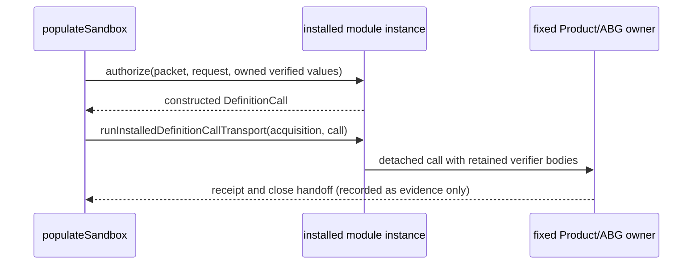

# Installed Public DefinitionCall construction

Retired sections: [history/T287_PUBLIC_DEFINITION_CALL_CONSTRUCTION__RETIRED_SECTIONS.md](history/T287_PUBLIC_DEFINITION_CALL_CONSTRUCTION__RETIRED_SECTIONS.md).

T-287 PUBLICCALL01 refines the existing S06/native SDK realization. Product
`SDK And CLI` and `ABG5-S06`, and REQ-P-PUBLIC-CONTRACTS-009/010 retain semantic
authority. The fifteen Product families and exact operation/definition family
are unchanged.

`@abiogenesis/typescript-tenant/public` exports
`constructInstalledPublicDefinitionCall` and its typed explicit input. It is
deterministic construction of an invocation candidate, not runtime admission
or execution. The implementation moves from test support into the Public owner;
test support re-exports that function by the public package specifier.

The caller supplies the installed Product canonical JSON/hash functions,
installed Public family/projections, verified definition coordinates, exact
contract catalog, operation/member selection, request, authority slots,
resource assertion, refs, event time and provenance. There are no implicit
selection defaults. Product verification remains the source of coordinates;
this helper is not a substitute for verification.

The constructor selects one exact definition/operation/member, checks slot
catalog, operation, version, selector, key, slot and definition ref against the
installed owner projection, then preserves the supplied coordinates. It hashes
the same authority, request and invocation preimages as the predecessor helper
and derives the same invocation ref. Request, slots and resources retain their
identity. Provenance is copied and frozen; construction does not deep-freeze
caller values or acquire resources.

Transport and the exact selected owners retain complete raw contract and
semantic admission. Construction does not admit capabilities, request meaning,
resource assertions, runtime events or outcomes. GTL declares; HoG traverses;
ABG admits. Existing transport and CLI receive the same DefinitionCall envelope.
No Public operation, schema, event, binding, controller or family is introduced.

Compatibility evidence compares the predecessor and exported constructor on
the same existing ordinary envelopes and malformed coordinate cases. It proves
only construction equality and preserved refusal boundaries. Installed native
execution, downstream lifecycle usability and release qualification remain
separate Executive-owned compositions.

For the shared native Run/GraphCall reads, the invocation's catalog and
request/result/refusal coordinates name the current executing Product. The
owner binds that catalog and operation row to its own package-relative
manifest using existing Product parsing and canonical identity. This bounded
immutable metadata read is not package re-verification or a new authority.

The authority slots instead select the historical source WorkspaceBinding,
ProductSet, lock and read grants. The owner obtains them from the authenticated prefix, validates the applicable
admission and operation relations below, and requires the selected source to
have that exact binding. Its original Program/GraphFunction and historical declaration
proof remain unchanged. The source grant's historical catalog need not equal
the current reader's catalog; neither catalog substitutes for the other.
Current exact ingress, supported event/profile/language admission, source
digest/currentness, typed absence/refusal and no-append closure remain binding.

## Owner-derived native call typing (HC1)

Root accepted this HOW re-entry on 2026-11-03 under the owner's explicit implementation authorization and operative STDO3.0.2. Source6027d03 is preserved custody, not accepted014. HC1, HC2 and the later practical proof are sequential increments of the existing RC4 goal; HC1 alone does not close the authorized consolidation.

The native type family is derived from `OWNER_CONTRACT_MODULE_SOURCES`, its existing package export, binding export and recursively corresponding member paths. Owner packet schemas supply request, result, refusal and nonterminal types. Actual callable binding leaves supply resource assertions and resource receipts. No second operation, request or resource catalog is introduced. The inspected6027 checkpoint declares18 operations/56 members and exports47 callable leaves. The five `interaction.respond` members and `witness.admit` attest, hygiene-stamp, intake and run-resumed currently lack callable bindings; they remain explicit unavailable members under the existing `installed_binding_unavailable` transport refusal. They receive no fabricated resource contract or callable type. This inventory does not allocate them as reserved5.1 work.

`constructInstalledPublicDefinitionCall` couples operation/member selection, owner-derived request, `InvocationAuthoritySlotsOf` and the selected callable resource type. Native receipt typing preserves the selected owner output and resource receipt. Request variants distribute before conditional authority-slot computation. `ExactStartRunInvocationRequest` and `ExactDirectRunInvocationRequest` retain their exported names and derive their shapes from `RUN_OPERATION_CONTRACTS`. Binding and schema helpers preserve concrete member types. No broad overload may silently restore independent request/resources. Type projections remain under Public; shared machinery stays owner-independent.

This is structural native caller law. Raw/dynamic/serialized input retains exact existing owner admission, permissions, currentness, execution faults and refusal precedence. Construction, TypeScript assignability and equal digests establish no new admission or Run-instance authority. Missing callable selection keeps the existing transport refusal. MJS clients may consume the constructor at runtime; that does not establish their static checking or complete the canonical client population work.

HC1 also replaces the selected controlled worker fixture's partial request with the existing `NativeInstructionAssembly.request` producer. It does not add a worker-request constructor or reopen014 write/currentness guards. HC2 owns canonical operation population and caller retirement described below.

## Canonical operation population (HC2)

Existing Product and ABG owners populate framework handoffs from explicit bound context and caller intent or reference keys. Public constructs the installed envelope and remains a thin shell. Rehome `constructInstalledStartCall`, `constructInstalledPendingCall` and `constructInstalledRunReadCall` from test support; support direct invoke and the existing next, graph_function, asset and declared_start variants, and the pending-execution continuation variant (`constructInstalledPendingCall`, `public/installed_public_definition_call.ts`). Reuse `prepareProductRunInvocation` and existing continuation/read owners by factoring shared population, not copying it. Product resolves selected declarations, input contracts, policy, grants and authority; ABG projects authenticated continuation input, historical source and exact prefix. Current B authority is distinct from retained A source. Cold recovery reconstructs through existing owners; a remembered start object is not recovery authority.

The admission-authority owner constructs `AdmissionCapabilityData` from the exact packet, verified owner artifact, request/resources, slots and optional bound-environment selection; `constructAdmissionCapabilityGrants` remains the grant producer. `ResolvedAdmissionAuthority` and its approval are explicit supplied authority, never an automatic allow decision. Worker request population remains `NativeInstructionAssembly.request`. Event-resource assertions may be populated from actual owner handoffs; acquired selections, held completion, physical close and interrupted recovery retain their distinct existing owners. No general receipt constructor is added.

Every call identity, selected mode, resource, dependency and permission is explicit; test Program/date/ref defaults, raw mutation hooks and private-import fallbacks stay out of the shipped functions. The SDK exports the canonical functions through existing package paths. The existing CLI accepts their constructed envelope through its unchanged JSONL transport. No separately callable tool service or friendly CLI subcommand is claimed without an actual exported/installed implementation. MJS operator/test wrappers consume the installed functions and retain scenario data and assertions. Superseded framework population bodies are removed after migration; historical evidence remains unchanged.

## Finite completion evidence

HC1 proves56 declared packet types,47 actual callable/resource/receipt relations and nine explicit unavailable leaves; positive packed-TypeScript consumption and negative wrong member/request/resource/target/selector/required-slot cases; runtime raw refusal and host fault/null/nonterminal preservation; the controlled native-work fixture consumes the existing complete instruction assembly. HC1 does not claim canonical LLM-facing population complete. HC2 proves installed start next/declared/asset and direct GraphFunction construction, B current authority with retained A source, pending continuation and cold read chaining; unknown effect, wrong Run, stale prefix, consumed continuation and missing historical dependency preserve actual owner causes. The subsequent fresh005 A-to-B interruption/recovery witness uses only these installed paths. Existing014 guard evidence is reused where unaffected. Whole5.0 qualification and the nine absent callables remain separate obligations.

## Admission boundary and established internal values

Reuse actual owner-established resolution, policy, grant, input, assembly and authenticated-source values within their owner scope. One unchanged owned value is not re-resolved merely because another helper is called. Cold/serialized ingress retains admission; fresh permission and physical currentness remain operation-owned. No new store, snapshot, registry, authority token or process hop is introduced.

T287/LIFE-01 selects this `design_reframe` with contained
`realization_refactor` increments under unchanged Product
[Definition, Tool, And Runtime Authority](../../../../specification/PRODUCT.md#definition-tool-and-runtime-authority),
[INSTALL043–057](../../../../specification/requirements/product/REQ-P-INSTALL.md)
and the Public contracts cited above. This HOW owns the reuse boundary; the
[ticket checklist](../../../../.ai-workspace/tickets/active/T-287-deliver-abiogenesis-5-feature-waves.md#admission-boundary-execution-checklist)
owns sequencing and acceptance status.

The tenant's [Distribution And Risk Proportionality principle](ABI5_REALIZATION_CONSTITUTION.md#41-distribution-and-risk-proportionality)
owns the technology and operating-model justification for the mechanisms below.
The Product calculus supplies their deployment-independent semantic obligations.

The path is **external/raw input → owning admission → established typed internal
values → additional operation-owned relations/currentness → admitted change**.
An owner establishes only the facts within its contract. Same-process origin,
`F_D`, a TypeScript cast, matching digest or successful construction does not
admit a value or authorize an effect. A structurally admitted wire result does
not thereby satisfy a target contract or substantive judgment.

| Boundary | Checks retained by the existing owner | Work reusable after those checks |
|---|---|---|
| Supplied Product, lock and declarations | Exact bytes, identities, schemas, dependency/contract linkage and provenance; installed physical correspondence where required | The unchanged verified body, resolved linkage and validated lock inside their lawful owner scope; a later operation checks its membership/selection and actual physical currentness rather than rebuilding the same body |
| Raw Public/serialized request | Selected definition/contract, structural schema, supplied authority, request/resource correspondence and permissions | Established immutable constituents across native calls; detach mutable caller input without first copying an unchanged verified body merely to restore it |
| Proposed runtime change | Authentic current predecessor, exact call/Run/binding, authority, additional semantic relation and lawful transition; preserve refusal precedence | Existing live derived state and candidate delta; refusal leaves the accepted predecessor unchanged |
| Raw `F_P` output and subsequent use | Schema and call/attempt/input/contract correspondence; eligible references and evidence; authority/currentness, substantive judgment and lawful transition | The actual checked result and established facts, scoped to the exact result/basis; a downstream owner still judges every additional relation it owns |
| Ordinary query and genuine recovery | Exact requested source/prefix, current read authority, typed absence/refusal and resource ownership | Live projections for queries against that owned state; cold acquisition/recovery reconstructs equivalent facts from the log and immutable inputs |

Reuse follows actual owner-established values and their exact basis, not a new
registry, cache, controller, trust token or required process-local semantic
authority. Serialized/reacquired data crosses its ordinary admission boundary;
a cast cannot replace it. A changed subject, contract, dependency, prefix or
physical observation requires the corresponding owner check. Prior immutable
facts remain historical facts; reuse does not make an old permission, witness
or worksite observation current. Existing physical resource lifetime ownership
continues to govern borrowing, successor selection, append and genuine close.

There is one authoritative event log and one live derived state for its active
owner. Candidate validation consumes that predecessor without discarding its
derivation; append advances the same owner state. Rollback, truncation,
reappend, immutable prior prefixes and refusal isolation remain binding.
Recovery reconstructs; a handoff or query within the live lifetime is not itself
a reason to reconstruct history. No competing persistent state is introduced.

### Maintained setup owner reuse (RC4 setup020)

Maintained setup composes the canonical installed calls in one installed module
instance. `publicCaller.invoke` hands the actual constructed DefinitionCall to
that instance's `runInstalledDefinitionCallTransport`, which retains the actual
owner-verified artifact and its exact request relation through authorization,
verification, resolution and installation and detaches every other caller
value. Setup records compact request/resource coordinates, the actual SDK
outcome, close handoff and timing as evidence; it never re-ingests a persisted
projection. Cold/raw ingress and new target Products still verify,
installations keep their physical checks and locks, and owners retain
permissions, currentness, close and reopen. There is no alternate legacy mode,
cache, service or receipt authority.

Installation runs npm in the ambient process environment, so the caller scopes
the configured setup `PATH` and `TMPDIR` over the complete serial setup and
authorization and restores the ambient values in `finally`. The event-resource
lock namespace follows no environment variable (`durableAppendLockPath` in
`abg/event_store.ts`). Lifecycle supervision and fresh Run
reads keep one explicitly named cold entry: one canonical JSONL request to a
fresh installed CLI process under its declared environment. Setup adds no
timeout race that could abandon an active owner.



### Authenticated read-source handoff (T287/Writer51)

One cold read authenticates the detached immutable durable coordinate and its
complete ordered event vector. The existing coordinate derivation receipt then
lets pure ArtifactTruth and WorkspaceEnvironment consumers borrow that exact
source; internal read preparation carries the resulting owner projection rather
than decoding the same physical prefix again. Capture alone establishes no
history facts. Raw/copied coordinates and explicit physical reads keep their
cold admission; currentness, invalidation, binding, install and causal checks
remain owned by their existing contracts. This is disposable established-value
reuse, with no additional history cache or recovery authority.

```mermaid
sequenceDiagram
  participant Caller
  participant Reader as Durable-prefix owner
  participant Truth as ArtifactTruth owner
  participant Env as WorkspaceEnvironment owner
  Caller->>Reader: capture coordinate; authenticate complete read
  Reader-->>Caller: immutable source and exact coordinate receipt
  Caller->>Truth: projectOwnedPrefixArtifactTruth(coordinate)
  Truth->>Env: projectWorkspaceEnvironmentFromArtifactTruth(truth, binding)
  Env-->>Caller: same source-bound environment for read preparation
```

The sandbox caller compares the whole event resource before and after each
eventless fresh read using bounded byte chunks, digest, length and file identity.
It retains no full before/after byte buffers. Replacement, append, truncation or
changed bytes still refuse; these checks add no runtime event or terminal truth.

The [catalog owner](T287_GRAPH_CATALOG_CONTRACTION_ACCEPTED_DESIGN.md) continues
to return plain immutable derived construction: equal complete bases produce
equal results, independently of process identity. Catalog reuse grants neither
execution authority nor a runtime lifecycle. The existing
[F_P admission owner](../code/src/abg/probabilistic_result.ts) retains wire,
target and judgment separation; checked-result reuse cannot promote unjudged
actor output, broaden evidence eligibility or replace independent assessment.
Public carrier/receipt changes re-enter their exact owning contracts together
with their callers; this model does not silently relax an existing schema.

### Conformance Definition resource receipt

`conformance.evaluate/gtl_program` preserves its complete semantic result and
refusal algebra. Its read-only `DefinitionReturn.resources` is a
`ConformanceEvaluationResourceReceipt`: existing invocation, request and
capability-grant coordinates, not an echo of the packet, declared inventory or
catalog. The admitted grants already bind the exact approved resource scope;
this receipt adds no admission authority. Host exit/failure and invocation
association remain unchanged. Real event-resource completions from effect
owners remain their existing handoffs; this read-only receipt invents none.
Historical full resource receipts retain their original bytes and meaning.

Within this conformance call, the owner reconstructs the declaration basis and
resolves its exact Program closure once. Its internal validation continuation
consumes that actual closure, while preserving packet/publication correspondence,
raw declaration admission and `validateProgram`. The raw catalog/conformance
entries still authenticate a supplied closure against its complete catalog and
view. Equal-body catalog construction, cold/raw readiness and all additional
operation-owned relations remain unchanged; no cross-call catalog authority or
process-identity registry is introduced.
