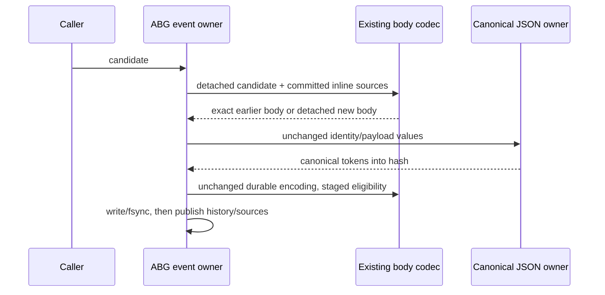

# T-289 Immutable Installation Event Bodies

## Authority and outcome

Executive accepted this bounded `design_reframe` on 2026-09-20 under T-289,
Product ABG admission/replay, REQ-R-ABG3-PAYLOAD-001..006 and
REQ-R-ABG3-EVENTS-024/025/032. It changes installation event representation,
not Product meaning, install admission, physical currentness, or publication
ordering. STDO RC7 and ABI5_PROJECT_REFERENCE_FRAME_BASIS remain the basis.

## Representation and owners

`environment_admission.ts::admitArtifact` uses its already validated predecessor
artifact projection to encode a valid Product install candidate as the closed
body `{kind: "product_install_lock_row", schemaVersion: "5.0.0", productId,
installId, installedRoot}`. Every other candidate field is exactly derivable
from the selected complete lock row, fixed candidate kind/disposition/schema,
and lock id/digest. This is an event body encoding, not a Product candidate or
an admission carrier. The unchanged candidate predicate and full candidate
canonical digest establish equivalence before publication.

The first installation for a lock embeds `resolvedLock`. Later distinct install
admissions with that exact lock use the same `resolvedLock` slot for a closed
`{kind: "resolved_product_lock_reference", schemaVersion: "5.0.0",
admissionEventRef, admissionEventDigest, lockId, lockDigest}` body. The tag
is disjoint from the inline `resolved_product_lock` shape. The event-contract
field table, native profile digest, and historical stamps remain unchanged;
Executive accepted this carrier adjustment after the existing closed event
contract refused a new top-level key during the first focused discriminator. The source is an earlier valid install admission in this same
stream which physically embeds the lock. The source digest is its admitted
payload digest. That source is the later event's sole causation reference.
No body event, sidecar, catalog, process cache, or new runtime authority exists.

`artifact_truth.ts` folds each event in admitted order. It accepts exactly one
inline or reference lock form for the compact representation. A reference must
match an earlier validated, physically embedded source's event identity/digest
and lock identity/digest; chains, cycles, missing, forward, wrong, malformed,
and mixed sources refuse. The selected product row must exist exactly once.
The reader reconstructs the full candidate, checks the Product candidate
predicate and full artifact digest, and only then exposes the install fact. An
inline lock answers the recorded question when the fold advances over history
and the strict question when admission prepares its candidate
(`T287_PACKAGE_OWNED_NATIVE_DECLARATIONS_DESIGN.md`, "Recorded and strict
Product truth").

Historical complete candidate plus embedded lock events retain their original
zero-cause branch. They may supply an exact embedded lock to a later compact
admission. Workspace binding continues to cite each actual install admission;
a body reference never stands in for the distinct target install admission.
Complete candidate/lock projection rows remain derived values, preserving
`rehydrateProductInstallRowFromRows` and its downstream contracts.

## Ordering and evidence

Existing predecessor physical checks, exact invocation/scope guards, successor
semantic projection before append, durable append, and effect/publication
ordering stay in force. Compaction eligibility and encoding preserve the same
structured `artifact_truth_conflict` refusal as successor projection when raw
candidate validation throws; the supplied predecessor remains unchanged and no
bytes append. This error boundary does not broaden Product validation or change
valid candidate encoding. Serialization does not erase the install's own
invocation, scope, identity, digest, event identity or availability effect.

Focused tests cover real owner production, cold reconstruction in a fresh
process, historical/new mixed bodies, full candidate equality, malformed and
missing/wrong/forward references, reference chains, wrong product selection,
wrong candidate identity/digest, mixed forms, and unchanged physical-byte
refusal. Mutation histories are isolated refusal probes, never accepted runtime
evidence. Executive owns the one deterministic installed Hello composition,
independent assessment, canonical application and delivery disposition.

## Native basis-input and CCall-result physical bodies (T-287 / RC1)

The T-287 body-projection increment applies the same earlier-inline-body reuse
principle under the selected STDO v2.5.1-rc.1 basis. Installation representation
above is unchanged. `event_store.ts` owns exactly two native slots:
`basis_admitted.payload.rawInputValue` and `c_call_result_admitted.payload.value`.
It retains complete logical RuntimeEvents and all original event, payload,
input, basis and result digests. Each admission and causal/runtime lineage
remains distinct. Reusing bytes grants no source, currentness, effect, judgment
or continuation authority.

The first whole body is physically inline in an ordinary event row. A later
identical body may be represented by the closed JSONL record
`{kind: "abg_admitted_body_reference_record", codecVersion: 1, event,
bodyReference}`. `event` is the original logical event with only its selected
body field absent; its kind fixes that field. `bodyReference` contains exactly
`sourceEventRef`, `sourcePayloadDigest`, `sourceSlot` (`basis_input` or
`c_call_result_value`) and `bodyDigest`. Both selected slots may reference either
source slot. The wrapper is physical storage vocabulary, not a RuntimeEvent
kind or a reserved marker inside arbitrary Product JSON. A reference is used
only when its encoded row is smaller than the inline row.

The source must be an earlier validated row in this stream that physically
contains the body. The codec restores that value before unchanged logical event
validation. Missing, forward, foreign, crossed, wrong-digest/slot, chained and
mixed inline/reference forms refuse. Body references do not add semantic
causation edges. Legacy inline histories and mixed histories remain readable;
old readers are not claimed to support the new physical record.

The existing store owns a disposable lookup of first physically inline sources
and exact per-event physical prefix correspondence. Cold reconstruction derives
both from actual bytes. Append stages new eligibility and offsets; successful
write/fsync publishes them with the history and SHA continuation. Rollback
cannot publish tentative sources. No sidecar, extra event, independent store,
configurable path registry or Public codec operation is introduced.

Physical lengths and prefix digests always describe encoded bytes. Existing
C1/C3 source-cut construction in `execution_basis.ts` obtains its coordinate
from `event_store.ts::durableRuntimeEventPrefixThroughEvent`; F_H predecessor
checks in `fh_continuation_projection.ts` consume the same owner's
`runtimeEventPhysicalPrefix` correspondence. In-memory histories without a
physical resource retain ordinary inline serialization. Historical ancestry,
close/reopen, and `event_log.ts::persistEventLog` must not infer physical bytes
by serializing expanded values. Public/replay/domain consumers receive only
full logical events; physical source correspondence does not confer append or
currentness authority.

## Current RC2 hot-memory and canonical-hash increment (T-287 / Writer35)

The selected Writer58 snapshot correspondence keeps nominal identity in a
module-private WeakMap from each exact snapshot to its branded proof. Its own
SNAPSHOT descriptor must equal that registered proof; the proof retains source,
parent proof and shared-prefix length, with no pointer back to the snapshot.
[WeakRef construction and dereference](https://tc39.es/ecma262/multipage/managing-memory.html#sec-weakref.prototype.deref)
add targets to the execution's kept objects. The
[WeakMap association](https://tc39.es/ecma262/multipage/keyed-collections.html#sec-weakmap-objects)
permits otherwise unreachable call-local vectors to be collected during a long
synchronous projection. Exact source identity, raw/copy cold fallback, prefix
answers and invalidation stay unchanged. This removes that lifetime pressure;
it does not establish the dominant retainer or close installed memory P0.

Under the selected STDO2.5.1RC2 integration/worksite and runtime-projection
frames, caller admission still captures the complete canonical candidate before
freezing it. For the two native body slots above, that detached value may reuse
the exact deeply immutable body of an earlier **committed, physically inline**
source in this store and exact selected predecessor prefix. Source membership
is `events[source.event.admissionOrdinal - 1] === source.event`; the existing
digest lookup plus complete canonical-value equality establish correspondence.
An envelope, stamp, scope, result identity
or causal edge is never reused. Unbound projections and new/tentative bodies
retain ordinary detachment. The durable encoder alone publishes source
eligibility after write/fsync; batch/transaction rollback cannot publish a
source. Hot sharing does not change physical encoding eligibility, cold
reconstruction, logical values, or prefix/currentness authority.

`canonicalJson` and `sha256Canonical` use one canonical traversal: the text
view collects its tokens, while the digest view feeds them incrementally to
SHA256. Neither view changes key order, escaping/Unicode, numeric text, sparse
array behavior, captured entries, refusal precedence, or any existing digest.
Hashing a replay state therefore need not retain a whole token array and joined
string. Replay continues to own its complete event-derived state and uses the
same digest owner; no replay, Public, store, cache or runtime authority is added.

Operator34's SIGABRT heap exhaustion justifies these two pressure repairs;
its precise allocating site remains unproved. Focused live/cold/physical,
rollback and canonical compatibility checks plus a bounded authentic-body
constrained-heap discriminator are mechanical readiness. They do not earn a
new Run, retained-state continuation, application completion or UAT result.

## Retained-route source carriage (T-287 / RC5 F4)

Root selected this private durable representation change under the owner's
approved RC5 scope and the F4 re-entry. Product meaning, the logical
RuntimeEvent, every value/payload/event/route identity, lineage, currentness,
refusal and the public event contract stay unchanged. It is the codec's third
physical form; v1 input/Result and v2 native-definition forms keep their
meaning above.

The measured RC3-building-RC4 history held 15 retained routes whose nested
source equalled the earlier Result of the same Run and CCall: 155,009,467 gross
bytes. Every one of those Results was itself a v1 body reference, so a form
limited to physically inline sources saves nothing there. The form below
therefore names the consumed Result and acquires that Result's own earlier body
dependency through the durable owner.

### Eligible event and source membership

Only a `traversal_route_admitted` event whose `payload.boundInput` is a
`raw_admitted_value` holding exactly `{entry, kind: "retained_graph_input",
schemaVersion, source}` is eligible; only `boundInput.value.source` may be
omitted. Every other route field, `entry` and the bound-input stamps stay in
the row.

The source is the exact earlier admitted Result the route consumes: a
`c_call_result_admitted` event in this stream, earlier by admission ordinal,
with the route's `runId`, `basisId`, `graphCallId` and `frameId`, aggregate
`c_call` and aggregate id equal to the route's `payload.cCallRef`, payload
`cCallRef` equal to it, and `resultClass: "success"`. This is the same
membership relation [worksite_input_provenance.ts](../code/src/abg/worksite_input_provenance.ts)
`projectRetainedWorksiteInputAtPrefix` uses to find the route's source Result.
New routes also cite that Result as a cause
([traversal_route.ts](../code/src/abg/traversal_route.ts) retention causes);
membership does not depend on that edge, so earlier retained routes have the
same eligibility. A basis or another Result with an equal value, another
occurrence of the CCall reference in a different Run or scope, a later or
uncommitted event, and the route itself never qualify. A route is a consumer:
it never becomes a body source for any later row, and the form adds no
causation edge.

### Physical record

The closed record is `{kind: "abg_admitted_body_reference_record",
codecVersion: 3, event, bodyReference}`. `event` is the complete logical route
with only `payload.boundInput.value.source` absent. `bodyReference` carries the
existing four keys: `sourceEventRef` (the Result's event id),
`sourcePayloadDigest` (its admitted payload digest), `sourceSlot:
"c_call_result_value"` and `bodyDigest` (canonical digest of the omitted body).

The encoder in `appendDurablyBatch` uses the existing `aggregate:c_call:<ref>`
history index over committed rows plus earlier events of the same durable
batch. It encodes only when exactly one earlier event satisfies the envelope
membership above, the reference row is smaller than the inline row, and the
owner-acquired Result value is canonically equal to the route's source. Any
other case writes the ordinary inline row; inline fallback is always valid.
The size check precedes body acquisition, so small routes acquire nothing.

### Decoding and acquisition

All three readers decode the same way: full history
(`decodeHistoricalEvents`), selected rows (`constructRuntimeHistory`'s reader)
and descriptor decode (`decodeRuntimeHistoryDescriptor`). Each supplies only
events before the route. The named source must satisfy the membership above
and the reference's payload digest and slot. Its logical event is acquired
through the same owner's existing body acquisition. That Result may itself be
physically inline or a v1 reference; its own earlier body dependency resolves
through its own v1 rule. The restored source must hash to `bodyDigest`. The
store then validates the complete restored route exactly as for an inline row:
envelope, ordinal, stamps and payload digest. A missing, forward, foreign,
wrong-kind/slot/digest, tampered or mixed (source present) record refuses
before logical history is exposed. Decoding checks only named membership; it
does not count candidates, so all three readers agree on every byte sequence.
The encoder's exactly-one condition is a producer policy. The CCall phase
projection in [c_call.ts](../code/src/abg/c_call.ts) already refuses more than
one Result per CCall.

### Atomicity, compatibility and limits

The record depends only on event identity, so v3 adds no staged source table.
Append stages the encoded rows and publishes history, prefix and SHA
continuation only after write and fsync. A failed write or fsync truncates to
the prior extent, and a failed truncation poisons ownership, as for v1/v2. A
rolled-back Result is absent from the history, so no committed route can name
it. Historical files are never rewritten: legacy, v1 and v2 histories remain
readable and may supply Results to new v3 rows. Readers older than this form do
not read v3 rows. Physical lengths and prefix digests describe encoded bytes
and differ from an all-inline encoding, while logical events and replay stay
equal.

Focused component cases distinguish exact membership from body equality: a
real Result that is already physically referenced; same-valued basis and
foreign-occurrence decoys; missing, forward, tampered and uncommitted sources;
mixed forms; rollback and failed fsync; full, selected and descriptor cold
reconstruction; and the captured-route-37961 three-row sample. The sample
measures net bytes with reference overhead included. One installed case runs a
`c_workflow` child into a retained E/S/T consumer and checks the physical
reference with fresh result/replay. These cases prove only representation,
reconstruction and that installed path. They establish no latency, capacity,
campaign-wide saving or qualification claim.
