Cut from `build_tenants/abiogenesis/typescript/design/M05_DIRECT_GTL_TRAVERSAL_EXPANSION_DESIGN.md` at commit `e1516b5f1`, lines 3487-3658, verbatim.

### 14.3 Observer and tuner Product domain

ABIogenesis publishes one executive Module containing:

- `gtl://abg/observer/default`;
- `gtl://abg/tuner/default`;
- one observer GraphFunction;
- one tuner GraphFunction;
- exact replay-snapshot, observer-report, tuning-signal, declaration-draft,
  transition, and refusal contracts; and
- declared implementations behind those GraphFunctions.

The observer input is an ABG-derived replay snapshot, not a caller-authored
summary. It binds the exact workspace, invocation or qualification subject,
event-store digest, ordered event refs, terminal or halt state, evidence refs,
result refs, route refs, continuation refs, and applicable policy refs. The
observer emits attributed findings and a truthful halt classification. It may
not carry a write, event-emission, traversal, continuation, or closure field.

The tuner input binds the admitted observer report plus replay-derived signal
rows. The tuner emits one declaration-draft candidate preserving:

- draft and proposer identity;
- affected declaration refs;
- replay, observation, and signal bases;
- proposal kind;
- before and proposed-after digests;
- an equivalence-contract ref when the proposal anneals an `F_P` interior to
  an `F_D` interior; and
- a summary that is evidence, not authority.

The deterministic default fixture may emit a bounded draft from a declared
signal. Open semantic interpretation remains `F_P`. Neither form mutates live
declarations, specification, configuration, tickets, workspace assets, or
runtime state.

### 14.4 Public reads and tuning transition

`project.read(observer_report)` and `project.read(tuning_report)` are
side-effect-free replay projections. They reopen the exact durable event log,
derive their output from admitted events and Product results, and append
nothing.

`tuning.transition` owns exactly three variants:

- `propose` admits one authentic tuner output as
  `tuner_draft_admitted`;
- `ratify` admits `tuner_draft_ratified` under an exact actor or visible policy
  authority; and
- `reject` admits `tuner_draft_rejected` under the same authority class.

The events are workspace-scoped ABG truth and preserve draft ref and digest,
workspace binding, proposal kind, proposer, replay and signal bases, affected
declarations, before/after digests, decision actor or policy, and causation.
Ratify and reject require the exact open admitted draft and are mutually
exclusive. Repeated, cross-workspace, substituted, unattributed, or
non-tuner-authored transitions refuse.

Event Calculus initiates `tuner_draft_open(draftRef)` on admission and
terminates it on ratification or rejection. Replay projects the exact draft
state and decision event. Ratification records authority only; applying the
draft requires later ordinary intake, change classification, and work under
the affected Product owner.

### 14.5 Qualification readiness

M5 does not issue the S04 qualification verdict. It makes S04 runnable by
proving the installed behavior over a bounded candidate-like replay fixture:

1. a truthful halted replay produces an attributed observer report;
2. an injected contradictory replay produces the expected non-green finding;
3. the tuner emits a grounded declaration draft from admitted signal truth;
4. proposal, ratification, and rejection are replay-visible;
5. a draft lacking signal or replay basis refuses;
6. neither observer nor tuner mutates live authority or source; and
7. all reads are side-effect free.

M6 repeats this behavior over the exact frozen `pre_rc_candidate`, selected
STDO basis, complete inventory, and qualification subject.

### 14.6 Semantic views and authority

**Domain view**

```text
FlavoredCatalogProduct
  -> node_type + overlay + GraphFunction

ExecutiveDomain
  -> ReplaySnapshot
  -> ObserverReport
  -> TuningSignal
  -> DeclarationDraft
  -> DraftDisposition
```

**Interaction view**

```text
native SDK | native CLI | Codex delegate
  -> one Public contract
  -> catalog/apply/invoke
  -> HoG
  -> ABG
  -> replay projection

project.read(replay)
  -> observer GTL
  -> tuner GTL
  -> tuning.transition
  -> ABG replay
```

**Lifecycle view**

```text
declaration: admitted -> applied
draft: candidate -> admitted -> ratified | rejected
```

These states project existing Product and ABG truth. They do not create a
controller or independent workflow.

IACS remains singular:

| Authority | Owns | Does not own |
|---|---|---|
| flavored Product | declarations, contracts, Program, GraphFunction, judgment, implementation | ABIogenesis runtime or public semantics |
| Codex delegate | process transport to installed CLI | Product, traversal, event, continuation, closure |
| observer Product content | attributed diagnostics over replay | mutation or runtime truth |
| tuner Product content | signals and declaration-draft candidates | ratification or live mutation |
| human or declared policy | ratify or reject decision | retroactive draft authorship |
| GTL publication | observer/tuner topology and contracts | runtime admission |
| validator | static program and contract law | lowering or execution |
| HoG | direct traversal | Product semantics |
| ABG | declaration application, draft transition, events, replay | diagnosis or proposal meaning |
| Public | typed invocation and projection | fixture, observer, or tuner orchestration |

Prime contraction is:

```text
one public invocation family
  + one direct traversal runtime
  + Product-owned semantics
  + ABG-owned admitted truth
```

The old Codex runtime, observer runner, tuner state store, manifest-only
capability roster, host-owned Product switch, and source-tree fixture import
are prohibited rival authorities.

### 14.7 Promotion boundary

Promotion requires:

- native SDK, CLI, and bounded Codex projection agreement;
- one source-independent flavored Product applying node-type and overlay rows
  and invoking its GraphFunction through installed public contracts;
- observer and tuner execution as ordinary admitted GTL;
- side-effect-free observer and tuning reads;
- authentic proposal plus mutually exclusive ratification and rejection;
- injected-negative, cross-basis, duplicate-transition, and direct-mutation
  refusals;
- deletion of the alternate Python Codex runtime;
- no fixture-specific core branch, compiler, lowering carrier, controller,
  second runtime, or second truth store;
- `test:m4`, complete prior `test:m5`, and deterministic package reproduction
  remaining green.

Micro implementation details may co-evolve inside these fixed identities.
Changing Product meaning, public operation identity, event ownership, or the
GTL/HoG/ABG authority split requires renewed design review.

---

Cut from `build_tenants/abiogenesis/typescript/design/M05_DIRECT_GTL_TRAVERSAL_EXPANSION_DESIGN.md` at commit `d5c1be89a`, lines 135-135, 212-212, 224-224, 234-234, 238-238, 239-239, 253-253, 258-258, 282-282, 340-340, 364-369, 558-560, 565-568, 870-886, 997-997, 999-999, 1011-1012, 1017-1017, 1019-1019, 1046-1046, 1048-1048, 1059-1060, 1153-1155, 1227-1227, 1231-1231, 1249-1250, 1252-1253, 1279-1279, 1280-1280, 1281-1282, 1300-1300, 1301-1301, 1305-1305, 1307-1307, 1309-1309, 1336-1337, 1405-1409, 1470-1470, 1488-1488, 1514-1514, 1524-1524, 1598-1613, 1638-1640, 1675-1675, 1729-1729, 1797-1805, 1827-1828, 1830-1831, 1864-1864, 1930-1931, 2041-2047, verbatim.

| `Continuation` | `TraversalAggregateFamily` | ABG | Authoritative run-local open obligation. The complete target algebra names open, resolved, superseded, and abandoned; the selected S03 realization proves only open, responded, and resolved, with superseded and abandoned deferred. |

| continuation | opened from admitted hold | open, responded, resume admitted | resolved in the selected S03 realization; superseded and abandoned remain explicit target-only gaps |

| `InteractionLeafRequirement` | GTL declaration and validation | ABG admits exact non-executable contract row | F_H request and response admission only | continuation terminal or declaration supersession |

| `HumanInteractionBoundary` | GTL declares callout and ABG admits hold | public projection renders pending interaction | attributed external actor returns candidate | response admitted or rejected in this cut; abandonment and supersession remain target-only gaps |

| `Continuation` | ABG admits an opening lifecycle event | replay projects exactly one run-local member | only separate response and continuation operations may advance it | resolved in this cut; superseded and abandoned are deferred with T-270 re-entry |

| `ContinuationBasis` | replay derives open obligation | public read and `run.continue` consume exact basis | never invokes HoG itself | resolved or run terminal in this cut; superseded and abandoned are deferred |

| request or answer human work | HoG proposes declared hold; attributed human answers | declared interaction and response contracts | F_H authority and replay basis | external human only | continuation and public interaction views | ABG | resolved or rejected in this cut; abandonment and supersession remain deferred |

| respond to hold | attributed F_H actor | declared response and capability contracts | ABG verifies open continuation and replay basis | `interaction.respond` only admits response truth | responded interaction view | ABG | response consumed, rejected, or continuation terminal |

| `admitInteractionResponse` | public `interaction.respond` candidate plus open continuation -> actor-attributed response truth or refusal; never invokes HoG | ABG |

| `ContinuationBasis` | `ReplayProjectionFamily` | `<<downstream>>` | `src/abg` | Events-only hold and resume projection. |

truth opens the authoritative `Continuation` aggregate. A later
`interaction.respond` operation admits an attributed response against that
exact continuation and response contract but does not invoke HoG. A separate
`run.continue` operation rehydrates the durable scope, admits resume truth, and
then explicitly re-enters HoG. It does not append a second result or judgment
to the completed request C call. T-270 owns the current domain interaction

6. appends `fh_interaction_resume_admitted` for F_H or
   `continuation_resume_admitted` for another declared continuation kind before
   `run.continue` explicitly re-enters HoG.

refuses before HoG and appends no resume event. The `interaction.respond`
operation may obtain its own reopened append context, but its semantic admission
only appends actor-attributed response truth; it cannot reconstruct execution
carriers or perform continuation steps 1-6.

          Human->>Public: later interaction.respond with attributed response candidate
          Public->>ABG: reopen existing durable sink without restamping
          ABG-->>Public: ReopenedEventStoreContext or typed refusal
          Public->>ABG: admit interaction.respond ingress with actor and capability
          ABG-->>Public: public-operation admission event
          Public->>ABG: admit response against exact open Continuation
          ABG-->>Public: actor-attributed response truth only
          Public-->>Human: typed response-admitted outcome
          Caller->>Public: later run.continue naming run, Continuation, actor, capability, and input
          Public->>ABG: reopen existing durable sink and preserve exact historical prefix
          ABG-->>Public: ReopenedEventStoreContext or typed refusal
          Public->>ABG: admit run.continue ingress with actor, capability, and input
          ABG-->>Public: public-operation admission event
          Public->>ABG: rehydrate replay and exact immutable authority basis in reopened context
          ABG->>ABG: reconstruct owner-issued basis, scope, cursor, and input and admit resume
          ABG-->>Public: RehydratedContinuationScope or typed basis-fork refusal
          Public->>HoG: explicitly re-enter exact cursor with admitted continued input

  Held --> ResponseAdmitted: separate interaction.respond admits attributed F_H response

  ResponseAdmitted --> ReplayRehydrated: later run.continue rehydrates exact durable scope

The lifecycle view above projects the complete target continuation algebra.
Edges marked `deferred` are not part of the selected S03 realization or proof:

  Open --> Responded: fh_interaction_responded

  Responded --> Resolved: fh_interaction_resume_admitted

| F_H is not an implementation or ABG callback | disjoint key sets and authority matrices | human, separate public operations, and ABG | interaction requirement plus Continuation | invoke stops, interaction.respond admits only response, run.continue rehydrates and re-enters HoG | Held through Responded, ReplayRehydrated, and ResumeAdmitted | no F_H implementation port and no ABG-to-HoG call | attributed response and resume admissions | pass | retained T-272 evidence under T-270 |

| continuation is authoritative and replay-constructible | Continuation aggregate, reopened store, and basis relation | ABG | open obligation plus downstream basis and exact historical prefix | reopen without restamp, verify public ingress, reconstruct, then separate resume and HoG re-entry | open/responded/resolved proven; superseded/abandoned target-only | preserved ordinals and owner constructors renewed only after equality | existing sink, max-plus-one append, immutable authority basis, and basis-fork refusal | pass for selected S03 path; two target transitions deferred | T-270 re-entry if Product selects supersede or abandon |

claim current `RUNTIME_EVENT_KIND_VALUES` membership. The realized rows add no
second envelope or event family. Every realized row carries

10. expose separate response, operation-scoped durable reopen, and continuation
    ports as retained T-272 evidence for T-270's accepted S03 reconciliation,
    without moving One Surface authority into traversal infrastructure.

| Continuation and continuation-operation family | One run-local continuation plus unique public-operation invocation identities | ABG event truth | Atomic hold opens continuation; ABG admits each respond/continue operation before Product or traversal effects | Replay and explicit public carrier | This cut realizes open -> responded -> resolved and replacement authority after post-resume failure | Resolved exhausts append authority; `superseded` and `abandoned` are named deferred gaps owned by T-270 if a Product path selects them |

| F_H response candidate | One attributed candidate for one open interaction and construction intent | F_H proposes; Product evaluates; ABG admits | Public transports candidate after operation admission | Product response evaluation and ABG continuation admission | Admitted response advances continuation once | Refusal creates no response truth; admitted value remains history |

4. ABG admits a continuation public operation before Product response
   evaluation or resumed traversal. Refused authority therefore executes no

5. F_H response and Product contract semantics are not leaf realization.
   Their installed provider is loaded and invoked through `src/product`.

| Open F_H hold and continuation | HoG hold proposal | Declared route/interaction law | ABG cursor and intent checks | ABG atomic hold batch | not_applicable: hold is admitted state | Public continuation carrier | Resolution or named deferred transition |

| Admit respond/continue operation | Developer request | Product invocation policy | ABG exact grant and durable duplicate checks | ABG before Product or HoG effect | not_applicable: admission is event truth | Replay over the admitted log | Invocation terminal |

| Evaluate F_H response | Attributed F_H candidate | Installed Product semantic function | Product request/response contract and pending basis | ABG response admission after Product validity | Product semantic provider | Replay/public interaction | Continuation resolution |
| Resume held traversal | Developer request carrying admitted response | Declared continuation law | ABG verifies operation and derives successor input; HoG derives the successor cursor | ABG admits resume over that exact cursor | HoG resumes traversal | Replay over the admitted log | Run terminal |

| Admit a public continuation operation once | `ContinuationPublicOperationAdmission` | `resolveContinuationPublicOperationGrant` then `admitContinuationPublicOperation` | durable idempotency fold | pure authority resolution then event admission | one admitted actor-operation capability grant, exact lifecycle state, and no prior event with the same invocation identity | derived; retain in `src/abg` |

| Project pending Product meaning | `FhInteractionSemanticBasis` | `projectFhInteractionSemanticBasis` | replay projection | downstream | open continuation and admitted construction lineage | derived; retain in `src/abg` |

| Evaluate an F_H response | `InteractionResponseCandidate` | `evaluateInstalledInteractionResponse` | installed Product semantic application | Product effect edge, no runtime truth | prior admitted public operation plus exact pending basis and Product contract | derived; retain in `src/product` |

| Derive resume input | `FhResumeSuccessorInput` | `deriveFhResumeSuccessorInput` | continuation transition | pure | responded continuation and admitted response | derived; retain in `src/abg` |

| Admit resume truth | `FhInteractionResumeAdmission` | `admitFhInteractionResume` | continuation transition | event admission | admitted `run.continue` operation and responded continuation | derived; retain in `src/abg` |

  ; evaluate(Product response)
  ; admit(response)

`src/product/semantics.ts` owns loading and invoking the exact installed Product
contract and F_H response provider; ABIogenesis's own provider resides in
`src/product/builtin_semantics.ts`. The fixed Public composition may invoke its F_H response
function only after ABG admits the corresponding actor-operation grant. HoG
does not export or evaluate F_H Product semantics.

    -evaluateInteractionResponse()

    -admitResponse()

    -admitResponse()

    -evaluateInteractionResponse()

  AbgAdmissionFunctions-->>PublicAdapter: held plus explicit continuation authority
  Developer->>PublicAdapter: interaction.respond(authority, candidate)
  PublicAdapter->>AbgAdmissionFunctions: reopen, admit public operation, project pending basis
  AbgAdmissionFunctions-->>PublicAdapter: admitted grant plus exact interaction basis
  PublicAdapter->>ProductSemanticBoundary: evaluateInteractionResponse(admitted operation, basis, candidate)
  ProductSemanticBoundary-->>PublicAdapter: canonical response or refusal
  PublicAdapter->>AbgAdmissionFunctions: admit attributed response
  AbgAdmissionFunctions-->>PublicAdapter: responded authority
  Developer->>PublicAdapter: run.continue(responded authority)
  PublicAdapter->>AbgAdmissionFunctions: reopen, admit continue operation, derive successor input
  AbgAdmissionFunctions-->>PublicAdapter: admitted operation plus successor input
  PublicAdapter->>HoGTraversalFunctions: derive successor cursor(held cursor, successor input)
  HoGTraversalFunctions-->>PublicAdapter: exact successor cursor
  PublicAdapter->>AbgAdmissionFunctions: admit resume(exact successor cursor)
  AbgAdmissionFunctions-->>PublicAdapter: admitted resume
  PublicAdapter->>HoGTraversalFunctions: resume(admitted resume, cursor, installed port)

  Held --> Held: refuse Product-invalid response / Product plus ABG
  Held --> Responded: admitContinuationPublicOperation plus admitFhInteractionResponse / ABG
  Responded --> Active: admitContinuationPublicOperation plus admitFhInteractionResume / ABG

| post-resume failure is total and publicly reopenable | failure transition plus refreshed carrier | ABG admits failure; Public projects authority | failure remains runtime truth, carrier remains downstream | every post-append catch replays and returns next authority | Responded reaches Active, Failed, then Readable | public refusal outcome carries event and continuation metadata | runtime failure event and exact-prefix refresh | pass, focused installed-byte mutation green | none |

  -> F_H hold -> project.read -> interaction.respond -> run.continue

Before runtime admission, ABG projects the exact pending request,
`NextActionBasis`, and `ConstructionIntent` from that lineage. After ABG admits
the exact actor-operation grant, the Product-owned installed semantics provider
evaluates the response candidate against that basis and returns either one
canonical Product-valid response or refusal. Public invokes the Product module
adapter but does not import or invoke an implementation module. HoG does not
participate in F_H response evaluation. A response naming another intent or a
choice outside the Product-owned pending choice therefore refuses before
`fh_interaction_responded`.

Ordinary F_H continuations without a construction intent continue to receive
their declared Product response value.

`fh_interaction_resume_admitted` consumes the prior continuation and
reactivates the held frame. Every later refusal or failure is therefore

This selected S03 path realizes `open -> responded -> resolved`.

admission, and that an otherwise Product-valid response naming another intent
refuses before response admission. Installed mutation negatives additionally

The accepted F_H continuation authority remains a durable read basis after its
continuation resolves. `run.continue` returns the same self-digested authority
updated to the exact appended event-log prefix. It does not create a second
run identity, projection store, or mutable current-run pointer.

From a fresh public context, `project.read` may consume that exact authority to
render:

---

Cut from `build_tenants/abiogenesis/typescript/design/M05_DIRECT_GTL_TRAVERSAL_EXPANSION_DESIGN.md` at commit `b13bdd5c2`, lines 123-123, 410-410, 416-417, 1068-1068, verbatim.

| `GraphFunctionApplication` | `GtlDeclarationFamily` | GTL | One declared graph relation for composition, substitution, recursion, fan-out, fan-in, gate, promote, identity, or same-object identity. |

| `gate` | target, rule, and evaluator refs | admit block or advance from evaluator truth; never select a candidate |

GTL value. Recursion, fan-out, fan-in, and gate retain explicit runtime-visible
application declarations because they govern child traversal or admission.

| `traversal_route_admitted` | `frame`; route ref/digest, route kind from `advance`, `retry`, `hold`, `blocked`, `failed`, or `terminal`, declaration ref/digest, source and optional target cursor refs/digests, applicable CCall/judgment and consumed-availability refs | current opened scope plus the judgment, child refusal/foldback, fan-out completion, gate result, retry progress, or structural declaration that permits the route | every variant terminates `locus_active(sourceCursorRef)` and any named consumed-availability fluent; `advance` and `retry` initiate `locus_active(targetCursorRef)`; `hold` terminates `frame_active` and initiates `hold_route_admitted(routeRef)`; `blocked` and `failed` terminate `frame_active` plus exact active retry/hold fluents and initiate `frame_blocked(frameId)` or `frame_failed(frameId)`; `terminal` initiates `terminal_route_available(routeRef)` |

---

Cut from `build_tenants/abiogenesis/typescript/design/M05_DIRECT_GTL_TRAVERSAL_EXPANSION_DESIGN.md` at commit `882b71e64`, lines 3278-3278, 3405-3407, 3433-3459, verbatim.

  -> the same invocation through a bounded Codex delegate

SDK owns the common parse boundary; the native CLI and Codex delegate submit
serialized values to it and do not implement another parser or operation
roster. Canonical JSON schemas for `PublicInvocation`, `PublicOutcome`, and


### 14.2 Bounded Codex projection

The Codex projection is a transport adapter over the installed `abg.cli`
contract. It accepts only:

- the exact installed `abg.cli` executable path; and
- one explicit JSONL public-invocation transcript path.

It invokes `abg.cli --jsonl <transcript>`, forwards stdout, stderr, and exit
status, and adds no interpretation. It imports no GTL, validator, HoG, ABG,
Product, implementation, or Public runtime module. It carries no Program,
catalog, event, continuation, worker, retry, or closure type.

The delegate resolves the submitted CLI path and the installed sibling path,
requires identity, and spawns the resolved installed sibling. The submitted
path is not retained as the executable path after verification.

The prior Python Codex build tenant is an alternate implementation and runtime,
not this projection. It is retired transactionally when the bounded delegate
lands. The native SDK and CLI remain independently executable with no Codex or
marketplace dependency.

Projection proof compares one fixed-result invocation through native SDK,
native CLI, and the Codex delegate. Native and delegated CLI output must match
byte-for-byte for the deterministic fixture. A source scan proves the delegate
contains only process transport and no copied Product or runtime semantics.

---

Cut from `build_tenants/abiogenesis/typescript/design/M05_DIRECT_GTL_TRAVERSAL_EXPANSION_DESIGN.md` at commit `8477fbc47`, lines 86-86, 92-92, 1722-1762, 1842-2091, 2183-3259, verbatim.

| Consensus declarations, execution, result, replay, and proof | selected S05 boundary under T-270; completed T-274, T-275, and T-276 are retained evidence |

Only the S05 Consensus domain program is active in this cut.


### 12.1 Product And Static Authority

The admitted `GtlProgram` publishes one immutable `ActionCatalog`. Each row
owns the action identity, kind, Program, GraphFunction, target locus,
obligations, input and output assets, expected delta, progress condition, and
stop condition. Whole-Program validation checks canonical catalog identity,
unique action membership, and exact Program, callable, and locus membership.
The catalog is Product declaration truth; it is not a runtime selector.

The same Program publishes one immutable `ConstructionComposition` containing
exactly four semantic-authority bindings: `synthesizeModel`, `evalGap`,
`evaluateNext`, and `evaluateAction`. Each binding owns one stable authority
identity and its declared initial and, where applicable, refresh locus. The
composition also names the F_H interaction locus and the exact Product closure
policy. Whole-Program validation proves that every locus is a member of the
same callable graph and that the initial and refresh passes use the same
authority identities. The admitted `ExecutionBasis` preserves the exact
composition identity and body. `stageRole` remains descriptive metadata and
never selects a semantic authority.

`evaluateNext` owns the semantic selection. ABG admits its
`NextActionProjection` only when the selected action resolves to exactly one
row in the admitted Program catalog and every row field equals the projection.

The public start input is one Product-owned `ObservationSnapshot` bound to the
exact admitted WorkspaceBinding and Program `ActionCatalog`. Product model and
gap evaluation derives the unresolved pressure and one `NextActionBasis`
containing that snapshot, target-obligation references, admitted catalog,
priority scheme, factual runtime frontier, and declared policy. The basis is
ordinary typed GTL data, not an ABG selection algorithm. `evaluateNext`
constructs the target-obligation bindings, applies the declared priority
scheme, and emits the total selected-action or no-action projection. ABG
verifies the basis, projection, and admitted environment; Product owns their
semantic contents and the selection.

The resulting `ConstructionIntent` binds the `NextActionBasis`, selected row,
projection, `ConstructionComposition`, and `evaluateNext` authority to the
workspace, invocation, Program, GraphFunction, ExecutionBasis, Run, GraphCall,
Frame, source C-call/result/judgment, and successor cursor. Public and HoG
choose none of those values.


### 12.3 Evidence Fold And Closure

The Product-owned `ActionEvaluationProjection` carries one canonical
`EdgeFulfillmentLedger` and one canonical
`EdgeClosureDecision(close_candidate)`. Those values remain candidates until
ABG admits one exact action-evaluation fold under the admitted
`ConstructionComposition`. `construction_delta_observed` records that
admission identity and is admitted only when:

1. the projection, ledger, and decision share the admitted intent, composition,
   action-evaluation basis, and target;
2. ledger obligations equal the selected `ActionCatalog` row while its
   evidence references and assets equal the actual complete admitted evidence;
3. the observation, workspace, catalog, obligation, policy, and intent chain
   equals the preceding `NextActionBasis` and admitted `ExecutionBasis`;
4. the intent selection, F_H open, response, and resume events exist in the
   same Run and Frame;
5. the `evaluateAction` C-call has admitted evidence, result, and judgment; and
6. the action-evaluation admission and delta bind all of those event and
   carrier identities to the exact successor refresh cursor.

`construction_delta_observed` is durable admitted truth with no independent
active fluent. Product-owned model, gap, and next-action refreshes then execute
as ordinary declared C-calls. They produce a refreshed `ObservationSnapshot`,
a refreshed `NextActionBasis` whose runtime frontier is `converged`, and a
final converged `NextActionProjection`.

Closure is state-governed, not label-governed. If an exact Run contains any
`construction_intent_selected`, no terminal route is admissible unless every
intent in every GraphCall and Frame has its matching later
`construction_delta_observed` with an admitted action-evaluation fold. The
terminal frame must also contain the post-delta refreshed basis and converged
projection citing its admitted intent, closure decision, and refreshed gap.
The refreshed calls must use the same three declared semantic-authority
identities as the initial model, gap, and next-action calls. A terminal route
immediately after `evaluateAction`, directly from F_H resume, or under any
renamed or omitted stage role cannot bypass that invariant.

Model, gap, basis, ledger, decision, and next-action values remain Product
semantics. ABG admits and replays them but does not calculate them.

### 12.4 Prohibitions And Evidence

- No F_H response, pending result, or individual evidence row is closure
  truth.
- No expected output asset is semantic evidence until Product output and ABG
  admission establish it.
- No scalar approval value substitutes for `ActionEvaluationBasis`.
- No action absent from the admitted Program catalog may open an intent or F_H
  interaction.
- No substituted policy, observation, workspace, catalog, obligation, or
  semantic-authority identity may enter the governed fold.
- No route event doubles as construction-intent authority.
- No Public, HoG, implementation, or projector selects an action or creates a
  ledger, decision, delta, or terminal truth.
- No model, gap, or projection-specific event family is introduced; ordinary
  C-call truth plus the published construction events remains sufficient.

The installed external Product proves the complete sequence through fresh
public contexts and the same durable Run. It also proves that a canonical
Program whose catalog omits the proposed action refuses before intent or F_H
admission. Human response is reserved to 5.1, so no installed proof admits or
refuses an F_H response (`interaction.respond` is declared and unbound,
`selectedCallable`, `public/installed_definition_call_transport.ts`).
Installed mutation negatives additionally
prove refusal of:

1. terminal closure immediately after `evaluateAction`;
2. terminal closure directly from the F_H resume;
3. the old scalar approval input in place of `ActionEvaluationBasis`;
4. a canonical ledger and decision that omit the admitted evidence;
5. a Product-valid substituted closure policy;
6. a Product-valid action absent from the admitted catalog;
7. expected but unobserved output assets;
8. a self-consistent substituted WorkspaceBinding;
9. an unresolved construction intent in another Frame; and
10. an installed-byte failure after continuation resume.

A complete converged path with every descriptive stage role renamed remains
green, proving that the admitted `ConstructionComposition` and replay-visible
lineage, not magic strings, own construction semantics and closure.

This delta repairs the selected-action, governed evidence-fold, and
post-evidence refresh boundary. It does not close S03 or disposition the
remaining consequence, runtime-disposition, and public-control obligations.

### 12.5 Typed Gap Stop And Public Re-entry

The next S03 vertical extends the same externally packed Product without
adding another operation, controller, continuation kind, or event family:

```text
Product-owned ObservationSnapshot reports one unavailable action basis
  -> Product-owned evalGap emits the typed unresolved pressure
  -> Product-owned evaluateNext emits one no-action gap_stop projection
  -> ordinary C-call evidence, result, and judgment admission
  -> ABG admits gap_stop against the exact evaluateNext authority and basis
  -> traversal_route_admitted(gap_stop) + run_stopped(gap_stop)
  -> project.read(gaps) replays the stopped frontier without appending truth
  -> an external Product observation changes
  -> repeated run.invoke(start) presents the exact stopped-run authority
  -> ABG admits public_start_reentry under the same immutable Product,
       WorkspaceBinding, CatalogView, Program, composition, and event history
  -> the ordinary One Surface path selects the now-lawful action
  -> governed evidence fold, refresh, and convergence
```

`NextActionProjection` is total. Its selected form names one admitted
`ActionCatalog` row. Its no-action form names `gap_stop`, the exact
`NextActionBasis`, gap, target obligations, missing assets, reason, rejected
action rows, Product Program, and lawful basis refs. The no-action form creates
no `ConstructionIntent`, target cursor, F_H interaction, retry, delta, or
closure truth.

ABG admits `gap_stop` only at the declared initial `evaluateNext` authority and
only when the Product result, admitted C-call judgment, observation,
WorkspaceBinding, ActionCatalog, construction policy, runtime frontier, and
gap identity agree. The admitted route consumes the judgment and current
locus, stops the Run with disposition `gap_stop`, and remains distinct from a
generic block or failure. The existing traversal-route and run-stop event
families are sufficient.

The public gap authority is a serialized, self-digested projection of existing
truth: durable event-log prefix, stopped Run and route, admitted no-action
projection, ProductInstall, exact ResolvedProductLock and ProductSet,
WorkspaceBinding, AdmittedCatalog, CatalogView, original public start identity,
and the original public setup references. It owns no new runtime state.
`project.read(gaps)` reopens that exact prefix, verifies all named admissions,
projects the stopped frontier, and closes the sink without appending an event.

Repeated `run.invoke(start)` may carry that authority and a fresh
Product-owned `ObservationSnapshot`. ABG admits re-entry only when:

1. the source route and `run_stopped` event are the exact admitted
   `gap_stop`;
2. the source gap has not already appeared as the consumed re-entry basis of
   another admitted invocation;
3. the new observation cites that gap and changes no ResolvedProductLock,
   ProductSet, workspace, catalog, Program, composition, or public start
   authority;
4. the same append-only event log is reopened at an exact prefix that contains
   the complete stopped source;
5. the new invocation admission records the source gap basis before a fresh
   Run opens; and
6. the Product, not Public, HoG, or ABG, determines whether the changed
   observation now permits a selected action.

Stale event-log prefixes refuse by append integrity, but prefix freshness is
not the single-transition authority. Even if a caller rebinds the historical
gap to the latest lawful reopen prefix, ABG rejects a second transition when
an existing `invocation_admitted.reentryBasis` has consumed the same source
invocation, Run, route, stop, projection, and gap. Re-entry does not cross-link
run-scoped event causation; the new workspace-scoped invocation admission
carries and validates that exact source basis.

Installed evidence shall prove:

- a no-action Product result becomes typed `gap_stop`, never generic success,
  retry, hold, or closure;
- the stopped trace contains no target cursor, `ConstructionIntent`, F_H
  interaction, construction delta, terminal route, or run closure;
- `project.read(gaps)` returns the replayed gap and lawful no-action basis
  without changing event count or digest;
- a fresh public context re-enters from the exact serialized gap authority and
  a changed Product observation, then converges through the ordinary four
  semantic authorities and evidence fold;
- missing, stale, wrong-workspace, wrong-Program, wrong-gap, non-gap,
  reduced-ProductSet, and already-consumed re-entry bases refuse before a new
  Run opens;
- Public and HoG neither select the post-gap action nor manufacture the changed
  observation.

### 12.6 Resolved Run Projection

An F_H continuation does not resolve in 5.0: human response and same-Run
resumption are reserved to 5.1, and its projection has one state, `open`
(`projectFhContinuations`, `abg/fh_continuation_projection.ts`).

From a fresh public context, `project.read` may render through its
`run_status`, `run_result`, `run_replay` and `run_lawful_actions` members
(`shared/capability_contracts.ts`):

- `status`: the replay-derived runtime and construction status;
- `result`: the admitted result contract, value, closure eligibility, and
  replay basis;
- `replay`: the ordered admitted event rows and replay identity for the exact
  Run; and
- `lawful-actions`: the admitted `NextActionProjection` at the current
  frontier, including the selected F_H action while held and the converged
  projection after the governed evidence fold.

All four variants reopen and verify the same ProductInstall,
WorkspaceBinding, CatalogView, Program, GraphFunction, invocation admission,
Run, continuation, and event-log prefix. They append no event and invoke no
HoG traversal, implementation effect, or action-selection logic. The `result`
variant may call one pure result projector from the exact installed Product
semantics provider after those admissions are revalidated; other variants do
not execute Product semantics. That projector may bind already-admitted
Product meaning to actual replay truth, but it may not create a gap, action,
runtime result, closure, or continuation.

Installed evidence shall prove open, responded, and resolved status reads;
selected and converged lawful-action reads; resolved result and ordered replay
reads; fresh-context operation; no event-count or event-digest change; and
refusal of stale, substituted-Run, or unresolved-result authority.

### 12.7 Typed Reprice-Required Stop

The external Product may determine that its current observation admits no
construction action and requires constitutional reprice. The observation
carries the factual change-authority state, `evalGap` derives constitutional
pressure, and `evaluateNext` alone maps that pressure to the typed no-action
disposition `reprice_required`. The caller does not supply a desired
disposition. The decision uses the same admitted observation, gap, obligation,
action-catalog, priority, runtime, policy, and Program basis as every other
next-action projection.

This result proposes no reprice and changes no constitutional authority. ABG
admits the exact Product result and judgment, then uses the existing
`gap_stop` route to stop unresolved traversal. The route is the no-action stop
carrier; it does not erase the Product semantic disposition. The admitted
`run_stopped` event, replay state, and public outcome preserve
`reprice_required` exactly.

This slice does not claim the `escalation_or_reprice` consequence route or the
`reprice` runtime action. Applying a reprice remains subject to the existing
change-class and human-authority law and must establish a new lawful Product
basis.

`project.read(gaps)` may reopen the exact durable stop and render its gap,
basis, and `reprice_required` projection without appending truth. The existing
serialized gap authority remains a read authority because the Product still
stopped over unresolved gap pressure. It is not a transition authority:
public-start re-entry is admissible only when the source projection's exact
no-action disposition is `gap_stop`. A caller cannot relabel
`reprice_required` as `gap_stop` or use the reprice stop to open a successor
Run.

Installed evidence shall prove:

- the Product-owned reprice decision reaches ABG as a valid no-action
  projection under the exact admitted basis;
- replay and the public outcome preserve `reprice_required` rather than
  generic success, failure, block, or `gap_stop`;
- no target cursor, construction intent, F_H interaction, delta, terminal
  route, or run closure follows that stop;
- a fresh-context read is side-effect free and renders the exact disposition;
- an unsupported observation authority state refuses before a Run opens; and
- attempted ordinary gap re-entry refuses without changing the event log.


### 12.10 Governed Correction And Escalation

The final S03 vertical extends the accepted One Surface path after admitted
F_H evidence. It does not add a correction controller, a second continuation
kind, or a new event family:

```text
Product observation identifies one correction pressure
  -> Product evaluateNext selects the existing declared F_H action
  -> ABG admits ConstructionIntent and opens the exact continuation
  -> interaction.respond(answer_escalation) admits one attributed choice
  -> run.continue reconstructs the exact ActionEvaluationBasis
  -> Product evaluateAction consumes the intent, evidence, workspace,
       policy, and runtime archive refs
  -> ABG admits the action evaluation and construction delta
  -> the same Product authorities refresh model, gap, and next action
  -> Product emits repair | inspect_runtime_archive | reprice | escalate
  -> ABG admits one non-progress route and stops the Run with that exact
       semantic disposition
  -> replay and fresh-context public read preserve the decision and basis
```

The correction choice is not a caller-selected runtime route. The initial
Product observation declares the factual pressure. The Product response
contract admits only a choice allowed for that pressure. `evaluateAction`
emits the candidate fulfillment ledger, decision, and runtime-archive
inspection projection. ABG verifies those values against the exact admitted
F_H response, action-catalog row, evidence set, workspace, policy, and causal
event refs before admitting the construction delta.

`evaluateAction` emits `close_candidate` only for the existing fulfilled
approval path. A governed correction emits `continue_candidate`; it cannot
authorize closure. The post-evidence `evaluateNext` authority then emits one
typed no-action projection carrying the selected correction disposition.
HoG proposes only the existing non-progress route. ABG records the route and
`run_stopped` atomically and preserves the Product disposition rather than
collapsing it into generic success, failure, or `gap_stop`.

The four dispositions have bounded meaning:

- `repair` admits a Product correction decision. Applying a source edit
  remains owned by the developer or a separately admitted Product action.
- `inspect_runtime_archive` exposes a typed projection over the exact causal
  runtime-event refs supplied by ABG. It does not create another truth store.
- `reprice` records an attributed proposal under F_H authority. It does not
  mutate Product, requirement, design, or ticket authority.
- `escalate` records an attributed unresolved-authority escalation. It does
  not grant the responding actor new authority.

`reprice` or `escalate` satisfies the retained
`escalation_or_reprice` consequence family because the action is declared by
the Product, selected under Product policy, attributed to F_H, admitted by
ABG, and replay-visible. Applying a reprice remains outside runtime and
requires the ordinary constitutional re-entry path.

Installed evidence shall prove:

- each correction pressure selects the same declared F_H action before the
  Product evaluates the human response;
- `answer_escalation` with the wrong choice, actor, capability, intent,
  workspace, evidence, policy, or archive basis refuses without a correction
  stop;
- the action evaluation and construction delta precede the refreshed
  no-action projection and stopped Run;
- `repair`, `inspect_runtime_archive`, `reprice`, and `escalate` remain
  distinct in Product result, route basis, `run_stopped`, replay, and
  fresh-context status/replay reads;
- no correction path emits terminal, frame-close, GraphCall-close, or
  Run-close truth; and
- no compiler, lowering carrier, Public loop, feature-specific HoG runner, or
  alternate runtime is introduced.

## 13. S05 Ordinary-Path Consensus

**Design status**: Candidate - exact implementation/design/proof cut pending
independent review and direct human acceptance under T-270.

S05 adds one ABIogenesis-owned standard-library publication to the accepted
Product-neutral path. It does not add a Consensus runtime, public command,
event family, controller, scheduler, result store, continuation, or ticket
writer.

```text
packed ABIogenesis Product
  -> SYSTEM-owned Consensus ModulePublication
  -> ordinary catalog admission and view
  -> admitted One Surface Program and canonical action selection
  -> exact ticket bytes and declared profile instructions in reviewer tasks
  -> canonical Consensus GraphFunction
  -> HoG fan-out / fan-in / bounded recursion over declared GTL
  -> ordinary F_P reviewer leaves and one complete admitted findings vector
  -> one attributed F_P submitter response over that exact vector
  -> ordinary response admission and Product-owned F_D reduction
  -> reviewer reconsideration of the admitted response on bounded recursion
  -> typed closed_done | recurse_next_round | escalate_fh state
  -> agreement | dissent | unresolved | contract_failure result
  -> ordinary F_H hold/respond/continue only for unresolved_disagreement + escalate_fh
  -> ABG result, events, replay, and public project.read
```

This section consumes accepted `A5-F07` and derives the selected S05 boundary
from `A5-F08`, `ABG5-S05`, `REQ-P-CONSENSUS-001` through `019`, accepted M03,
and accepted M05 Sections 1 through 12. It activates only the Consensus
boundary. SDK/CLI equivalence belongs to S06; observer/tuner, complete
conservation, qualification, and release remain deferred to their selected
Product outcomes.

### 13.1 Boundary Ontology

The parent Product Ontology remains singular. This is its bounded Consensus
slice.

| Entity or value family | Identity and relationship | Cardinality and invariant | Authority owner |
|---|---|---|---|
| `ConsensusDomainFamily` | SYSTEM-owned meaning for subject, panel, policy, reviewer findings, submitter profile/instruction/task/response, reviewer reconsideration, rulings, rounds, outcome, and result | exactly one family for the canonical callable; native and serialized values have identical meaning | Product |
| `ConsensusModulePublication` | publishes the canonical and subordinate GraphFunctions, including the attributed submitter F_P GraphFunction, contracts, bindings, starts, and One Surface action row | exactly one publication in the installed ABIogenesis Product; every `workflow.C` target is a published callable member | Product declaration through GTL |
| `ConsensusProgram` | one supervised One Surface Program publishes the canonical public handle and contains the canonical reviewer, submitter, reducer, recursion, and projection callables; one non-public support Program carries only replay-bound F_H escalation | the complete three-outcome by three-workspace S05 matrix enters through One Surface; the support Program cannot invoke the canonical Consensus root | GTL topology |
| `ConsensusSubjectMaterialization` | binds the selected subject ref and contract to exact UTF-8 bytes and their digest | exactly one non-empty materialization per invocation; its digest equals the subject and ticket digest carried by the invocation | Product |
| `ConsensusReviewerInstruction` | binds one reviewer role and instruction contract to exact instruction text, canonical response schema, and digest | exactly one instruction per admitted profile; role, instruction ref, instruction digest, and response schema agree before task construction | Product |
| `ConsensusInvocation` | composes one exact subject materialization, non-empty reviewer panel, matching reviewer instruction vector, one attributed submitter profile and instruction, policy, transport lane, and invocation identity | one subject; one non-empty duplicate-free panel; one reviewer instruction per profile; one submitter profile whose actor equals the submitting actor; one matching submitter instruction; one positive bounded policy; subject workspace equals admitted workspace identity | Product |
| `ConsensusOneSurfaceBasis` | admitted observation, action catalog, four-authority construction composition, selected ConstructionIntent, evidence fold, and refreshed no-action projection around the canonical Consensus GraphFunction | one exact action row selects the canonical GraphFunction; the selected intent and admitted evidence must converge through the same declared authorities before the outer Run closes | Product proposes meaning; ABG admits runtime truth |
| `ConsensusRoundState` | ordered recursive state containing subordinate reviewer tasks, findings, submitter responses, rulings, dissent, evidence, and lineage | round ordinals are contiguous and bounded; the complete findings vector has exactly the admitted panel cardinality and order; exactly one admitted submitter response binds each complete admitted round before reduction | Product |
| `ConsensusSubmitterTask` | binds the submitting actor's exact profile and instruction to one complete admitted findings vector, the exact panel carried by every reviewer task, subject materialization, policy, round, prior response refs, evidence, and invocation | exactly one task per complete vector, including a vector carrying a typed reviewer refusal; the canonical digest derived from that carried vector and every panel/round/subject/actor identity remain exact; no partial, reordered, or cross-panel vector can create the task | Product |
| `ConsensusSubmitterResponse` | attributed F_P response candidate and admitted response record over one exact submitter task and findings-vector digest | exactly one admitted response per complete round; disposition is `acknowledge`, `address_findings`, or `dispute_findings`; addressed and residual finding refs partition the exact finding refs; malformed or unattributed output cannot reach reduction | Product meaning; ABG admits ordinary C-call evidence, result, and judgment |
| reviewer reconsideration relation | the irreducible round relation carries one complete admitted reviewer findings vector into one attributed F_P submitter response, ordinary response admission, response-bound reduction, and, on recursion, next-round reviewer tasks carrying the ordered prior responses | zero prior responses in round one; exactly one prior response per prior round thereafter; only `recurse_next_round` creates the next task/vector relation | Product/GTL declares the relation; HoG traverses it; ABG admits runtime truth |
| `ProbabilisticWorkerContractProjection` | projects one admitted reviewer or submitter task to its profile-owned instruction contract and declared result contract | exactly one projection per F_P C call; the profile configuration digest is recomputed over every execution-affecting field before use; result contract equals the C-call output contract and the instruction contract remains attributable to the exact profile | Product semantics projected through the admitted leaf port |
| result-evidence lineage relation | compares semantic evidence refs in reviewer findings or a submitter response with the exact probabilistic-transport evidence ABG admitted for that C call | exactly one admitted probabilistic evidence row; its transport digest derives the sole semantic evidence ref; every nested finding uses that same ref; a structurally valid result with substituted lineage remains non-admitted | Product owns semantic relation; HoG supplies the compact admitted evidence basis; ABG owns the evidence and result admissions |
| `ConsensusResultCandidate` | Product semantic result proposed by the projector or F_H finalizer | exactly one terminal semantic candidate; agreement, dissent, unresolved disagreement, and typed contract failure are closed variants; only `unresolved_disagreement` with `escalate_fh` and no contract-failure ref is escalation-eligible; it cannot mint replay identity | Product |
| `ConsensusEscalationDecision` | attributed F_H response over one exact replay-bound escalation-eligible unresolved result | zero or one admitted decision per eligible unresolved escalation continuation; actor, request, result, disposition, and rationale remain exact; agreement, dissent, and contract failure cannot enter this path | Product evaluates; ABG admits |
| `ConsensusRuntimeEpisode` | admitted invocation, Run, GraphCalls, Frames, C calls, routes, continuation, result, and replay | one causal ABG episode per public invocation; only ABG events change runtime truth | ABG |
| `PublicRunProjectionAuthority` | read-only durable authority derived from one admitted Run, exact event-log prefix, logical workspace identity recorded by the source invocation admission, admitted ProductInstall, compact catalog/view admission identities, publication digest, and Product semantics binding | one current carrier per prefix; update changes only the reopen prefix; reopening requires its workspace identity to equal the source invocation event; it cannot append or execute; it never embeds the Catalog, CatalogView, ModulePublication, Program, or graph family | Public projection over ABG and admitted Product basis |
| `PublicResultProjection` | binds one requested admitted root or subordinate C-call result identity and actual replay identity through the exact installed pure Product projector | one read projection per exact result and durable prefix; the selected result must be judged `advance` in the closed source Run; Product owns result meaning and ABG remains runtime source truth | Product semantics then Public downstream envelope |
| `InvocationSourceResultBasis` | ABG-derived cross-episode basis over one admitted source invocation, its exact bound closed Run, selected GraphCall/C-call result, advancing judgment, exact result/value digests, replay, WorkspaceBinding, and public read authority | zero or one per new invocation; immutable and branded by the source event store; derivation appends no source event; a linked target invocation must use the exact same WorkspaceBinding identity and digest | ABG |
| `ConsensusSchemaSource` | one Product-owned TypeScript value defines the public schema, reviewer and submitter response schemas, closed value rosters, and required-key families used by native predicates | exactly one source per Product cut; native predicates and generated serialized schema consume this source without an independently authored duplicate | Product |
| `ConsensusSerializedContractAssets` | subordinate `GtlDeclarationFamily` projection containing one generated JSON Schema asset for the public Consensus definitions and two generated JSON vocabulary assets for ruling and round-outcome values; manifest rows bind exact paths, digests, media types, and definition refs | one generated schema asset and two generated vocabulary assets per Product cut; all consume the Product-owned TypeScript source and must project meaning identical to native `./gtl` predicates; none belongs to `ReplayProjectionFamily` | Product publication |
| `TicketConsensusProjection` | optional read-only ticket-shaped projection over the admitted result and actual replay | zero or one per ticket result; never mutates ticket state | Product downstream |

Every exported native type and named serialized record has one Promotion Test
disposition:

| Native or schema records | Disposition | Promotion criterion | Authority and lifecycle limit |
|---|---|---|---|
| `ConsensusSubject`, `ConsensusSubjectMaterialization`, `ConsensusReviewerInstruction`, `ConsensusReviewerProfile`, `ConsensusSubmitterInstruction`, `ConsensusSubmitterProfile`, `ConsensusPanel`, `ConsensusRoundPolicy`, `ConsensusInvocation`, `ConsensusObservationSnapshot` | promoted as public or admitted Product input contracts | authoritative source carrier plus public contract boundary | Product meaning; immutable members of one invocation or One Surface basis, never peer runtime authorities |
| `ConsensusReviewerCandidate`, `ConsensusReviewerTask`, `ReviewFindings`, `ConsensusFindingsVector`, `ConsensusSubmitterResponseCandidate`, `ConsensusSubmitterTask`, `ConsensusSubmitterResponse`, `ConsensusSubmitterResponseRecord` | promoted as the F_P, response-admission, and higher-order vector contract boundary | public effect-edge input/output reused across GTL, implementation, HoG, and ABG | subordinate to one invocation and round; no independent lifecycle or admission authority |
| `ReviewFinding`, `ReviewRuling`, `ReviewRulings`, `ReviewRulingKind`, `ConsensusRoundOutcome`, `ConsensusRoundOutcomeValue`, `ConsensusClassification` | promoted as closed public outcome variants | direct consumer pattern-match semantics | subordinate payloads of one finding set, round, or result; no peer truth writer |
| `ConsensusRoundState`, `ConsensusResultCandidate`, `ConsensusResult`, `ConsensusEscalationDecision`, `TicketConsensusProjection` | promoted as cross-function or public result/projection contracts | reused module boundary, public result, or persisted/replay-linked contract | Product meaning; ABG alone admits runtime truth; projection types append no truth |
| schema helpers `Ref`, `Digest`, and `RefArray` | remain subordinate schema payloads | no independent authority, lifecycle, or consumer outcome meaning | schema-local definitions; no catalog row or native peer carrier |
| `CONSENSUS_IDS`, `CONSENSUS_PUBLIC_SCHEMA`, `CONSENSUS_SCHEMA_REQUIRED_KEYS`, value rosters, `CONSENSUS_REVIEWER_RESPONSE_SCHEMA`, and `CONSENSUS_SUBMITTER_RESPONSE_SCHEMA` | remain Product declaration values, not promoted entity types | one closed source family carried by native predicates and the generated serialized contract projection | change only with a new Product cut; no independent lifecycle |
| implementation-private parsing and transport records | remain private or local payloads | no true interface boundary | implementation-local; cannot enter IACS or public schema authority |

Reviewer and submitter profiles, instructions, tasks, candidates, findings,
responses, rulings, round outcomes, evidence refs, and lineage refs therefore
inherit Product meaning and the lifecycle of the owning invocation, round, or
result. Public typing does not promote them to independent products, modules,
lifecycle owners, or admission authorities.

The Product-owned `src/gtl/consensus_schema.ts` value is the single source for
the native reviewer- and submitter-candidate predicates, both response schemas,
closed value rosters, required-key families, and public serialized schema.
Package preparation deterministically writes its `CONSENSUS_PUBLIC_SCHEMA`
projection to
`contracts/schemas/consensus.schema.json` and its ruling and round-outcome
rosters to the two `contracts/vocabularies/*.json` assets. The eleven
`abg.schema.consensus-*` / `abg.schema.review-*` contract identities resolve
through the generated schema; the two `abg.vocabulary.*` identities resolve
through the generated vocabularies. Manifest rows carry exact content digests
and definition refs. Native predicates remain the installed execution
projection through `./gtl`; the generated serialized assets make the same
contracts addressable across CLI and package boundaries. No independently
authored JSON meaning, schema runtime, or rival conformance engine is
introduced.

Ontology invariants:

1. The canonical handle, GraphFunction, and SYSTEM owner are singular.
2. Every reviewer task carries the exact admitted panel, and every reviewer
   result preserves the exact input task, profile, configuration, worker,
   instruction, result-contract, round, workspace, and invocation attribution.
   The task contains the exact subject bytes and exact declared instruction
   body/schema, not only their refs or digests.
   When a ticket identity is present, `ticketRef` equals `subjectRef` and
   `ticketDigest` equals `subjectDigest`; a cross-paired ref or digest refuses
   before execution.
   The profile configuration digest is recomputed over the exact profile
   fields before panel, invocation, Product, or worker admission.
   Product resolves the worker instruction and result contracts from the exact
   reviewer task before ABG admits actor/process truth; C-call input identity
   remains the reviewer-task contract. The complete findings vector contains
   exactly one member for each panel profile in panel order. Partial,
   reordered, duplicated, or cross-task findings cannot create a submitter
   task.
3. Each complete admitted findings vector, including a vector carrying a typed
   reviewer refusal, creates exactly one submitter task
   bound to the subject's submitting actor, exact submitter profile and
   instruction, round, policy, vector digest, and prior response lineage.
   The attributed F_P submitter response partitions the exact round findings
   into addressed and residual refs before ordinary ABG response admission.
   Before either reviewer findings or a submitter response is admitted as a
   successful result, Product reconciles its semantic evidence refs with the
   exact probabilistic-transport evidence already admitted by ABG for that
   C call. Product reduction consumes that admitted response and its bound
   vector. A
   refusal-bearing vector then deterministically projects typed
   `contract_failure`; it does not bypass the response gate.
   On `recurse_next_round`, the next reviewer tasks carry the ordered admitted
   response so reviewers reconsider the submitter's answer rather than merely
   repeating the original assessment. Missing, malformed, duplicate,
   wrong-actor/profile/configuration, wrong-prior-round, forged
   identity/digest/evidence, vector-unbound, or unadmitted submitter responses
   cannot reduce, recurse, or close.
4. Policy rule identities select the Product-owned reduction law; unknown rule
   identities refuse rather than becoming ignored labels.
5. One Surface alone selects the canonical Consensus action. Product
   construction and ABG invocation admission both refuse direct invocation of
   a supervised Program before a Run or reviewer actor can open. The exact
   `ActionCatalog`, `evaluateNext` projection, admitted ConstructionIntent,
   evidence fold, construction delta, and refreshed no-action projection
   surround every promoted S05 scenario. The support Program cannot bypass
   this entry relation.
6. `closed_done` follows complete admitted findings, one admitted attributed
   submitter response, and deterministic reduction; `recurse_next_round`
   preserves response-bearing reconsideration foldback and decrements the bound;
   `escalate_fh` closes one typed `unresolved_disagreement` result without
   deciding it. Agreement, dissent, and `contract_failure` cannot enter the F_H
   support Program.
   A successfully observed reviewer transport whose payload violates the
   declared response schema becomes typed refused `ReviewFindings`; after the
   complete vector passes through the exact submitter response gate, reduction
   emits one replay-visible `contract_failure` result instead of successful
   agreement. A schema-valid reviewer candidate observed before timeout,
   non-zero exit, crash, or equivalent transport failure is deterministically
   salvaged while ABG retains the failed process observation. A transport
   failure without a valid preserved candidate, or no observed output, remains
   an implementation failure candidate and enters ordinary ABG failure/stop
   truth; it cannot be reclassified as semantic `contract_failure`.
7. `project.read(result)` may select an exact admitted root or subordinate
   C-call result from the closed Run and bind it to the actual replay. Before
   an ordinary escalation GraphFunction can open, ABG derives one
   `InvocationSourceResultBasis` from that exact source result, advancing
   judgment, replay, source-invocation WorkspaceBinding, and public authority.
   The source `run_segment_opened` must bind the exact source invocation
   admission. Product validates the replay-bound unresolved input and exact
   source/target WorkspaceBinding equality against that basis; ABG records the
   basis on the new invocation admission. The source Run remains closed.
8. A semantic result candidate contains no fabricated future replay identity.
   `project.read(result)` binds its admitted result identity to the actual ABG
   replay identity.
9. Public reads append no event and cannot widen Product, catalog, invocation,
   or runtime authority. `result` alone may call the exact installed pure
   Product result projector after install, catalog/view event chain,
   publication/semantics basis, invocation, Run, GraphCall, result, and
   event-prefix revalidation; no Product effect or traversal follows.
10. A retained-context reopen cache may preserve the latest exact durable
   prefix between sequential operations. It is not admissibility authority:
   fresh and retained contexts accept or refuse from the same serialized
   carrier and ABG event truth.
11. A source-result basis is not caller-authored authority. Missing, stale,
   substituted, cross-invocation, cross-Run, cross-WorkspaceBinding,
   mismatched, or non-advancing source results refuse before the new invocation
   is admitted and do not append to either source or target event truth.

### 13.2 Entity lifecycle completeness

| Entity | Identity | Authority owner | Declare/create | Read/project | Update/transition | Delete/retire |
|---|---|---|---|---|---|---|
| Consensus domain family | canonical IDs and contract/vocabulary roster | Product | `constructConsensusModulePublication` | public contract catalog and module-owned projections | new Product version only | superseded by a later Product release; history retained |
| Module publication and Programs | module, public One Surface Program, support Program, start, GraphFunction, action, and construction-composition refs | Product/GTL | construct publication; raw admit; validate | catalog view and installed declarations | new admitted publication version only | catalog supersession under Product install law |
| Subject materialization and reviewer/submitter instructions | materialization ref/content digest; role-specific instruction contract/role/digest | Product | `constructConsensusSubjectMaterialization`; `constructConsensusReviewerInstruction`; `constructConsensusSubmitterInstruction` | invocation, role-specific task, F_P request, schema projection | not_applicable: changed bytes or either instruction body create a new immutable carrier | Product release supersession; admitted task/evidence history retained |
| Consensus invocation | invocation ref over exact materialization, reviewer panel/instruction vector, submitter profile/instruction, policy, lane, and workspace | Product meaning; ABG admission | Product constructors; raw admission; validator; `admitInvocation` | Product predicates and ABG replay | not_applicable: invocation is immutable; a retry or escalation is another invocation | admitted invocation remains immutable episode history |
| One Surface construction basis | observation, action-catalog, composition, intent, evaluation, delta, and refresh refs/digests | Product meaning; ABG runtime admission | Product constructors and declared F_D GraphFunction stages; ordinary result/route admission | ABG replay and public result projection | each stage creates the next immutable candidate or admitted runtime fact; refresh reuses the same four declared authorities | outer Run closes only after converged refreshed projection; history remains |
| Consensus round state | round and state refs over ordered reviewer tasks, findings, submitter response, rulings, evidence, dissent, and lineage | Product meaning; ABG admission of runtime effects | `initializeConsensus` and subordinate C-call admission | Product predicates and ABG replay | admitted submitter response plus reducer/foldback produces the next immutable state and reviewer reconsideration basis | not_applicable: immutable lineage is retained |
| Reviewer task, candidate, findings, and complete vector | task identity over exact subject/panel/profile/instruction/round and prior submitter responses; candidate/findings attribution and vector order with a canonical derived digest | Product meaning; ABG admission of F_P runtime effects and vector completion | declared reviewer task construction; reviewer F_P candidate; Product candidate/findings and result-evidence-lineage predicates; ordinary C-call and fan-out completion admission | submitter task construction, Product predicates, and ABG replay | exactly one full panel-ordered vector creates the exact submitter task; a partial, reordered, cross-task, or transport-failed vector without a preserved candidate remains existing non-close truth | immutable findings/evidence history remains |
| Submitter task and response | task identity over the exact carried findings vector and panel, submitter profile/instruction, subject, round, policy, prior response refs, and evidence; response ref/digest binds the vector's canonical digest to one attributed candidate | Product meaning; ABG admission of F_P runtime effects | task construction after complete findings admission; published submitter F_P child GraphFunction; Product response, exact-task, and result-evidence-lineage predicates; ordinary child and transparent-parent C-call admission | round state, next-round reviewer tasks, Product predicates, and ABG replay | one admitted semantic response identity may appear in child and transparent parent C-call truth, then enables one deterministic reduction; recurse carries it into the next reviewer tasks | immutable response history remains; malformed or failed candidates terminate through existing non-close truth |
| Probabilistic worker-contract projection | reviewer or submitter profile configuration digest plus instruction/result contract refs | Product semantics | resolve from one exact admitted F_P task/profile | leaf port and ABG actor/process evidence | not_applicable: changed profile/configuration creates another projection | Product release supersession; historical evidence retained |
| Result candidate | Product result ref, closed classification, terminal outcome, and optional contract-failure ref | Product proposes; ABG admits | `projectConsensusResult` or F_H finalizer | replay-bound public result projection | not_applicable: a different result is a new candidate; only unresolved/no-contract-failure/escalate is support-eligible | not_applicable: admitted result history remains |
| Escalation decision | decision over exact escalation-eligible unresolved result, actor, disposition, and rationale | Product evaluates; ABG admits | actor proposes through `interaction.respond`; Product evaluates exact response basis | continuation and replay projection | admitted once before continuation resume | resolved continuation exhausts append authority; admitted history remains |
| Runtime episode | invocation/Run/GraphCall/Frame/C-call identities | ABG | ordinary invocation/open-call/C-call admission | replay and `project.read` | admitted route, continuation, result, closure, or failure events; unresolved escalation is a second invocation causally bound to the first result and replay | closed/stopped episode remains immutable history |
| Public run projection authority | authority digest plus exact reopen prefix, Run basis, source-invocation workspace identity, ProductInstall, compact catalog/view admission refs and digests, publication digest, and Product semantics binding | Public projection over ABG and admitted Product basis | `constructPublicRunProjectionAuthority` after durable projection | parser plus ABG rehydration; workspace identity must equal the source `invocation_admitted` payload; catalog admission event binds the publication and Product-semantics basis digests, and the view event must be caused by that exact catalog admission | a changed actual close pair requires a new immutable authority constructed by `constructPublicRunProjectionAuthority` from that pair and the same source Run/Product basis; the prior authority is not mutated and no append or execution power is conferred | stale or substituted prefixes/Product bases refuse; retirement follows source log retention |
| Public result projection | requested result ref plus source Run and replay identity | Product meaning over ABG truth | `project.read(result)` after exact source rehydration | caller-owned immutable read value | a different result or prefix produces a new projection | not_applicable: no append or execution authority |
| Invocation source-result basis | basis ref/digest over source invocation, its exact bound Run, GraphCall/C-call, result admission, judgment, replay, WorkspaceBinding, and public authority | ABG | `deriveInvocationSourceResultBasis` from one exact source event store | Product invocation-basis validator and ABG admission | not_applicable: immutable evidence basis | target invocation retirement does not alter source history |
| Consensus schema source and serialized contract assets | Product source identity plus schema/vocabulary paths, exact content digests, and definition refs | Product meaning and publication within `GtlDeclarationFamily`; no replay authority | `src/gtl/consensus_schema.ts` declares the native source; package preparation generates the subordinate JSON Schema and both vocabulary projections; manifest generation binds those generated assets | native predicates, public contract catalog, and direct package reads | changed meaning creates a new Product source value, generated assets, and manifest identity | Product release supersession; prior release assets remain immutable |
| Ticket Consensus projection | projection ref and digest | Product downstream | `projectTicketConsensus` from result plus replay | caller-owned read model | new source result/replay creates a new projection | not_applicable: no ticket mutation authority |

### 13.3 Authority matrix

| Function or transition | Proposer | Evaluator | Verifier | Admitter | Executor | Projector | Retirement owner |
|---|---|---|---|---|---|---|---|
| publish Consensus family | Product | Product | raw admission and validator | catalog admission | not_applicable: declaration | catalog/public-contract projection | Product release |
| publish serialized Consensus contracts | Product schema source | Product | package preparation regenerates the schema and both vocabularies; manifest generation verifies exact bytes, media types, definitions, and native-value agreement | Product release cut | not_applicable: asset projection | public contract catalog | Product release |
| enforce supervised canonical entry | caller proposes a public start | Product Program policy | Product constructor and ABG compare invocation variant with the admitted Program root mode | ABG refuses direct entry before Run admission | not_applicable on refusal; HoG only receives an admitted supervised basis | Public refusal or ordinary outcome | ABG episode retention |
| select canonical callable through One Surface | Product observation/action catalog | Product `synthesizeModel`, `evalGap`, and `evaluateNext` semantics | exact workspace, action row, target obligation/assets, priority, and construction composition | ABG ConstructionIntent and route admission | HoG traverses the declared composition | ABG replay and Public outcome | ABG episode retention |
| invoke canonical callable | selected ConstructionIntent | Product action policy | validator plus exact workspace/catalog/action basis | ABG child invocation and C-call admission | HoG | Public | ABG episode retention |
| materialize exact subject and reviewer/submitter instructions | caller supplies selected ticket bytes and declared role-specific profile instructions | Product | content digest, subject/ticket equality, reviewer and submitter role/instruction/digest/schema equality | Product invocation validation; ABG admits the carrying invocation and role-specific C calls | not_applicable: pure construction | reviewer/submitter tasks and F_P requests | Product release and ABG episode retention |
| materialize reviewer tasks | Product GTL | Product | exact subject materialization, instruction vector, profile, complete panel, policy, and round invariants | ABG child/C-call admission | HoG composition | ABG replay | ABG episode retention |
| resolve F_P worker contracts | Product reviewer or submitter task/profile | Product semantics | install-bound Product projection and exact C-call output contract | not_applicable: pure projection | HoG consumes the projection; it does not select contract meaning | ABG actor/process evidence records the exact refs | Product release |
| invoke reviewer effect | Product task containing exact subject, panel, profile, and instruction | Product contract | install-bound port, Product worker-contract projection, declared response schema, exact output-task equality, transport contract, and Product reconciliation of semantic evidence refs with ABG-admitted transport evidence | ABG actor/process and evidence admission precedes result admission | declared F_P implementation | ABG replay | ABG episode retention |
| construct submitter task | complete admitted findings vector, including a typed reviewer refusal | Product | exact full-panel vector and digest, subject/submitting actor, submitter profile/instruction, round, policy, prior responses, and evidence | ABG transparent parent and child C-call admission | HoG declared composition | ABG replay | ABG episode retention |
| invoke and admit submitter response | exact submitter task | Product response contract | install-bound worker projection, submitter response schema, exact output-task equality, attribution, vector digest, addressed/residual partition, and Product reconciliation of semantic evidence refs with ABG-admitted transport evidence | ordinary ABG actor/process and evidence admission precedes child result/judgment/closure and transparent parent foldback admission | published F_P submitter implementation through `C.retry(workflow.C(submitter), 2)` | ABG replay | ABG episode retention |
| reduce findings and submitter response | Product round | Product | complete vector plus exact admitted submitter response, Product contract, and policy identities | ABG result admission | declared F_D implementation | ABG replay | ABG episode retention |
| bind reviewer reconsideration | admitted submitter response with `recurse_next_round` | Product/GTL | response lineage, round order, addressed/residual refs, and recursion bound | ABG child/foldback admission | HoG constructs the next declared reviewer tasks | ABG replay | ABG episode retention |
| project typed reviewer contract failure | successful attributed reviewer observation with a semantically malformed payload | Product closed refusal semantics | exact task attribution, refusal ref, residual evidence, complete vector, exact admitted submitter response, and result predicate | ordinary reviewer and submitter evidence/result/judgment admission | reviewer F_P leaf proposes refusal; submitter F_P answers the complete vector; declared F_D reducer/projector classifies it | ABG replay and public result projection | ABG episode retention |
| salvage valid reviewer output before failed process termination | schema-valid attributed reviewer candidate preserved before timeout, non-zero exit, crash, or equivalent transport failure | Product reviewer-candidate predicate | exact task attribution, native response-schema semantics, and preserved output bytes | ordinary ABG process evidence plus C-call evidence/result/judgment admission | declared F_P leaf returns the valid candidate without erasing failed process truth | ABG replay exposes both process failure and admitted semantic result | ABG episode retention |
| preserve reviewer transport failure | observed timeout, non-zero exit without a valid preserved candidate, or no-output process result | implementation failure contract | ABG-owned actor/process observation and failure candidate contract | ordinary ABG failure result, judgment, route, and stop admission | declared F_P leaf reports failure without fabricating findings | ABG replay and public failed outcome | ABG episode retention |
| recurse/fold back | Product GTL | Product reducer | validator and parent/child basis | ABG route/foldback admission | HoG | ABG replay | ABG episode retention |
| derive prior-result invocation basis | caller supplies read authority and result ref | not_applicable: no Product choice | ABG rehydrates the source invocation, proves its exact `run_segment_opened` relation, closed Run, exact selected C-call result, advancing judgment, replay, WorkspaceBinding, and Product-semantics basis | ABG derives and brands the immutable basis; no event append | not_applicable: evidence derivation | Product invocation validator consumes it; ABG invocation event records it | source event-log retention |
| open F_H escalation | Product replay-bound `unresolved_disagreement` result with `escalate_fh`, null contract-failure ref, and ABG-derived source-result basis | Product | exact eligible source result/value digests, advancing judgment, replay, source/target WorkspaceBinding identity and digest, public authority, and interaction requirement | ABG invocation plus atomic hold admission | HoG reaches F_H boundary in the ordinary escalation GraphFunction | Public hold projection | ABG continuation lifecycle |
| admit F_H response | actor | Product against exact request and actor | exact capability and response contract | ABG | not_applicable: response is admitted truth | Public response projection | ABG continuation lifecycle |
| finalize escalation | Product decision | Product | exact unresolved-result basis | ABG result admission | declared F_D implementation | ABG replay | ABG episode retention |
| read admitted result/replay | caller with run projection authority | Product pure result semantics for `result`; not_applicable for status/replay | durable prefix, admitted install, catalog-to-view event chain, publication and Product-semantics basis digests, rehydrated invocation/closed Run/requested root-or-child C-call result, advancing judgment, and exact Product semantics binding | not_applicable: read-only | Product pure projector then Public envelope for `result`; Public over ABG replay otherwise | Public projection with Product-owned result meaning | source log retention |
| project ticket result | caller | Product pure projection | result and replay identities | not_applicable: downstream read | not_applicable | Product | caller; no ticket authority |

Actor identity is not capability authority. Available reviewer or F_H
capability labels do not grant invocation. Composition carries only authority
already admitted for the exact Product, workspace, Program, action, actor, and
runtime basis.

### 13.4 Atomic functions and composition

| Discovered functionality | Entity | Atomic function or template | Higher-order composition | Effect class | Required authority | Disposition |
|---|---|---|---|---|---|---|
| materialize exact review subject | subject materialization | `constructConsensusSubjectMaterialization` plus `isConsensusSubjectMaterialization` | subject bytes -> digest -> invocation/task | pure | Product | derived |
| materialize exact reviewer instruction | reviewer instruction | `constructConsensusReviewerInstruction` plus `isConsensusReviewerInstruction` | instruction body/schema -> profile -> panel -> invocation/task | pure | Product | derived |
| materialize exact submitter instruction | submitter instruction | `constructConsensusSubmitterInstruction` plus `isConsensusSubmitterInstruction` | instruction body/schema -> submitter profile -> invocation/task | pure | Product | derived |
| construct and validate subject/panel/policy | domain family | parameterized Product constructors and predicates | exact materialization + reviewer instruction vector + submitter profile/instruction + `constructConsensusInvocation` | pure | Product | derived |
| validate reviewer configuration identity | reviewer profile and panel | recompute `configurationDigest` over every profile field, then verify panel digest | profile -> panel -> invocation validation | pure | Product | derived |
| validate one reviewer semantic candidate | `ConsensusReviewerCandidate` | `isConsensusReviewerCandidate` over the Product-owned response schema and recommendation/findings cardinality law | observed output -> admitted findings or typed refusal | pure | Product | derived |
| validate one submitter semantic candidate | `ConsensusSubmitterResponseCandidate` | `isConsensusSubmitterResponseCandidate` over the Product-owned response schema and addressed/residual partition law | observed output -> attributed submitter response or typed non-close refusal | pure | Product | derived |
| publish canonical and subordinate functions | module publication | `constructConsensusModulePublication`, including the canonical submitter F_P GraphFunction | Program + exact callable membership + GraphFunction + application composition | declaration | Product/GTL | derived |
| define public Consensus contract meaning | schema source | `CONSENSUS_PUBLIC_SCHEMA`, `CONSENSUS_SCHEMA_REQUIRED_KEYS`, reviewer and submitter response schemas, and closed value rosters | one Product-owned source consumed by native predicates and package generation | pure declaration | Product | derived |
| publish serialized contract projections | schema/vocabulary assets | deterministic generation of the schema and both vocabularies plus manifest asset locators | one generated schema definition family + two generated closed vocabularies + native predicate/value projection | package projection | Product publication | derived |
| enforce supervised canonical entry | Program and invocation | `constructInvocation` plus `admitInvocation` root-mode checks | public start -> Product refusal or ABG refusal before Run -> admitted supervised traversal | pure validation followed by ABG admission | Product policy and ABG | derived |
| construct admitted observation | One Surface observation | `constructConsensusObservationSnapshot` | workspace + action catalog + exact Consensus invocation | pure | Product | derived |
| select canonical Consensus action | One Surface basis | `synthesizeConsensusModel` -> `evaluateConsensusGap` -> `selectConsensusNextAction` | accepted four-authority construction composition | pure `F_D` followed by ABG intent/route effects | Product selection; ABG admission | derived |
| initialize round state | invocation | `initializeConsensus` | canonical root workflow | pure `F_D` | Product | derived |
| construct reviewer tasks | round state | parameterized task materialization carrying exact subject materialization, matched instruction, and ordered prior submitter responses | `C.batch` plus fan-out | pure topology | Product/GTL | derived |
| resolve F_P worker contracts | reviewer or submitter task/profile | `resolveProbabilisticWorkerContracts` | installed Product semantics projection consumed by the leaf port | pure | exact admitted Product install and profile | derived |
| execute attributed reviewer | reviewer task | `realizeConsensusReviewer` | applicative fan-out | `F_P` effect edge | admitted implementation plus ABG transport | derived |
| reconcile semantic result evidence | reviewer findings or submitter response plus exact admitted C-call evidence | Product `validateResultEvidenceLineage` relation | admitted probabilistic transport evidence -> Product semantic evidence-ref comparison -> ordinary ABG result admission or refusal | pure Product predicate inside the result-admission boundary | Product owns semantic relation; ABG owns admitted evidence and result truth | derived |
| admit findings | finding set | ordinary C-call evidence then result/judgment admission after exact Product evidence-lineage reconciliation | exact full panel-ordered vector collection | ABG event effect | ABG | derived |
| totalize malformed reviewer output | reviewer task and successful process observation | `realizeConsensusReviewer` typed refusal projection | successful attributed F_P observation -> refused `ReviewFindings` -> complete vector | F_P effect observation followed by pure candidate construction | admitted implementation observation; Product contract | derived |
| salvage valid reviewer output | reviewer task, valid preserved candidate, and failed process observation | `realizeConsensusReviewer` semantic candidate projection | valid attributed output observed before timeout, non-zero exit, crash, or equivalent transport failure -> admitted findings while failed process evidence remains exact | F_P effect observation followed by pure candidate construction and ABG event effects | Product reviewer contract; ABG process truth | derived |
| preserve reviewer transport failure | reviewer task and failed/missing process observation without a valid preserved candidate | `realizeConsensusReviewer` failure candidate projection | timeout, non-zero exit, or no-output -> ordinary ABG failure result/judgment/stop | F_P effect observation followed by ABG event effects | admitted implementation observation; ABG runtime truth | derived |
| construct submitter task | complete admitted findings vector, including a typed reviewer refusal | `constructConsensusSubmitterTask` carrying the exact vector, exact panel, subject/submitting actor, submitter profile/instruction, policy, round, prior responses, and evidence; the response binds its canonical digest | ordered findings vector -> local F_D preparation -> `C.retry(workflow.C(published submitter), 2)` | pure topology | Product/GTL | derived |
| execute attributed submitter response | submitter task | declared submitter F_P GraphFunction plus `isConsensusSubmitterResponseCandidate`, `isConsensusSubmitterResponse`, exact output-task equality, and Product result-evidence-lineage validation | exact findings vector -> attributed response candidate -> admitted child C-call -> child closure -> transparent parent foldback over the same response identity | `F_P` effect edge followed by Product validation and ABG event effects | admitted implementation, Product contract, and ABG transport | derived |
| reduce one round | admitted submitter response carrying its complete findings vector | `reduceConsensusRound` | response-bound fan-in fold | pure `F_D` | Product | derived |
| continue bounded rounds | round state plus admitted submitter response | round terminal evaluator | `recurse` plus workflow child foldback; next reviewer tasks carry ordered prior responses | traversal/event effects | Product topology, HoG traversal, ABG admission | derived |
| project semantic result | terminal state | `projectConsensusResult` | terminal workflow step over agreement, dissent, unresolved, or contract-failure variants | pure `F_D` | Product | derived |
| evaluate action and refresh after child result | admitted Consensus result and One Surface construction basis | `evaluateConsensusAction`, `refreshConsensusModel`, `refreshConsensusGap`, `refreshConsensusNextAction` | evidence fold -> construction delta -> same-authority refresh -> converged projection | pure `F_D` plus ordinary ABG result/route effects | Product meaning; ABG admission | derived |
| validate invocation Product basis | admitted input plus workspace and Program basis | `validateInstalledInvocationBasis` | Product invocation admission composition | pure Product validation | exact loaded Product semantics provider | derived |
| select admitted result for public read | durable run authority plus requested result ref | `projectCurrentOutcome` result selection | source rehydration -> replay -> exact C-call selection -> Product projection | durable read; no append | exact ABG source truth and installed Product projector | derived |
| derive cross-episode source basis | exact public read authority plus selected result ref | `deriveInvocationSourceResultBasis` | source invocation + exact bound closed Run + C-call result + judgment + replay + WorkspaceBinding | pure ABG derivation; no append | ABG | derived |
| validate escalation eligibility | replay-bound result candidate | `isConsensusEscalationRequest` | exact result classification + terminal outcome + null contract-failure ref | pure | Product | derived |
| validate replay-bound escalation input | eligible admitted input, target WorkspaceBinding, and source-result basis | `validateInstalledInvocationBasis` | Product pure comparison of input to source candidate, actual replay, and exact source/target WorkspaceBinding equality | pure Product validation | exact loaded Product semantics provider | derived |
| record source basis on target invocation | Product-validated input plus branded source basis | `admitInvocation` | ordinary invocation admission | ABG event effect | ABG | derived |
| read/open/respond/continue escalation | replay-bound unresolved result | `project.read`, source-basis derivation, ordinary escalation invocation, and accepted Section 12 continuation functions | result read -> exact prior-result admission -> ordinary F_H composition | durable read plus ABG event effects | Product choice, ABG source basis, admitted actor/capability | derived from accepted S03 family and bounded S05 composition |
| finalize escalation | admitted decision | `finalizeConsensusEscalation` | escalation finalizer GraphFunction | pure `F_D` | Product | derived |
| admit and replay result | result candidate | ordinary ABG result/judgment/closure functions | accepted traversal spine | ABG event effects | ABG | derived by accepted M05 family |
| project terminal run | runtime episode | `projectOutcome` | two replay folds | pure | ABG source truth, Public projection | derived |
| mint/update/read durable run projection | runtime episode plus admitted Product basis | one parameterized run-projection-authority family | reopen -> revalidate install/catalog/view/invocation -> replay -> close | durable read effect; no append | exact ABG reopen authority and exact admitted Product basis | derived |
| bind admitted result to replay | admitted Product result plus actual ABG replay | `projectInstalledPublicResult` | Product pure projection then Public result envelope | pure | exact loaded Product semantics provider after durable revalidation | derived |
| project ticket result | result plus replay | `projectTicketConsensus` | downstream projection | pure | Product | derived |
| SDK/CLI equivalence | public projection | existing public-operation family | package adapter projection | public I/O | Product public contract | deferred to S06 |
| generic alternate policy algebra | round policy | not selected | not selected | not selected | Product re-entry | excluded from 5.0 S05; canonical declared rules only |

The canonical round topology is one declared relation:

```text
ConsensusRoundState
  -> C.batch(workflow.C(reviewer F_P))
  -> complete panel-ordered attributed ConsensusFindingsVector
  -> workflow.C(round reducer)
       -> local F_D prepare exact ConsensusSubmitterTask
       -> C.retry(workflow.C(published submitter F_P), 2)
            -> admitted probabilistic transport evidence
            -> Product evidence-lineage validation
            -> admitted child result/judgment/closure
       -> transparent parent foldback over the same response identity
       -> local F_D reduce exact ConsensusSubmitterResponse
  -> closed_done | recurse_next_round | escalate_fh
  -> on recurse, fold the admitted response into every next-round reviewer task
```

The submitter leaf does not reduce findings or choose closure. The reducer
cannot run on reviewer findings alone. Reviewer reconsideration is the declared
recursive input relation over the admitted submitter response; it is not a
host loop, prompt convention, new event, continuation, or runtime family.

The governing algebra is:

| Law | S05 relation |
|---|---|
| identity/unit | accepted GTL `C.id` constructor (`cIdentity`) remains the left and right unit of pure `C.compose`; initializing one exact Consensus invocation lifts it into the initial non-terminal round state without inventing findings, submitter response, runtime truth, or authority |
| closure | every reviewer task with a schema-valid preserved candidate whose semantic evidence refs match the exact admitted transport evidence yields admitted findings even when the process later times out, crashes, or exits non-zero; a successfully observed malformed payload yields an attributed typed refusal inside the complete vector; a transport failure without a valid candidate, no-output failure, partial stop, or semantic evidence mismatch enters ABG refusal/failure/stop truth and never masquerades as a complete vector; every complete vector, including a refusal-bearing vector, produces one attributed submitter task and requires one evidence-reconciled admitted response before one reduction to one closed round outcome; a refusal-bearing response-bound reduction projects typed contract failure; only unresolved/no-contract-failure/escalate may enter F_H; the outer construction closes only after evidence fold and same-authority converged refresh |
| associativity | not_applicable to `reduceConsensusRound`: it is one total fold over one complete ordered vector plus its exact admitted submitter response and exposes no binary regrouping operator; accepted GTL `C.compose` associativity governs the surrounding pure stages, while effectful reviewer and submitter execution is never reassociated |
| cardinality | panel size is non-empty and duplicate-free; every reviewer task carries the same exact panel; one reviewer task/result position exists per profile in exact panel order per round; one submitter task and one semantic response identity exist per complete vector, although child and transparent parent C-call truth may both reference that response identity; one reducer consumes that exact response-bound vector |
| recursion | `recurse_next_round` alone creates the next bounded round, preserves prior lineage, and carries the admitted submitter response into every next-round reviewer task for reconsideration |
| effects | reviewer and submitter F_P worker effects and all runtime transitions cross existing ABG admission; Product response validation, reduction, and projection remain pure |
| authority conservation | fan-out, fold, recursion, continuation, and projection do not widen the admitted Product, actor, workspace, or runtime basis |

### 13.5 Whole-family Prime contraction

| Candidate family | Contraction relation | Retained meaning | Authority before -> after | Accepted loss | Falsification condition | M3 IACS disposition |
|---|---|---|---|---|---|---|
| subject reference, subject bytes, reviewer/submitter roles, instruction bodies, and response schemas | one exact materialization plus parameterized reviewer and submitter instruction carriers in the invocation and their tasks | reviewers and submitter receive the selected subject bytes and their declared profile instructions, not metadata-only refs | caller/file/profile label temptations -> one Product-owned digest-bound carrier chain | no ambient file read or hard-coded prompt/schema authority | either F_P role can execute without the exact subject bytes and matched instruction body/schema, or substituted content survives the digest checks | retain inside `GtlDeclarationFamily` |
| subject, profile, panel, policy, reviewer candidate/finding, submitter candidate/response, ruling, round, and result shapes | one Product-owned domain family with subordinate payload variants | closed values and public pattern-match outcomes | many possible schema authorities -> one Product family | no independent payload authorities | another decoder or schema registry can change meaning | retain inside `GtlDeclarationFamily`; runtime instances remain subordinate to `TraversalAggregateFamily` |
| native and serialized contract representations | one Product-owned TypeScript schema/value/key source projected into one generated schema asset and two generated vocabulary assets | installed execution meaning plus canonical serialized CLI/package contracts | independently authored native and JSON shapes -> one native source family with deterministic digest-bound serialized projections | no schema runtime, per-contract generator, rival decoder, or hand-maintained duplicate schema authority | native and serialized closed values disagree, generation does not reproduce all three serialized assets, a manifest row lacks an exact asset digest/definition ref, or asset bytes can change without Product identity changing | native meaning and serialized declaration assets remain subordinate members of `GtlDeclarationFamily`; no `ReplayProjectionFamily` classification |
| static Product and Program checks | parameterized raw, whole-Program, contract, and Product-basis predicates | refusal without lowering or runtime effect | ad hoc checks -> one staged static-judgment family | no executable validator or feature controller | invalid One Surface, materialization, instruction, panel, policy, or workspace basis reaches a Run | retain `ValidationFamily` |
| installed Product, workspace, catalog, action, and invocation basis | one exact environment plus staged invocation basis | exact install/workspace/catalog authority and Product-selected target | caller labels and repeated snapshots -> admitted environment and invocation identities | no ambient workspace or catalog authority | a changed install, workspace, catalog, action, or invocation basis survives admission | retain `EnvironmentBasis` and `InvocationBasis` |
| public entry and support entry | one supervised One Surface public handle plus one non-public replay-bound F_H support Program | canonical selection through ActionCatalog/evaluateNext across every promoted S05 scenario; unresolved-result escalation remains ordinary GTL | direct Consensus bypass plus separate One Surface demonstration -> one canonical One Surface selection path guarded by Product and ABG before Run, and one narrowly scoped support path | no public direct root start for canonical Consensus | any promoted agreement/dispute/unresolved workspace case invokes the root outside One Surface, Product or ABG admits a direct start of the supervised Program, or the support Program can select the canonical root | retain `GtlDeclarationFamily`, `InvocationBasis`, and `TraversalAggregateFamily` |
| reviewer and submitter commands and worker contracts | one parameterized reviewer GraphFunction, one attributed submitter GraphFunction, and one Product-owned task-to-worker-contract projection | arbitrary admitted reviewer panel cardinality, exact submitting actor, attribution, profile-owned instruction contracts, and digest-bound execution configuration | per-profile command or transport-label temptation -> two declared GTL roles and one Product semantic projection | no profile-specific operation identity or host-authored response turn | either role requires a new public command/runtime branch, a changed execution-affecting field survives a stale configuration digest, or ABG accepts a worker contract not derived from that profile | declarations remain in `GtlDeclarationFamily`; execution stays inside `LeafRealizationBoundary` |
| reviewer findings, submitter response, and reviewer reconsideration | one round-local typed relation from complete attributed findings vector through one attributed F_P submitter response and ordinary admission to response-bound reduction and next-round reviewer tasks | the submitting actor answers the exact findings before closure, and reviewers receive that admitted answer when reconsidering | reducer-only or host-mediated response temptation -> Product declarations + two F_P leaves + F_D reducer over admitted carriers | no ambient submitter prose, direct findings-only reduction, or implicit repeated review | reduction runs without one exact admitted response, a response is not bound to the vector/actor/round, or recursion omits it from next reviewer tasks | declarations remain subordinate in `GtlDeclarationFamily`; execution and admission remain in `LeafRealizationBoundary`, `TraversalAggregateFamily`, and `RuntimeEventFamily` |
| semantic evidence refs and admitted transport evidence | one Product-owned relation between reviewer/submitter semantic output and the exact probabilistic transport evidence ABG already admitted for that C call | a semantic result can cite only evidence actually observed and admitted for its own effect edge | implementation-authored or structurally valid evidence refs -> Product comparison over ABG-owned compact evidence basis at result admission | no caller/implementation-selected semantic provenance and no duplicate evidence authority | a structurally valid reviewer finding or submitter response with a substituted evidence ref is admitted, or Product can mint transport truth | Product relation remains subordinate in `GtlDeclarationFamily`; admitted evidence/result truth remains in `RuntimeEventFamily`; HoG carries but does not own the comparison basis |
| round orchestration and runtime truth | one GTL reviewer fan-out/fan-in -> submitter -> reducer -> recursion composition plus the existing C-call/event spine | ordered review, attributed response, reviewer reconsideration, dispute recursion, bound, foldback, and replay-visible truth | host loop or feature-event temptation -> GTL topology + HoG + ABG | no shell/service loop or Consensus event family | any round relation proceeds outside admitted GTL or another writer creates runtime truth | retain `TraversalAggregateFamily` and `RuntimeEventFamily` |
| terminal classifications | one closed round-outcome family and one result projector, with deterministic valid-output salvage and outputless transport failure remaining ordinary ABG stop truth | agreement, dissent, unresolved disagreement, and semantic contract failure only for successfully observed malformed reviewer payloads; a valid candidate observed before timeout, crash, or non-zero exit survives while failed process truth remains visible | branch-specific finalizers or semantic relabeling of process failure -> one Product projection family plus the existing ABG failure family | no independent result store, malformed-output side channel, loss of valid observed output, or conversion of outputless timeout/non-zero/no-output into Product disagreement truth | a successfully observed malformed reviewer payload cannot produce a typed replay-visible contract failure, a valid preserved candidate is lost after transport failure, a transport/no-output failure can produce semantic contract failure, or a terminal class needs another closure authority | Product meaning remains in `GtlDeclarationFamily`; admitted result/failure truth and reads remain in `RuntimeEventFamily` and `ReplayProjectionFamily` |
| F_H escalation | replay-bound `unresolved_disagreement` plus `escalate_fh` and null contract-failure ref, one ABG-derived source-result basis, accepted generic continuation family, and one Product response contract | exact unresolved-result decision while the source Run remains closed; agreement, dissent, and contract failure remain terminal readable results | feature continuation or caller-asserted provenance -> pure eligibility check + read + ABG prior-result derivation + ordinary invocation + Product choice + ABG continuation | no Consensus-specific continuation, ambient transfer, caller-minted source truth, or contract-failure escalation between episodes | escalation can open for any ineligible classification, without the exact source invocation-to-Run relation, selected result, advancing judgment, replay, exact source/target WorkspaceBinding, and public authority, or can respond/close outside the ordinary continuation spine | retain `InvocationBasis`, `TraversalAggregateFamily`, `RuntimeEventFamily`, and `ReplayProjectionFamily` |
| status/result/replay reads | one parameterized `project.read` family plus one compact run projection authority carrying the exact admitted Product-semantics basis by digest and event reference | fresh-process reads of exact ABG truth, including a requested admitted child C-call result, with Product-owned result meaning | direct outcome memory and feature branch -> durable ABG read plus one exact Product pure projection | no mutable caller authority, feature-specific Public/ABG branch, repeated catalog/program snapshot, or root-result-only read restriction | an admitted child result is not selectable, a terminal result is readable only from the invoking process, Public/ABG must name Consensus to project it, or the authority must embed the full catalog family | contract into `ReplayProjectionFamily` |

The accepted M3 eight-family IACS remains complete: every S05 carrier above is
disposed into `GtlDeclarationFamily`, `ValidationFamily`, `EnvironmentBasis`,
`InvocationBasis`, `TraversalAggregateFamily`, `LeafRealizationBoundary`,
`RuntimeEventFamily`, or `ReplayProjectionFamily`. Section 13 adds no ninth
Prime family. The contracted IACS is sufficient only if every row remains
singular. Fewer files is not the goal; one semantic authority per retained
relation is.

### 13.6 IACS and module ownership

| Carrier | Ontology law carried | Role | Authority | Visibility |
|---|---|---|---|---|
| Consensus domain/publication/schema-source family | domain identity, contracts, policies, outcomes, native schema/value/key source, and GTL publication | `<<prime>>` | Product authoritative | public through `./gtl` |
| subject materialization plus reviewer and submitter instructions | exact source bytes, profile instruction bodies, response schemas, and digests crossing both F_P effect boundaries | `<<prime>>` | Product authoritative | public typed values through `./gtl`; carried inside invocation/tasks |
| Consensus invocation, One Surface basis, round state, reviewer candidate/findings, submitter candidate/task/response, result candidate, and escalation decision | immutable Product semantic values and subordinate payloads carried through ordinary GTL and ABG admission | `<<prime>>` with payloads `<<subordinate>>` | Product meaning; ABG owns only admitted runtime truth | public typed values through `./gtl` |
| irreducible reviewer-findings-to-submitter-response-to-reviewer-reconsideration relation | one complete admitted findings vector -> attributed submitter F_P task/candidate/response -> ordinary response admission -> response-bound reduction -> ordered prior response in recursively created reviewer tasks | `<<subordinate>>` relation within the accepted eight families | Product/GTL owns semantic relation; HoG traverses; ABG admits effects and foldback truth | public typed carriers through `./gtl`; no peer operation, event, continuation, or runtime family |
| admitted Program/GraphFunction/application family | One Surface selection, support-only escalation topology, and callable membership | `<<prime>>` | GTL authoritative | public |
| Consensus generated schema and vocabulary assets | serialized declaration projection of the public Product contracts | `<<subordinate>>` member of `GtlDeclarationFamily` | Product authoritative meaning; assets carry no runtime admission or replay authority | public package assets and manifest locators |
| Product semantics provider | raw input, invocation-basis, contract, judgment, reviewer/submitter worker-contract, semantic result-evidence-lineage, F_H response, and public-result meaning | `<<effect-edge>>` | Product authoritative | module-local provider, loaded from admitted install |
| implementation binding and leaf effect port | declared F_D/F_P reviewer, submitter, reducer, and projector interiors | `<<effect-edge>>` | subordinate to admitted binding | module-local |
| ABG runtime episode and replay | admission, events, continuation, closure, replay | `<<prime>>` | ABG authoritative | public typed runtime surface |
| invocation source-result basis | exact prior invocation, closed Run, selected result/judgment, replay, workspace, and public authority | `<<prime>>` | ABG authoritative derivation; Product consumes but cannot mint | public typed ABG value only through ordinary invocation admission |
| Public run projection authority | exact durable read capability plus compact admitted install, catalog/view event chain, publication digest, and semantics binding basis | `<<prime>>` | derived from ABG and admitted Product basis; no Product meaning | public |
| Public result/replay and ticket projection | read model | `<<downstream>>` | Product owns result projection; Public owns no semantic or runtime authority | public |
| SDK equivalence, observer/tuner, qualification assets | later Product outcomes | `<<deferred>>` | owning later outcomes | absent from S05 cut |

Physical module mapping:

| Module | Semantic owner | Boundary |
|---|---|---|
| `src/gtl/consensus_schema.ts` | Product-owned Consensus contract source | owns the public schema value, reviewer and submitter response schemas and candidate predicates, closed value rosters, and required-key families consumed by native predicates and package generation |
| `src/gtl/consensus.ts` | Product-owned SYSTEM standard-library authoring module | owns exact subject/reviewer/submitter instruction carriers, Consensus domain constructors and predicates over the schema source, digest-complete profile validation, the findings-response-reconsideration relation, One Surface semantics, reduction/result semantics, and GTL publication; its `gtl` path is the installed authoring export, not generic GTL ownership of Product meaning |
| `src/product/builtin_semantics.ts` | Product | admits installed Consensus values, validates the invocation workspace, resolves exact reviewer and submitter worker contracts, reconciles semantic result evidence refs with the compact exact ABG-admitted transport evidence basis, evaluates exact F_H response basis, and binds admitted results to actual replay |
| `src/implementation/consensus.ts` | implementation | realizes declared reviewer, submitter, reducer, and projector leaf interiors; materializes exact task subject/instruction/schema into each F_P request; and may call Product-owned pure functions; owns no topology or runtime truth |
| `contracts/schemas/consensus.schema.json` and `contracts/vocabularies/*.json` | subordinate `GtlDeclarationFamily` publication assets | generated serialized schema and generated vocabulary declarations bound by manifest digest and definition/value checks; no executable schema, runtime, replay, or independent projection authority |
| `scripts/generate-product-manifest.mjs` | Product packaging projection | regenerates the schema and both vocabularies from the Product-owned source and binds them into the public contract catalog with exact path, media type, digest, and definition ref; does not originate contract meaning |
| `src/product/invocation.ts` and `src/abg/invocation_admission.ts` | Product policy and ABG admission | independently refuse direct invocation of any supervised Program before Run admission; contain no Consensus identity branch |
| `src/hog/leaf_invocation_port.ts` and `src/hog/execute.ts` | HoG boundary over Product projection | expose only the exact install-bound Product semantic projection needed for leaf traversal and carry compact admitted evidence into its result-lineage predicate before requesting ABG result admission; they do not author reviewer/submitter contracts, evidence meaning, or runtime truth |
| `src/abg/invocation_admission.ts` | ABG | rehydrates and derives the immutable source-result basis, verifies the exact source invocation-to-Run relation, source events, replay, and WorkspaceBinding, and records it on the ordinary target invocation admission |
| `src/public/run_projection_authority.ts` | Public projection | carries exact durable read authority and the compact install/catalog-view event and Product-semantics basis needed to re-establish Product provenance; it carries no catalog or Program snapshot |
| `src/public/operations.ts` | Public | transports ordinary invoke/respond/continue/read operations, requests ABG source-basis derivation, and delegates pure result meaning to the exact installed Product; contains no Consensus branch |
| validator, HoG, and ABG modules | accepted M03/M05 owners | unchanged generic validation, traversal, admission, event, replay, continuation, and closure behavior |

### 13.7 Three semantic views

The views project the Ontology above; they do not originate another model.

```mermaid
classDiagram
  class Developer {
    <<external>>
  }
  class Public {
    <<prime>>
    +runInvoke()
    +projectRead()
  }
  class Product {
    <<authoritative>>
    +declarePublication()
    +materializeSubject()
    +materializeReviewerInstruction()
    +materializeSubmitterInstruction()
    +evaluateConstruction()
  }
  class Validator {
    <<prime>>
    +validateProgram()
  }
  class ABG {
    <<authoritative>>
    +admitInvocation()
    +deriveSourceResultBasis()
    +replay()
  }
  class HoG {
    <<prime>>
    +traverse()
  }
  class ProductSemantics {
    <<effect-edge>>
    -validateInvocationBasis()
    -resolveProbabilisticWorkerContracts()
    -validateResultEvidenceLineage()
    -projectPublicResult()
  }
  class LeafPort {
    <<effect-edge>>
    -invoke()
  }
  class Replay {
    <<downstream>>
    +fold()
  }
  class ConsensusDomainFamily {
    <<authoritative>>
    +constructInvocation()
    +validateSubmitterResponse()
    +reduceRound()
    +projectResultCandidate()
  }
  class ConsensusSchemaSource {
    <<authoritative>>
    +publicSchema
    +reviewerResponseSchema
    +submitterResponseSchema
    +candidatePredicates
    +valueRosters
    +requiredKeyFamilies
  }
  class ConsensusModulePublication {
    <<prime>>
    +canonicalGraphFunction
    +subordinateGraphFunctions
  }
  class ConsensusProgram {
    <<prime>>
    +oneSurfaceStart
    +supportEscalationStart
  }
  class ConsensusSubjectMaterialization {
    <<prime>>
    +subjectRef
    +contentDigest
    +content
  }
  class ConsensusReviewerInstruction {
    <<prime>>
    +instructionContractRef
    +roleContractRef
    +instructionDigest
    +responseSchema
  }
  class ConsensusSubmitterInstruction {
    <<prime>>
    +instructionContractRef
    +roleContractRef
    +instructionDigest
    +responseSchema
  }
  class ConsensusSubmitterProfile {
    <<subordinate>>
    +profileRef
    +actorRef
    +configurationDigest
  }
  class ConsensusInvocation {
    <<prime>>
    +subject
    +subjectMaterialization
    +panel
    +instructions
    +submitterProfile
    +submitterInstruction
    +policy
    +workspaceRef
  }
  class ConsensusOneSurfaceBasis {
    <<prime>>
    +observation
    +actionCatalog
    +constructionComposition
    +constructionIntent
    +refreshedProjection
  }
  class ConsensusRoundState {
    <<prime>>
    +roundOrdinal
    +findings
    +submitterResponses
    +rulings
    +lineage
  }
  class ConsensusReviewerTask {
    <<subordinate>>
    +subjectMaterialization
    +panel
    +instruction
    +priorSubmitterResponses
  }
  class ConsensusReviewerCandidate {
    <<subordinate>>
    +recommendation
    +findings
    +residualRefs
  }
  class ReviewFindings {
    <<subordinate>>
    +recommendation
    +findings
    +refusalRef
  }
  class ConsensusFindingsVector {
    <<subordinate>>
    +applicationRef
    +exactPanelOrderedMembers
  }
  class ConsensusSubmitterTask {
    <<subordinate>>
    +findingsVector
    +panel
    +profile
    +instruction
    +priorSubmitterResponseRefs
  }
  class ConsensusSubmitterResponseCandidate {
    <<subordinate>>
    +disposition
    +responseText
    +addressedFindingRefs
    +residualFindingRefs
  }
  class ConsensusSubmitterResponse {
    <<subordinate>>
    +responseRef
    +findingsVectorDigest
    +submittingActorRef
  }
  class ProbabilisticWorkerContractProjection {
    <<effect-edge>>
    +configurationDigest
    +instructionContractRef
    +resultContractRef
  }
  class ResultEvidenceLineageRelation {
    <<subordinate>>
    +validateExactTransportEvidence()
  }
  class ConsensusResultCandidate {
    <<prime>>
    +classification
    +terminalOutcome
    +contractFailureRef
  }
  class ConsensusEscalationDecision {
    <<prime>>
    +unresolvedResultRef
    +humanActorRef
    +decision
  }
  class ConsensusRuntimeEpisode {
    <<authoritative>>
    +invocationAdmissionRef
    +runId
    +workspaceBindingId
  }
  class PublicRunProjectionAuthority {
    <<prime>>
    +runId
    +workspaceId
    +reopenAuthority
    +install
    +catalogAdmissionEventRef
    +catalogViewAdmissionEventRef
    +publicationDigest
    +productSemanticsBinding
  }
  class PublicResultProjection {
    <<downstream>>
  }
  class InvocationSourceResultBasis {
    <<prime>>
    +sourceInvocationAdmissionRef
    +sourceRunId
    +sourceResultRef
    +sourceReplayRef
    +workspaceBindingId
    +workspaceBindingDigest
  }
  class TicketConsensusProjection {
    <<downstream>>
  }
  class ConsensusSerializedContractAssets {
    <<subordinate>>
    +parentFamily GtlDeclarationFamily
    +schemaDigest
    +vocabularyDigests
  }
  class LaterOutcomeAssets {
    <<deferred>>
  }
  Developer "1" --> "1" Public : invokes and reads
  Product "1" *-- "1" ConsensusDomainFamily
  Product "1" *-- "1" ConsensusSchemaSource
  Product "1" *-- "1" ProductSemantics
  Product "1" *-- "1" ConsensusSerializedContractAssets
  ConsensusSchemaSource "1" --> "1" ConsensusDomainFamily : constrains native predicates
  ConsensusSchemaSource "1" --> "1" ConsensusSerializedContractAssets : generates schema and vocabularies
  ConsensusDomainFamily "1" *-- "1" ConsensusModulePublication
  ConsensusModulePublication "1" *-- "2" ConsensusProgram
  ConsensusDomainFamily "1" --> "0..*" ConsensusInvocation
  ConsensusInvocation "1" *-- "1" ConsensusSubjectMaterialization
  ConsensusInvocation "1" *-- "1..*" ConsensusReviewerInstruction
  ConsensusInvocation "1" *-- "1" ConsensusSubmitterInstruction
  ConsensusInvocation "1" *-- "1" ConsensusSubmitterProfile
  ConsensusProgram "1" --> "0..*" ConsensusOneSurfaceBasis
  ConsensusOneSurfaceBasis "1" --> "1" ConsensusInvocation : selects
  ConsensusInvocation "1" *-- "1..*" ConsensusRoundState
  ConsensusRoundState "1" *-- "1..*" ConsensusReviewerTask
  ConsensusReviewerTask "1" --> "1" ConsensusSubjectMaterialization
  ConsensusReviewerTask "1" --> "1" ConsensusReviewerInstruction
  ConsensusReviewerTask "1" --> "1" ProbabilisticWorkerContractProjection
  ConsensusReviewerTask "1" --> "1" ResultEvidenceLineageRelation
  ConsensusReviewerTask "1" --> "0..1" ConsensusReviewerCandidate : F_P proposes
  ConsensusReviewerCandidate "1" --> "0..1" ReviewFindings : validates into
  ReviewFindings "1..*" --> "1" ConsensusFindingsVector : ordered complete vector
  ConsensusFindingsVector "1" --> "1" ConsensusSubmitterTask
  ConsensusSubmitterTask "1" --> "1" ConsensusSubmitterInstruction
  ConsensusSubmitterTask "1" --> "1" ConsensusSubmitterProfile
  ConsensusSubmitterTask "1" --> "1" ProbabilisticWorkerContractProjection
  ConsensusSubmitterTask "1" --> "1" ResultEvidenceLineageRelation
  ConsensusSubmitterTask "1" --> "0..1" ConsensusSubmitterResponseCandidate : F_P proposes
  ConsensusSubmitterResponseCandidate "1" --> "0..1" ConsensusSubmitterResponse : validates into
  ConsensusSubmitterResponse "1" --> "1" ConsensusRoundState : admitted then reduced into
  ConsensusSubmitterResponse "0..*" --> "0..*" ConsensusReviewerTask : ordered prior response for reconsideration
  ProbabilisticWorkerContractProjection "1" --> "1" LeafPort
  ConsensusRoundState "1" --> "0..1" ConsensusResultCandidate
  ConsensusEscalationDecision "0..1" --> "1" ConsensusResultCandidate : decides eligible unresolved only
  ConsensusResultCandidate "1" --> "0..1" TicketConsensusProjection
  Public "1" --> "1" Product
  Public "1" --> "1" Validator
  Public "1" --> "1" ABG
  Public "1" --> "1" HoG
  HoG "1" --> "1" LeafPort
  LeafPort "1" --> "1" ProductSemantics
  ABG "1" *-- "0..*" ConsensusRuntimeEpisode
  ABG "1" --> "1" Replay
  ConsensusProgram "1" --> "0..*" ConsensusInvocation
  ConsensusSerializedContractAssets "1" ..> ConsensusDomainFamily : subordinate declaration projection
  ConsensusInvocation "1" --> "0..1" ConsensusRuntimeEpisode : admitted as
  ConsensusRuntimeEpisode "1" --> "0..1" PublicRunProjectionAuthority
  ConsensusRuntimeEpisode "1" --> "0..*" PublicResultProjection
  ConsensusResultCandidate "1" --> "0..*" PublicResultProjection
  ProductSemantics "1" --> "0..*" PublicResultProjection
  ProductSemantics "1" --> "0..*" ProbabilisticWorkerContractProjection
  ProductSemantics "1" --> "0..*" ResultEvidenceLineageRelation
  ResultEvidenceLineageRelation "1" --> "1" ConsensusRuntimeEpisode : compares admitted C-call evidence
  ProductSemantics "1" --> "0..*" ConsensusEscalationDecision
  ConsensusSubmitterResponse "1" --> "1" ConsensusRuntimeEpisode : admitted in
  ConsensusRuntimeEpisode "1" --> "0..*" InvocationSourceResultBasis : source
  InvocationSourceResultBasis "0..1" --> "0..1" ConsensusRuntimeEpisode : target
  PublicResultProjection "1" --> "0..1" InvocationSourceResultBasis
  Replay "1" --> "0..*" PublicResultProjection
  Public "1" --> "0..*" PublicRunProjectionAuthority
  Public "1" --> "0..*" PublicResultProjection
  LaterOutcomeAssets "0..*" ..> Product : deferred
```

```mermaid
sequenceDiagram
  actor Developer
  participant Public
  participant Product
  participant Validator
  participant ABG
  participant HoG
  participant ProductSemantics
  participant LeafPort
  participant Replay

  Developer->>Public: start canonical handle with Consensus observation
  Public->>Product: construct supervised invocation over exact workspace, subject bytes, reviewer/submitter instructions and profiles, panel, policy, and action catalog
  Product-->>Public: exact Product input, direct variant refuses before ABG
  Public->>ProductSemantics: recompute materialization, reviewer/submitter instruction, profile configuration, and panel digests
  ProductSemantics-->>Public: exact Product observation and invocation meaning
  Public->>Validator: validate original One Surface Program and Graph
  Public->>ABG: admit supervised invocation and execution basis, direct candidate refuses before Run
  ABG-->>Public: admitted basis
  Public->>HoG: traverse admitted One Surface GTL
  HoG->>LeafPort: invoke synthesizeModel, evalGap, and evaluateNext
  LeafPort->>ProductSemantics: evaluate exact observation, action catalog, obligations, priority, frontier, and policy
  ProductSemantics-->>LeafPort: canonical action candidate
  LeafPort-->>HoG: Product-selected next action
  HoG->>ABG: admit ConstructionIntent and canonical target route
  ABG-->>HoG: exact target GraphFunction admitted
  loop bounded Product-declared rounds
    HoG->>ABG: open child and reviewer C calls
    HoG->>LeafPort: resolve reviewer task with exact subject bytes, instruction body/schema, and ordered prior submitter responses
    LeafPort->>ProductSemantics: project exact task/profile worker contracts
    ProductSemantics-->>LeafPort: instruction and findings contract refs
    LeafPort-->>HoG: exact install-bound projection
    HoG->>LeafPort: invoke attributed F_P reviewer tasks
    LeafPort->>ABG: invoke through admitted F_P effect port
    ABG-->>LeafPort: observed actor/process result
    alt response satisfies declared reviewer schema
      LeafPort-->>HoG: attributed ReviewFindings candidate
      HoG->>ABG: admit exact probabilistic transport evidence
      HoG->>ProductSemantics: reconcile semantic evidence refs with that admitted evidence
      ProductSemantics-->>HoG: exact relation passes
      HoG->>ABG: admit result and judgment with exact timeout/non-zero/crash evidence
      ABG-->>HoG: admitted ordered findings position
    else successful transport with malformed attributed response
      LeafPort-->>HoG: attributed typed ReviewFindings refusal
      HoG->>ABG: admit exact process/transport evidence
      HoG->>ProductSemantics: reconcile refusal evidence refs with that admitted evidence
      ProductSemantics-->>HoG: exact relation passes
      HoG->>ABG: admit refused result and judgment
      ABG-->>HoG: admitted ordered refusal position
    else schema-valid response cites substituted semantic evidence
      HoG->>ABG: admit exact process/transport evidence
      HoG->>ProductSemantics: reconcile substituted refs with admitted evidence
      ProductSemantics-->>HoG: relation refuses
      HoG->>ABG: totalize result rejection and blocked route
    else timeout, non-zero exit without a valid preserved candidate, or no output
      LeafPort-->>HoG: implementation failure candidate, no ReviewFindings
      HoG->>ABG: admit process failure, failed judgment, route, and run stop
      ABG-->>Public: failed outcome and replay, no Consensus result
    end
    opt complete admitted findings vector
      HoG->>LeafPort: prepare exact submitter task over full panel-ordered vector, actor, profile, instruction, round, policy, and prior responses
      HoG->>ABG: open published submitter child GraphCall/Frame and C-call under transparent parent retry
      LeafPort->>ProductSemantics: project exact submitter task/profile worker contracts
      ProductSemantics-->>LeafPort: submitter instruction and response contract refs
      LeafPort-->>HoG: exact install-bound projection
      HoG->>LeafPort: invoke attributed F_P submitter response
      LeafPort->>ABG: invoke through admitted F_P effect port
      ABG-->>LeafPort: observed submitter actor/process result
      alt response satisfies declared submitter schema and exact findings partition
        LeafPort-->>HoG: attributed ConsensusSubmitterResponse candidate
        HoG->>ABG: admit exact probabilistic transport evidence
        HoG->>ProductSemantics: reconcile response evidence refs with that admitted evidence
        ProductSemantics-->>HoG: exact relation passes
        HoG->>ABG: admit child result, judgment, and GraphCall-scope closure
        HoG->>ABG: admit transparent parent foldback over the same response identity
        ABG-->>HoG: admitted response bound to exact vector, panel, actor, and round
        HoG->>LeafPort: invoke Product F_D reducer over findings plus admitted response
        LeafPort-->>ABG: candidate round state
        ABG-->>HoG: admitted closed_done, recurse_next_round, or escalate_fh state
        opt recurse_next_round
          HoG->>ABG: admit foldback carrying response lineage
          HoG->>LeafPort: materialize next reviewer tasks with admitted response for reconsideration
        end
      else missing, malformed, wrong-actor/profile/configuration, wrong-prior-round, forged, partial/reordered/cross-panel, vector-unbound, evidence-unbound, or failed submitter response
        LeafPort-->>HoG: typed non-close refusal or implementation failure candidate
        HoG->>ABG: admit ordinary failed result, judgment, route, and stop
        ABG-->>Public: failed outcome and replay, no reduction or Consensus closure
      end
    end
  end
  opt complete terminal Consensus state
    HoG->>ABG: admit terminal result classified as agreement, dissent, unresolved, or semantic contract_failure
    HoG->>LeafPort: evaluateAction over intent and complete admitted evidence
    LeafPort->>ProductSemantics: derive ledger, decision, and construction delta
    ProductSemantics-->>LeafPort: Product action evaluation
    LeafPort-->>HoG: exact action evaluation candidate
    HoG->>ABG: admit action evaluation and construction delta
    HoG->>LeafPort: refresh model, gap, and evaluateNext under the same four authorities
    LeafPort-->>HoG: converged no-action projection
    HoG->>ABG: admit refreshed projection and outer closure
  end
  ABG->>Replay: fold admitted events
  Replay-->>Public: exact run/result/replay
  Public-->>Developer: run outcome plus durable read authority
  Developer->>Public: project.read result or replay
  Public->>ABG: reopen and rehydrate exact prefix
  Public->>ABG: verify admitted install, compact catalog-to-view event chain, and invocation
  ABG->>Replay: pure fold
  Replay-->>ABG: typed Run and C-call projection
  alt result variant
    ABG-->>Public: exact requested root or child result, judgment, and replay
    Public->>ProductSemantics: project admitted result plus actual replay
    ProductSemantics-->>Public: Product-owned read value
  else status or replay variant
    ABG-->>Public: exact status or replay
  end
  Public-->>Developer: result or replay plus refreshed read authority
  opt replay-bound result is unresolved_disagreement + escalate_fh + null contractFailureRef
    Developer->>Public: run.invoke escalation with source authority and result ref
    Public->>ABG: reopen exact closed source Run
    ABG->>ABG: prove run_segment_opened binds exact source invocation
    ABG->>Replay: fold source events
    Replay-->>ABG: source result, judgment, replay, and exact WorkspaceBinding
    ABG-->>Public: branded InvocationSourceResultBasis
    Public->>Product: admit replay-bound unresolved result
    Public->>ProductSemantics: validate input and exact source/target WorkspaceBinding
    Public->>Validator: validate original escalation Program and Graph
    Public->>ABG: admit separate target invocation with source-result basis
    Public->>HoG: traverse admitted escalation GTL
    HoG->>ABG: atomic F_H hold
    ABG-->>Public: continuation authority
    Developer->>Public: interaction.respond exact result and actor
    Public->>ABG: admit actor-operation capability
    Public->>Product: evaluate exact ConsensusEscalationDecision basis
    Public->>ABG: admit response
    Developer->>Public: run.continue
    Public->>ABG: admit continuation operation
    Public->>HoG: resume declared cursor
    HoG->>ABG: final result and closure
    ABG->>Replay: fold linked escalation episode
    Replay-->>Public: exact final result
  end
```

```mermaid
stateDiagram-v2
  [*] --> SourceRefused: Product or validator refusal [Product/validator]
  [*] --> SourceAdmitted: source invocation_admitted [ABG]
  SourceAdmitted --> SourceActionSelected: evaluateNext plus ConstructionIntent admitted [Product/ABG]
  SourceActionSelected --> SourceRoundOpen: canonical Consensus child graph_call_opened [HoG/ABG]
  SourceRoundOpen --> SourceFindingsAdmitted: C.batch complete vector, including attributed typed refusal [ABG]
  SourceRoundOpen --> SourceFailed: no valid preserved output after transport failure, no output, or partial stop [ABG]
  SourceFindingsAdmitted --> SourceSubmitterResponseAdmitted: full panel-ordered vector -> published submitter child -> exact Product evidence-lineage check -> child closure and transparent parent foldback [Product/HoG/ABG]
  SourceFindingsAdmitted --> SourceFailed: missing, malformed, wrong-actor/profile/configuration, wrong-prior-round, forged, partial/reordered/cross-panel, vector-unbound, evidence-unbound, or failed submitter response, with no reduction or next-round fact [Product/ABG]
  SourceSubmitterResponseAdmitted --> SourceRoundOpen: recurse_next_round foldback carries response into next reviewer tasks for reconsideration [HoG/ABG]
  SourceSubmitterResponseAdmitted --> SourceUnresolvedClosed: response-bound reduction emits escalate_fh plus converged refresh and source closure [Product/HoG/ABG]
  SourceSubmitterResponseAdmitted --> SourceResolvedClosed: response-bound reduction emits closed_done plus converged refresh and source closure [Product/HoG/ABG]
  SourceSubmitterResponseAdmitted --> SourceContractFailureClosed: response-bound reduction over refusal-bearing findings emits typed contract_failure plus converged refresh and source closure [Product/HoG/ABG]
  SourceUnresolvedClosed --> SourceUnresolvedReadable: no-append unresolved result and replay projection; source remains closed [Product/Public/ABG]
  SourceResolvedClosed --> SourceFinalReadable: no-append result and replay projection [Product/Public/ABG]
  SourceContractFailureClosed --> SourceFinalReadable: no-append typed contract-failure result and replay projection [Product/Public/ABG]
  SourceFailed --> SourceFinalReadable: no-append status and replay projection [Public/ABG]
  SourceUnresolvedReadable --> SourceUnresolvedReadable: no-append project.read refresh [Product/Public/ABG]
  SourceFinalReadable --> SourceFinalReadable: no-append project.read refresh [Product/Public/ABG]
  SourceUnresolvedReadable --> SourceBasisDerived: unresolved-only derivation of exact source invocation, Run, result, replay, and WorkspaceBinding [ABG]
  SourceBasisDerived --> TargetRefused: source or target basis mismatch [Product/ABG]
  SourceBasisDerived --> TargetAdmitted: separate target invocation under exact WorkspaceBinding [Product/ABG]
  TargetAdmitted --> TargetHeld: atomic F_H hold [Product/ABG]
  TargetHeld --> TargetResponded: exact ConsensusEscalationDecision admitted [Product/ABG]
  TargetResponded --> TargetContinued: target continuation resume admitted [ABG]
  TargetContinued --> TargetResolvedClosed: target final result plus closure [HoG/ABG]
  TargetContinued --> TargetFailed: target runtime_failure_observed [ABG]
  TargetResolvedClosed --> TargetReadable: target run projection authority [Public/ABG]
  TargetFailed --> TargetReadable: target run projection authority [Public/ABG]
  TargetReadable --> TargetReadable: no-append project.read refresh [Product/Public/ABG]
  SourceRefused --> [*]
  SourceUnresolvedReadable --> [*]: source Run is immutable terminal history
  SourceFinalReadable --> [*]: source Run is immutable terminal history
  TargetRefused --> [*]
  TargetReadable --> [*]
```







### 13.8 Cross-view axioms

| Axiom | Ontology evidence | Authority | Domain evidence | Sequence evidence | State evidence | Native enforcement | Admission/static enforcement | Verdict | Gap owner |
|---|---|---|---|---|---|---|---|---|---|
| view participants and cardinalities are closed | Product, Public, validator, ABG, HoG, Product semantics, leaf port, replay, domain/schema-source/publication/Program, invocation, round, reviewer task/candidate/findings/vector, submitter task/candidate/response, worker-contract projection, result candidate, escalation decision, source-result basis, source/target runtime episode, and public/ticket projection entities | each named owner | every active Ontology entity is named and every association carries a cardinality | every sequence participant is a domain identity; payload entities remain subordinate to their named invocation/round/result owner | source and target episode states are distinct and every transition names Product, Public, HoG, or ABG authority | module exports and module-local Product provider | TypeScript boundaries plus admission checks | pass | none |
| one canonical Consensus callable | domain family, One Surface basis, and publication | Product/GTL | singular public handle plus non-public escalation support relation | ActionCatalog/evaluateNext selects the one canonical target; support Program exposes only replay-bound escalation | SourceAdmitted -> SourceActionSelected -> SourceRoundOpen | constants, closed constructors, and exact action/composition predicates | raw admission, whole-Program validation, catalog/action admission | pass | none |
| supervised canonical entry cannot be bypassed | supervised Consensus Program, invocation, and runtime episode | Product policy and ABG admission | one canonical public Program has supervised root mode; support Program cannot select its root | Product construction refuses direct variant; ABG independently refuses a direct candidate before Run | direct refusal terminates at SourceRefused; supervised admission alone reaches SourceAdmitted | generic invocation constructor root-mode check | generic ABG invocation-admission root-mode check plus installed no-event mutation | pass | none |
| exact subject and reviewer/submitter instructions reach each F_P task | subject materialization, both instruction/profile roles, invocation, reviewer task, and submitter task | Product | one materialization and matched instruction per profile/task; submitter actor equals the subject submitting actor; ticket identity, when present, equals subject ref and digest | exact bytes, instruction body, response schema, and prior response context cross each leaf effect edge | SourceRoundOpen cannot produce findings and SourceFindingsAdmitted cannot produce a response without exact tasks | content/instruction/configuration digests, exact ticket/subject/submitter equality, and closed predicates | Product invocation validation, cross-paired ticket/role mutations, C-call contracts, and ABG result admission | pass | none |
| serialized contracts are subordinate GTL declarations of native Product meaning | schema source, serialized contract assets, and domain family | Product publication within `GtlDeclarationFamily` | one TypeScript schema/value/key source generates one subordinate schema family and both subordinate vocabulary projections | deterministic package generation precedes manifest binding and installed catalog use; no replay fold creates them | not_applicable: immutable release declarations, not runtime state | native reviewer/submitter candidate predicates, required-key families, both response schemas, closed values, and `CONSENSUS_PUBLIC_SCHEMA` share one source | generated schema/vocabulary equality plus exact asset digest, media type, definition ref, and native-value proof | pass | none |
| no host-owned panel or response loop | round state and Program topology | GTL/HoG | reviewer tasks, submitter task, published submitter child, admitted response, reducer, and reconsideration remain subordinate to the Program | reviewer fan-out/fan-in -> local task preparation -> `C.retry(workflow.C(published submitter), 2)` -> child admission/closure -> transparent parent foldback -> local reducer is shown inside HoG traversal | round transitions derive from admitted routes and no new runtime state family | direct GTL constructors and exact Program callable membership | validator plus ordinary ABG C-call, child closure, and foldback admission | pass | none |
| reviewer and submitter attribution is ordinal and exact | invocation, exact-panel reviewer/submitter tasks, worker-contract projection, findings, and response | Product/ABG | profile/task/panel containment, submitting-actor equality, recomputed complete configuration digests, exact output-task equality, and exact Product projection | Product configuration and contract projection precede both effect edges; each effect binds profile, worker, task, and panel | findings and response are admitted before reduction | closed predicates recompute both profile digests and compare output task bytes with input task bytes; Product worker-contract resolver and transport contracts preserve them | invocation validation plus actor/process and C-call evidence/result admission; partial, reordered, cross-task, and cross-panel mutations | pass | none |
| semantic result evidence is causally exact | result-evidence lineage relation, reviewer findings, submitter response, worker-contract projection, and runtime episode | Product owns semantic relation; ABG owns admitted transport evidence and result truth | each successful reviewer or submitter result cites the sole semantic ref derived from its own admitted probabilistic transport digest; Product cannot create or alter the evidence event | ABG admits transport evidence -> HoG supplies compact immutable basis -> Product compares semantic refs -> ABG admits or rejects result | only an evidence-reconciled result can enter SourceFindingsAdmitted or SourceSubmitterResponseAdmitted; substitution reaches SourceFailed | `validateResultEvidenceLineage` plus exact findings/response predicates | structurally valid forged-ref Product mutation, module-owned HoG result-admission wiring assertion, generic real result-admission rejection, and installed positive path | pass | none |
| submitter response precedes reduction and governs reviewer reconsideration | findings vector, submitter task/candidate/response, round state, and next reviewer tasks | Product declares meaning; ABG admits runtime truth | every exact full panel-ordered vector, including a refusal-bearing vector, relates to exactly one semantic response identity; addressed and residual refs partition its findings; ordered prior responses enter each recursively created reviewer task | complete vector -> published submitter child F_P -> evidence reconciliation -> child closure -> transparent parent foldback -> local F_D reduction -> response-bearing recursion foldback | SourceFindingsAdmitted -> SourceSubmitterResponseAdmitted -> resolved, unresolved, contract failure, or next SourceRoundOpen; missing or unbound response reaches SourceFailed | `isConsensusFindingsVector`, `isConsensusSubmitterTask`, `isConsensusSubmitterResponseCandidate`, `isConsensusSubmitterResponse`, exact vector digest, response partition, and prior-response predicates | ordinary F_P C-call evidence/result/judgment, child closure, and parent foldback; no Consensus-specific event or continuation | pass | none |
| declared policy controls response-bound reduction | policy, submitter response, and round state | Product | policy composed into invocation and submitter task | reducer consumes the exact admitted response carrying its findings vector | only declared outcomes transition after SourceSubmitterResponseAdmitted | exact rule-ref and response predicates | Product input/result admission | pass | none |
| malformed successful reviewer output becomes typed Product truth but cannot escalate | reviewer task, ReviewFindings refusal, submitter task/response, round state, and result candidate | Product meaning; ABG runtime truth | refusal remains subordinate to the exact task, complete vector, exact admitted response, and terminal result; contract failure has no F_H eligibility | successful transport plus malformed payload -> attributed typed refusal -> complete vector -> attributed submitter F_P response -> ordinary response admission -> response-bound contract-failure reduction/projector -> ordinary ABG admission; support invocation refuses | SourceRoundOpen -> SourceFindingsAdmitted -> SourceSubmitterResponseAdmitted -> SourceContractFailureClosed -> SourceFinalReadable with no edge to SourceBasisDerived | exact reviewer and submitter response schemas, refusal/response/result predicates, deterministic contract-failure ref, and escalation-eligibility predicate | reviewer and submitter actor/process evidence plus ordinary C-call result, judgment, closure, replay, public read, and installed support-invocation refusal with no target or hold events | pass | none |
| reviewer transport truth preserves valid observed output without inventing semantic contract failure | reviewer task, reviewer candidate, implementation failure candidate, runtime episode, and replay | Product owns candidate meaning; ABG owns process and stop truth | a valid candidate observed before timeout, crash, or non-zero exit has ReviewFindings plus failed process truth; transport failure without a valid candidate and no-output have no ReviewFindings or Consensus result identity | valid preserved candidate -> ordinary findings admission with exact failed process evidence; failed/missing process observation without one -> implementation failure candidate -> ABG failure result/judgment/route/stop | valid preserved candidate reaches SourceFindingsAdmitted; outputless failure reaches SourceFailed -> SourceFinalReadable | Product reviewer-candidate predicate is shared by schema and parser; failure candidate contract contains no findings or terminal Consensus classification | installed valid-before-timeout and valid-before-nonzero proofs plus timeout/non-zero/no-output mutations prove the two disjoint outcomes | pass | none |
| eligible unresolved truth alone reaches F_H | outcome, requested result projection, ABG source-result basis, linked target invocation, and continuation | Product/ABG | one source episode relates to zero or more derived bases; each target episode has at most one; source and target are distinct; only unresolved/no-contract-failure/escalate is eligible | requested eligible result is selected from the exact source Run; ABG proves the source Run opened from that invocation and derives result/judgment/replay/WorkspaceBinding before Product validation and target admission | SourceUnresolvedClosed -> SourceUnresolvedReadable -> SourceBasisDerived -> TargetAdmitted -> TargetHeld; source Run remains immutable terminal history; contract failure remains SourceFinalReadable | closed outcome vocabulary, `isConsensusEscalationRequest`, exact result predicate, and Product basis validator | ABG source invocation-to-Run rehydration, advancing judgment, branded basis, exact source/target WorkspaceBinding equality, target invocation, atomic hold admission, and contract-failure negative | pass | none |
| F_H response binds request and actor | result candidate and Consensus escalation decision | Product/ABG | decision composes exact unresolved result and actor | actor admission precedes Product evaluation | TargetHeld -> TargetResponded only on exact basis | Product response predicate | capability and response admission | pass | none |
| semantic result cannot mint replay | result candidate, Product projector, runtime episode, and source-result basis | Product/ABG | candidate, public projection, and source basis are distinct identities | replay follows admitted closure; exact Product projector binds it only on read; only ABG derives later invocation provenance | Readable or SourceBasisDerived follows terminal source truth | candidate omits replay identity; Product projector requires exact result ref | ABG replay, selected result/judgment checks, and Product-basis rehydration | pass | none |
| source result cannot cross invocation-to-Run lineage | invocation source-result basis and runtime episode | ABG | each source basis binds one admitted invocation to its own opened Run and selected result | ABG rehydrates the exact invocation and proves `run_segment_opened` before deriving the basis | SourceUnresolvedReadable -> SourceBasisDerived only for the same source episode | not_applicable: global event relation | direct two-Run cross-pair mutation plus ABG rehydration and replay checks | pass | none |
| public reads are no-append, durable, Product-exact, and proportional | run projection authority and requested root-or-child result | Product meaning over ABG truth; Public transport only | runtime episode relates to zero or more result projections under one current authority | reopen, revalidate event-bound publication/semantics digests, invocation-to-Run relation, replay, select exact judged result, optional pure Product projection, close | SourceUnresolvedReadable, SourceFinalReadable, and TargetReadable self-transitions do not change either Run | exact carrier parser and Product projector | event prefix, ProductInstall, catalog-to-view causation, publication/Product-semantics basis digest, invocation-to-Run binding, closed Run, selected GraphCall/C-call result and judgment checks; full catalog snapshot is absent | pass | none |
| ticket projection cannot mutate ticket | Ticket Consensus projection | Product | result candidate relates to zero or one downstream ticket projection | pure projection only | no ticket lifecycle transition | immutable function | not_applicable: no admission or effect | pass | none |
| promoted payload types do not create peer authority | subject materialization, reviewer/submitter instructions and profiles, reviewer candidate/task/findings/vector, submitter candidate/task/response, rulings, and round outcome within the one domain/IACS family | Product | public/effect contracts and direct pattern-match variants remain subordinate to invocation/round/result lifecycle | no promoted payload originates selection, admission, execution, or closure | no independent payload lifecycle state; SourceSubmitterResponseAdmitted is a projection of ordinary C-call truth | one closed TypeScript/schema family | ordinary Product predicates and ABG owner admissions only | pass | none |
| SDK equivalence | deferred S06 asset | S06 owner | deferred | deferred | deferred | not selected | not selected | not_applicable: S06 owns | T-281 |

### 13.9 Operational lifecycle and proof

| Phase | S05 answer | Source truth and owner |
|---|---|---|
| intent | Consensus is ordinary free construction, not a special engine | Intent/Product; F_H |
| requirement | accepted `A5-F07` consumed by `A5-F08`, `ABG5-S05`, and `REQ-P-CONSENSUS-001..019` | specification |
| build | Product-owned exact subject/reviewer/submitter instruction/domain/publication assets plus the declared findings-response-reconsideration relation over the existing GTL/HoG/ABG/Public path | this design; T-270 |
| assurance | module-owned exact-materialization, schema/vocabulary generation, exact full-panel/order and output-task agreement, reviewer/submitter candidate agreement, Product semantic-evidence reconciliation at a real ABG result-admission boundary, published submitter child closure and transparent parent foldback, attributed response admission before reduction, response-bearing reviewer reconsideration, contract-failure non-escalation, valid-output salvage, generic ABG direct-entry refusal, source-Run, and authority proof; installed One Surface three-outcome/three-workspace proof; exact source-result and child-result projection mutations; S03/M5/M4 regressions; Mermaid; reproducible pack | test lanes and exact candidate |
| release | included in the future exact ABIogenesis 5.0 candidate; no independent Consensus release | T-248 / release design |
| deployment | installed from the packed ABIogenesis Product into an explicit consumer root with schema/vocabulary assets addressable through the manifest | Product/install law |
| live usage | ordinary catalog, canonical One Surface start, exact materialized ticket Consensus, attributed submitter response and reviewer reconsideration on recursion, F_H continuation when needed, and `project.read` | public Product contract |
| observed telemetry | ABG events and replay; no Consensus event or result store | ABG |
| retirement | superseded only by a later admitted ABIogenesis Product publication; historical event and result truth remains | Product release and ABG retention law |

Module-owned proof derives from this boundary rather than helper layout:

| Proof family | Owning law |
|---|---|
| domain/publication exactness, one Product-owned schema/value/key source, deterministic serialized schema and vocabulary generation, native parser/schema agreement, and public contract addressability | Ontology, IACS, `REQ-P-CONSENSUS-001..008A` |
| exact ticket bytes, exact ticket-ref/digest equality with the subject, declared reviewer and submitter instruction bodies/schemas, policy, exact WorkspaceBinding, recomputed profile configuration, attribution, Product-declared worker contracts, Product result projection, and F_H exact-basis mutations | authority matrix and `REQ-P-CONSENSUS-005..011` |
| `ConsensusReviewerCandidate` promotion plus exact full panel-ordered reviewer findings vector -> attributed F_P submitter task/candidate/response -> ordinary child closure and transparent parent foldback -> response-bound local F_D reduction -> next-round reviewer reconsideration, with partial/reordered/cross-task/cross-panel, missing response, wrong actor/profile/configuration, wrong prior round, forged identity/digest/evidence, and vector-unbound negatives | Ontology relation, atomic topology, Prime/IACS, three views, and `REQ-P-CONSENSUS-009..011A` |
| Product semantic evidence-lineage relation supplied with exact ABG-admitted probabilistic transport evidence, including a structurally valid forged-ref Product mutation, module-owned HoG result-admission wiring assertion, generic real result-admission rejection, and installed positive path | evidence-lineage Ontology/Prime row and authority/sequence axioms |
| generic Product and ABG refusal of direct invocation against the supervised canonical Program before Run or actor truth, including a direct ABG module mutation | public-entry Prime row and `REQ-P-CONSENSUS-010` |
| typed reviewer contract failure from a successfully observed malformed attributed payload through ordinary result admission, replay, public read, and refusal before support invocation/F_H truth | terminal-classification and F_H Prime rows plus `REQ-P-CONSENSUS-008A` |
| a valid reviewer candidate observed before timeout or non-zero exit is salvaged with exact failed process evidence; transport failure without a valid candidate and no-output remain ordinary failed/stopped ABG truth and never become semantic Consensus contract failure | terminal-classification Prime row and transport/runtime requirements |
| no special operation/event family and no alternate runtime | Prime/IACS and `REQ-P-CONSENSUS-010` |
| run projection authority positive, install/semantics/catalog-admission tamper, stale-prefix, no-feature-branch, no-full-catalog-carrier, and no-append cases | public-read lifecycle and `REQ-P-POLICY-026..028` |
| exact child-result read plus missing, wrong-replay, wrong-result, terminal-class, forged-source-authority, direct cross-paired source invocation/Run, changed WorkspaceBinding under the same logical workspace, and cross-workspace refusals before target admission | source-result lifecycle, Prime contraction, and cross-episode authority axiom |
| installed agreement, dispute recursion, and unresolved outcomes across all three workspaces, each selected through One Surface | `ABG5-S05` and `REQ-P-CONSENSUS-013..018` |

### 13.10 Promotion boundary

Promotion requires:

- one package-owned publication with the exact canonical identity;
- addressable native public contracts plus generated digest-bound serialized
  schema and vocabulary assets from the same Product source;
- raw admission and whole-Program validation of the original GTL;
- ordinary catalog, implementation resolution, HoG, ABG, and CLI paths;
- exact ticket bytes and declared reviewer instruction bodies/schemas reaching
  every attributed reviewer F_P task;
- exact submitter profile/instruction attribution and one
  `ConsensusSubmitterResponseCandidate` validated and admitted as one
  `ConsensusSubmitterResponse` for every complete findings vector, including a
  refusal-bearing vector;
- exact full-panel cardinality and order, exact reviewer/submitter output-task
  equality, and refusal of partial, reordered, cross-task, or cross-panel
  vectors;
- the published submitter F_P GraphFunction reached through ordinary
  `C.retry(workflow.C(...), 2)`, with child closure and transparent parent
  foldback over one semantic response identity;
- Product reconciliation of reviewer/submitter semantic evidence refs with the
  exact probabilistic transport evidence ABG already admitted for that C call;
  a structurally valid substituted ref refuses at result admission;
- ordinary ABG response evidence/result/judgment admission before local F_D
  reduction, with no findings-only reducer path;
- `recurse_next_round` carrying the ordered admitted submitter response into
  every next-round reviewer task for reconsideration;
- missing response, wrong submitter actor/profile/configuration, wrong prior
  round, forged response identity/digest/evidence, and vector-unbound response
  all refusing before any successor-round GraphCall, Frame, task, C-call, or
  event;
- exact ticket ref/digest equality with the selected subject identity;
- all three outcome families over all three workspace applications, each
  selected through One Surface;
- typed `contract_failure` from successfully observed malformed attributed
  reviewer output admitted, replayed, and read through the public Product, but
  refused before support invocation or F_H hold;
- generic Product and ABG refusal of direct invocation against the supervised
  canonical Program before Run admission;
- valid reviewer output observed before timeout or non-zero exit salvaged while
  exact failed process evidence remains visible;
- transport failure without a valid preserved candidate and no-output reviewer
  failures preserved as failed/stopped ABG truth rather than Product semantic
  outcomes;
- admitted root and subordinate result plus replay reads through fresh-process
  `project.read`;
- unresolved escalation admitted only when the replay-bound result is
  `unresolved_disagreement` with `escalate_fh` and a null contract-failure ref,
  from one ABG-derived exact source-result basis whose source Run opened from
  the exact source invocation, recorded on the target invocation while the
  source Run remains closed;
- exact WorkspaceBinding identity and digest across linked source and target
  episodes, policy, digest-complete profile, actor, replay-bound unresolved
  result, final result, and replay basis;
- module-owned proof derived from this section;
- no special runtime or public branch;
- accepted S03, external Product, `test:m4`, and complete `test:m5` remaining
  green; and
- deterministic package reproduction.

The exact implementation/design/proof subject requires independent review and
direct human acceptance. Earlier delegated stage authority is exhausted and
cannot accept this cut.

Micro-level contract and implementation details may co-evolve inside these
fixed identities and authority boundaries. A change to Product meaning,
runtime authority, event ownership, or public operation identity returns to
design before promotion.

At the S05 freeze, S06 remained held. Direct F_H acceptance at `1ddc802d`
subsequently selected T-281/S06 without adding a Product family, public
operation, event kind, continuation, or runtime.
